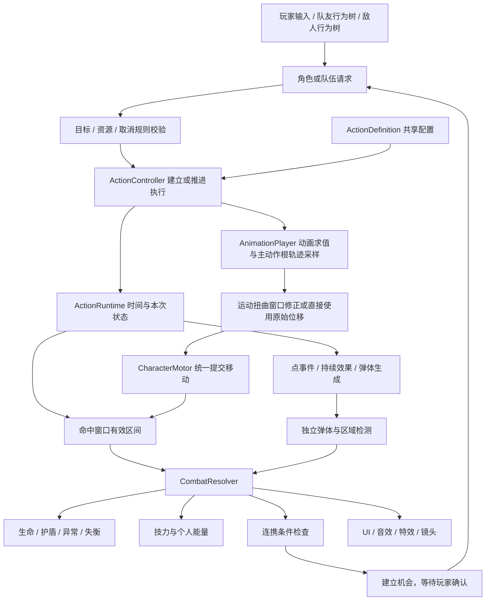

# 仿终末地完整实现方案

> 编写日期：2026-11-16
>
> 文档性质：基于当前工程的完整实现方案，包含模块职责、实现方式、完整流程和阶段验收
>
> 当前执行范围（2026-11-17）：仅 P1-01～P1-08；活动工程已收回单角色、木桩、三段普攻、攻击运动扭曲和动作 Timeline 编辑器。时间步为最大 1/60 秒、每帧最多 4 步、超预算截断
>
> 实施节奏：由用户逐阶段测试后再决定下一阶段，不自动推进 P2。本文保留 P1～P5 完整设计，P2～P5 的已有代码、资源、旧文档和构建保存在 [备份目录](../Backups/CombatBeforeP1Only_2026-11-17/README.md)，不参与当前运行。当前实现与本次验证以 [战斗系统完整实现文档](战斗系统完整实现文档.md) 为准

## 1. 方案结论与当前工程基础

保留当前移动、属性修改器、生命、对象池和 UI 的基础，围绕“统一动作执行、小队指挥、战斗结算、异常与连携”建立完整系统。玩家、队友和敌人共用动作与结算流程，各自只负责产生不同的行为请求。

### 1.1 调研基线

本次调研已阅读现有业务脚本，并检查输入资产、角色配置、预制体、场景配置、动画控制器及包依赖。后续实施时，应重新核对已经变化的源码与资产，不将本节快照当成永久状态。

### 1.2 可复用能力

| 当前模块 | 源码确认的能力 | 后续处理 |
|---|---|---|
| [PlayerController](../Assets/Scripts/Character/PlayerController.cs) | 读取输入、提交攻击与移动意图、同步镜头 | P1 已将通用动作、动画和移动执行移交独立模块 |
| [CharacterMotor](../Assets/Scripts/Character/Movement/CharacterMotor.cs) | 加减速、平滑转向、重力、碰撞及动作位移统一提交 | P1 已接入根运动和扭曲；击退与受控重定位按后续阶段增加 |
| [CharacterStats](../Assets/Scripts/Character/Stat/CharacterStats.cs) | 攻击、最大生命、防御；固定值与百分比修改器 | P1 保持三个属性，P2 再扩展种类和派生计算 |
| [CharacterHealth](../Assets/Scripts/Character/Stat/CharacterHealth.cs) | 扣血、治疗、死亡事件、最大生命变化处理 | 保留生命职责，接入统一结算 |
| [GameInputManager](../Assets/Scripts/Input/GameInputManager.cs) | 移动、镜头、跑步、攻击、面板和鼠标控制 | P1 已接入攻击缓存，其他战斗按键随阶段增加 |
| [CombatFeedbackPlayer](../Assets/Scripts/Presentation/CombatFeedbackPlayer.cs) | 池化音效、粒子播放及跟随偏移 | P1 接入动作点和持续效果窗口，后续再扩展自动命中表现 |
| [GameUIController](../Assets/Scripts/UI/GameUIController.cs) | 单角色生命与三属性面板 | P3 再增加主控切换绑定和小队 HUD |

工程已经有 `CombatDemo`、玩家与木桩、移动动画控制器，以及大剑、双刀等攻击、技能、闪避和受击动画素材。优先用这些资产搭建玩法，但素材存在不代表重定向、根运动和动作衔接已经验收。

### 1.3 本版执行约定

- 当前版本为 Unity `6000.3.28f1`，已安装 Input System `1.20.1`、AI Navigation `2.0.16`、Timeline `1.8.13`；调研起点尚无动作执行器或编辑器，P1 实施后已具备动作、连段、命中、编辑器和运动扭曲，行为树在 P2 实施
- 本文是实施计划，新增类型名用于明确职责，实际实现时优先简单组合；不要求每个表格条目都单独建立组件或接口
- 当前只执行 P1，每项任务同时完成必要的脚本、资产、场景接线和对应验证；满足出口条件后仍停留 P1，等待用户实际测试并明确选择下一阶段，不自动连续实现 P2～P5
- 动作使用共享配置与独立执行实例；首版不要求建立通用 `ActionTimeline + NotifyRunner` 框架，也不采用所有事件边界驱动全场切步
- 动作 Timeline 编辑器是 P1 的明确交付项，在第一段攻击通过 Inspector 配置跑通后建设，直接编辑同一份动作资产
- 攻击运动扭曲是 P1 的明确交付项，按动作窗口修正水平根轨迹和朝向；算法、碰撞边界及烘焙数据约定见 3.6.1，不作为后续可选优化
- AI 使用行为树；现有移动 FSM 可保留移动职责，玩家输入不必经过行为树
- 业务规则与默认值以第 3、4、6 节为实施基准；Action 时间步采用 4.3 的有上限可变步长。改变时间模型、结算顺序、窗口精度或取消规则时，先说明影响并同步修改相关契约与验收
- UI 沿用实施计划前的原有布局、样式及缩放设置；P1 接入数据和交互，不重新排版。后续阶段的 UI 扩展另行讨论，不直接重排已有界面
- 已建立完整实现文档与项目阅读说明，按实际接入内容维护；`Docs/TODO.md` 保持只读

建议阅读顺序：先看第 2 节范围与第 6 节实施任务，再读 3.5、3.6、3.7、3.8 与第 4 节完整流程，其余模块随对应阶段展开。

### 1.4 ScriptableObject 命名约定

项目自行编写的 ScriptableObject 类型统一使用 `Definition` 后缀，脚本文件名与类名一致，创建菜单与默认新建文件名使用相同称呼。Unity 和第三方自带类型保留原名，例如 `TimelineAsset`；普通运行时、窗口配置结构和组件不因保存了配置就添加该后缀。

代码命名遵循 AGENTS.md：字段使用 camelCase，类型、属性和方法使用 PascalCase。当前 P1 的字段重命名直接同步现有资产、调用和编辑器查找，保留资源 GUID，不保留旧名称兼容层；不借规范化变更玩法或提前实现后续阶段。

| 类型 | 当前状态与职责 |
|---|---|
| [CharacterDefinition](../Assets/Scripts/Character/CharacterDefinition.cs) | 已有角色配置，类型与脚本已统一命名，后续扩展属性分组 |
| [AudioDefinition](../Assets/Scripts/Presentation/Audio/AudioDefinition.cs) | 已有共享音效配置，保持声音选择、音量与音高规则 |
| [ParticleEffectDefinition](../Assets/Scripts/Presentation/Effects/ParticleEffectDefinition.cs) | 已有共享粒子配置，保持 Prefab 与缩放配置 |
| `ActionDefinition` | P1 已接入，包含当前动作所需字段 |
| `SkillDefinition` | P2 计划；旧实现已备份，当前 Assets 不包含该类型 |
| `CombatRulesDefinition` | 已接入的战斗规则定义 |
| `RootMotionDefinition` | 已接入的根轨迹烘焙资产，由编辑器生成，只保存共享轨迹数据 |

本次只统一类型、脚本文件、创建菜单和类型引用；三个脚本沿用原 `.meta` 与 GUID，现有 SO 资产的序列化类型标识同步更新。具体资产实例名称、`.asset` 扩展名和已有序列化字段键保持不变，例如 `Combatant` 中的 `characterAsset` 仍是原有资产引用字段，避免仅为变量后缀引入字段迁移。共享定义与每次执行的运行时状态继续分离。

## 2. 目标范围与原作参考边界

目标是一个四人同场、可切换主控、有完整资源和配合循环的单机战斗 Demo，需要覆盖：

- 普攻连段、末段重击、闪避和极限闪避
- 攻击运动扭曲：在可配置窗口内有限贴近目标并修正朝向，保留动画节奏与真实碰撞约束
- 四人小队、队友自主行动、玩家指挥队员技能
- 共享技力、个人终结技能量、条件触发的连携技
- 物理伤害与四类法术伤害、破防、法术附着、异常反应
- 敌人受击、失衡节点、完整失衡、处决和死亡
- 近战、投射物、范围技能、治疗、护盾、增益与减益
- 敌人 AI、战斗 UI、反馈和配置工具

原作明确存在破防与法术附着层数、异常配合、闪避续段及极限闪避等机制，可以作为玩法依据，参见[官方战斗机制说明](https://endfield.hypergryph.com/news/7235)。

本文的类划分、公式、扣费时机、去重规则和实施顺序，是针对当前工程的建议方案；具体数值属于 Demo 配置，不宣称与原作完全一致。

完成 P1～P5 后的目标验收场景为四名队员、近战敌人、远程敌人与一名精英/Boss 的封闭战斗场地；当前 P1 入口仅为单角色与木桩。角色可暂时复用现有模型，通过名称、颜色与技能配置区分；不以新增四套完整美术为前置。联网同步、回滚、开放世界和完整装备成长经济不在本 Demo 范围内。

## 3. 具体模块与实现方案

### 3.1 角色与小队：角色实例承载状态，小队模块管理控制权

继续保留 `Combatant`，将它作为角色的统一访问入口，提供以下成员的引用：

```text
Combatant
├─ CharacterStats          属性
├─ CharacterHealth         当前生命
├─ CharacterResources      个人终结技能量
├─ ActionController        当前动作
├─ SkillController         技能使用与冷却
├─ StatusController        Buff、Debuff、护盾
├─ StaggerController       失衡
├─ CharacterMotor          实际移动
└─ AnimationPlayer         动画播放
```

`Combatant` 负责初始化与生命周期协调，具体计算留在对应模块。

新增 `TeamController`，维护队员列表、主控角色、共享资源和队伍指令。四名角色始终作为独立战斗实体存在，各自拥有生命、动作、技能状态和目标。

切换主控不重新创建角色，也不重置资源。本 Demo 默认交换新旧主控站位，保持玩家当前操控位置连续；先检查双方动作是否允许切换、目标站位的胶囊体是否被场景阻挡，以及需要导航的站位是否可用，通过后再一次性提交两者位置和控制权。站位验证失败则拒绝切换并保留原状态，不把角色强行放进墙内。位置变更通过 Motor 的明确入口完成，并同步导航位置。

切换规则：

- 普通移动和可取消普攻允许切换
- 不可打断的技能演出期间拒绝切换
- 切换成功后清理旧主控尚未消费的玩家输入
- 新主控接收玩家指令，旧主控恢复队友 AI
- 镜头和主角色 HUD 重新绑定
- 主控死亡后转交给存活队员；全员死亡进入失败流程

当前 `PlayerController` 不适合直接复制到四名队员身上，因为它同时读取玩家输入、控制镜头和提交移动。应保留它作为玩家指令入口，把通用角色执行能力移到角色自身模块。

普通切换在同一提交中结束双方需要取消的主动作，再交换站位和控制权。主控死亡时采用存活队员当前位置接管，不与尸体交换站位，也不等待死亡角色的取消窗口。队伍自主寻路使用位置槽位与简单间距调整，首版不引入复杂阵型求解。

### 3.2 属性：区分基础能力、战斗属性和运行时资源

这是当前工程需要先明确的数据边界。

| 分类 | 建议数据 | 主要用途 |
|---|---|---|
| 基础能力 | 力量、敏捷、智识、意志 | 角色成长、装备加成、派生属性、部分技能条件 |
| 基础战斗属性 | 攻击、最大生命、防御 | 基础伤害与生存 |
| 暴击属性 | 暴击率、暴击总倍率 | 可暴击攻击的计算 |
| 伤害加成 | 通用伤害加成、物理及四类法术伤害加成 | 对应类型伤害计算 |
| 抗性 | 物理、灼热、电磁、寒冷、自然抗性 | 对应类型减伤 |
| 技艺属性 | 源石技艺强度 | 法术异常效果计算 |
| 辅助属性 | 治疗效率、受治疗加成、终结技充能效率 | 治疗和能量获取 |
| 行为属性 | 移动速度、需要时配置的攻击速度 | 移动与动作速率 |

四项基础能力通过 `CharacterStatRules` 集中派生战斗数值。例如，本 Demo 可以配置力量影响生命、敏捷影响物理抗性、智识影响法术抗性、意志影响受治疗效果，并由角色的主、副能力影响攻击。系数放在配置中，避免散落在技能和 UI 内。

数据流固定为：

```text
角色基础配置 + 成长配置
       ↓
基础能力及其修改器
       ↓
CharacterStatRules 派生计算
       ↓
战斗属性及其修改器
       ↓
伤害、治疗、移动等模块读取最终值
```

当前生命、当前技力、当前失衡值、Buff 剩余时间都不放进 `Stat`。它们是会被消费或推进的状态，应由各自模块维护。

当前属性实现继续使用，但需要以下调整：

- `CharacterDefinition` 从三个数值扩展为分组配置，避免构造函数变成大量浮点参数
- 保留 `StatModifier` 的来源和句柄，装备、Buff 使用自己的实例作为来源
- 增加受控的基础值更新入口，支持派生属性变化
- 不再对所有属性统一采用非负下限；抗性允许按规则降为负值
- 暴击率等属性按自身规则限制范围
- 主能力变化只触发一次派生更新，避免属性事件递归
- 保留当前最大生命增加不自动治疗、下降时限制当前生命的语义

现有修改器公式：

```text
最终值 =（基础值 + 固定加成合计）×（1 + 百分比加成合计）
```

继续用于攻击、生命等属性。需要额外乘区的伤害效果，在伤害公式中处理，不把所有乘区硬塞进通用 `Stat`。

实施时保留 `Stat` 对象身份：更新基础值而不是替换对象，以免失效 `CharacterHealth` 和 UI 的订阅。派生只沿“基础能力 → 战斗属性”单向传播，派生更新完成后发布最终变化，不让战斗属性反向触发基础能力计算。

当前 `Stat` 在构造器及计算过程内都有非负截断，仅增加一个负数 `Minimum` 不足以支持负抗性。按属性配置最终上下限，去除基础值加固定值后的统一非负截断，攻击、生命等再通过自身下限约束。抗性、暴击率与伤害加成统一使用比例数值，例如 `0.2` 表示 20%，UI 才转换成百分数。

Demo 派生默认值见 6.3，不是原作成长公式。P1 保留现有三个战斗属性跑通基础伤害，P2 再一次性接入上述属性分组及对应 UI，避免在第一刀尚未接通时展开全部成长系统。

### 3.3 输入与指令：输入只表达意图，成功执行后才消费

扩展现有 Input System 资产与 `GameplayInputFrame`，增加：

```text
普攻、闪避、锁定、切换目标
切换队员、使用指定队员战技
使用连携技、使用指定队员终结技、处决
```

`GameInputManager` 继续负责设备、输入开关、面板和鼠标状态。

新增小型 `CombatInputBuffer`，缓存普攻、闪避等短时命令，记录命令种类、接收角色、产生时间和有效期。技能选择等队伍指令交给 `TeamController` 路由。

规则：

- 命令成功启动动作后才消费
- 普攻只能在接段窗口进入下一段
- 技力不足的技能直接失败，不留下稍后自动释放的请求
- 打开面板、失焦、死亡和切换主控时清理相关缓存
- 发给队员 B 的技能请求，不因随后切换主控而变成队员 C 的请求
- 同帧多个命令按固定优先级处理，例如处决、闪避、主动技能、普攻

首版明确优先级为：系统死亡/强制反应 → 玩家处决 → 闪避 → 指定技能（含终结技与连携）→ 切人 → 普攻 → 普通移动；同类按收到的序号处理。一次战斗步每名角色最多成功提交一个主动主动作请求。持续移动、朝向属于采样状态，按键边沿属于一次性命令，不能在同一渲染帧的多个战斗步中重复入队。正常输入缓冲默认 0.2 秒，接受与过期按战斗时间计算。

玩家输入、队友 AI 和敌人 AI 最终都调用相同的动作请求入口，例如：

```csharp
ActionController.TryStart(request)
SkillController.TryUse(skill, target)
TeamController.TrySwitchMember(index)
```

以上为调用入口示意，无需先搭建通用命令总线。

### 3.4 索敌与镜头：区分锁定目标、普攻辅助目标和技能目标

新增 `TargetingController`，从场景中的战斗单位集合筛选目标。

采用先过滤、再评分的方式：

```text
存活、阵营、距离、角度、视线
       ↓
锁定目标优先
       ↓
输入方向、镜头中心、距离评分
       ↓
得到本次动作目标
```

技能还要叠加自己的条件，例如：

- 优先选择带指定异常的敌人
- 优先选择生命比例最低的队友
- 必须选择失衡且可处决的目标
- 地面技能选择位置，而非必须选择角色

每次动作启动时确定目标策略，不能每帧无条件换到最近敌人。需要追踪目标的技能继续追踪；落点已提交的范围技能保留原落点。

攻击运动扭曲使用本次动作确定的目标。首版在每个扭曲窗口进入时锁定一次目标站位，不在窗口内切换目标或无限追踪；贴近距离、停止间距与转向上限见 3.6.1。AI 仍负责接近施放范围，运动扭曲只修正攻击执行期间的有限距离。

首版锁定搜索半径 15 米、丢失距离 20 米；先保留仍合法的锁定对象，否则按镜头方向夹角与距离评分，权重初值为 0.7、0.3，输入方向用于同分时选择。技能施放距离优先使用技能自身配置，普通攻击辅助转向不会把超出实际命中形状的目标直接判为命中。目标死亡立即解除锁定；暂时被遮挡时不越过视线规则继续施放定向技能。

原作也区分技能条件目标、锁定目标和辅助选择目标，这个职责划分值得保留，参见[官方索敌说明](https://endfield.hypergryph.com/news/7219)。

镜头优先扩展现有 `PlayerCameraTarget` 和 `CustomThirdPersonCamera`，保留当前碰撞避障，增加主控切换平滑、锁定构图、技能镜头偏移及震动。当前没有必要仅因为安装了 Cinemachine 就替换全部镜头实现。

### 3.5 动作：数据描述动作，独立运行时记录每次执行

本模块负责一次动作从开始到结束的执行过程。共享资产描述动画和玩法时序，本次执行的时间、命中记录与临时资源由独立运行时保存，Unity Playables 承担动画播放与混合。

首版采用明确的业务数据与直接调用。时间推进、点事件分发、窗口查询先实现为 `ActionController` 中职责清晰的方法；只有实际形成独立复杂度时，才拆出时序求值类。未来编辑器显示多条轨道，不要求运行时为每条轨道建立节点、组件或运行器。

#### 3.5.1 职责、生命周期与动作粒度

| 对象 | 职责与实现 |
|---|---|
| `ActionDefinition` | 共享 `ScriptableObject`，保存动画、事件、窗口、移动和转向配置；执行中不修改 |
| `ActionRuntime` | 普通 C# 实例，保存本次执行身份、局部时间、目标、事件进度、命中记录与资源句柄 |
| `ActionController` | 每角色一个组件，校验动作切换、建立运行时、推进时序、结束和清理 |
| `AnimationPlayer` | 每角色一个动画图，执行动画播放、混合与根运动提取，详见 3.6 |
| `ComboController` | 保存普攻段数、推进点和闪避续段信息，不推进动画时间 |

普攻的一刀、闪避、受击、一次技能释放都可以是一个动作。一个技能可以由多个动作组成，技能消耗、冷却及跨动作数据由 `SkillController` 的本次施放状态管理。

- P1 每个动作使用一段非循环主动画，三段普攻是三个动作资产，角色配置用顺序数组引用它们
- 普攻连段与条件连携技分别由 `ComboController` 和 `ComboSkillController` 管理
- 需要蓄力时，再增加“开始、保持、释放”的动作组合；蓄力值保存在本次技能施放状态，循环动作明确每圈是否重复事件，不能用重播动作再次扣费
- 一般技能与普攻共享同一套执行流程，不按每个招式编写一个控制组件
- 首版每角色最多有一个主动作；旧动作动画可以淡出，独立弹体、持续区域和状态可以并存，它们拥有各自生命周期

#### 3.5.2 ActionDefinition：时间点、区间与曲线

动作资产是编辑器与运行时唯一的权威配置。时间以动作起点之后的秒数保存，帧数只作为编辑器显示和吸附单位。

| 配置组 | 必要字段与规则 |
|---|---|
| 标识与分类 | 可读名称、动作类别；资产引用识别配置，`ExecutionId` 识别本次执行 |
| 动画 | `clip`、`clipStart`、`clipEnd`、默认速率、混入与混出时间；`Duration = clipEnd - clipStart`，避免手填两份时长 |
| 速率策略 | 是否受攻击速度影响；闪避、受击不默认继承普攻攻速 |
| 命中窗口 `HitWindow` | `Start`、`End`、`HitGroupId`、判定形状、挂点、局部偏移、攻击参数 |
| 取消窗口 `CancelWindow` | `Start`、`End`、允许的请求类别，例如接段、移动、闪避、技能、切人 |
| 状态窗口 `StateWindow` | `Start`、`End`、无敌或霸体等明确状态；按有效窗口合并本动作贡献 |
| 表现时间点 | 时间、音效或特效资产、挂点、偏移、跟随方式 |
| 弹体时间点 | 时间、弹体资产、发射挂点、目标或方向策略 |
| 技能效果时间点 | 时间、定向命中/即时范围命中/治疗/护盾/施加状态等有限类型及参数；请求所属模块结算，处决使用定向命中 |
| 持续效果窗口 | 起止时间、效果资产、挂点、自然退出与取消时的处理方式 |
| 连段推进点 | 提交可续接段的时间；空挥也可达到，不承担命中奖励 |
| 移动与转向 | 代码位移、根运动或禁止主动位移；转向窗口、转向速度、位移距离曲线 |
| 运动扭曲 `MotionWarpWindow` | 起止时间、平移/旋转开关、目标站位间距、距离/角度/速度限制、修正曲线；引用匹配的根轨迹数据，见 3.6.1 |
| 目标策略 | 起手锁定目标或方向、允许转向的时间范围、目标丢失后的继续或取消规则 |

首版使用 `HitWindow[]`、`CancelWindow[]`、`StateWindow[]`、音效、特效、弹体和技能效果事件等具体可序列化类型。事件列表可在初始化时生成只读排序视图，先按时间排序；同一时间按“连段推进 → 弹体与技能效果 → 音效 → 特效”，同类按资产条目顺序处理，不在每个 Tick 重新排序。无需字符串反射、任意表达式、每条事件一个 SO 或任意轨道插件体系。伤害与效果数值由动作引用的攻击/效果配置保存，`SkillDefinition` 不再保存另一份相同数值。

曲线首先用于代码位移：资产保存累计位移曲线，本步位移取前后曲线值之差，再乘距离与执行方向，避免把每帧采样值重复当作完整位移。根运动与代码位移每步只选择一种主来源。

挂点使用角色绑定表中的标识，例如 `Root`、`RightHand`、`WeaponTip`，初始化时解析成实例 `Transform`。共享动作资产不直接引用场景角色的骨骼。P1 只要求 Root 挂点的球形判定，其他形状与骨骼轨迹在有实际动作需要时补充。

动作相关的玩法时序统一保存于此。原生 `AnimationEvent` 可以保留已有动画的脚步等表现，但同一行为不能同时由片段事件和动作数据触发；导入攻击素材时检查原有事件。Unity 支持片段事件调用脚本并传参，参见 [AnimationEvent](https://docs.unity3d.com/6000.3/Documentation/ScriptReference/AnimationEvent.html)，它不替代本方案的动作身份、取消和清理职责。

配置示例 `BasicAttack01`，数值仅作第一轮调试起点：

| 时间 | 配置 |
|---|---|
| `0.00～0.12` | 允许朝起手目标有限转向 |
| `0.14` | 播放一次挥击音效 |
| `[0.16, 0.28)` | 命中组 1，角色前方球形判定 |
| `0.22` | 提交连段推进点 |
| `[0.22, 0.48)` | 接受下一段普攻 |
| `[0.30, 0.60)` | 允许闪避、移动和指定技能取消 |
| `0.60` | 动作结束 |

动画区间需要和所选素材实际姿势对齐，不能为了满足示例数字随意截断收招。

动作资产是开发者维护的内部配置，控制器直接使用，不建立全量 `ValidateConfiguration`，也不在初始化、起手或预览前重复扫描配置。编辑器保留拖拽范围限制、排序等编辑操作约束；详细字段的关系由开发者维护，不增加一套保存前校验流程。

#### 3.5.3 ActionRuntime：每次执行的状态与时间

| 状态 | 用途 |
|---|---|
| `Definition`、`ExecutionId` | 引用配置，识别本次执行；ID 在本场遭遇中不复用 |
| `LocalTime`、`PlaybackRate` | 唯一动作业务时间与本步倍率，由控制器推进 |
| 本次目标、方向、落点 | 按动作策略保存或跟踪，不每步重新无条件索敌 |
| 事件进度 | 指向尚未处理的事件；调用具体行为前先前移进度 |
| 命中记录 | 按命中组和目标去重，多段攻击分别记录 |
| 持续效果与状态句柄 | 只保存需要本动作清理的内容 |
| 本次运动扭曲状态 | 窗口索引、进入姿态、锁定目标点/朝向、修正量和受阻标记；随执行 ID 结束清理，不写入共享资产 |
| 结束状态、结束原因 | 保证完成与取消结果只发布一次 |

所有者由持有该实例的 `ActionController` 确定，不复制血量、技能冷却或共享技力。上一时间与本步有效区间作为当前更新的局部数据，不再由另一个时间轴对象独立累加。

```text
有效播放倍率 = 默认速率 × 本动作适用的攻速倍率
新的局部时间 = min(Duration, 旧局部时间 + 战斗步长 × 有效播放倍率)
动画位置 = ClipStart + LocalTime
```

局部时间只向前推进。暂停和顿帧的战斗时间策略见 4.4；动画和动作必须一起停止，不能只停止动画而让命中继续推进。初版不支持运行时倒放或任意跳转，预览拖动走独立流程。

动作剩余时间不足一个战斗步时，只推进到终点；动画片段同样钳制到 `clipEnd`，本步不再自动启动并补跑下一个动作。剩余时间仍按整步推进世界计时，下一动作在下个决策点开始，这个最多一个战斗步的量化属于首版规则。

独立弹体和区域在生成时取得自己的攻击上下文、命中记录及必要数值快照，不能长期依赖已经结束的 `ActionRuntime`。原动作被取消后不再产生新的弹体，已经发出的弹体按自身配置继续运行。

#### 3.5.4 ActionController：请求、推进、切换与清理

以下为拟新增入口的职责约定，不要求照抄签名或立即增加接口：

| 入口 | 契约 |
|---|---|
| `CanStart(request)` | 只读检查存活、动作类别和取消规则；不消耗输入、资源或替换动作 |
| `TryStart(request)` | 提交时复查，成功创建运行时并返回执行 ID；失败给出原因，原动作保持运行 |
| `Advance(stepDelta)` | 推进本实例时间，提供本步经过的事件与窗口区间，不直接计算伤害 |
| `Cancel(executionId, reason)` | 只取消匹配的当前执行；旧 AI 节点不能误取消刚启动的新动作 |
| 自然结束处理 | 本步终点事件与命中处理完成后结束，记录一次带执行 ID 的结果，在结果通知阶段发布 |

技能必须通过 `SkillController.TryUse()` 统筹资源、冷却和动作提交。内部配置直接使用，必需组件在初始化时按需检查；提交前复查目标、取消条件与资源，业务条件不满足时保留旧动作，不扣费、不消费请求。提交阶段按以下顺序完成，不把异常捕获与回滚当成正常施放流程：

```text
旧动作失效并清理其资源，只记录结束结果
    → 建立新执行 ID、目标上下文与事件进度，定位动画起始姿态
    → 提交扣费与冷却，建立新动作在零时刻的规则窗口贡献
    → 消费已成功接受的输入、指令或连携机会，记录开始结果
    → 提交完成，再处理零时刻点通知与持续效果进入
```

提交期间的动作、技能、资源和清理引起的对外状态通知只记录，不同步调用外部订阅者；必需的属性派生、生命上限限制等内部状态联动仍需在提交完成前更新。接入现有同步 `Changed` 事件时，须把这类内部联动与对外通知分开，不能让清理调用间接暴露半完成的提交。普通普攻和闪避复用相同边界，仅处理各自实际拥有的消耗。

零时刻音效、特效在起始姿态上执行一次；零时刻伤害、治疗、护盾或施加状态等玩法效果只生成请求，由本步结算阶段处理，不在提交中递归结算。提交完成即视为成功起手，之后即使本步内被取消也遵守已起手的消耗规则。`TryStart/TryUse` 直接返回提交结果与执行 ID，调用者不需要等待广播确认成功。

对外结果保存在本战斗步的普通通知列表中，按产生顺序于 4.3 第 9 阶段通过所属模块的局部事件发布；替换动作时先记录旧动作结束，再记录新动作开始。记录保存当时的 ID、原因与必要数值，订阅者不能通过读取可变的当前动作来猜测历史结果。状态读取和当前动作有效性立即更新，通知延后不代表死亡或取消延后。

打断规则：

- 死亡立即结束当前动作
- 强制受击先由结算和角色状态判断霸体、控制免疫，获准后才替换动作
- 普攻接段、闪避、技能、移动和切人分别匹配允许的取消类别，不用单个“可以取消”布尔值代替
- 没有取消窗口时拒绝主动替换；输入仍在有效期内则等下一决策点，否则过期
- 一个已经提交的动作不因目标刚离开攻击范围就自动取消；目标丢失按照配置处理

统一退出路径：

```text
标记该执行已结束，停止后续事件和命中请求
    → 移除本动作提供的状态贡献
    → 归还随动作结束的持续效果句柄
    → 清理运动扭曲状态，释放本动作的移动与转向控制
    → 记录一次完成或取消结果，等待本步结果通知阶段发布
    → 按过渡配置淡出旧动画
```

清理只能处理本实例的资源，不能清空其他 Buff 提供的无敌或其他技能的特效。自然完成效果与取消清理分开，不能在取消时执行“蓄力完成爆炸”。重复结束不重复释放或登记结果。外部结果回调产生的主动动作请求进入下一决策阶段，发布期间不递归启动新动作；任何允许改变状态的回调之后重新确认执行 ID，旧动画淡出不恢复旧动作的玩法权限。

普攻推进点更新的是连段上下文；真正切入下一段只在请求成功时发生。末段后回到待机，已用于当前连段的输入不能再次启动新一轮；新增按键可按正常缓冲规则开始新一轮。

#### 3.5.5 时序、动画与命中协作及精度边界

首版采用统一顺序、单步上限为 `1/60` 秒的战斗步，并限制每帧最多 4 步，具体流程见 4.3。同一个渲染帧可以执行多步，步长不由每个音效或窗口边界决定。该方案不承诺连续时间下的精确跨角色事件排序，也不承诺不同渲染帧率逐位相同的模拟结果。

三类数据分别处理：

1. **点事件**：采用 `previousTime < eventTime <= currentTime`；零时刻单独消费，终点事件先处理再自然结束。同一执行、同一事件执行一次
2. **规则窗口**：使用 `[Start, End)`，取消请求在决策点查询，无敌与霸体在本步结算时查询当前有效动作和状态；重叠窗口取有效贡献的并集
3. **持续行为**：命中检测取得本步与命中窗口的交集；持续特效处理跨过的进入、退出，即使一步完整跨过窗口也不留下未清理句柄

例如本步局部时间从 `0.14` 到 `0.32`，窗口为 `[0.16, 0.28)`，必须处理有效段 `0.16～0.28`。这个例子也用于验证高倍率或直接调用时序方法时不会漏窗，并不要求正常帧都使用这么大的时间步。

P1 的角色前方球形判定保存移动前后中心，根据有效区间在本步中的比例截取两个位置，做起点/终点重叠与中间球体扫掠。仅在有效区间内检测，不能把整步位移都当成攻击。插值视为该步内的线性近似；转身圆弧、动画骨骼高速运动、目标自身高速位移需要额外采样或相对运动检测，作为实际遇到相应动作时的局部扩展。

点事件在本步动画与移动提交之后按顺序处理，弹体与特效默认使用本步结束时的挂点；本步新建弹体下一步才运动。原生或自定义事件都不会自动提供过去精确时刻的骨骼姿态。需要精确发射姿态时，单独增加该动画时间点的姿态采样；需要严格的跨角色先后顺序时，再升级模拟策略，不能仅靠跨越判断宣称已经满足。

取消、无敌等纯查询窗口应覆盖至少一个最大战斗步的实际时长。编辑器按允许的最大动作倍率校验；过短窗口先调整配置或提高采样频率，不能保证任意短的无敌窗口一定被采到。命中窗口采用区间处理，不因此被直接丢弃。

默认同一步先处理所有有效点事件，再收集命中，随后按稳定顺序结算。若前一份结果导致来源死亡或动作取消，后续依赖该动作的请求失效；已经独立生成的弹体按独立上下文处理。该规则允许先结算的一击阻止后一击，不采用默认双方同时命中的批量扣血语义。

#### 3.5.6 动画 Timeline 编辑器

编辑器采用一个直接编辑 `ActionDefinition` 的专用窗口，先满足一段主动画与有限业务轨道。Unity Timeline 已支持自定义轨道和标记，参见 [Timeline 自定义示例](https://docs.unity3d.com/Packages/com.unity.timeline@1.8/manual/samp-custom-samples.html)；本 Demo 首版选择专用窗口，不同时维护 `TimelineAsset` 和动作列表两份可修改数据。

| 区域 | 首版功能 |
|---|---|
| 动作与模型选择 | 指定动作资产、角色预览 Prefab、Animator/Avatar 与挂点绑定 |
| 动画轨道 | 显示片段、裁剪区间与动作时长，播放、暂停、拖动、逐帧定位 |
| 业务轨道 | 命中、取消、运动扭曲、状态、音效、特效、弹体和连段推进点；尚未实现的业务不提供可运行配置入口 |
| 选择与编辑 | 移动点事件、拖动区间和两端、增加/删除、复制条目，详细字段在选中项面板编辑 |
| 时间显示 | 秒与帧号、缩放和平移、可关闭的帧吸附；关闭吸附时保留非整帧时间 |
| 场景预览 | 动画姿态、挂点、球形判定体、原始/扭曲位移轨迹、可拖动的模拟目标与停止位置；后续形状随运行时能力增加 |
| 资源管理 | Undo/Redo、保存、重载，提示缺少资源、非法窗口、命中组参数冲突与未绑定挂点 |

编辑代码放在 `Assets/Editor/Combat/`。先用 `EditorWindow`、`SerializedObject` 和项目常用 Inspector 绘制方式实现，窗口、时间轴绘制与预览对象各自承担明确职责，避免先建立通用编辑器框架。

预览在独立 Preview Scene 和 PlayableGraph 中运行，复用局部时间换算、位移曲线与判定形状计算；拖动仅采样当前姿势，不补发之前的战斗事件。预览模型的战斗脚本与原生事件接收不参与真实玩法，不扣血、扣资源或生成真实战斗弹体。预览关闭、脚本重载及进入 Play Mode 时释放图和临时对象。

P1 完成动画、命中、取消、音效/特效及连段点的编辑，并在 P1-08 增加运动扭曲轨道、根轨迹烘焙和目标预览。后续弹体、状态、通用代码位移曲线等功能接入时扩充对应轨道。单片段编辑器预览不等于实际根运动碰撞、前后动作混合或战斗时序已经通过验收，这些仍在场景中验证。

保存前校验 `0 <= clipStart < clipEnd <= clip.length`、点事件 `0 <= Time <= Duration`、窗口 `0 <= Start < End <= Duration`、有效速率、非负形状尺寸、必需资源与挂点。允许窗口重叠，但拒绝同组伤害参数冲突。拖动只限制正在编辑的值；更换片段导致旧配置越界时明确提示，由使用者调整，不静默删除事件或批量改时长。

### 3.6 动画与移动：动画提供姿态和位移，Motor 统一提交角色移动

采用 Animator Controller 负责移动混合、Playables 负责动作片段和过渡的组合：

- 保留现有 `Phoebe_Controller` 的移动 Blend Tree
- 使用 `AnimatorControllerPlayable` 播放移动控制器
- 使用 `AnimationClipPlayable` 播放攻击、闪避、受击等动作
- 使用 Mixer 处理移动与动作、前后动作之间的过渡
- `AnimationPlayer` 是每个角色唯一的动画图持有者

`ActionController` 推进动作时间，`AnimationPlayer` 按同一时间步长求值。现有 `SetupAnimator()` 中的参数更新随之迁入动画模块，写入移动控制器对应的 Playable。

动画图设置为 `DirectorUpdateMode.Manual`，由模拟流程调用 `Evaluate(stepDelta)`；动作片段与 `ActionRuntime` 使用同一有效时间增量。正常步的片段速率等于 `PlaybackRate`；最后一步按 `实际局部时间增量 / stepDelta` 限制推进，保证停在 `clipEnd`。正常前进不额外调用 `SetTime()` 推进一次，避免重复推进；开始、切换和独立编辑器预览时才显式定位时间，参见 [Manual 更新模式](https://docs.unity3d.com/6000.3/Documentation/ScriptReference/Playables.DirectorUpdateMode.Manual.html)。

Unity 支持手动推进 `PlayableGraph`，也提供 `OnAnimatorMove` 处理根运动；这里使用这些能力统一动作时间和移动提交，参见 [PlayableGraph.Evaluate](https://docs.unity3d.com/6000.3/Documentation/ScriptReference/Playables.PlayableGraph.Evaluate.html) 和 [OnAnimatorMove](https://docs.unity3d.com/6000.3/Documentation/ScriptReference/MonoBehaviour.OnAnimatorMove.html)。

位移按动作选用：

| 行为 | 位移来源 |
|---|---|
| 行走、跑步、AI 追击 | 代码计算速度 |
| 带明确位移的攻击 | 未启用扭曲时使用动画根运动；启用运动扭曲时使用主动作烘焙根轨迹及窗口修正 |
| 闪避 | 可配置位移曲线或适配后的根运动 |
| 击退、击飞 | 受击模块产生的位移 |
| 切换站位、复位 | Motor 的受控重定位入口 |

同一个战斗步中，先确定当前位移来源，再交给 Motor 提交。不能同时执行当前 `motor.Tick()` 和另一份攻击根运动，导致重力与水平位移重复提交。P1 将现有 Motor 的“计算普通移动”与“提交位移”分开，保留加减速与平滑转向规则；普通移动或当前动作先提供水平位移，再统一处理重力和一次 `CharacterController.Move`。

根运动模式启用 Animator 根运动求值，在 `OnAnimatorMove` 中仅收集本步 `deltaPosition`/`deltaRotation`，不直接写 Transform；Motor 决定碰撞后的实际位移。普通根运动动作使用动画图混合后的位移，混合权重会影响移动；启用运动扭曲的动作采用 3.6.1 的主动作根轨迹来源，整段动作不再叠加混合图的根位移与旋转。代码位移动作忽略根运动平移。运动扭曲窗口接管其启用的平移/朝向通道，与普通追踪转向、根运动旋转互斥，禁止同一步重复提交。

每名角色只持有一个图，动作切换更换动作分支，过渡结束销毁不用的 Playable；角色停用或销毁时释放整个图。旧动画剩余片段同样不得越过裁剪终点，不靠其结束事件清理动作。挂在现有 Animator 上的运行控制器改为图内的 `AnimatorControllerPlayable`，参数通过该 Playable 写入，避免两条动画更新路径并行。

首版参战角色保持动画求值，不因离开镜头就停止需要用于判定和位移的动画；沿用当前角色的 `AlwaysAnimate` 策略，后续有实测性能需求再区分表现裁剪与玩法采样。

当前 `ApplyMovement()` 会清除传入位移的 Y 分量，因此实现击飞需要明确增加垂直运动模式，不能直接把带 Y 的击飞向量传进去。

动画淡出与玩法生命周期分开：旧动画可以继续参与姿态过渡，但已结束动作不能继续命中或发布技能通知。

#### 3.6.1 攻击运动扭曲：按窗口修正主动作根轨迹

攻击需要支持 Motion Warping：在动画指定区间内调整原始根轨迹，使角色向本次目标的合适站位靠近，并在允许角度内调整朝向。它是动作位移计算的一部分，不改变动画播放时间、伤害窗口或命中规则；靠近成功不代表必然命中。

首版实现地面攻击的 XZ 平移与 Y 轴旋转扭曲，玩家、队友、敌人共用。各动作可以配置不同窗口或关闭某个通道；至少三段普攻中的一段在 P1 配置完整平移与朝向扭曲，其他段依据素材配置。空中三维对齐、翻越、脚部 IK 和手部精确接触不属于这次攻击扭曲的首版范围。

**模块与数据归属**：

| 对象 | 职责 |
|---|---|
| `MotionWarpWindow` | 内嵌于动作资产的窗口配置，保存时间、目标站位与修正限制 |
| `RootMotionDefinition` | 共享只读烘焙资产，保存指定 Clip 与 Avatar/模型尺度下的累计根位置和旋转样本，不保存运行目标 |
| 本次 `WarpState` | 存在 `ActionRuntime` 内，保存窗口进入姿态、锁定目标、终点修正及受阻状态 |
| `MotionWarping` | 普通 C# 求值类，读取配置和本次状态，返回请求位移与朝向；无独立 Update，不控制动画时间，不直接移动角色 |
| 编辑器烘焙工具 | 复用隔离预览环境采样根轨迹，保存、校验版本并提供轨迹预览；不进入运行时程序集 |

`MotionWarping` 具有明确的几何计算职责，编辑器和运行时共用同一求值算法；不为窗口再建立通用通知框架或独立调度器。

**配置与目标点**：

| 配置 | 规则 |
|---|---|
| `Start`、`End` | 动作局部秒数，`0 <= Start < End <= Duration`；同一动作的扭曲窗口不重叠 |
| `WarpTranslation`、`WarpRotation` | 独立开启平移与朝向修正，窗口内相应通道由扭曲接管 |
| 目标选择限制 | 使用本次动作目标，检查存活、阵营、距离、前方夹角、视线与高度差 |
| 停止间距 | 攻击者水平身体半径 + 目标锚点对应的战斗半径 + 额外间距；锚点默认是身体中心，若配置在身体表面则对应目标半径取 0，避免重复扣除 |
| 贴近限制 | 最大贴近距离、相对原动画终点允许额外延伸的距离；过近时允许压缩到零前进距离，不强制后退 |
| 旋转限制 | 最大朝向修正角与每秒最大角速度，不允许一帧掉头攻击背后目标 |
| 修正曲线 | 归一化单调曲线，起点为 0、终点为 1；默认线性映射源轨迹的前进进度，按原动画节奏分配修正，避免前摇尚未移动就被时间插值推走 |
| 速度限制 | 每秒最大水平速度，超过时限制实际请求增量；受限时允许达不到目标点，不能在终点补瞬移 |

窗口进入时读取攻击者根位置 P、目标参考点 T，计算水平朝向 D。距离接近零时保留当前朝向，不归一化零向量。首版目标点计算为：

```text
需要前进距离 = max(0, 水平距离(P, T) - 停止间距)
允许前进距离 = min(需要前进距离, 最大贴近距离, 原动画窗口终点水平距离 + 最大额外延伸距离)
锁定目标根位置 = P + D × 允许前进距离
锁定目标朝向 = 朝向 T 的水平旋转，实际修正角在与源终点朝向比较后统一限幅
```

初版 `TargetingController` 在 P1-08 提供存活、阵营、前方距离和视线筛选，P2 再扩展锁定与技能评分。窗口内锁定同一位置与朝向；目标正常移动后允许攻击落空，不不断扩大距离追踪。目标死亡、移除或阵营失效时关闭本窗口修正，保持当前实际位置，以未扭曲的源轨迹增量继续剩余动作，不重新锁定另一个敌人。

进入前检查目标站位附近的地面、高度差与 World 障碍，无法安全贴近则不启用本次平移修正；必要时仍可在角度限制内转向。没有目标或目标超出辅助范围时正常播放攻击与源根运动，不取消普攻，不从远处吸附过去。敌人追击与技能施放距离仍由 AI 和技能模块判断。

**根轨迹来源与烘焙**：

为避免交叉淡入淡出改变预期终点，启用扭曲的动作整段使用主动画的 `RootMotionDefinition` 作为水平位移与根旋转来源，窗口外也读取该源轨迹。Playables 继续负责骨骼姿态和混合；混合图的 `deltaPosition/deltaRotation` 不再叠加到这类动作的移动中。普通未启用扭曲动作仍使用 3.6 的原有根运动模式。

1. 在独立 Preview Scene 中实例化兼容的纯模型与 Animator，绑定实际使用的 Avatar、模型尺度和动画导入设置，建立单片段 PlayableGraph
2. 开启根运动求值和 `AlwaysAnimate`，从片段起点顺序推进到终点；保证临时模型根运动只应用一次，记录累计位置和旋转并归一到初始根姿态。不能仅用 `AnimationClip.SampleAnimation` 后读普通 Transform 来假定 Humanoid 根运动正确
3. 默认按 60 Hz 烘焙并包含准确的片段终点，运行时对累计位置做线性插值、旋转做四元数插值；动作裁剪与窗口边界通过同一采样方法读取
4. 数据记录 Clip、Avatar、纯模型与尺度、采样率以及源资产依赖签名；片段重导入、Avatar 或尺度变化时，由编辑器提示重新烘焙，运行时不比较签名或据此拒绝起手。动作的时间裁剪变化使用完整片段采样数据重新求值，无需重新生成整段轨迹
5. 纯模型不引用动作或烘焙资产，避免依赖签名形成循环；数据缺失或过期属于配置错误，运行时不临时创建隐藏 Animator 重新烘焙。所有预览对象与图在关闭、异常退出或重载时释放

Unity 的 `Animator.deltaPosition` 提供上次求值的根位移，需要启用 `applyRootMotion`，参见 [Unity 根位移接口](https://docs.unity3d.com/6000.3/Documentation/ScriptReference/Animator-deltaPosition.html)。实际烘焙还必须验证导入设置与 Avatar，不能把全零样本当成成功；确认为原地动画时，平移扭曲先选择合适根运动素材或显式代码位移方案，纯朝向修正仍可独立使用。

**首版求值算法：源轨迹加分配到窗口内的终点修正**。

进入窗口时，记录实际根姿态 `P0/Q0`，将源轨迹转换到以窗口起点为原点的局部坐标。记转换后的累计源位置为 `r(t)`，源朝向为 `q(t)`，均在窗口起点为零位移/单位旋转；它们来自片段时间 `clipStart + t`，转换时必须使用窗口起点源旋转的逆，不能混用片段起点与窗口起点坐标。下式中的位置计算统一投影到 XZ，姿态求值只取 Y 轴旋转。

```text
u(t) = Clamp01((t - Start) / (End - Start))
原始世界轨迹 B(t) = P0 + Q0 × r(t)
源终点方向 E = Normalize(B(End) - P0)，仅取 XZ
源前进进度 s(t) = Clamp01(Dot(B(t) - P0, E) / 水平距离(P0, B(End)))
w(t) = 修正曲线(s(t))
终点位移修正 C = 锁定目标根位置 - B(End)，仅取 XZ
扭曲轨迹 W(t) = B(t) + w(t) × C
本段请求位移 = W(t1) - W(t0)

原始世界朝向 R(t) = Q0 × q(t)
终点角度修正 = DeltaAngle(Yaw(R(End)), 锁定目标朝向)，受最大修正角限制
期望朝向(t) = Yaw(R(t)) + w(t) × 终点角度修正
本段提交朝向 = 从实际/已规划朝向朝期望朝向推进，受最大角速度限制
```

P1 的平移窗口由开发者选取具有非零终点位移且沿终点方向单调前进的贴近段，结合轨迹预览确认，不额外扫描样本校验该条件。源终点距离接近零时不进行上述除法，纯朝向窗口改用时间进度 `u(t)`；复杂回撤或绕圈片段应把贴近段单独配置，不让首版算法自动重写整段运动意图。

关闭某个通道时，对应修正为零。平移使用相邻采样的增量，不使用 `W(t1) - 当前实际位置` 追赶历史误差；仅在平移扭曲开启时，进一步限制沿锁定接近方向的前进不越过目标停止平面，不因近距离压缩产生额外后退。关闭平移扭曲时不套用目标站位限制，保持正常源位移。窗口外按源轨迹的局部增量及角色当前朝向继续移动，不重新把角色放回预先计算的绝对轨迹。因此窗口结束或失效不会产生位置跳变。

当一步跨过窗口边界时，只在该动作的位移求值中拆出“进入前、窗口内、退出后”的区间，按顺序合成该步的一份位移与朝向，仍只调用一次 Motor，不为扭曲重新建立全场边界调度。步内窗口起点姿态由本步实际起点和之前已规划的源位移估计，最终以 Motor 碰撞结果为准；这仍遵守 3.5.5 的步长近似。

速度限制使用相应区间的真实战斗时长；攻速变化通过 `LocalTime` 改变轨迹进度，不再额外对位移乘一遍倍率。无碰撞、无速度/角度限制介入且目标锁定时，窗口终点应达到配置站位和朝向；限制介入后接受可解释的终点误差，不补瞬移。

**Motor、碰撞与命中协作**：

```text
动作时间推进与动画求值
    → 读取主动作源根轨迹
    → 建立/求值当前运动扭曲窗口
    → 限制本步水平位移与朝向
    → Motor 合并重力并提交一次移动
    → 读取实际位移和碰撞结果，更新受阻状态
    → 使用实际移动后的 Hurtbox/武器位置执行命中检测
```

首版只修正水平位置，Y 轴由 Motor 的重力、贴地与碰撞处理，不把角色拉向目标骨骼高度。`CharacterController.Move` 会受到碰撞约束并返回 `CollisionFlags`，但不会自动施加重力，参见 [Unity 移动接口](https://docs.unity3d.com/6000.3/Documentation/ScriptReference/CharacterController.Move.html)。复用现有 `RequestedPlanarDelta/ActualPlanarDelta`，增加本步侧向阻挡信息供动作读取。

存在侧向阻挡且沿请求方向的实际位移明显小于请求值时，标记本窗口平移受阻，停止该窗口剩余的贴近平移，可继续允许的朝向修正；不累积未完成位移，墙体消失后也不在同一窗口重新冲刺。窗口结束后恢复源轨迹增量，碰撞始终由 Motor 约束。转身或滑墙不等于保证到达，调试信息要显示受阻原因与最终误差。

动作取消、死亡、切人或转入新攻击时清理该执行的 WarpState，旧动画淡出不再修正移动。命中形状使用真实移动和姿态，不能用计划终点直接制造命中。运动扭曲窗口建议在首次主要命中前结束，确需边贴近边攻击时以实际有效区间扫掠，并验证近距离目标不会被穿过。

**编辑与调试交付**：Timeline 中提供独立扭曲区间，编辑起止点、平移/旋转开关、限制及曲线；显示原始轨迹、扭曲轨迹、停止间距圈、锁定目标点和朝向。拖动模拟目标即可比较近距离压缩、侧向修正和远距离限制；提供烘焙/更新按钮与过期提示。拖动时间时从缓存起点确定性重算预览，不触发玩法事件。无障碍预览验证算法，真实碰撞、混合观感与滑步仍在场景中验收。

### 3.7 命中：检测几何接触，结算模块决定接触造成什么结果

新增 `Hurtbox`，明确关联所属 `Combatant`、阵营以及可选的部位标识。检测命中后通过它找到目标，避免所有碰撞体都承担战斗语义。

支持三类攻击载体：

| 类型 | 实现方案 |
|---|---|
| 近战 | 球、胶囊、盒体或扇形查询，配合运动路径扫掠 |
| 投射物 | 池化弹体，上一位置到当前位置进行射线或球体扫掠 |
| 范围与持续区域 | 范围查询，按脉冲序号或目标命中间隔结算 |

近战初期使用角色前方判定体。需要更贴近刀刃时，再让同一检测模块读取武器根部和尖端的采样点。

对旋转幅度大的武器动作，要增加中间姿态采样，不能把端点之间的一次直线扫掠当成完整刀刃轨迹。

去重分成两个层次：

```text
命中收集：同一攻击来源、命中组和目标的多个 Hurtbox → 一份候选请求
普通动作的跨步记录：ExecutionId + HitGroupId + TargetId，由 CombatResolver 检查并登记
```

多段攻击通过不同命中组再次命中；持续区域通过明确的脉冲或间隔再次命中。

P1 使用球形重叠与球体扫掠，算法和时间截取见 3.5.5。相同动作内共享 `HitGroupId` 的窗口共享命中记录，攻击参数必须一致；不同伤害段使用不同组。检测阶段仅合并本批重复候选，不写入跨步命中记录。`CombatResolver` 复查来源、目标存活、阵营及接触资格后，检查并登记尚未处理的命中键，再判断无敌与伤害；重复请求直接结束，完全没有接触或已经失效的请求不登记。

登记包括随后被无敌规避的接触，避免一个长窗口在无敌结束后补命中同一目标；第一次合法请求不会因为检测阶段提前写入记录而被误判重复。独立载体各自维护接触记录，不因共享奖励上下文而合并不同弹体的接触资格；周期状态以状态实例和脉冲序号识别一次伤害，见 3.8、3.10。极限闪避另有奖励标记，不靠伤害是否成功来去重。

首版查询可以使用 Unity 返回数组的 API，先验证形状和去重；只有 Profiler 证明分配成为问题时再改为复用缓冲，不用固定长度数组默默截断命中结果。查询返回顺序不作为结算顺序，候选按稳定单位 ID 整理；弹体按路径距离先取最近的有效障碍或目标。

同时配置障碍物遮挡规则。选中了目标并不意味着伤害可以穿墙，投射物也不能只检查敌人层而忽略场景障碍。

场景使用独立的 Hurtbox 查询层与 World 障碍层，Hurtbox 为触发器并显式包含在查询中；角色身体的 CharacterController 不重复充当 Hurtbox。队员之间的身体碰撞在层矩阵中关闭，敌我仍通过 Hurtbox 和阵营规则判定。地面区域首版以施放点到目标的遮挡检查限制穿墙伤害。

弹体和持续区域复用当前对象池。其运行时持有独立攻击上下文；已经发出的弹体可以继续飞行，而施法者不再生成后续弹体。需要随动作结束消失的持续法术，由动作持有池句柄并主动回收。

### 3.8 结算：集中处理伤害、护盾、异常、失衡和结果

新增 `CombatResolver` 编排结算，`DamageCalculator` 负责纯数值计算。

一次命中携带 `HitRequest`：

```text
来源类型、来源单位 ID、目标、归属施放 ID
动作执行 ID / 载体上下文 ID / 状态实例 ID 与脉冲序号，按来源类型提供
命中组；追加伤害另带根命中 ID 与追加序号
伤害类型、伤害倍率、固定伤害
是否允许暴击、失衡量
物理异常请求、法术附着请求
附加状态、击退参数、命中位置
```

伤害类型与法术附着分开配置。电磁伤害不自动意味着施加电磁附着，普通攻击也不应因为角色具有某种属性而自动触发所有异常逻辑。

来源校验按实际生命周期分开，不能统一要求原动作仍在执行：

| 请求来源 | 有效性与去重归属 |
|---|---|
| 当前动作的命中或即时效果 | 校验当前执行 ID 与来源存活，普通命中使用执行 ID、命中组和目标记录 |
| 独立弹体或区域 | 校验载体上下文及其继续/取消策略，不要求原动作仍存在；接触或脉冲记录由该载体持有 |
| 状态周期伤害 | 使用已合法生成的状态脉冲快照，按状态实例 ID、脉冲序号和目标去重，不要求原动作或原状态实例仍存在 |
| 根命中的追加伤害 | 在本次根命中内按追加序号处理，不复用根命中的普通接触键；仍复查目标存活、阵营和免疫 |

各来源通过明确的数据字段与分支接入结算；P1 只启用动作来源，P4 增加状态脉冲，P5 增加载体。周期伤害所需的独立来源数据在 P4 就绪，不等待 P5 的弹体系统。

Demo 的基础伤害公式：

```text
基础伤害 = 攻击 × 技能倍率 + 固定伤害

最终伤害 =
    基础伤害
    × 暴击倍率
    × 伤害加成倍率
    × 防御减伤倍率
    × 对应类型抗性倍率
    × 易伤倍率
    × 失衡增伤倍率
```

例如防御减伤采用 `K / (K + 防御)`，`K` 放在战斗规则配置中。这样防御效果连续，也方便调节敌人的耐久度。

首版统一让物理和法术直接伤害使用该防御公式，`K = 100`；对应抗性限制在 `[-1, 0.9]`，抗性倍率为 `1 - 抗性`。伤害加成倍率为 `max(0, 1 + 通用加成 + 对应类型加成)`，暴击时使用暴击总倍率，否则为 1。易伤与失衡增伤分别为 `1 + 对应加成`，最终伤害不小于 0。计算使用浮点数，伤害数字仅在显示时取整；这些是 Demo 规则，不作为原作公式。

近战在命中时读取攻击者属性；弹体与持续区域在创建时复制所需攻击数值，之后仍读取目标结算时的防御。每份目标命中独立进行一次暴击判定，默认周期伤害不暴击。需要验证伤害公式时可注入固定的暴击结果，不要求建设完整随机数框架。

结算顺序：

1. 按来源类型校验上下文，复查目标存活、阵营及请求资格；检查对应去重键，合法且未处理时在此登记
2. 判断闪避无敌、攻击免疫等结果；被规避时保留接触记录并记录规避结果，不继续执行该命中的伤害和异常
3. 读取本次攻击数据与目标当前防御状态，计算直接伤害；护盾吸收，剩余伤害交给 `CharacterHealth`
4. 目标仍存活且有物理异常请求时，先消费冻结并完成碎冰追加伤害，再复查存活，处理正常物理异常表及其追加伤害
5. 目标仍存活时处理法术附着与反应，并完成该阶段产生的同类爆发等追加伤害
6. 目标仍存活时处理其他附加状态、失衡和受击请求；此前已造成的伤害和状态变化不回滚
7. 按来源资格结算本次有效效果的技力、能量和被动奖励，周期与追加伤害遵守各自奖励限制
8. 生成不可变结果记录，本步结果通知阶段再交给连携条件、UI 和表现模块

默认让直接伤害使用命中前的目标状态；追加伤害在其规定阶段读取当时的防御、抗性和护盾，之后产生的减防、易伤不追溯影响已经完成的伤害。需要先减防再伤害的特殊技能，必须显式定义该技能的效果顺序。

异常追加伤害使用本次根命中的小型待处理列表。每个阶段生成请求后，用循环完成该列表，再进入下一阶段或下一份根请求；不把所有追加伤害拖到本步末尾，也不在事件回调里递归调用完整结算链。追加请求只走伤害与有效性检查，不再次生成附着、物理异常或追加请求。各阶段使用明确的处理方法，不要求通用效果指令框架。

例如目标同时有冻结与四层破防，本次命中请求碎甲：直接伤害 → 消费冻结并结算碎冰 → 若目标仍存活，消费破防并施加减防。假设碎冰基础伤害为 50、目标防御为 100、K=100 且其余倍率为 1，则碎冰为 25；随后碎甲将防御降为 60，该减防只影响后续伤害，不能把本次碎冰改算为 31.25。

结果需要区分：

- `HitResolved`：对一个目标的一次命中结果
- `AttackResolved`：一次攻击执行的汇总
- `FinalStrikeResolved`：本次重击首次满足奖励条件的结果

范围重击命中五个敌人，可以产生五份命中结果，但默认只获得一次重击技力奖励。

奖励归属与去重保存在可随攻击载体存活的 `AttackContext` 中，记录攻击发起时的操控来源、技能施放 ID 和奖励标记。多枚弹体来自同一次奖励资格时共享该上下文，各自仍有独立接触记录。`FinalStrikeResolved` 在首次有效结果时登记一次，随本步结果通知发布；`AttackResolved` 在该次攻击及其登记的独立载体全部结束后汇总并等待发布，不用已经销毁的动作实例保存标记。P1 没有独立载体，动作结束即可汇总。燃烧等独立状态不延长原攻击的汇总生命周期，其脉冲结果保留来源与施放 ID 供追踪，不追加到已经发布的汇总中。

致死命中仍可按有效伤害发放该次奖励，但不再对尸体施加新的控制或附着。生命归零后的内部死亡处理立即禁用主动作与 Hurtbox，后续候选重新检查；对外死亡结果延后发布，不让战斗清理依赖 UI 或其他外部订阅者的调用顺序。治疗使用独立请求，按 `治疗基础值 × (1 + 治疗效率) × (1 + 受治疗加成)` 结算，首版不暴击、不复活，过量部分不产生额外收益。

护盾受到实际损耗可以算有效命中，不能只使用“HP 是否下降”判断。完全闪避、无敌或无有效效果的接触，不产生重击奖励。

### 3.9 技能与资源：共享技力、个人能量、条件连携分别管理

资源归属：

| 状态 | 所有者 |
|---|---|
| 当前技力及恢复 | `TeamResources` |
| 闪避体力 | 本 Demo 放在 `TeamResources`，切人不刷新 |
| 个人终结技能量 | `CharacterResources` |
| 技能冷却、使用状态 | `SkillController` |
| 连携机会 | `ComboSkillController` |

`SkillDefinition` 配置技能对应动作、资源消耗、冷却、目标规则、施放距离，以及必要的连携触发条件。

首版一次技能对应一个主动作。多阶段技能出现时增加一个本次施放记录，贯穿多个 `ExecutionId`，资源和冷却只在首次提交时处理。状态型终结技持续时间归 `StatusController`，不要求原始施法动作一直占用角色。

释放采用一个明确提交点：

```text
请求技能
   ↓
校验施法者、目标、动作取消条件、资源和冷却
   ↓
必要时进入接近目标阶段
   ↓
真正起手时再次检查
   ↓
同一次提交中结束旧动作、扣费、启动动作、设置冷却并消费成功请求
   ↓
记录技能开始结果，按 3.5.4 处理零时刻效果，在本步结果通知阶段发布
```

目标非法、无法接近或当前动作不允许取消时，不扣资源。动作开始后被打断，默认不退款；技能若有返还机制，作为技能效果明确配置。

多名队员同时收到请求时，由队伍指令按顺序提交，共享资源不会被重复透支。

每名队员只保留一条尚未起手的玩家技能指令，新指令替换旧的未提交指令；已开始的技能按取消规则处理。接近阶段不预扣或预留技力，资源不足立即反馈并移除请求，避免持续等待恢复后自动施放；接近超时或目标失效同样结束。暂时被不可取消动作阻挡但其他条件合法的指令可以等待至有效期，默认 2 秒。

连携技采用“结果驱动的有限机会”：

```text
重击命中 / 施加异常 / 消耗破防 / 敌人失衡
       ↓
ComboSkillController 检查队员条件
       ↓
建立机会：施法者、技能、关联目标、有效期、触发 ID
       ↓
HUD 提示
       ↓
玩家确认
       ↓
重新检查并启动技能，消费机会
```

连携冷却从成功释放时开始。目标死亡、机会过期、角色死亡或离队后移除机会。条件结果只建立机会，不在事件回调里直接强制播放动画。

首版每个“角色 + 连携技能”最多保留一个机会，不叠加次数；有效机会存在时忽略新的同类触发，不刷新过期时间。技能冷却中不建立机会。触发 ID 去重，消费在成功起手时进行；候选失效与临时不能取消分别反馈，后者允许机会在有效期内继续存在。

终结技共用技能执行流程，区别在于消耗个人能量以及可能进入特殊演出或强化状态。强化普攻通过临时替换角色运行时的普攻配置实现，不修改共享的角色资产。

### 3.10 异常与状态：层数状态、持续效果和控制表现分别处理

新增 `StatusController` 持有状态实例，`ReactionResolver` 计算异常规则。

物理异常独立记录破防层数及持续时间。规则表区分没有破防时的起始处理，以及已有破防时的追加、消耗和异常效果，不能把四种效果全部实现成“加一层”。

| 物理效果 | Demo 中的职责 |
|---|---|
| 击飞、倒地 | 建立或增加破防，并按目标控制能力请求相应受击表现 |
| 猛击 | 消耗破防，产生按消耗层数计算的爆发效果 |
| 碎甲 | 消耗破防，施加相应的持续削弱效果 |

法术附着记录当前附着类型、层数、有效时间和必要的来源信息：

- 无附着时建立附着
- 再施加同类附着时，根据规则触发爆发并增加层数
- 施加不同类型时，按反应表消耗原附着并产生反应
- 燃烧、导电、冻结、腐蚀分别配置持续效果和强度
- 冻结与物理异常之间的碎冰关系单独列入规则

反应关系采用一个固定的小型规则表或明确分支，覆盖现阶段的四类法术，不需要先做任意表达式系统。

为使 P4 可以直接实现，首版采用以下 **Demo 默认规则**，后续调参或追求原作细节时统一修改规则资产，不分散修改技能：

| 物理请求 | 没有破防 | 已有破防 |
|---|---|---|
| 击飞、倒地 | 建立 1 层并请求对应控制 | 增加 1 层，上限 4，刷新 10 秒持续时间，再请求控制 |
| 猛击 | 建立 1 层，不额外爆发 | 消耗全部 L 层，产生倍率 `0.5 × L` 的物理追加伤害 |
| 碎甲 | 建立 1 层，不额外削弱 | 消耗全部 L 层，施加 `10% × L` 减防，持续 8 秒，最多 40% |

直接伤害始终先按本次命中配置结算，再处理这张表。控制免疫仅拒绝击飞或倒地位移，不自动拒绝层数变化；碎甲同类状态取更强效果并刷新时间，不反复叠加修改器。

法术附着上限 4 层、默认 10 秒。无附着时建立输入类型的 1 层；同类输入产生一次爆发，使用输入前层数 L 计算追加倍率 `0.3 × L`，再加 1 层并刷新时间，上限时仍可爆发；不同类型消耗全部原附着，按新输入类型触发下表，不在同次命中重新留下新附着。

| 已有附着 \ 新输入 | 灼热 | 电磁 | 寒冷 | 自然 |
|---|---|---|---|---|
| 灼热 | 同类爆发 | 导电 | 冻结 | 腐蚀 |
| 电磁 | 燃烧 | 同类爆发 | 冻结 | 腐蚀 |
| 寒冷 | 燃烧 | 导电 | 同类爆发 | 腐蚀 |
| 自然 | 燃烧 | 导电 | 冻结 | 同类爆发 |

反应以触发者为来源，强度系数 `Q = (1 + 0.25 × (L - 1)) × (1 + 0.005 × 源石技艺强度)`；技艺强度按非负值读取。同类爆发的追加倍率也乘 Q。以下均为首版可调数值：

- 燃烧：4 秒，每 1 秒以 `攻击快照 × 0.2 × Q` 为基础伤害结算灼热伤害，第一次在建立后 1 秒触发；无刷新时包含到期同刻的第 4 次脉冲
- 导电：6 秒，增加 `0.1 × Q` 法术易伤，上限 0.5；只影响后续四类法术伤害
- 冻结：控制持续 `min(4, 2 × Q)` 秒；Boss 若免疫控制则只记录可被碎冰消费的冻结标记，不改变其动作
- 腐蚀：6 秒，降低 `0.1 × Q` 防御百分比，上限 0.5，与碎甲的修改器按已定义的属性规则合并
- 碎冰：被冻结标记的目标收到有效物理异常请求时，在直接伤害之后消费冻结并完成一次倍率 `0.5 × Q` 的物理追加伤害；目标仍存活才继续正常物理异常表。Q 使用冻结实例保存值，具体队列顺序见 3.8

追加伤害仍经过防御、抗性、护盾与有效性检查，默认不暴击、不再次施加附着或物理异常，不单独触发重击或个人能量奖励；施放本身的首次有效效果按根请求的资格统一处理。其他同类反应状态取更强效果并刷新到期时间，替换来源时正确移除旧句柄。每次根命中的追加效果有限，规则配置禁止自触发环。

**燃烧的刷新与周期约定**：首次建立时分配本场不复用的状态实例 ID，设置 `ExpiresAt = 当前战斗时间 + 4`、`NextTickAt = 当前战斗时间 + 1`，脉冲序号从首次生成起递增。刷新保留实例 ID、脉冲序号和 `NextTickAt`，只将 `ExpiresAt` 更新为刷新时刻加 4 秒，并按强度规则更新快照，不立即补发一次伤害。

比较强度时，使用未经过目标防御、抗性、易伤和护盾的单次周期伤害，包含来源攻击、Q 与适用的来源伤害加成。更强时整体替换来源快照及其来源单位、施放 ID，相等或更弱时保留旧快照；不能分别挑取两次来源的最大攻击和最大 Q。已入队的脉冲保留生成时的快照，不受随后刷新影响。例如每 0.5 秒刷新一次，伤害仍按原来的第 1、2、3 秒等时刻产生，不会不断推迟下一跳。

周期状态是独立伤害来源。状态建立时保存必要攻击数值、Q、伤害加成及来源单位/阵营/施放 ID；结算时读取目标当前的防御、抗性、护盾和免疫。原动作结束、被取消、来源死亡或被移除均不取消已建立的燃烧，后续伤害不再读取原动作或已销毁角色的组件。目标死亡或被移除时停止未来脉冲；周期伤害默认不暴击、不再次附着或触发异常、不新增技力和个人能量奖励。

世界计时阶段逐次生成满足 `NextTickAt <= min(本步末时间, ExpiresAt)` 的脉冲请求，生成时先推进序号和 `NextTickAt`，每份请求复制来源快照、目标 ID 和脉冲身份。到期时先生成允许的最后一跳，再移除状态。已合法入队的请求不因随后自然到期或驱散而撤销，结算仍检查目标存活、阵营和免疫；驱散只阻止其后尚未生成的脉冲。自然到期后重新施加视为新状态，使用新 ID 和新周期；场景退出或遭遇重置则直接清空全部未结算请求。

状态实例负责未来脉冲，已入队请求负责本次结算，二者不共享“必须仍挂在目标身上”的有效性条件。周期结果保留归属信息供调试和表现，不要求原攻击汇总继续等待状态结束。

异常的数值效果与控制位移分开。Boss 可以免疫实际击飞位移，同时仍接受允许生效的破防或其他数值效果。

普通 Buff、Debuff 和护盾实例至少保存：

```text
状态实例 ID、状态配置、来源单位/阵营/施放 ID、层数
到期战斗时间、下次周期触发时间
周期伤害所需快照、脉冲序号
已添加的属性修改器句柄
必要的护盾剩余量
```

每种状态明确选择刷新时间、增加层数、独立叠加或保留更强效果。到期、驱散和死亡时，按实例移除自己添加的修改器，不能直接覆盖属性基础值。

护盾按“最早到期优先、相同时创建序号优先”吸收伤害，耗尽立即移除；同一技能同一来源的护盾默认以新值替换，不无限累加，不把生命回复自动转成护盾。控制状态结束后恢复普通行为请求，不能直接恢复已经取消的旧动作。

### 3.11 闪避、受击、失衡与处决：共用动作执行，分别维护玩法状态

闪避是一个有消耗、有位移、有无敌窗口的动作。

极限闪避需要来自敌方攻击的证据：敌方攻击在有效时机进入闪避判定范围，并被本次闪避成功规避，才触发奖励。不能仅凭“闪避时附近有敌人”发放技力。

对同一次敌方攻击记录奖励标记，防止一个多帧碰撞窗口重复触发极限闪避。

首版直接复用实际攻击形状与玩家 Hurtbox 的接触证据：本次接触因闪避无敌被规避，且当前闪避在极限窗口内时才奖励。按“敌方攻击上下文 + 闪避者”记录一次奖励，同时每次闪避最多奖励一次，多个敌人同一步命中也不叠加奖励。普通 Buff 无敌不视为极限闪避。

闪避续段保存在 `ComboController`：

- 到达本段配置的推进点后闪避，恢复时接下一段
- 尚未到推进点就闪避，恢复时重新执行当前段
- 续段机会过期、死亡或指定强制中断后清除
- 是否命中不决定空挥能否接段

`StaggerController` 管理当前失衡值、节点、完整失衡持续时间和本轮处决状态：

```text
累积失衡
   ↓
越过节点：触发一次短暂踉跄
   ↓
达到上限：进入完整失衡
   ↓
开放爆发与处决机会
   ↓
时间结束：退出失衡并重置本轮状态
```

节点使用本轮已触发记录，不能停留在阈值以上时每帧重复踉跄。

首版失衡上限 100，节点为 33、66；单次命中跨越多个节点时记录所有跨越节点，但只启动一次最高等级反应，满值反应优先。完整失衡持续 6 秒，期间停止累积与重复节点触发，伤害倍率 1.3；结束后归零并开始新一轮。节点短暂踉跄默认 0.3 秒，节点触发是否允许打断当前 Boss 动作由该动作的控制规则决定。

受击请求由结算批准后交给动作系统，死亡优先于完整失衡，完整失衡优先于普通受击。普通轻击可只播放受击表现，不强制中断每个技能；配置明确要求硬直时再检查霸体。击飞与击退交给 Motor 的对应运动模式，不直接改变 Transform。

处决是双方协同动作，启动时同时确认施法者和目标可用，并占用目标本轮的处决机会。伤害在配置时间点结算，技力只发放一次。所有退出路径都需要释放双方的演出和移动限制。

首版处决要求距离不超过 2 米、目标处于完整失衡且本轮未被占用，默认伤害倍率 3。由一个本次处决记录保存双方引用、执行 ID 和限制句柄，避免双方互相等待。占用成功即消费本轮机会，中途取消不返还；任一方死亡或被移除时立即结束双方约束。动画对齐先验证站位，再经 Motor 调整，不通过动画直接穿透场景。

### 3.12 队友与敌人 AI：行为树选择行为，动作系统执行行为

队友和敌人的 AI 决策统一使用行为树。当前 `Assets` 与包清单未发现已接入的行为树实现，因此方案采用一套轻量 C# 行为树运行时，以代码组合两类树，技能、距离、权重等参数继续由配置资产提供。

现有 `LocomotionStateMachine` 可以继续处理 Idle、Walk、Run 这类移动状态；它不再承担队友和敌人的 AI 决策。玩家仍直接产生输入请求，角色动作时间、命中和移动也不搬入行为树节点。

#### 3.12.1 运行时结构和节点职责

建议将基础节点放在 `Assets/Scripts/AI/BehaviorTree/`，队友与敌人的业务组合放在对应的 AI 文件中。每个角色持有自己的节点实例、运行节点和黑板，不能共享带运行状态的节点对象。

| 对象 | 职责 |
|---|---|
| `CompanionBrain` / `EnemyBrain` | 构造对应行为树，在模拟阶段调用根节点 |
| `AIBlackboard` | 保存候选目标、待执行指令引用、技能选择结果、出生点或跟随位置等决策数据 |
| `NodeStatus` | `Success`、`Failure`、`Running` 三种返回结果 |
| `ReactivePrioritySelector` | 每次 Tick 从高到低检查可选分支，并维护当前运行分支 |
| `Sequence` | 顺序执行子节点，记录正在运行的子节点，不每帧从第一步重新开始 |
| `GuardNode` | 只读判断分支进入和继续条件，不扣资源、不消费指令、不启动动作 |
| 业务叶节点 | 选择目标、接近目标、请求技能、等待动作结果、跟随或巡逻 |

选择器在分支返回 `Failure` 时检查下一分支，遇到 `Success` 或 `Running` 时停止本次选择。`Sequence` 在子节点成功后进入下一步，失败则结束当前序列，运行中则保存该步。死亡、持续控制等阻断分支在对应条件成立期间保持占用，防止落入低优先级攻击或移动分支。

黑板保存决策数据和模块引用，不复制当前生命、技力或冷却作为另一份权威状态。运行中技能的实际目标和动作进度从 `ActionController` 读取。

业务叶节点具有 `Enter`、`Tick`、`Exit` 和 `Abort` 生命周期：

- 第一次进入时只执行一次 `Enter`
- 返回 `Running` 后继续调用同一个节点的 `Tick`，不重新进入
- 返回 `Success` 或 `Failure` 时执行一次 `Exit` 并复位节点
- 被抢占或停用时执行 `Abort`，清理自己持有的导航请求和动作句柄；重复清理不产生额外效果

执行技能叶节点在成功提交技能后记录返回的动作 ID，随后只等待该 ID 的完成或取消结果。正常完成返回 `Success`，明确拒绝或中途取消返回 `Failure`。不能把“当前有动作”直接当成自己的动作仍在运行，也不能在每次 Tick 中再次调用 `TryUse()`。

#### 3.12.2 队友行为树

```text
ReactivePrioritySelector
├─ 已死亡 → 停止自主行为并维持死亡处理
├─ 已进入控制或失衡反应 → 等待已批准的强制动作结束
├─ 有玩家指令，或本节点正在执行该指令
│  └─ Sequence
│     ├─ 读取并校验指定技能、目标
│     ├─ 必要时接近合法施放位置
│     └─ 提交一次技能，等待该动作完成
├─ 允许自主作战
│  └─ Sequence
│     ├─ 选择一个有效敌人
│     ├─ 接近普攻距离
│     ├─ 提交一次普攻，等待该动作完成
│     └─ 必要时调整站位
├─ 偏离跟随位置 → 跟随主控
└─ 待机
```

根节点从上到下按优先级选择。玩家指令分支高于自主普攻，但能否抢占当前动作仍由取消规则决定；高优先级不等于无条件打断。

队友自主行动默认不消费队伍技力、不自动确认连携机会，也不自行释放终结技。AI 普攻与主控普攻使用同一动作系统，通过攻击上下文区分主控专属奖励。

待执行指令由队伍模块维护，技能成功起手时消费；无法执行或超时则明确反馈并撤销。执行节点保存自己的指令和动作 ID，所以指令已经消费后，继续条件仍成立，不会因为“没有待执行指令”而马上中止已启动技能。

切换主控时先按小队切换规则完成动作处理，再暂停新主控的队友决策、启用旧主控的队友决策。节点停止只清理自己仍拥有的请求，不清空角色资源或误取消其他来源刚启动的动作。

#### 3.12.3 敌人行为树

```text
ReactivePrioritySelector
├─ 已死亡 → 停止自主行为并维持死亡处理
├─ 已进入受控或失衡反应 → 等待已批准的强制动作结束
├─ 有允许执行的阶段切换指令 → 执行阶段行为
├─ 满足脱战条件 → 返回出生区域
├─ 可以进入或继续战斗
│  └─ Sequence
│     ├─ 选择或确认目标
│     ├─ 根据阶段、冷却、可接近范围和权重选择技能
│     ├─ 接近该技能的施放位置
│     └─ 提交一次技能，等待前摇、攻击与恢复全部结束
└─ 巡逻或待机
```

普通敌人使用战斗、巡逻和返回分支；精英或 Boss 增加阶段指令。阶段、技能权重、追击和脱战距离由配置提供，不为每一种招式复制整棵树。

带记忆的 `Sequence` 让目标与技能只在对应叶节点进入时选择一次；攻击执行期间不会每帧重新随机招式或因为瞬时距离变化重新开始追击。寻路期间目标失效可以失败退出，动作开始后则遵守该动作定义的目标丢失策略。

死亡、无敌判定、失衡阈值和强制受击的批准仍由结算与角色模块处理。行为树读取已批准的结果，不自行将原始碰撞请求变成受击，也不等待下一次 AI Tick 才关闭一个已经死亡角色的命中窗口。

#### 3.12.4 重新决策与打断的契约

`ReactivePrioritySelector` 每次重新检查更高优先级分支时，先执行只读条件检查，再询问动作系统是否允许相应的行为切换。条件节点不能为了试探是否可执行而真的播放技能。

切换分支时遵守以下规则：

1. 先检查新分支所需的目标、资源和取消条件；检查失败则保留旧分支及旧动作
2. 对技能抢占，由 `SkillController` 和 `ActionController` 在同一次成功提交中完成旧动作结束、新动作启动和资源扣除；对接近或跟随行为，在获准结束旧动作后再交接移动请求
3. 确认切换后退出旧节点并激活新节点；旧节点清理只针对自己保存的动作 ID，不能取消新动作
4. 相同分支持续运行时不反复执行 `Enter`，已经启动的动作也不重复扣资源
5. 进入条件和继续条件分开：进入时检查资源、冷却和待执行指令，执行中检查自己的动作结果与实际中止条件

例如队友正在不可取消的攻击段收到玩家技能指令，树保留当前攻击，指令等待合法窗口；进入可取消窗口后再切换。角色死亡或被批准的强制反应会立即由动作模块结束旧动作，行为树随后同步进入对应高优先级分支。

行为树在每个战斗步的决策阶段 Tick 一次，使用 4.3 的有界步长，不因某个音效时间点增加 Tick。结果导致的条件变化在下一战斗步决策，不在命中或通知回调中递归 Tick。暂停时停止自主决策和时间推进。动作、命中窗口与技能冷却继续由各自模块维护。

#### 3.12.5 导航和遭遇管理

导航复用已经安装的 AI Navigation：

- `NavMeshAgent` 负责路径和期望移动方向
- 关闭其自动写入角色位置、旋转的能力
- 由 Motor 执行最终移动
- 将实际位置同步回导航代理

Unity 支持将导航模拟位置与 Transform 解耦，适合这里统一 Motor 的方案，参见 [NavMeshAgent.updatePosition](https://docs.unity3d.com/6000.3/Documentation/ScriptReference/AI.NavMeshAgent-updatePosition.html)。

遭遇管理使用 `CombatEncounter`，负责敌人生成、进入战斗、脱战、胜负和重新开始。敌人死亡登记一次，避免多次死亡通知重复计数或发放奖励。

### 3.13 表现、UI 与配置工具：展示真实状态，让战斗参数可直接调试

表现层继续复用当前池和播放组件：

- 动作通知触发挥击、蓄力、施法音效
- 命中结果触发受击粒子、伤害数字、震动和顿帧
- 跟随角色的持续效果由动作或状态持有句柄
- UI 与表现监听结果，不负责扣血、加技力和判定连携条件

**跟随特效的接入改造**：当前 `PooledParticleEffect.Play(followTarget)` 和 `LateUpdate` 直接使用挂点位置与旋转，会覆盖传入的世界姿态。P1 接入动作特效时需保留当前 `CombatFeedbackPlayer.PlayEffect` 的世界位置/旋转语义，并增加相对挂点姿态的保存，不能只在调用方加一次偏移。

动作配置保存挂点局部位置和局部旋转偏移。调用方先用挂点求出世界初始姿态，再租用效果；启用跟随时，效果从该初始世界姿态计算并保存 `InverseTransformPoint` 得到的局部位置与 `Inverse(挂点旋转) × 效果旋转` 得到的局部旋转。每次跟随更新使用 `挂点.TransformPoint(局部位置)` 与 `挂点.rotation × 局部旋转`，默认零偏移保持原来的贴合效果。位置偏移按挂点局部空间解释，效果视觉缩放仍沿用池与效果资产的规则，不每帧重复乘缩放。

不跟随的效果仅使用生成时的世界姿态；归还和再次租用时清空跟随引用及相对姿态，挂点失效时沿用当前回收策略。持续效果的池句柄仍由动作或状态负责释放，预览仅显示配置与姿态，不生成真实战斗效果。

HUD 至少显示：

| 区域 | 内容 |
|---|---|
| 主控角色 | 生命、护盾、体力 |
| 队伍 | 四人生命、战技可用状态、个人终结技能量 |
| 公共资源 | 共享技力 |
| 连携提示 | 可用角色、关联目标、剩余机会时间 |
| 敌人 | 生命、失衡、节点、破防层数、附着和异常 |
| 操作反馈 | 目标非法、资源不足、无法打断等简短原因 |

当前 `GameUIController` 已有绑定和解绑逻辑，可以扩展一个明确的目标切换入口，避免切人后残留旧角色订阅。

增加一个轻量动作编辑器，提供动画预览、命中窗口、取消窗口、通知时间点编辑和判定体 Gizmos，预览与运行时通知的边界遵守 3.5 节。连携条件、Buff、技能优先用普通 Inspector 配置。

编辑器提供直观配置、拖拽约束、预览和派生数据过期提示，不为开发者维护的内部资产建立全量校验框架。运行时调试面板显示当前动作、时间、活动通知窗口、目标、命中组、资源和最近一次结算结果；AI 调试显示当前行为树路径、节点返回值、待执行指令及最近一次中止原因。初版用代码组合行为树并显示运行路径，不另建行为树图形编辑器。

## 4. 完整运行流程与时间约定

### 4.1 模块调用主线



场景级 `CombatSimulation` 只持有战斗单位与独立载体集合、战斗时间及调用顺序，不承接伤害公式、技能条件或行为树业务。模块通过明确调用提交玩法变化，结果通知只用于后续条件和表现。

### 4.2 初始化、注册与重置

```text
场景 Awake：各组件取得必需依赖，Combatant 创建属性与生命
    → 场景启动入口在所有 Awake 之后读取规则、角色与动作配置
    → 取得并按需检查必需组件，直接使用开发者维护的内部配置
    → 初始化每角色的动画图、动作、技能、导航与状态
    → 注册单位，分配本场稳定 UnitId 和执行 ID 序列
    → 建立队伍、共享资源与主控
    → 为非主控队员和敌人创建独立行为树、黑板
    → 绑定镜头与 UI，开放输入
    → 开始遭遇
```

注册与移除在战斗步之间提交，不在遍历单位集合时直接修改集合。组件各自负责自身资源释放；场景退出先停止模拟与输入，再停止 AI、取消动作、清理状态/载体、解除 UI 订阅，最后释放动画图与导航。退出和遭遇重置清空未结算请求、未发布结果及临时去重记录；资源释放直接完成，不依赖退出时再执行一次结果广播。

P1 用重新加载 `CombatDemo` 验证初始状态恢复，不为测试增加完整存档或通用对象重置框架。P5 提供遭遇重新开始入口，复用相同初始化和释放顺序；新遭遇清空机会、奖励记录、输入与池化载体的本次状态。

### 4.3 每帧与战斗步流程

**首版已选定有上限的可变步长。**不使用事件边界调度，也不宣称固定步长确定性；以下预算是正式实施初值，按实测调参。若要改为其他时间模型，先说明影响并同步本节、3.5.5、3.6、6.3 与第 7 节验收。

每帧使用 `Time.unscaledDeltaTime`，先排除暂停和顿帧占用的时间，再乘战斗倍率，得到候选战斗时间。设置 `MaxCombatStep = 1/60` 秒、`MaxCombatStepsPerFrame = 4` 作为实施初值：

```text
候选战斗时间 = 本帧可用于战斗的未缩放时间 × 战斗倍率
本帧预算 = MaxCombatStep × MaxCombatStepsPerFrame
本帧接受时间 = min(候选战斗时间, 本帧预算)

对接受时间依次取 stepDelta = min(剩余接受时间, MaxCombatStep)
最多执行 MaxCombatStepsPerFrame 次，最后一步可以更短
战斗时钟只累计实际执行的 stepDelta
```

首版截断超预算时间，不留到下一帧追赶，也不把它直接加到战斗时钟。所有动作、冷却、状态期限、周期伤害、资源恢复和输入/连携期限共同采用该战斗时钟；音效、粒子和 UI 仍遵守 4.4 的独立表现策略。卡顿期间相对真实时间会减慢，但不跳过已接受模拟区间内的通知、命中或周期效果。记录本帧截断量供调试，不把持续低帧率误判为模拟已追上真实时间。

在倍率 1 下，30 FPS 的普通帧通常执行两步，较高帧率使用更短的一步；一次 0.5 秒卡顿按上述初值最多模拟约 0.0667 秒，其余约 0.4333 秒不补跑。没有跨帧累积器和模型插值层。这里是 Update 中的战斗流程，不同时在 FixedUpdate 再推进同一角色；持续低于约 15 FPS 时战斗相对真实时间减慢，联调需记录这一行为。

渲染帧入口按 `GameInputManager → PlayerController 输入转换 → CombatSimulation` 排序，可用明确执行顺序控制。镜头 Look 一帧应用一次，战斗按键边沿一帧入队一次；多个战斗步读取同一持续移动意图。镜头跟随与最终 HUD 展示在本帧所有战斗步完成后更新。

每个战斗步顺序固定为：

1. **决策与提交**：在步首时刻清理过期请求；按固定优先级处理玩家与队伍指令，Tick 非主控角色的行为树，按 3.5.4 提交动作、消耗与冷却，仅记录结果。提交完成后处理零时刻表现与玩法效果请求，不递归结算。同一角色已成功接受主动请求后不再接受本步第二个主动请求。强制死亡与已批准控制优先
2. **保存与推进**：记录当前执行 ID、局部起止时间和判定体起始位置，推进所有有效动作；新动作的起始姿态及零时刻配置已在提交时处理，本阶段不重复触发。每个角色动画图的正常前进只由这个阶段求值
3. **移动提交**：普通移动、动作或受击模块确定唯一移动来源；启用运动扭曲的攻击先按主动作根轨迹和本次目标计算修正增量，再由所有 Motor 各提交一次移动。读取实际位移及侧向碰撞反馈，终止受阻窗口的后续贴近；同步导航代理，以实际位置取得判定体结束位置。已有弹体推进自身位置，刚生成的载体本步不运动
4. **世界计时**：将战斗时刻推进到步末，处理既有状态到期、冷却可用性、资源恢复和到期的周期效果请求。周期效果复制本次脉冲快照后入队，不递归结算；到期与周期同刻时，先生成配置允许的最后一次请求，再移除状态，不能让后续结算依赖该状态仍然存在
5. **动作事件**：对仍匹配执行 ID 的动作按时间顺序处理本步跨过的事件与持续效果窗口，生成弹体或效果。只有端点同刻时才先结束旧持续效果、再开始新效果，随后处理点事件；完整跨过的同一窗口仍是先进入再退出。本步末产生的状态以步末时刻建立到期时间
6. **命中收集**：所有角色完成移动后统一同步需要的碰撞体，再检测本步有效命中区间、已有弹体和区域，合并同一来源、命中组及目标的重复候选，不登记跨步命中记录。新建弹体与区域从下一步开始检测，明确的即时范围伤害用本步点事件产生的请求表示
7. **结算**：按来源单位 ID、来源实例序号、命中组/脉冲序号与目标 ID 的稳定顺序处理根请求；弹体先完成沿路径最近障碍/目标选择。按 3.8 区分动作、载体和状态脉冲的有效性，检查并登记对应去重键，判断免疫，再立即提交伤害、死亡、控制、资源及异常变化。每份根请求按阶段完成自己的追加列表后，才进入下一份根请求
8. **动作收尾**：仍有效且到终点的动作完成最后一段命中与终点事件后自然结束。死亡或获准受击在第 7 步立即取消旧动作，强制反应的后续动画在下一决策阶段开始，不补跑已经结束的本步
9. **结果通知**：按记录顺序发布本步动作、技能、状态与结算结果，更新连携机会和表现请求；内部状态与死亡清理此前已提交。外部回调只向下一决策阶段提交主动玩法请求，不递归开始动作或推进结算；下一步行为树读取已提交结果。本步已结束的动作不再因回调重新获得命中权限

`Physics.SyncTransforms()` 用于把已提交的 Transform 变化同步给紧接着的空间查询；按阶段集中调用，不在每个攻击候选中调用，参见 [Unity 文档](https://docs.unity3d.com/6000.3/Documentation/ScriptReference/Physics.SyncTransforms.html)。这不是手动推进整个刚体物理世界，首版战斗对象以 CharacterController 和查询为基础，不混用另一套 Rigidbody 战斗模拟。

短窗口的区间处理与位置近似见 3.5.5。无敌/霸体按结算时的当前动作时间和状态查询，取消按步首决策时间查询，因此首版接受最多一个战斗步的窗口采样误差；不将所有碰撞恢复到帧内精确接触时刻。要求更高精度时，应同时增加姿态/目标轨迹采样和相关规则验证。

结算中的直接业务调用与必需的内部联动可以立即使角色死亡、取消动作或添加状态，对外结果订阅者不承担这些提交职责。通知列表使用具体结果记录和局部事件，不引入全局事件总线；发布期间不继续消费回调产生的新请求。集合遍历、按来源区分的有效性检查和执行 ID 校验共同保证清理后的对象不会继续参与旧流程。

### 4.4 时间归属与暂停策略

| 时间 | 用途与首版策略 |
|---|---|
| 未缩放帧时间 | UI、编辑器和暂停/顿帧计时；来自 `Time.unscaledDeltaTime` |
| 战斗时间 | 由 `CombatSimulation` 对未缩放帧时间应用暂停/顿帧、战斗倍率及本帧预算后推进，动作、冷却、状态、资源恢复、机会和输入缓冲共用 |
| 动作局部时间 | 战斗步长再乘动作速率；攻速变化只影响适用动作，不加速技能冷却和 Buff |
| 表现自身时间 | 当前池化声音与粒子可以按自身生命周期播放；游戏状态不依赖其播放完毕回调 |

首版战斗倍率默认为 1，不同时用 `Time.timeScale` 再缩放一次。暂停停止战斗推进，UI 继续工作；打开角色面板、失焦或主动释放鼠标时暂停单机战斗并清空玩家输入，恢复控制后不补跑暂停期间的时间。

顿帧首版采用短暂全场战斗停顿，动画与所有战斗计时一起停止，顿帧剩余时长按未缩放时间减少；当前帧只有超出停顿的部分进入战斗步。命中结果提出的顿帧从下一渲染帧的时间入口生效，不在当前结算中途停止清理；同帧多个请求取最长剩余时长，不累加。局部角色顿帧与技能预选慢动作在 P5 按实际手感需要再扩展，不能让一个模块私自改变全局时间。

冷却、状态和机会优先保存 `ReadyAt`、`ExpiresAt` 等战斗时间戳，UI 读取剩余值；周期效果保存 `NextTickAt`，按 3.10 生成不超过状态到期时刻的请求。新建状态从实际提交时刻建立周期与期限，刷新状态只按各自规则修改期限和快照；燃烧刷新保留原周期，不重设 `NextTickAt`。连续资源恢复只按本步实际接受时长累计并限制上限，截断时间不产生额外恢复或补发脉冲。

## 5. 一场完整战斗的示例

以下使用自定义 Demo 技能组合验证完整循环，不对应原作特定角色的完整技能组。

1. 玩家控制 A 接近敌人，队友进入各自攻击位置
2. A 完成普攻末段重击，造成伤害、增加失衡，并获得一次技力奖励
3. 重击结果满足 C 的连携条件，HUD 显示 C 的连携机会
4. 玩家确认 C 的连携，C 暂停自主普攻，执行技能并施加电磁附着
5. 玩家命令 D 使用寒冷战技，校验成功后扣除共享技力，命中后产生相应反应
6. B 使用物理技能建立或增加破防，A 的战技消费破防形成爆发
7. 相关命中继续积累失衡；越过节点时敌人短暂踉跄，满值后进入完整失衡
8. 玩家使用一次处决，并安排已充满能量的角色释放终结技
9. 敌人死亡后立即关闭其动作与命中能力，撤销指向它的无效机会
10. 遭遇管理确认敌人全部死亡，结束战斗并清理残留运行时对象

这一流程同时验证动作、队伍、资源、异常、连携、失衡和表现是否真正接通。

## 6. 分阶段实施、资产与验收

### 6.1 任务顺序与阶段出口

**当前阶段边界：只交付与测试 P1，后续表格保留为路线图，不授权自动推进。P2～P5 旧实现已备份，重新接入时仍需按该阶段核对接口、配置和验证。**

每个任务都包含代码、必要资产、场景接线和最小验证，不以“脚本写完”单独判定完成。表中的类型是职责入口，可随实际代码组织调整；不要一次性为所有后续阶段建立空组件。

| 阶段 | 可玩的结果 | 进入下一阶段的条件 |
|---|---|---|
| P1 | 单角色三段普攻攻击木桩，支持攻击运动扭曲，动作可在 Timeline 编辑器配置 | 动作、动画、移动、命中、死亡、运动扭曲和编辑器保存闭环通过，且用户完成测试并明确启动 P2 |
| P2 | 玩家与近战敌人完成攻防，能闪避、使用战技、打出失衡并处决 | 最小行为树、属性扩展、技能提交、无敌与打断均有场景证据 |
| P3 | 四人同场，能切人、指挥队友并使用终结技 | 控制权、共享资源、行为树抢占与 HUD 归属正确 |
| P4 | 物理和法术配合、条件连携、治疗与护盾形成循环 | 规则表与技能资产相符，追加效果与奖励次数正确 |
| P5 | 完整遭遇、远程威胁、精英阶段和可重新开始的 Demo | 第 5 节流程可完整游玩，完成一次目标平台 Player 构建与启动检查 |

#### P1：动作闭环与 Timeline 编辑器

| 任务 | 前置 | 修改与产出 | 本项验收 |
|---|---|---|---|
| P1-01 输入与更新入口 | 当前移动能运行；已选定 4.3 时间步 | 扩展输入资产，重新生成现有输入包装；加入攻击命令缓存、战斗时间与每帧预算、`CombatSimulation` 调用顺序；保留现有移动效果 | 单次按键只入队一次；低帧率多步不重复接收；卡顿遵守选定预算且各模块时钟一致；面板、失焦和恢复不残留攻击 |
| P1-02 动作与动画、移动接入 | P1-01 | 建立 `ActionDefinition/Runtime/Controller` 和 `AnimationPlayer`；实现提交、清理与结果记录的边界；迁移 Animator 参数与普通移动职责；一段无伤害攻击用 Inspector 配置 | 同时只有一个有效主动作；角色每步只移动一次；攻击自然结束、取消和动画淡出正常；结果不会在提交中途对外发布 |
| P1-03 第一段命中与结算 | P1-02 | 增加 Hurtbox、球形检测、HitRequest、DamageCalculator 和 CombatResolver；统一结算登记、内部死亡清理与结果延后；复用生命与反馈组件，补跟随特效相对姿态 | 第一份合法请求正常生效，木桩多个 Hurtbox 只扣一次；窗口跨步不丢失；死亡和取消立即失效；跟随偏移正确且池复用无残留 |
| P1-04 三段普攻与输入缓冲 | P1-03 | 普攻顺序数组、连段推进点、接段/移动取消窗口、执行 ID 去重；配置三段动作 | 空挥可以接段；早按能缓冲，过期不自动出招；末段不复用已消费输入启动新一轮 |
| P1-05 编辑器显示与预览 | P1-03 | 动作 Inspector、专用 Timeline 窗口、隔离模型预览、播放/逐帧/拖动及判定体显示 | 预览时间与动作时间一致；拖动不执行伤害或真实弹体；关闭窗口释放临时对象 |
| P1-06 编辑器修改与保存 | P1-04、P1-05 | 点与区间拖动、窗口两端编辑、吸附开关、详细字段、Undo/Redo、保存与预览错误提示 | 非整帧时间可保存；Undo/Redo 后正确；重载资产与场景运行使用同一配置 |
| P1-07 基础场景验收与记录 | P1-01～06 | 在 CombatDemo 配好玩家、木桩、三段动作、命中层与池资源；记录源码入口和实测结果 | 第 7 节 P1 基础动作项目通过；现有移动、镜头、面板没有因拆分失效 |
| P1-08 攻击运动扭曲 | P1-07 | 最小目标选择、RootMotionDefinition 烘焙、MotionWarpWindow 与求值、Motor 阻挡反馈；扩展 Timeline 扭曲轨道与模拟目标 | 至少一段普攻支持近距离压缩、有限贴近与朝向修正；无目标、受阻和打断不瞬移；源轨迹与扭曲轨迹可预览和保存 |

P1 仅保留攻击、最大生命、防御和原有修改器，不提前扩展后续属性；P2～P5 的独立模块移出 Assets，共用文件保留其 P1 所需部分，原版在备份中保留。

P1 的自然结束和强制取消可以通过测试入口验证，不提前实现完整敌人或失衡系统。P1 不要求全部属性、所有攻击形状、连招树编辑器或行为树图形编辑器。

P1-07 先固定未扭曲动作的基础行为作为对照，P1-08 在同一场景完成新功能并回归命中、取消与移动；完成 P1-08 后才达到本版 P1 出口条件。运动扭曲不延后到 P5 的可选手感优化。

#### P2：完整单角色攻防

| 任务 | 前置 | 修改与产出 | 本项验收 |
|---|---|---|---|
| P2-01 属性与基础状态 | P1 | 分组 CharacterDefinition、StatId 扩展、基础值更新与派生规则；扩展属性面板；最小状态容器 | 负抗性、上下限、修改器移除正确；最大生命变化不额外治疗 |
| P2-02 目标与技能提交 | P2-01 | 扩展 P1 最小目标选择，增加技能评分、锁定输入、SkillDefinition、SkillController；单人也使用 TeamResources 实例，不在 P3 重写资源归属；将消耗、冷却和请求消费接入同一提交边界 | 非法目标、距离和资源失败不扣费；成功起手仅扣一次并设置冷却；结果订阅者只看到完整提交；零时刻效果不导致重复施放；技能与攻击扭曲引用同一执行目标 |
| P2-03 行为树与近战敌人 | P1，建议接在 P2-02 后 | 最小节点、EnemyBrain、导航与 Motor 接入；巡逻、追击、一次攻击、等待、脱战 | Running 不重复 Enter；敌人停止移动后攻击；不可取消动作不被树反复重启 |
| P2-04 闪避、受击与续段 | P2-02、P2-03 | 闪避动作、体力、无敌/极限窗口、受击请求和取消清理；编辑器状态与位移配置 | 有实际威胁才奖励；一次闪避/一次威胁不重复奖励；闪避后按推进点续段 |
| P2-05 失衡与处决 | P2-04 | 节点、满失衡、双角色处决记录；必要的垂直运动与控制免疫策略 | 跨节点不重复启动反应；本轮只能处决一次；任一方退出都会解除约束 |
| P2-06 攻防场景验收 | P2-01～05 | 玩家、近战敌人、锁定 UI、资源与失衡条；调节动画窗口 | 能完成一次从接敌到击杀的战斗，双方死亡都不留下攻击判定 |

#### P3：四人小队与指挥

| 任务 | 前置 | 修改与产出 | 本项验收 |
|---|---|---|---|
| P3-01 队伍与控制权 | P2 | TeamController、四名实体、切人事务、镜头和 HUD 重绑、死亡接管 | 站位不合法拒绝交换；切人不刷新资源、不残留旧输入；死亡接管不移到尸体位置 |
| P3-02 队友行为树 | P3-01 | 跟随、自主普攻、玩家指令分支与导航站位 | 队友不自动花技力；玩家技能在允许窗口抢占；旧节点 Abort 不取消新动作 |
| P3-03 资源和队员技能 | P3-02 | 指令超时/替换、共享技力、个人能量、四角色战技和终结技配置 | 同时请求不透支；接近失败不扣费；指令消费后仍等待自己的执行结果 |
| P3-04 小队 HUD 与验收 | P3-03 | 四人状态、可用技能、失败原因、独立能量显示 | 切人后 UI 与输入对应同一主控；四人同场完成至少一轮指挥释放 |

P3 可以先使用直接伤害版技能验证调用和资源，P4 再接入同一资产的异常、治疗、护盾与连携效果，不复制出另一套技能执行器。

#### P4：异常与技能配合

| 任务 | 前置 | 修改与产出 | 本项验收 |
|---|---|---|---|
| P4-01 状态、治疗与护盾 | P3 | 状态来源和期限、独立周期快照与脉冲身份、到期/驱散语义、修改器释放、治疗/护盾请求 | 原动作结束或来源死亡不误取消独立周期；自然到期的最后一跳有效；重复脉冲不重复结算；移除后无未来脉冲或修改器残留；护盾真实损耗属于有效命中 |
| P4-02 物理与法术规则 | P4-01 | 3.10 的规则表、附着层数、分阶段追加列表、燃烧刷新节奏与快照替换、控制免疫区分 | 物理四类、同类爆发、不同类反应及碎冰逐项对表；碎冰先于本次碎甲减防；频繁刷新不推迟周期；追加不形成递归环 |
| P4-03 条件连携 | P4-02 | 结果条件、有限机会、HUD 确认、触发和消费去重 | 不自动施放；过期/目标死亡撤销；失败不消费，成功仅消费一次 |
| P4-04 四角色技能配置 | P4-03 | 将 6.4 的技能组合接入现有动作与状态资产；补相应编辑器轨道 | 完成一组物理和一组法术配合；空挥不发重击技力，范围命中不重复奖励 |

#### P5：完整 Demo 与交付

| 任务 | 前置 | 修改与产出 | 本项验收 |
|---|---|---|---|
| P5-01 弹体与持续区域 | P4 | 在现有来源分类上接入池化载体、独立攻击上下文、路径遮挡、脉冲与奖励生命周期；弹体轨道 | 原动作结束后弹体正常存在；不同载体不误共享接触记录；复用不残留命中记录；墙前目标与墙后目标区分正确 |
| P5-02 遭遇与精英阶段 | P5-01 | 远程敌人、精英阶段分支、出生与脱战规则、CombatEncounter | 阶段只切换一次；死亡只登记一次；胜负与重新开始恢复一致初态 |
| P5-03 反馈与工具完善 | P5-02 | 顿帧、音效、伤害数字、镜头反馈、动作和行为树调试信息；按具体动画需求补采样 | 多人战斗时通知、资源和声音无重复；调试可定位执行 ID 与结算来源 |
| P5-04 完整验收 | P5-03 | 跑通第 5 节流程、代表性性能观察、一次 Windows Player 构建与启动 | 无阻断流程问题；编辑器与 Player 均可完成遭遇；记录实际结果和限制 |

需要提前做远程角色时，可以在 P2 后提前执行 P5-01 的弹体部分；它只依赖动作、结算和池，不需要等异常系统。其余任务仍按依赖推进。

### 6.2 文件、资产与场景配置

新增内容按功能组织，保留现有资产与 `.meta`，不按 P1/P2 复制项目目录。建议位置如下，实施时只创建本阶段用到的文件：

```text
Assets/Scripts/Combat/
    Actions/       动作配置、运行时、控制器、连段
    Animation/     AnimationPlayer、挂点绑定、RootMotionDefinition 与 MotionWarping 求值
    Hit/           Hurtbox、近战检测、弹体与区域
    Resolution/    命中请求、结果、伤害和结算
    Skills/        技能配置、施放、连携机会
    Status/        状态、附着、反应和失衡
    Team/          小队、共享资源、个人资源
    Simulation/    更新顺序、遭遇生命周期
Assets/Scripts/AI/
    BehaviorTree/  基础节点
    CompanionBrain.cs、EnemyBrain.cs 与导航控制
Assets/Editor/Combat/
    动作 Inspector、Timeline 窗口、时间轴绘制、隔离预览与根轨迹烘焙
Assets/Game/Combat/
    Actions/、RootMotion/、Skills/、Status/、Rules/
```

现有 `Character`、`Camera`、`Input`、`Pooling`、`Presentation`、`UI` 继续保留；不为目录统一移动全部旧脚本。P1 将 `LocomotionStateMachine` 的所有者从 `PlayerController` 调整为 `CharacterMotor`，步行/跑步速度和目标速度由 Motor 保存，PlayerController 与 AI 提供世界移动方向和速度意图。Motor 分开规划与提交位移，动画参考速度随参数计算迁入 `AnimationPlayer`，同步迁移 Prefab 中已有值，避免默认值改变现有移动手感。

| 资产或场景对象 | 配置内容 | 首次需要 |
|---|---|---|
| CombatRulesDefinition | 选定的时间步参数、每帧预算、输入缓冲、属性派生、伤害与资源默认值 | P1，后续按模块增字段 |
| 玩家角色配置 | 普攻动作数组、属性、技能、挂点；P1 保留原始三属性数据 | P1 |
| 三个普攻动作 | 片段、区间、组号、倍率、取消、音效和效果 | P1 |
| 根轨迹与扭曲配置 | 兼容 Clip/Avatar/尺度的 RootMotionDefinition、攻击窗口、停止间距和距离/朝向限制 | P1-08 |
| CombatDemo 系统对象 | CombatSimulation、现有输入、池、反馈和 UI 的明确引用 | P1 |
| Player.prefab | 保留 CharacterController、模型和镜头目标；接入角色执行模块、Animator 和 Hurtbox | P1 |
| TrainingDummy.prefab | Combatant、Hurtbox 与生命展示；固定木桩不强制挂完整 AI、导航或移动图 | P1 |
| 近战敌人 Prefab | 完整可动角色、EnemyBrain、导航代理、攻击与受击动作 | P2 |
| 队伍与技能资产 | 四名队员引用、个人技能、共享资源和指令配置 | P3 |
| 状态与反应规则 | 状态资源、期限、刷新策略、层数与反应参数 | P4 |
| 弹体/区域 Prefab | 移动/查询参数、外观、独立运行时清理与池注册 | P5，远程需求可提前 |

`Combatant` 仅统一提供实际配置的能力；木桩等明确的静态目标可只拥有属性、生命和 Hurtbox，不能为了满足统一入口创建空的动作、导航组件。可动战斗角色所必需的模块在初始化边界检查，内部不重复查找组件。

P1 场景接线顺序：选定现有可用攻击片段与 Avatar → 建立第一段动作 → 注册角色和木桩 Hurtbox → 设置查询层、World 遮挡与身体碰撞矩阵 → 连接池和反馈资源 → 验证第一段 → 配置三段连击 → 使用编辑器调整窗口并保存。新输入从现有 `.inputactions` 资产修改并重新生成包装，不手改生成文件。

基础闭环之后执行 P1-08：检查攻击片段的根运动导入与前进区间 → 用实际 Avatar 和尺度烘焙根轨迹 → 在主要命中之前配置贴近窗口 → 设置目标参考点、身体半径和限制 → 预览不同距离/角度 → 在场景验证静止、移动、墙边目标与打断。烘焙资产为派生数据，更新源素材后明确重新烘焙并一起保存。

### 6.3 Demo 默认值与配置边界

以下数值是供首次联调的默认值，可在试玩后集中调节；它们不构成原作数值还原承诺。

| 配置项 | 初始值与规则 |
|---|---|
| 最大战斗步 / 普通输入缓冲 | 首版 `1/60` 秒 / 0.2 秒 |
| 每帧战斗预算 | 最多 4 步，合计不超过 `4/60` 秒；超出时间截断、不积压，所有战斗计时共同减慢 |
| 攻击扭曲默认范围 | 获取范围 3.5 米、前方夹角不超过 60 度、高度差不超过 0.5 米；窗口内锁定目标点 |
| 攻击扭曲站位与限制 | 额外停止间距 0.15 米、最大贴近 2 米、相对源终点最多延伸 1 米；最大朝向修正 60 度、角速度 720 度/秒、水平速度 8 米/秒 |
| 根轨迹烘焙与初始窗口 | 默认 60 Hz；按实际完整前进段配置，检查窗口结束后的源根位移，避免越过目标；当前第一段大剑使用 `[0,2.633333)`，技能按前进/回撤段拆窗，详见实现文档；可覆盖命中窗口，判定始终取实际移动；修正曲线默认线性映射源前进进度 |
| 角色基础生命/攻击/防御 | 沿用现有玩家资产，新增队员先复制数值再按职责调节 |
| 普攻三段伤害倍率 | 0.8、1.0、1.8；第三段标记末段重击，每段失衡量 5、6、10 |
| 暴击率 / 暴击总倍率 | 0.05 / 1.5；暴击率 `[0,1]`，倍率至少 1 |
| 防御系数 / 抗性 | K=100，抗性默认 0，最终范围 `[-1,0.9]` |
| 攻速倍率 | 默认 1，初版允许 `[0.25,3]`；仅影响配置启用攻速的动作 |
| 基础能力派生 | 力量每点 +5 最大生命；敏捷每点 +0.001 物理抗性；智识每点 +0.001 四类法术抗性；意志每点 +0.002 受治疗加成 |
| 主/副能力攻击派生 | `基础攻击 + 主能力 × 1 + 副能力 × 0.5`，再应用攻击修改器；未配置能力时系数为 0 |
| 共享技力 | 上限 3，开战 2，每秒恢复 0.08；普通战技消耗 1 |
| 重击 / 极限闪避 / 处决技力 | 0.35 / 0.25 / 0.5，各按前文资格和次数限制发放 |
| 闪避体力 | 上限/开战 100，闪避消耗 25，最后一次消耗 0.5 秒后每秒恢复 20 |
| 闪避动作 | 初始总时长 0.6 秒，位移 3 米，无敌 `[0,0.25)`，极限窗口 `[0,0.12)`；不受普攻攻速影响 |
| 普攻闪避续段期限 | 闪避动作结束后保留 1 秒，再次有效续段消费该机会 |
| 终结技能量 | 每人上限 100、开战 0，终结技消耗 100；每次普攻首次有效命中 +3，战技/连携首次有效效果 +8，再乘充能效率 |
| 主控奖励资格 | 技力重击奖励取攻击起手时的主控身份，队友自主普攻不发该奖励；个人能量归各自来源角色 |
| 技能冷却 / 指令期限 | 战技默认 6 秒；未起手指令最长 2 秒，资源不足即时失败 |
| 连携机会 / 冷却 | 有效 5 秒，成功使用后冷却 8 秒，默认不消耗共享技力 |
| 失衡 / 处决 | 使用 3.11 默认值；每轮处决一次，满失衡期间伤害倍率 1.3 |

任何命中奖励都以攻击上下文记录，范围命中多个目标不逐目标重复增加上述资源；治疗或护盾技能的首次实际有效效果也可以作为其个人能量资格，但终结技自身不回充能量。P1 只接入生命和伤害，资源字段在对应阶段启用。

### 6.4 首套角色与敌人配置目标

先用自定义 Demo 角色验证机制，模型可复用；按下表组织技能资产，动作片段从当前素材中挑选合适的姿态，不虚构尚未存在的资产路径。

| 角色 | 普攻与战技 | 连携条件与效果 | 终结技 |
|---|---|---|---|
| A：主攻 | 物理三连；战技为物理猛击，消耗破防形成追加爆发 | 敌人进入完整失衡时开放一次，执行直接物理重击 | 范围物理攻击，伤害倍率 5，较高失衡量 |
| B：物理支援 | 物理普攻；战技请求击飞并增加破防 | 队友消耗破防后开放，请求碎甲；目标已无破防时按规则先建立 1 层 | 治疗队伍并提供护盾，默认治疗为自身攻击 ×2、护盾为自身攻击 ×3，护盾持续 8 秒 |
| C：电磁 | 普攻不默认附着；战技施加电磁附着 | 主控末段重击首次有效命中后开放，施加一次电磁附着 | 电磁范围攻击，倍率 4，并施加一次电磁附着 |
| D：寒冷 | 普攻不默认附着；战技施加寒冷附着 | 敌人受到法术反应后开放一次寒冷追加攻击，不再次附着 | 寒冷范围攻击，倍率 4，并施加一次寒冷附着 |

每次技能直接伤害默认倍率 2、失衡量 15，连携默认倍率 1.5；独立附着事件不因多个 Hurtbox 重复执行。A、B 连携条件只接受指定结算结果，C、D 连携不由自身同一次结果递归建立新机会。

敌人首套配置：近战敌人有一段可读前摇的攻击；远程敌人有一次定向弹体攻击；精英有普通近战、范围重击和一次 50% 生命阈值阶段切换，二阶段更改技能权重。精英免疫实际击飞，但接受允许的破防、附着、失衡和处决。阶段切换请求等待动作允许窗口，死亡始终优先。

最终验收至少包含：一条“B 建立破防 → A 猛击消费”的物理配合，一条“C 电磁附着 → D 寒冷触发冻结”的法术配合，以及一次治疗/护盾、一次切人、一次极限闪避、一次处决和一次终结技。燃烧、导电、腐蚀通过规则测试与调试技能分别覆盖，不要求首套四名角色同时携带所有法术类型。

## 7. 最小必要验证与文档维护

### 7.1 按实际修改选择验证层级

- 纯规则计算与状态生命周期：少量 Edit Mode 测试，例如伤害公式、去重、事件跨越、刷新/移除与行为树节点生命周期
- 动画、根运动、导航、空间查询与场景接线：在实际 `CombatDemo` 的 Play Mode 验证，不能仅靠纯 C# 测试替代
- Timeline 编辑器：实际拖动、预览、Undo/Redo、保存与重载验证；不把单片段采样当成战斗或混合验证
- Player：P5 完整闭环时执行一次目标平台构建并启动，之前阶段不默认执行完整构建

新增功能只验证受影响路径及阶段出口，发现错误或改变规则后再补相应回归，不建立与实现逐行对应的大型测试体系。

### 7.2 关键验收用例

| 范围 | 操作或场景 | 通过条件 |
|---|---|---|
| P1 输入 | 单次攻击按键，在 30/60/120 FPS 代表性条件下运行 | 一个边沿只入队一次，多步不重复执行；成功才消费，超时不自动出招 |
| P1 时间点 | 配置零时刻、中间和终点事件，使用 0.5/1/3 倍速及暂停恢复 | 每次执行各触发一次；零时刻玩法效果在提交后入队；暂停不推进；终点事件执行后才结束 |
| P1 卡顿预算 | 模拟 0.5 秒长帧、连续低帧率、暂停恢复 | 首版初值下最多 4 步，战斗时钟仅前进约 0.0667 秒；后续帧不追赶截断时间；动作与资源/状态计时一致 |
| P1 短命中窗口 | 一步时间完整跨过窗口，目标放在有效段内及有效段外 | 有效段内不漏检，不把窗口前后的整段移动误计为攻击；按 3.5.5 的线性采样范围判断 |
| P1 去重 | 第一份合法候选、重复提交同一候选、单目标多个 Hurtbox、一个组多个重叠窗口、两个不同命中组 | 检测不提前消耗资格，首次命中正常生效；结算同组一次，不同组允许分别命中；免疫接触不在窗口末尾补打 |
| P1 取消 | 攻击中主动取消、强制取消、死亡，同一片段立即再次执行 | 旧 ID 无后续伤害/事件，新 ID 正常；旧动画淡出只保留表现作用 |
| P1 移动与动画 | 普通移动、带根运动攻击、代码位移动作、碰墙及动作混合 | 每步只提交一次角色位移，无双重重力；终点无根运动越界；移动手感未被无关改变 |
| P1 跟随特效 | 配置非零挂点位置/旋转偏移，移动和旋转角色，再归还并复用为另一挂点或不跟随效果 | 首帧与持续跟随均保留局部偏移；不跟随时保持生成姿态；复用不继承旧挂点、偏移或重复缩放 |
| P1 扭曲轨迹与混合 | 同一攻击对近、中、远距离及左右目标执行，改变动画混合时长 | 无碰撞且未触及限制时，锁定站位终点误差不超过 0.05 米、朝向误差不超过 3 度；轨迹保持源前进节奏，近距离不穿过停止平面；旧动画不重复提供根位移 |
| P1 扭曲限制与生命周期 | 无目标、超距、背后、高台、目标移动/死亡、攻击中取消与切换 | 遵守范围、角度和高度限制；窗口锁点后不无限追踪，目标失效关闭修正；新执行不继承旧目标与受阻标记 |
| P1 扭曲碰撞与步进 | 墙前贴近、中途受阻、完整跨过短窗口、不同攻速与 30/60/120 FPS | 实际移动不穿墙，不累计受阻差额或补瞬移；只修正有效区间，位移不被攻速重复相乘；命中基于实际位置 |
| P1 扭曲烘焙与编辑 | 使用 Humanoid 素材烘焙，修改 Clip/Avatar/尺度，拖动目标与窗口后保存重载 | 非零源根运动可复现；过期数据明确提示；原始/扭曲轨迹、窗口、曲线和限制保存一致；预览不产生玩法副作用 |
| P1 编辑器 | 拖点和区间、关闭吸附编辑非整帧时间、Undo/Redo、保存重载 | 数据与运行时一致；预览没有真实伤害/资源变化；关闭或重载不残留预览对象和图 |
| P2 属性 | 基础能力变化、多个修改器添加移除、负抗性、最大生命升降 | 派生不递归累计，旧订阅仍有效；生命上限增加不治疗，减少正确限制当前生命 |
| P2 技能 | 资源不足、目标失效、取消窗口关闭、成功起手后被打断 | 失败不扣费且旧动作继续；成功只扣一次、只设一次冷却；默认打断不退款 |
| P2 提交与通知 | 用技能替换旧动作，在旧取消、新开始与资源结果中读取当前状态，并尝试提交新指令；另测新动作同一步被取消，技能含零时刻效果 | 读取状态不见半完成的提交；记录准确区分旧结束、新开始及后续取消，不能假定新动作发布开始结果时仍在执行；旧结束先于新开始且各发布一次；零时刻效果不重入提交；回调指令最早在下一决策阶段执行 |
| P2 闪避 | 无敌期接触、窗口外接触、无敌 Buff、多个敌人同时接触 | 仅合法闪避威胁产生极限奖励，遵守每次闪避与每次威胁的次数限制 |
| P2 受击失衡 | 一击跨越多个节点、Boss 控制免疫、双方处决中任一方死亡 | 节点记录完整但只启动最高反应；数值与位移免疫分开；双方约束都释放 |
| P2/P3 行为树 | Running 持续、玩家指令抢占失败/成功、指令消费后继续等待 | 不重复 Enter 或扣费；失败保留旧动作；旧 Abort 仅处理自己的 ID |
| P3 小队 | 同时提交两个耗技力技能、连续切人、站位阻挡、主控死亡 | 不透支，不串角色指令；失败切换保持原状态；镜头/UI/AI 归属一致 |
| P4 连携 | 同一结果多次通知、已有机会再触发、过期、目标死亡、释放失败 | 去重并遵守单机会策略；失败不消费，成功一次；不会递归自动施放 |
| P4 状态反应 | 逐项覆盖物理表、法术矩阵、碎冰、刷新、到期和驱散 | 层数/期限/伤害符合 3.10；修改器无残留；追加效果不无限递归 |
| P4 追加顺序 | 冻结与四层破防共存时受到碎甲请求，另测碎冰致死 | 碎冰先于碎甲减防；基础伤害 50、防御 100、K=100 且其余倍率为 1 时为 25；碎冰致死后不再施加减防或控制 |
| P4 独立周期 | 建立燃烧后结束/取消原动作、杀死或移除来源；自然到期、脉冲入队后驱散、目标死亡、重复脉冲 | 无刷新时在第 1、2、3、4 秒各产生一次；原动作与来源退出不取消已建立燃烧；到期/驱散前已入队请求保留；目标死亡不再受伤，重复脉冲不重复结算；周期不额外发资源奖励 |
| P4 周期刷新 | 每 0.5 秒刷新燃烧，交替使用更强、相等和更弱的来源快照；到期后重新施加 | 保留原跳伤节奏与脉冲序号，刷新只延长到期时间；更强快照与来源整体替换，相等/更弱保留旧来源；已入队快照不变；重新施加使用新实例 ID 与新周期 |
| P4 护盾与奖励 | 范围重击同时命中五人，部分被盾吸收、部分无敌 | 有效盾损耗计入命中，重击技力只奖励一次；完全规避没有重击奖励 |
| P5 独立载体 | 发射后取消动作、来源死亡、对象池复用、遇到墙与多个目标 | 按载体策略继续或清理，命中记录不串用；不穿越配置障碍；汇总与奖励不提前丢失 |
| P5 完整遭遇 | 执行第 5 节循环，胜利/全灭后重新开始，启动 Player | 机会、资源、状态、池对象恢复初态；编辑器和 Player 均可完成流程 |

性能只观察代表性四人遭遇下的角色动画求值、查询数量、GC 和池复用，记录实际设备与配置。只有出现实测瓶颈时才增加 NonAlloc 查询、AI 降频或专门采样优化。

### 7.3 文档与执行记录

实施每一项任务时记录：任务编号、实际修改入口、所用资产/场景、执行过的验证与结果、尚未验证的部分。出现新的规则取舍时先同步本文相关条目，再继续实现，不把尚未实现的后续计划写成当前能力。

落地时按已实现内容维护项目协作规范中约定的 `Docs/战斗系统完整实现文档.md` 和 `Docs/项目阅读说明.md`：前者记录当前玩法、配置与实测结果，后者记录真实源码阅读顺序和调用链。本文保留方案、默认值与阶段依赖，避免复制已接入工程的完整代码。

`Docs/TODO.md` 保持只读，不因本文中的阶段计划而自动修改其待办状态。

### 7.4 实施状态与验证入口

本方案已进入实施。首版时间步选定最大 1/60 秒、每渲染帧最多 4 步；超过预算的时间截断。阶段完成情况、实际接线及验证边界统一记录在 [战斗系统完整实现文档](战斗系统完整实现文档.md)，源码调用链见 [项目阅读说明](项目阅读说明.md)。

资源由 TeamResources/CharacterResources 持有，SkillController 统筹技能提交，ActionController 仅处理动作部分。修改当前动作的回调检查当前执行 ID；历史完成结果匹配等待者保存的 ID；独立载体和状态脉冲按自己的生命周期校验，不要求原动作仍存在。

实施按 P1～P5 的依赖逐项推进，不把未来字段、类型或验收条目视为已经完成。保留现有模块允许必要的内部调整：移动计算和提交分开，动画转入手动图，内部生命联动与对外结果通知分开。

动画技术验证使用实际 Avatar 和大剑素材，覆盖同帧多次 Evaluate、混合、裁剪与变速、Preview Scene 根运动采样和 Motor 单次提交。受控 Play Mode、实际操作观感及 Player 构建属于不同证据，分别记录；已安装并连接 Unity MCP 时优先通过当前编辑器验证。
