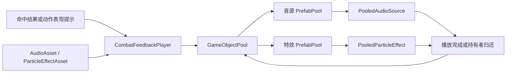

# GameObject 对象池设计与实现方案

创建日期：2026-11-12  
适用项目：`D:\CODE\Unity\Projects\ArknightsEndfield`，Unity `6000.3.28f1`  
文档状态：池核心、SO 定义、播放组件和示例资产已落地，CombatDemo 已配置；Unity 编译与 8 项受控 Play Mode 检查通过，验证边界见第 9 节  
范围依据：[战斗系统完整规划](战斗系统完整规划.md)、[战斗系统阶段性实施规划](战斗系统阶段性实施规划.md)

## 1. 目标与当前工程

提供一个场景级 GameObject 对象池，复用短音效、粒子特效，以及后续需要重复出现的临时表现物体。池负责实例生命周期，音效和特效组件负责自己的播放与复位规则。

2026-11-12 已在已有 PoolHandle、PooledObject 和 PrefabPool 空壳基础上完成本方案，运行时代码共 10 个文件。配置层使用 AudioAsset 和 ParticleEffectAsset 两种 SO，播放层通过 CombatFeedbackPlayer 读取定义并调用场景池；不依赖尚未实现的战斗结算接口。下文完整代码与当前 Assets 文件一致。

这里的 Effect 指视觉特效。完整规划中的 `EffectController / ActiveEffect` 管理 Buff、附着和属性效果，属于玩法逻辑，不由本对象池计时或结算。表现物体被回收不会移除 Buff，也不会改变伤害结果。

本轮设计包含：

- 按 Prefab 引用分池，预热、借出、归还、空闲容量限制和场景销毁
- 单次或循环 AudioSource，播放结束自动归还，循环音效由持有者归还
- 粒子特效及子粒子结束检测、拖尾清理、可选跟随目标
- 普通临时 GO 的定时归还示例，以及表现层调用示例
- AudioAsset 与 ParticleEffectAsset 配置资产，同一 Prefab 的多个定义共用分池
- 防止重复归还和旧句柄误回收新一轮实例

不加入全局单例、跨场景常驻、Addressables、异步加载、线程安全池、统一事件总线或音频优先级系统。当前也不池化玩家、敌人、战斗状态对象或资源资产本身。`AudioClip`、材质、Prefab 仍由 Unity 管理，池复用的是它们的 GO 实例。

## 2. 结构与接口

### 2.1 职责划分

| 类型 | 职责 |
| --- | --- |
| `GameObjectPool` | 场景组件，保存 Prefab 配置和分池字典，提供统一借出与批量归还入口 |
| `PrefabPool` | 一个 Prefab 的运行时池，封装 `ObjectPool<PooledObject>`，跟踪借出实例 |
| `PooledObject` | 根组件基类，提供创建、借出、归还回调及本次借用身份 |
| `PoolHandle` | 本次借用的实例引用与版本号，只用于有效性检查和归还 |
| `AudioAsset` | SO，保存音源 Prefab、候选 AudioClip、音量、Pitch 范围和循环开关 |
| `ParticleEffectAsset` | SO，保存粒子 Prefab 和默认缩放，与玩法 EffectAsset 区分 |
| `PooledAudioSource` | 设置本次音效参数、播放、结束检测和音频状态清理 |
| `PooledParticleEffect` | 播放选定粒子、检测整组结束、跟随目标和清理残留 |
| `PooledTimedObject` | 普通临时 GO 的游戏时间寿命示例 |
| `CombatFeedbackPlayer` | 场景表现入口，读取 SO 后借用并播放实例，向调用者返回句柄 |

底层使用 Unity 自带的 `UnityEngine.Pool.ObjectPool<T>`，不重复实现空闲栈。基类提供的是实际不同类型共用的生命周期，不再添加 `IPoolService / IAudioService / IEffectService` 等没有当前替换需求的接口。



实际归还通过实例记录的所属 `PrefabPool` 进行，不通过 Prefab 名称、字符串或再次搜索场景定位池。

### 2.2 API 约定

| API | 含义 |
| --- | --- |
| `feedback.PlayAudio(asset, position)` | 从 SO 选择音频及参数，借出音源播放并返回句柄 |
| `feedback.PlayEffect(asset, position, rotation, followTarget)` | 按 SO 的 Prefab 和缩放播放特效，可选跟随挂点 |
| `feedback.PlayHit(audio, effect, position, rotation)` | 一次触发单次命中音效与特效，可省略其中一种定义 |
| `pool.Rent(prefab, position, rotation)` | 获取同类型实例，复位并设置世界位置和旋转，保持 inactive |
| `audio.Play(clip, volume, pitch, loop)` | 填入参数，激活，开始播放，返回本次句柄 |
| `effect.Play(followTarget)` | 可选跟随目标，激活并开始指定粒子，返回本次句柄 |
| `timed.Show(seconds)` | 激活普通临时 GO，并启动游戏时间倒计时 |
| `instance.Activate()` | 普通 `PooledObject` 的手动激活入口 |
| `handle.IsValid` | 该句柄是否仍对应当前借用，不等同于 GO 是否 active |
| `handle.Return()` | 提前结束本次借用，默认句柄、重复调用和过期句柄均无操作 |
| `pool.ReturnAll()` | 归还所有借出实例，保留空闲缓存 |
| `pool.GetCounts(prefab, out rented, out inactive)` | 查询一个分池的借出数、空闲数 |

`Rent → 配置 → Play / Show / Activate` 必须在同一次同步调用中完成，不跨帧等待。借出但尚未激活的实例仍属于借出集合，由调用者负责结束这次借用。

业务可以在这个同步调用中使用返回组件设置参数，跨帧保存的是 `PoolHandle`。不要保存组件后在延迟回调里直接调用它的 `Play`，也不要到回调执行时才读取组件的最新 `Handle`，否则拿到的可能已经是另一次借用。版本号只保护经旧句柄进行的操作。

### 2.3 容量与预热

每项配置只有 `Prefab`、`PrewarmCount`、`MaxRetained`，必须满足 `0 <= PrewarmCount <= MaxRetained` 且 `MaxRetained > 0`。

- `PrewarmCount` 是初始化时实际创建的 GO 数量
- `MaxRetained` 是最多保留的空闲 GO 数量，不是播放并发上限
- 空闲池耗尽时继续创建，归还时超出空闲容量的对象被销毁
- 不抢占正在播放的音效或特效，不在池层丢弃表现请求

例如预热 4、保留 8，同时借出 12 个会创建到 12 个；全部归还后保留 8 个，其余 4 个销毁。若演示场景的常态并发超过 8，应根据测量调整配置，避免反复扩容和销毁。声音数量限制、优先级和抢占属于后续音频业务策略。

Unity 的 `defaultCapacity` 只预分配内部容器，不会创建 GO；本实现先取出全部预热对象，再统一归还，避免循环 `Get → Release` 实际只创建一个实例。[Unity ObjectPool 构造参数](https://docs.unity3d.com/6000.0/Documentation/ScriptReference/Pool.ObjectPool_1-ctor.html)

## 3. 生命周期与使用边界

### 3.1 创建、借出和归还

```text
创建一次
  Instantiate 到 inactive 根节点
  → 保持实例 inactive
  → Bind / OnCreated 缓存组件与初始缩放

每次借出
  从空闲池取出或创建 → 加入借出集合
  → 设置父节点、世界位置、世界旋转与初始缩放
  → 更新版本号，标记借出 → OnRent 复位本次状态
  → 调用方设置参数 → Activate → 开始播放

每次归还
  校验句柄版本 → 移出借出集合 → 标记未借出
  → 停止本组件协程与 Invoke → OnReturn 清理表现
  → SetActive(false) → 放回 inactive 根节点
  → 入空闲池，或因空闲容量已满而销毁
```

创建放在 inactive 层级中，避免 Prefab 原本 active 时提前触发播放。Unity 的 `Awake / OnEnable` 与实例的层级激活状态有关，因此初始化依赖显式 `OnCreated`，不依赖首次 `Awake` 是否已经执行。[Unity Instantiate 生命周期](https://docs.unity3d.com/6000.0/Documentation/ScriptReference/Object.Instantiate.html)

`OnCreated` 只做组件缓存和固定设置；`OnRent` 重置本次数据；`OnReturn` 停止播放、清引用和清残留。`OnRent` 执行时 GO 仍 inactive，不能在其中启动协程。播放类也不在 `OnEnable / Start` 中自动播放，防止覆盖调用方刚设置的参数。

归还不会恢复整个 Prefab 的序列化快照。核心只恢复根 Transform；子节点位姿、材质参数、Rigidbody 速度、Animator 状态等，由实际修改它们的派生组件复位。当前 Audio 和粒子实现只修改代码中明确列出的字段。

### 3.2 所有权与销毁

1. 一个 Prefab 根节点只挂一个 `PooledObject` 或其派生组件，传入的必须是 Prefab 资产上的该根组件
2. 每个场景一个显式引用的 `GameObjectPool`，不使用静态实例或 `DontDestroyOnLoad`
3. 所有池对象始终属于池的层级，禁止外部 `Destroy`、`SetActive(false)` 或重新设父节点，归还统一使用句柄
4. 跟随角色采用位置/旋转同步，不把池对象挂到角色下，角色销毁不会连带销毁池对象
5. 生命周期回调只处理本对象，不重入池、不借还其他对象，也不主动抛出异常；配置错误在接入时修正，不尝试继续运行损坏的池
6. `StopAllCoroutines / CancelInvoke` 只覆盖当前组件；扩展组件自己的异步任务、订阅和回调必须由该组件取消，延迟归还捕获本次句柄

场景卸载时，池同时销毁空闲和借出的实例，所有旧句柄失效。销毁路径不模拟一次正常归还，不调用 `OnReturn`，避免依赖正在拆除的场景对象。未来派生组件若订阅池外事件，应让 `OnDisable / OnDestroy` 也能独立解除订阅；本版没有池外订阅。

同场景重开时，先停止产生新表现的动作与事件，再调用 `ReturnAll()`，然后恢复战斗状态。场景重载时由 `OnDestroy` 清理即可。池宿主与其祖先保持 active、固定单位缩放；不要通过关闭池宿主暂停战斗。

### 3.3 暂停与播放完成

音效通过 `AudioSource.isPlaying` 判断结束，不使用 `clip.length` 倒计时，因此 pitch 改变不会导致过早归还。单个音源本版不开放 `Pause`，全局战斗暂停由统一暂停入口同时设置 `Time.timeScale = 0` 和 `AudioListener.pause = true`，恢复时同时恢复原时间缩放并解除 listener 暂停。这个入口属于战斗暂停系统，池不修改这两个全局值。

`AudioSource.Pause()` 会使 `isPlaying` 返回 false，不能把它直接当作播放结束；本代码在 `AudioListener.pause` 时跳过回收检查，音源设置 `ignoreListenerPause = false`。暂停期间新提交的声音由 listener 保持暂停，恢复后继续播放。[AudioSource.isPlaying](https://docs.unity3d.com/6000.0/Documentation/ScriptReference/AudioSource-isPlaying.html)、[AudioListener.pause](https://docs.unity3d.com/6000.0/Documentation/ScriptReference/AudioListener-pause.html)

仅设置 `timeScale = 0` 不代表音频暂停。非零慢动作下本版声音按设定 pitch 播放，不自动跟随 timeScale。UI 音效、BGM 和独立暂停音源不在当前适配范围。

粒子使用游戏时间，逐个检查缓存的全部 ParticleSystem 的 `IsAlive(false)`，任一系统仍存活或还能生成粒子就不归还；这样涵盖不同寿命的子粒子与延迟发射。循环粒子持续占用，必须主动归还或由跟随目标失效结束。[ParticleSystem.IsAlive](https://docs.unity3d.com/6000.0/Documentation/ScriptReference/ParticleSystem.IsAlive.html)

设置 `cullingMode = AlwaysSimulate`，让离开镜头的特效仍能完成生命周期；Demo 先接受这部分模拟开销。普通 TrailRenderer 在归还时直接清空，本版不额外等待其拖尾消散。[粒子离屏模拟设置](https://docs.unity3d.com/6000.0/Documentation/ScriptReference/ParticleSystem.MainModule-cullingMode.html)

## 4. 文件与场景配置

以下路径已落地。音频定义通过 Create 菜单创建并填写项目素材；当前工程没有 AudioClip 资产，因此没有创建空的音频配置或代用正式音频。

```text
Assets/Scripts/
  Pooling/
    PoolHandle.cs
    PooledObject.cs
    PrefabPool.cs
    GameObjectPool.cs
  Presentation/
    Audio/
      AudioAsset.cs
      PooledAudioSource.cs
    Effects/
      ParticleEffectAsset.cs
      PooledParticleEffect.cs
    PooledTimedObject.cs
    CombatFeedbackPlayer.cs

Assets/Game/Prefabs/
  Audio/WorldAudioSource.prefab
  Effects/HitSpark.prefab
  Effects/ChargeGlow.prefab
  Systems/CombatPresentation.prefab

Assets/Game/Data/Presentation/
  HitSpark.asset
  ChargeGlow.asset

Assets/Game/Materials/Effects/PoolParticle.mat
```

CombatDemo 已保存的配置：

```text
CombatDemo
  Systems
    GameInput
    CombatPresentation         Prefab 实例，GameObjectPool + CombatFeedbackPlayer
      Active                   运行时创建
      Inactive                 运行时创建，activeSelf = false
```

`Systems/CombatPresentation` 和祖先的缩放均为 `(1, 1, 1)`，运行时不移动或禁用这个宿主。池在 `Awake` 中初始化，执行顺序为 `-200`；正常业务从 `Start` 或之后的战斗回调借出。

| Prefab | 必需配置 | 初始容量示例 |
| --- | --- | --- |
| WorldAudioSource | 根节点 `AudioSource + PooledAudioSource`；关闭 Play On Awake，Spatial Blend = 1，Doppler Level = 0；Mixer、距离衰减在 Prefab 配置 | 预热 4，空闲保留 16 |
| HitSpark | 根节点 `PooledParticleEffect + ParticleSystem`，单次粒子爆发；Start Systems 引用根粒子 | 预热 4，空闲保留 16 |
| ChargeGlow | 根节点 `PooledParticleEffect + ParticleSystem`，循环粒子；Start Systems 引用根粒子，业务保存句柄 | 预热 1，空闲保留 4 |

容量只是便于接入的初值，不是性能结论。相同音源设置可复用同一音源 Prefab 并传入不同 AudioClip；不同 Mixer 路由、2D/3D 模式可以各用一个 Prefab。不同视觉资源各自分池，Prefab 变体也是不同的键。

HitSpark 和 ChargeGlow 是用于接入与生命周期检查的基础粒子示例，材质使用工程已有 URP Particles/Unlit Shader，不代表正式战斗美术。CombatPresentation 只提供池和播放入口，不会自行播放，也未给当前 PlayerController 增加战斗输入。

粒子的 `Start Systems` 只填应主动启动的粒子系统，每项不重复且属于该 Prefab。普通子发射器若需随播放启动，也列入其中；由 Sub Emitters 模块触发的系统不要列入，由所属粒子触发。所有这些系统都在同一个池实例下，结束检查和清理会覆盖全部系统。不要在播放过程中增删粒子组件或关闭粒子子节点。

池化短音效要求 AudioClip 已可同步播放，建议开启 Preload Audio Data、关闭 Load In Background，接入时实际检查加载状态和首播。预热 GO 不等于预热音频解码、Shader 或 GPU 资源。

## 5. 通用池的完整实现

以下文件已保存到第 4 节所列路径，命名空间按功能组织，不带阶段编号。代码不依赖尚未实现的战斗类型。

### 5.1 `PoolHandle.cs`

```csharp
namespace Endfield.Pooling
{
    public readonly struct PoolHandle
    {
        private readonly PooledObject instance;
        private readonly ulong version;

        internal PoolHandle(PooledObject instance, ulong version)
        {
            this.instance = instance;
            this.version = version;
        }

        public bool IsValid => instance != null && instance.Matches(version);

        public void Return()
        {
            if (IsValid)
                instance.Return(version);
        }
    }
}
```

### 5.2 `PooledObject.cs`

```csharp
using System;
using UnityEngine;

namespace Endfield.Pooling
{
    [DisallowMultipleComponent]
    public class PooledObject : MonoBehaviour
    {
        private PrefabPool owner;
        private Vector3 initialScale;
        private ulong version;

        public bool IsRented { get; private set; }
        public PoolHandle Handle => new PoolHandle(this, version);

        internal void Bind(PrefabPool pool)
        {
            owner = pool;
            initialScale = transform.localScale;
            OnCreated();
        }

        internal void Prepare(Transform activeRoot, Vector3 position, Quaternion rotation)
        {
            transform.SetParent(activeRoot, false);
            transform.SetPositionAndRotation(position, rotation);
            transform.localScale = initialScale;
            version++;
            IsRented = true;
            OnRent();
        }

        public PoolHandle Activate()
        {
            if (!IsRented)
                throw new InvalidOperationException("Rent the object before activating it");

            gameObject.SetActive(true);
            return Handle;
        }

        internal bool Matches(ulong expectedVersion)
        {
            return IsRented && version == expectedVersion && owner != null && !owner.IsDisposed;
        }

        internal void Return(ulong expectedVersion)
        {
            if (Matches(expectedVersion))
                owner.Return(this);
        }

        internal void ResetForPool(Transform inactiveRoot)
        {
            IsRented = false;
            StopAllCoroutines();
            CancelInvoke();
            OnReturn();
            gameObject.SetActive(false);
            transform.SetParent(inactiveRoot, false);
            transform.localPosition = Vector3.zero;
            transform.localRotation = Quaternion.identity;
            transform.localScale = initialScale;
        }

        internal void Invalidate()
        {
            IsRented = false;
            owner = null;
        }

        protected void ReturnToPool() => Handle.Return();
        protected virtual void OnCreated() { }
        protected virtual void OnRent() { }
        protected virtual void OnReturn() { }
    }
}
```

`version` 每次借出递增，而不是每次播放递增。一个实例一次借用只启动一次；需要再次播放时重新借出。内部 `Update` 可以用 `ReturnToPool()`，池外延迟操作必须使用预先捕获的 `PoolHandle`。

### 5.3 `PrefabPool.cs`

```csharp
using System;
using System.Collections.Generic;
using UnityEngine;
using UnityEngine.Pool;
using Object = UnityEngine.Object;

namespace Endfield.Pooling
{
    internal sealed class PrefabPool : IDisposable
    {
        private readonly PooledObject prefab;
        private readonly Transform activeRoot;
        private readonly Transform inactiveRoot;
        private readonly ObjectPool<PooledObject> items;
        private readonly HashSet<PooledObject> rented = new HashSet<PooledObject>();

        public bool IsDisposed { get; private set; }
        public int RentedCount => rented.Count;
        public int InactiveCount => items.CountInactive;

        public PrefabPool(PooledObject prefab, Transform activeRoot,
            Transform inactiveRoot, int prewarmCount, int maxRetained)
        {
            this.prefab = prefab;
            this.activeRoot = activeRoot;
            this.inactiveRoot = inactiveRoot;

            items = new ObjectPool<PooledObject>(
                createFunc: Create,
                actionOnGet: null,
                actionOnRelease: item => item.ResetForPool(inactiveRoot),
                actionOnDestroy: DestroyItem,
                collectionCheck: true,
                defaultCapacity: Mathf.Max(1, prewarmCount),
                maxSize: maxRetained);

            var warmup = new PooledObject[prewarmCount];
            for (int i = 0; i < warmup.Length; i++)
                warmup[i] = items.Get();
            for (int i = 0; i < warmup.Length; i++)
                items.Release(warmup[i]);
        }

        private PooledObject Create()
        {
            PooledObject item = Object.Instantiate(prefab, inactiveRoot);
            item.gameObject.SetActive(false);
            item.Bind(this);
            return item;
        }

        public PooledObject Rent(Vector3 position, Quaternion rotation)
        {
            if (IsDisposed)
                throw new ObjectDisposedException(nameof(PrefabPool));

            PooledObject item = items.Get();
            rented.Add(item);
            item.Prepare(activeRoot, position, rotation);
            return item;
        }

        public void Return(PooledObject item)
        {
            if (IsDisposed || !rented.Remove(item))
                return;

            items.Release(item);
        }

        public void ReturnAll()
        {
            var snapshot = new List<PooledObject>(rented);
            foreach (PooledObject item in snapshot)
                Return(item);
        }

        public void Dispose()
        {
            if (IsDisposed)
                return;

            IsDisposed = true;
            foreach (PooledObject item in rented)
                DestroyItem(item);
            rented.Clear();
            items.Clear();
        }

        private static void DestroyItem(PooledObject item)
        {
            if (item == null)
                return;

            item.Invalidate();
            item.gameObject.SetActive(false);
            Object.Destroy(item.gameObject);
        }
    }
}
```

预热会执行 `OnCreated` 和清理用的 `OnReturn`，不会触发 `OnRent` 或播放。因此派生类的 `OnReturn` 必须允许“尚未播放”的状态，以下三个实现均按此约定编写。`ReturnAll` 的临时 List 只在重开或显式清理时分配，不进入每帧路径。

### 5.4 `GameObjectPool.cs`

```csharp
using System;
using System.Collections.Generic;
using UnityEngine;

namespace Endfield.Pooling
{
    [DefaultExecutionOrder(-200)]
    [DisallowMultipleComponent]
    public sealed class GameObjectPool : MonoBehaviour
    {
        [Serializable]
        private sealed class Entry
        {
            public PooledObject prefab;
            [Min(0)] public int prewarmCount = 4;
            [Min(1)] public int maxRetained = 16;
        }

        [SerializeField] private Entry[] entries = Array.Empty<Entry>();
        private readonly Dictionary<PooledObject, PrefabPool> pools =
            new Dictionary<PooledObject, PrefabPool>();

        private void Awake()
        {
            var seen = new HashSet<PooledObject>();
            foreach (Entry entry in entries)
            {
                if (entry == null || entry.prefab == null ||
                    entry.prefab.transform.parent != null ||
                    entry.prefab.gameObject.scene.IsValid() ||
                    !seen.Add(entry.prefab))
                    throw new InvalidOperationException("Pool entries need unique prefab root components");

                if (entry.maxRetained < 1 || entry.prewarmCount < 0 ||
                    entry.prewarmCount > entry.maxRetained)
                    throw new InvalidOperationException("Pool capacity requires 0 <= prewarm <= maxRetained");
            }

            Transform activeRoot = CreateRoot("Active", true);
            Transform inactiveRoot = CreateRoot("Inactive", false);
            foreach (Entry entry in entries)
            {
                pools.Add(entry.prefab, new PrefabPool(entry.prefab, activeRoot,
                    inactiveRoot, entry.prewarmCount, entry.maxRetained));
            }
        }

        public T Rent<T>(T prefab, Vector3 position, Quaternion rotation) where T : PooledObject
        {
            return (T)GetPool(prefab).Rent(position, rotation);
        }

        public void ReturnAll()
        {
            foreach (PrefabPool pool in pools.Values)
                pool.ReturnAll();
        }

        public void GetCounts(PooledObject prefab, out int rented, out int inactive)
        {
            PrefabPool pool = GetPool(prefab);
            rented = pool.RentedCount;
            inactive = pool.InactiveCount;
        }

        private PrefabPool GetPool(PooledObject prefab)
        {
            if (prefab == null || !pools.TryGetValue(prefab, out PrefabPool pool))
                throw new InvalidOperationException("Prefab is not registered in this scene pool");

            return pool;
        }

        private Transform CreateRoot(string rootName, bool active)
        {
            var root = new GameObject(rootName);
            root.SetActive(active);
            root.transform.SetParent(transform, false);
            return root.transform;
        }

        private void OnDestroy()
        {
            foreach (PrefabPool pool in pools.Values)
                pool.Dispose();
            pools.Clear();
        }
    }
}
```

Prefab 未注册属于配置错误，直接报错，不悄悄生成一个缺少容量规则的新池。这里仅做入口配置校验和借用身份检查，不加入自动恢复、定期扫描或外部销毁修复机制。使用范围是 Unity 主线程。

## 6. Audio、Effect 与普通 GO 的完整实现

### 6.1 `PooledAudioSource.cs`

```csharp
using Endfield.Pooling;
using UnityEngine;

namespace Endfield.Presentation
{
    [RequireComponent(typeof(AudioSource))]
    public sealed class PooledAudioSource : PooledObject
    {
        private AudioSource source;
        private bool started;

        protected override void OnCreated()
        {
            source = GetComponent<AudioSource>();
            source.playOnAwake = false;
            source.ignoreListenerPause = false;
        }

        protected override void OnRent()
        {
            started = false;
        }

        public PoolHandle Play(AudioClip clip, float volume = 1f, float pitch = 1f, bool loop = false)
        {
            if (clip == null)
            {
                ReturnToPool();
                return default;
            }

            source.clip = clip;
            source.volume = Mathf.Clamp01(volume);
            source.pitch = Mathf.Clamp(pitch, 0.01f, 3f);
            source.loop = loop;
            PoolHandle handle = Activate();
            source.Play();
            started = true;
            return handle;
        }

        private void Update()
        {
            if (!started || AudioListener.pause)
                return;

            if (!source.isPlaying)
                ReturnToPool();
        }

        protected override void OnReturn()
        {
            started = false;
            source.Stop();
            source.clip = null;
            source.loop = false;
            source.volume = 1f;
            source.pitch = 1f;
        }
    }
}
```

一个借用实例只播放一个声音，使用 `clip + Play`，不在同一个池实例上叠加多个 `PlayOneShot`。循环音效返回的句柄由业务保存，停止时调用 `Return()`。Mixer 路由、距离衰减和 spatialBlend 固定在 Prefab 上，不开放外部直接修改 AudioSource。本版音源停留在传入的世界位置。

### 6.2 `PooledParticleEffect.cs`

```csharp
using Endfield.Pooling;
using UnityEngine;

namespace Endfield.Presentation
{
    public sealed class PooledParticleEffect : PooledObject
    {
        [SerializeField] private ParticleSystem[] startSystems;
        private ParticleSystem[] allSystems;
        private TrailRenderer[] trails;
        private Transform followTarget;
        private bool followsTarget;
        private bool started;

        protected override void OnCreated()
        {
            allSystems = GetComponentsInChildren<ParticleSystem>(true);
            trails = GetComponentsInChildren<TrailRenderer>(true);
            foreach (ParticleSystem system in allSystems)
            {
                var main = system.main;
                main.playOnAwake = false;
                main.stopAction = ParticleSystemStopAction.None;
                main.useUnscaledTime = false;
                main.cullingMode = ParticleSystemCullingMode.AlwaysSimulate;
            }

            foreach (TrailRenderer trail in trails)
                trail.autodestruct = false;
        }

        protected override void OnRent()
        {
            started = false;
            followsTarget = false;
            followTarget = null;
            ClearPlayback();
        }

        public PoolHandle Play(Transform follow = null)
        {
            followTarget = follow;
            followsTarget = follow != null;
            if (followsTarget)
                transform.SetPositionAndRotation(follow.position, follow.rotation);

            PoolHandle handle = Activate();
            foreach (ParticleSystem system in startSystems)
                system.Play(false);
            started = true;
            return handle;
        }

        private void Update()
        {
            if (!started)
                return;

            foreach (ParticleSystem system in allSystems)
            {
                if (system.IsAlive(false))
                    return;
            }

            ReturnToPool();
        }

        private void LateUpdate()
        {
            if (!followsTarget)
                return;

            if (followTarget == null || !followTarget.gameObject.activeInHierarchy)
            {
                ReturnToPool();
                return;
            }

            transform.SetPositionAndRotation(followTarget.position, followTarget.rotation);
        }

        protected override void OnReturn()
        {
            started = false;
            followsTarget = false;
            followTarget = null;
            ClearPlayback();
        }

        private void ClearPlayback()
        {
            foreach (ParticleSystem system in allSystems)
                system.Stop(false, ParticleSystemStopBehavior.StopEmittingAndClear);
            foreach (TrailRenderer trail in trails)
                trail.Clear();
        }
    }
}
```

`startSystems` 必须在 Prefab 上正确配置，至少一个有效项，不能含丢失引用。这里使用明确配置，不猜测哪些子系统应该主动播放。代码禁用粒子的 Destroy / Disable / Callback Stop Action，也禁用 TrailRenderer 自毁，归还权集中到池组件。

跟随不复制目标缩放；局部偏移通过角色上的挂点 Transform 表达。需要已发射粒子留在世界时配置 World Simulation Space，需要粒子整体随挂点移动时配置 Local Simulation Space。循环特效取消时立即清掉粒子，本版不提供“停止发射后等待余粒子”的额外 API。

### 6.3 `PooledTimedObject.cs`

```csharp
using Endfield.Pooling;
using UnityEngine;

namespace Endfield.Presentation
{
    public sealed class PooledTimedObject : PooledObject
    {
        private float remaining;

        protected override void OnRent()
        {
            remaining = 0f;
        }

        public PoolHandle Show(float duration)
        {
            if (duration <= 0f)
            {
                ReturnToPool();
                return default;
            }

            remaining = duration;
            return Activate();
        }

        private void Update()
        {
            remaining -= Time.deltaTime;
            if (remaining <= 0f)
                ReturnToPool();
        }

        protected override void OnReturn()
        {
            remaining = 0f;
        }
    }
}
```

这个组件适合没有额外动态状态的临时世界标记。后续伤害数字应新建自己的 `PooledObject` 派生类，在显示前填写文字、颜色等，并在归还时清理 Tween 或动画。UI RectTransform、Canvas 父节点和坐标转换需到 UI 接入时单独处理，不直接套用这里的世界空间例子。

### 6.4 `AudioAsset.cs`

```csharp
using System;
using UnityEngine;

namespace Endfield.Presentation
{
    [CreateAssetMenu(fileName = "AudioAsset", menuName = "Endfield/Presentation/Audio Asset")]
    public sealed class AudioAsset : ScriptableObject
    {
        [SerializeField] private PooledAudioSource prefab;
        [SerializeField] private AudioClip[] clips = Array.Empty<AudioClip>();
        [SerializeField, Range(0f, 1f)] private float volume = 1f;
        [SerializeField] private Vector2 pitchRange = Vector2.one;
        [SerializeField] private bool loop;

        public PooledAudioSource Prefab => prefab;
        public float Volume => volume;
        public bool Loop => loop;

        public AudioClip GetRandomClip()
        {
            return clips.Length == 0 ? null : clips[UnityEngine.Random.Range(0, clips.Length)];
        }

        public float GetRandomPitch() => UnityEngine.Random.Range(pitchRange.x, pitchRange.y);

        private void OnValidate()
        {
            pitchRange.x = Mathf.Clamp(pitchRange.x, 0.01f, 3f);
            pitchRange.y = Mathf.Clamp(pitchRange.y, pitchRange.x, 3f);
        }
    }
}
```

### 6.5 `ParticleEffectAsset.cs`

```csharp
using UnityEngine;

namespace Endfield.Presentation
{
    [CreateAssetMenu(fileName = "ParticleEffectAsset", menuName = "Endfield/Presentation/Particle Effect Asset")]
    public sealed class ParticleEffectAsset : ScriptableObject
    {
        [SerializeField] private PooledParticleEffect prefab;
        [SerializeField, Min(0.01f)] private float scale = 1f;

        public PooledParticleEffect Prefab => prefab;
        public float Scale => scale;
    }
}
```

AudioAsset 保存音源 Prefab、音频集合、音量、Pitch 范围和循环开关；ParticleEffectAsset 保存粒子 Prefab 和默认缩放。多个定义可以共享同一个 Prefab 和分池，运行时播放状态与回收句柄不写回 SO。池容量继续在场景组件上配置，不增加 PoolAsset。

## 7. 表现层接入示例

### 7.1 `CombatFeedbackPlayer.cs`

```csharp
using Endfield.Pooling;
using UnityEngine;

namespace Endfield.Presentation
{
    public sealed class CombatFeedbackPlayer : MonoBehaviour
    {
        [SerializeField] private GameObjectPool pool;

        public PoolHandle PlayAudio(AudioAsset asset, Vector3 position)
        {
            if (asset == null)
                return default;

            AudioClip clip = asset.GetRandomClip();
            if (clip == null)
                return default;

            PooledAudioSource audio = pool.Rent(asset.Prefab, position, Quaternion.identity);
            return audio.Play(clip, asset.Volume, asset.GetRandomPitch(), asset.Loop);
        }

        public PoolHandle PlayEffect(ParticleEffectAsset asset, Vector3 position,
            Quaternion rotation, Transform followTarget = null)
        {
            if (asset == null)
                return default;

            PooledParticleEffect effect = pool.Rent(asset.Prefab, position, rotation);
            effect.transform.localScale *= asset.Scale;
            return effect.Play(followTarget);
        }

        public void PlayHit(AudioAsset audio, ParticleEffectAsset effect,
            Vector3 position, Quaternion rotation)
        {
            PlayAudio(audio, position);
            PlayEffect(effect, position, rotation);
        }
    }
}
```

`PlayHit` 应在命中结果已提交后调用，位置和旋转由命中表现数据提供。它不从碰撞回调自行扣血，也不检查攻击是否合法。Animation Event 触发挥刀音效等表现时，仍由动作层验证当前动作，池的版本号不替代动作实例 ID。

动作拥有者在开始循环音效或蓄力表现时，保存 `PlayAudio` 或 `PlayEffect` 返回的句柄，在正常结束、打断、死亡和自身 `OnDisable` 清理时调用该句柄的 `Return()` 并置为 `default`。同一清理入口可重复调用。独立命中特效可以自然播放完；循环表现必须有明确拥有者。`PlayHit` 是不保存句柄的单次反馈入口，传入的音效与粒子都应关闭 Loop。

例如未来动作组件内部持有 `PoolHandle chargeHandle`，开始新动作前先执行 `chargeHandle.Return()`，再赋值为 `feedback.PlayEffect(chargeAsset, anchor.position, anchor.rotation, anchor)`；结束动作时执行 `chargeHandle.Return(); chargeHandle = default;`。传入的挂点应有效且 active。位置和旋转不跟随时作为生成姿态，跟随时使用挂点姿态。这段接线不要求现在创建 `ActionController` 或修改当前 `PlayerController`。

接入已有资产时，在调用组件中序列化引用场景 `CombatFeedbackPlayer` 和所需 SO。单次特效调用 `feedback.PlayEffect(hitSparkAsset, position, rotation)`；同一次命中需要音效和特效时调用 `feedback.PlayHit(hitAudioAsset, hitSparkAsset, position, rotation)`。定义为 null 时跳过该表现，音频定义的音频集合为空时不借出音源；定义引用了未注册 Prefab 时由场景池报配置错误。

新增音频的配置顺序：通过 `Create → Endfield → Presentation → Audio Asset` 创建资产；Prefab 指向 WorldAudioSource，Clips 填入音频，按需设置音量、Pitch 范围和 Loop；调用方引用该 SO 即可。当前音源 Prefab 已注册，使用同一个音源 Prefab 的新 AudioAsset 不需要再添加一项池配置。新增粒子类型时创建自己的 Prefab、Particle Effect Asset，并把 Prefab 注册到 CombatPresentation 的 entries；只修改定义缩放而继续使用同一 Prefab 时，不创建新分池。

### 7.2 与当前阶段的关系

本方案细化可复用表现设施，不新增独立阶段，也不改变 P1—P5 的战斗出口：

1. 本次已实现第 5、6、7 节代码，配置共享音源、两种粒子示例与对应粒子 SO
2. CombatPresentation 已作为 Prefab 实例接入 CombatDemo 的 Systems；正式音频素材与战斗事件在对应功能接入时绑定
3. P1-07 如果采用重复生成的命中特效，可以采用此池；仅使用命中变色时不必创建空池
4. P2-06 接入重开时，验证同场景 `ReturnAll` 或场景卸载清理
5. P5-02 / P5-05 根据实际音效、VFX 数量观察容量与性能，再决定是否增加音频限流等策略

## 8. 最小实施与验收

核心、播放组件、SO 和示例资产已经实现；新增资源时按第 4、7 节配置，不需重复创建脚本。下表为接入时的验收清单，不表示每一项都已运行，当前实际完成的检查见第 9 节。PooledTimedObject 已提供代码并通过编译，当前没有配置对应的正式 GO 资源。

| 检查 | 操作 | 预期结果 |
| --- | --- | --- |
| 预热与首次激活 | 预热 4，进入 Play Mode，再借出一个并播放 | 初始化确有 4 个不同实例且不提前发声/播放，首次播放使用新位置和参数 |
| 基础复用 | 播放后归还，再借同一 Prefab | 可复用已创建实例，缩放和播放状态不沿用上次修改 |
| 分池与超额归还 | A 预热 2、保留 3，连续借 5；另借 B；全部归还 | A 最终空闲 3、借出 0，B 使用自己的池，等待帧末销毁后数量一致 |
| 旧句柄 | 保存 h1，归还并复用相同实例得到 h2，再调用 h1.Return 两次 | h1 无效，h2 对应对象继续工作，计数不重复变化 |
| 音频完成与暂停 | pitch 分别 0.5 / 2 播放短音效；统一暂停后恢复 | 按实际声音结束回收，暂停期间不误回收；恢复可继续播放 |
| 循环音频 | Play 时 loop=true，等待后主动归还 | 不按片长自动归还，主动归还后停止且 clip 引用清空 |
| 粒子组合 | 父粒子短、子粒子长，包含延迟发射或 Sub Emitter；移出镜头 | 全部粒子结束后才归还，离屏仍能结束 |
| 粒子复位与跟随 | 循环特效跟随挂点，主动归还后在远处复用；另一次禁用或销毁目标 | 无旧粒子和拖尾跨位置残留，目标失效时结束跟随特效 |
| 暂停与计时 | 运行粒子和定时 GO，timeScale=0 后恢复 | 两者暂停推进，恢复后继续到自然结束 |
| 清理与重开 | 同时有单次和循环表现时 ReturnAll，再借用；随后重载场景 | 批量归还后借出 0，旧句柄无效；新场景无残留实例并能正常使用 |

自动化如果需要，只覆盖预热/容量、重复及过期句柄、ReturnAll 等核心生命周期。Audio 和粒子是否按预期播放、暂停、离屏结束以及视觉残留，需要 Play Mode 验收，纯 C# 编译不能替代。

Profiler 只观察实际演示负载：预热够用并完成首次容量增长后，重复播放不应持续出现该池的 Instantiate / Destroy；超过空闲容量时发生销毁符合设计。不承诺零 GC、固定帧率或任何未经测量的性能提升。

## 9. 本次交付与验证记录

| 层级 | 状态 |
| --- | --- |
| 设计文档 | 已补充 SO 层与现行调用方式，10 段完整代码同步工程实现 |
| 工程代码实施 | 4 个池核心文件、3 个播放组件、2 个 SO 定义、1 个表现入口已写入 Assets，沿用已有三个脚本的 GUID |
| 资产与场景 | WorldAudioSource、HitSpark、ChargeGlow、CombatPresentation 四个 Prefab；两个粒子定义与一个粒子材质；CombatDemo 的 Systems 下已配置并保存 |
| 文档结构检查 | 严格 UTF-8、代码围栏、表格列数、新增本地链接、10 段文档代码与源码一致性及 diff 空白检查通过；既有缺失链接见下文 |
| Unity 编译 | Unity 6000.3.28f1 编译与域重载完成，Console 0 错误、0 警告 |
| Edit Mode | 退出播放后确认 CombatDemo 已保存且 isDirty=false，只有一个场景池，三个 entries 和表现入口引用正确，无 Missing Script，未把运行时实例保存进场景；正式音频定义待导入实际音频素材后创建 |
| Play Mode | 在已确认的 ArknightsEndfield / CombatDemo 中完成下述 8 项受控检查，已退出 Play Mode |
| Player 构建 / 构建运行 | 未执行 |

本次受控检查结果：

1. 预热得到 9 个不同且 inactive 的实例，初始缩放未被清零
2. 实例复用恢复位置与缩放；默认、重复和过期句柄不影响当前借用
3. 音源同时借出 17 个，归还后仅保留 16 个且超额实例帧末销毁；特效池计数独立
4. 粒子 SO 的缩放应用到实例，单次粒子自然结束后归还
5. 循环粒子持续播放，跟随目标且不更改所有权层级，目标禁用后归还
6. 临时 AudioClip 以 Pitch=2 播放，全局暂停期间句柄有效，恢复后自然结束并清除 clip 引用
7. 循环音频与特效不提前结束；ReturnAll 停止播放、使句柄失效，随后仍可正常借出
8. 销毁独立池宿主后，活动和空闲实例均销毁，原句柄失效

检查辅助代码及结果位于被 Git 忽略的 `.utmp/PoolingVerification.cs` 与 `.utmp/pooling-verification.json`，没有增加测试程序集、正式测试音频或测试场景。测试临时对象已清理，时间缩放、listener 暂停和 runInBackground 已恢复。该检查覆盖真实池与播放组件的受控生命周期，不代表人工听感、复杂子粒子/Sub Emitter/TrailRenderer 组合、真实场景重载、PooledTimedObject 的运行时验收或性能测量。宿主销毁检查不扩大为完整场景重开验收。

两份总规划与 TODO 已同步本轮结果，不把对象池完成视为 P1 或战斗反馈接入完成。Packages、ProjectSettings、角色控制器与输入代码没有修改。

2026-11-12 命名调整：SO 类型、脚本文件、创建菜单、调用参数及规划中的配置类型统一使用 Asset 命名，脚本和现有 SO 的 GUID 保持不变。Unity 编译通过，两个已有粒子资产按新类型加载成功，Prefab 引用与缩放保留；CombatDemo 无 Missing Script，场景未变脏。本次命名调整未重复运行 Play Mode 或构建。

当前检查还发现，两份既有总规划引用的 `第三人称控制器与移动状态系统实现方案.md` 不在当前 Docs 目录。该缺失属于已有文档状态，本次不重建控制器方案，也不把那些历史引用记为已验证有效。
