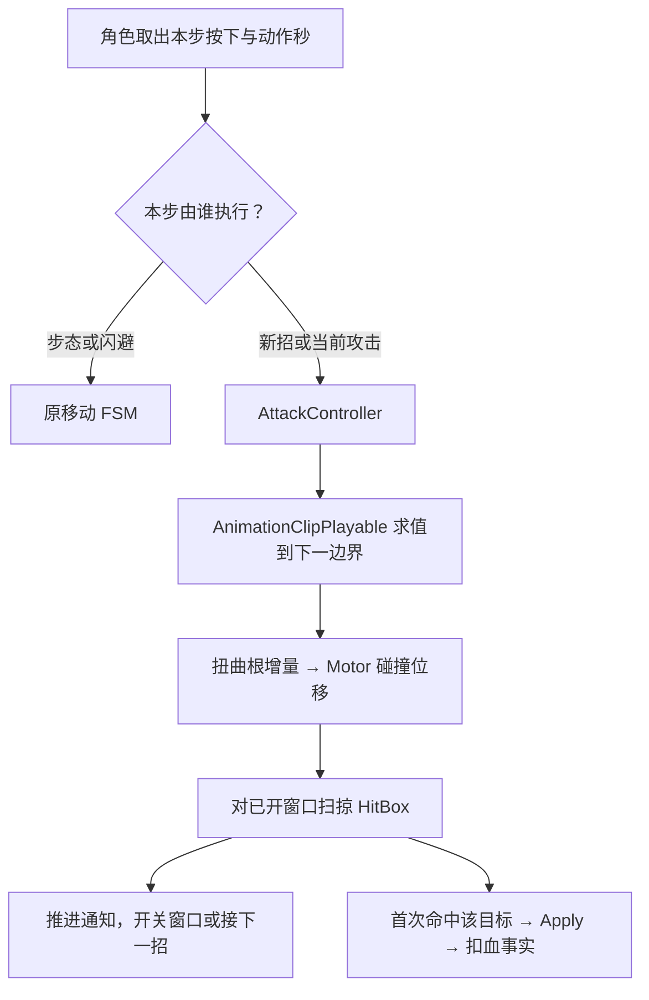

# M6 战斗执行详细技术设计

**设计基线 · 2026-11-27 · 待实施**　玩家给菲比装上大剑，点按普攻。角色用攻击片段向木桩靠近，刀刃在动画指定的几帧扫过木桩，木桩扣血。在衔接窗口再按一次，角色沿连招树选下一招；菲比首套树的两条路径都以第三击重击收尾。战技、终结技沿用同一条执行链，分别支付队伍 SP 和个人能量

## 1. 交付范围和设计依据

M6 交付武器装配、挂载点、Playable 攻击、平面运动扭曲、动画窗口驱动的 HitBox、普攻连招树及其 Inspector、续段与取消、技能支付和命中结算。首套可玩内容为菲比大剑三段普攻、一战技、一终结技；双手挂载用祀的双刀验证。格挡、防御动作和处决在本阶段范围之外。目标已有的 DEF 面板值仍按既定伤害公式参与结算。[总体路线](../仿终末地战斗系统设计方案.md#61-总体路线) · [伤害公式与状态算例](../M2%20Runtime%20Foundation/M2.4%20Damage%20详细技术设计.md)

| 已核对的当前工程 | 对本设计的影响 |
| --- | --- |
| `SceneActors.Register` 把角色推进回调交给 `BattleClock`，`ActorStepBinding.Step` 收到本角色的动作秒，`CharacterControl.Step` 提取本步输入 | 在 `PartyMemberControl.StepActor` 的动作选择处接入 AttackController。地面和闪避是两个移动状态，待机、走、跑是地面步态，攻击占用动作步时保留地面状态 |
| `AnimationSource` 已支持 Controller 片段与直接播放的 AnimationClipPlayable；`CharacterActionPlayback` 按片段进度逐段应用自然或扭曲位移，再派发通知 | 攻击入口复用 `TryPlayAction(animation, speed, targets)`。M6 在位移与段末通知之间接入 HitBox 扫掠，并扩展续段、变速与收尾 |
| `AnimationDefination.windowNotifies` 使用 SerializeReference，现有 Inspector 和 Timeline 均可发现派生窗口并编辑其字段。通知轨道保存实际窗口对象，AnimationNotice 当前只暴露索引、信号等信息 | 扩展通知载荷，把窗口对象交给订阅者。制作者在动画窗口直接填写检测挂点和 DamageSpec |
| `Characters/TrainingDummy` 已存在，源 Prefab 的 Body Collider、Head Collider 在 HitTarget 层，场景实例删除了这两个子物体。场景另有名为 TrainingTarget 的 TMP 文本。SceneActors.initialActors 目前只有两名友方 | 复用实体木桩，恢复两个触发器，接入敌方身份和现有资源模块。文字节点继续作 UI |
| `CharacterBuildState.TryEquip` 已能更换武器槽、更新面板。武器美术 Prefab 和大剑、双刀动画资源均在工程中 | 复用构筑槽保存已装备的定义，角色组件负责模型、挂点和可用 HitBox；共享资产只保存配置 |

### ARPG Demo 中采用的做法

下列路径相对同级参考工程 `ARPG Demo/Assets/Scripts/Runtime/`。表中描述来自本次源码核对

| 参考源码 | 采用的做法及本工程接法 |
| --- | --- |
| `Animation/AnimationSystem/OneShotAnimationState.cs`、`Animation/AnimationSystem/AnimationSource.cs` | 单次片段创建 AnimationClipPlayable 并连入 Mixer。M6 由 AttackController 请求播放、变速与退出 |
| `Animation/AnimationMotionWarping/AnimationMotionWarpingControl.cs` | 依据片段窗口修正位置和朝向。M6 已有 M5 求解器，输出交给 CharacterMotor 处理碰撞 |
| `MeleeSystem/Attachment/WeaponAttachment.cs`、`MeleeSystem/Weapon/RuntimeWeapon.cs` | 通过挂点装配、按部位选择检测器、卸下时释放。M6 把模型和 HitBox 放在同一个武器 Prefab 内，使装配同时决定外形和判定 |
| `Animation/AnimationNotify/GameNotifies/StateNotifies/HitboxWindowNotify.cs`、`ComboInputWindowNotify.cs`（同目录） | 命中与输入许可分别由持续通知开关。本工程按角色本次 PlayId 接收，直接读取派生通知字段 |
| `MeleeSystem/ComboTree/ComboTreeAsset.cs`、`MeleeSystem/ComboTree/ComboTreeNode.cs`、`MeleeSystem/Combat/MeleeCombatController.cs` | 参考实现按当前节点 ID 选择根或直接子节点，从匹配的输入取得下一招，播放成功后更新游标。M6 沿用此结构，由本角色的招式表引用普攻树，末段收势后允许重新起手 |
| `../Editor/ComboTree/ComboTreeAssetEditor.cs` | 参考 Inspector 用树显示层级、选中节点编辑招式、在当前节点添加同级或子级。M6 用缩进树和一个节点详情区实现相同的制作流程 |
| `MeleeSystem/HitDetection/Hitbox.cs`、`MeleeSystem/HitDetection/HitboxQuery.cs` | 球体或胶囊描述打击范围，上一姿态与当前姿态共同决定扫掠，Scene 视图绘制对应形状。去重范围由一次攻击的具体窗口确定 |

## 2. 谁推进一次攻击

`BattleClock → ActorStepBinding.Step → CharacterControl.Step → PartyMemberControl.StepActor` 选择招式后，由 `CharacterActionPlayback.Advance → AnimationSource.EvaluateSegment → MotionWarping.UpdateWarp（配置启用时）→ CharacterMotor.MovePlanar → HitBox → 动画段末通知` 消费同一段动作秒。HitBox 命中后交给 IDamageable 结算



**分派边界**　保留 `CharacterControl.Step(double actionDelta)` 的按键快照，在已有的 `PartyMemberControl.StepActor(double actionDelta)` 内决定本步消费者。正在闪避时走原逻辑；在地面同时收到可用的 Dodge 和 Attack 时走闪避。其余情况优先继续当前攻击，或从地面尝试终结技、战技、普攻，均未提交才推进地面步态。AttackController 是普通的角色实例对象，既不继承 CharacterState，也不向 Machine 提交攻击状态。攻击从走或跑开始时调用 Motor 清零步态速度与转向残量，并把 GroundSpeed、MoveAmount 置零，防止收招时重用起手前的速度

| 所有者 | 配置或运行成员 | 创建、更新和释放 |
| --- | --- | --- |
| PartyMemberControl | `AttackSetDefination attackSet`、`WeaponEquipment equipment` 由 Inspector 指定，`AttackController attacks` 在角色登记后创建。输入经现有 SetControlInput、StepCommands 取得 | 角色登记时给 attacks 提供 ActorRuntime、本场 Clock、SceneActors 和 TeamSkillPoints，角色步进继续共用现有绑定。无进攻配置的队员继续运行原步态与闪避 |
| AttackController | `uint sequence` 初始 0，成功提交递增；`AttackId currentAttack`、`long playId`、`AttackSnapshot snapshot` 在每次出招生成。`int currentComboNodeId` 初始 0（尚未起手），`ComboPress? bufferedPress` 初始 null，记录首次缓存按下时的移动意图；每个技能槽有 `double readyAt` 初始 0 战斗秒 | 提交时锁定招式、武器实例代次、目标和起始朝向；持有开放命中窗口及其独立去重集合；本次运动扭曲由 CharacterActionPlayback 持有。换段重新提交。冷却在该角色本场生命周期内保留 |
| AnimationSource / CharacterActionPlayback | 手动图在 Controller 和当前 ClipPlayable 之间选择输出；AnimationSource.ClipTime 来自实际播放源，默认倍率为 1 | AnimationSource 求值并采集自然根增量。CharacterActionPlayback 按配置选择位移，提交 Motor 后派发段末通知，两者均按角色实例持有 |
| WeaponEquipment / HitBox | 角色各自持有挂点表、已装实例和部位到 HitBox 的映射；HitBox 组件持有几何配置。窗口运行记录保存本窗上次形状姿态及 `HashSet<ActorId>` | 装配建立映射，开窗记录起始姿态，扫掠后更新，闭窗即释放。两名角色共用定义时，实例、刀刃位置和命中记录各自独立 |
| CharacterDamageReceiver / DamageReceiver | 目标根组件组合本角色只读面板、资源容器、Status。普通 C# 结算器读取攻击快照、窗口参数与目标现场值 | Resources 持有 HP，Status 持有状态。仅在实际扣血后发布事实，由表现订阅者租用火花 |

**动作入口**

- `TryStart(CharacterCommand request, double battleNow) → bool` 普攻从 `attackSet.normalCombo` 查根节点，技能从对应技能槽选招，要求角色存活、未冻结或失衡，武器和所需挂点可用。先检查动画、扭曲摘要、目标要求和冷却，再支付费用。支付失败保留原资源、播放和编号。成功后建立攻击快照、启动片段和通知，锁定新编号。普攻和战技允许挥空，终结技要求有效目标。技能在收势或中断后保留已支付费用与冷却
- `Advance(double actionDelta, CharacterCommand pressed)` 只消费本角色的正动作秒。正在攻击时，已开放的闪避取消优先于续段；取消成功在步首把本步交回现有地面选态，Dodge 收到同一次按下。正常换段在同一控制器内完成，本步余时继续新片段，原按下只消费一次。自然收势时余时仅推进步态图，下一正步恢复地面位移
- `SetPlaybackRate(float rate)` 在子段边界接受有限正值，同时更新 ClipPlayable 速度和下一边界的动作秒换算。30 fps 片段到第 6 帧改 2 倍速，再过 0.10 动作秒到第 12 帧
- `Cancel()` 按本次编号关闭通知、命中窗、扭曲和片段，释放缓存，回到可从地面起手的状态。死亡、Frozen/Staggered 生效、卸换武器、禁用攻击控制或绑定、销毁均可同步取消。回调内先使旧攻击编号失效，待当前派发返回后收尾；每次可能触发用户回调的支付、命中或通知后复查代次。重复清理无副作用。失去焦点或面板清输入只清续段缓存，暂停或局部顿帧的零动作步丢弃新按下，已开窗口与姿态停在原位

## 3. 武器装配和挂载点

**资产与挂点**　新增 `WeaponDefination : BuildModifierProfile`，复用构筑槽已有的武器类别和属性词条；现有 BuildModifierProfile 开放继承。定义内嵌 `WeaponPart[] parts`，每项有 `WeaponSocket slot`（RightHand 或 LeftHand）、`GameObject prefab`、`Vector3 localPosition`（米，默认零）、`Vector3 localEulerAngles`（度，默认零）。大剑只配右手，双刀一行左手、一行右手。Prefab 包含可见网格及一个或多个 HitBox。资产中保存 Prefab 引用，场景里的骨骼引用由角色持有

在左右手实际骨骼下建立空子物体 `RightWeaponSocket`、`LeftWeaponSocket`。角色逻辑根的 WeaponEquipment 在 Inspector 中配置 `SocketBinding[] sockets`，将部位枚举对应到这些 Transform；装配所需的部位必须唯一且存在。武器实例作为 Socket 子物体，应用该零件的局部握持偏移，保留 Prefab 自身缩放。两个 Avatar 的同一挂点标识可以映射到各自不同的骨骼。首次制作可从 `ModelAnimator.GetBoneTransform(HumanBodyBones.RightHand/LeftHand)` 定位骨骼

| 入口 | 可观察结果 |
| --- | --- |
| `TryEquip(WeaponDefination next, out string error) → bool` | 先校验所有零件、HitBox、挂点，准备一整组失活实例。准备失败销毁候选并保留原武器。随后调用本角色 Build.TryEquip(Weapon, next, …)；成功时取消旧攻击、停用旧组、挂接并启用新组，再销毁旧组。重复装备同一份定义复用已装实例；切换前以变更标记禁止在同步订阅回调中启动新攻击。当前武器读 Build.GetEquipped(Weapon) |
| `Unequip()` | 使用同一入口提交空武器槽，立即关闭旧判定、清除连段与挂点映射，销毁已装实例。空手按 Attack 不创建攻击编号。收回装备不回滚已经发生的扣血 |
| 既有 Build.TryEquip 调用、进场和重新启用 | 构筑层在武器槽成功提交后发布一次槽位变化，WeaponEquipment 订阅并同步模型。经 TryEquip 预建的实例在该回调消费一次，其他调用按当前槽重建；旧的纯属性武器仍能更新面板，释放旧战斗模型。直接写入一份无法适配当前角色的战斗武器时报告缺失挂点并禁用该武器的进攻。启用时主动读槽补齐禁用期间的变更，禁用时解除订阅、关判定、隐藏实例，销毁时彻底释放 |

场景默认大剑通过 PlayerRoot 的 `WeaponEquipment.startingWeapon` 在首次角色初始化且武器槽为空时装备一次，加载存量构筑时优先采用已有槽位。训练大剑的属性词条留空，基准 ATK 保持 704。祀在装配验收中使用双刀定义。该阶段的装配入口可供初始化、代码和测试调用，背包界面归后续内容

## 4. 攻击片段、扭曲和通知的先后顺序

1. **建图与提交**　复用 `PartyMemberControl.TryPlayAction(animation, speed, targets)`。`AnimationSource.BeginPlayableClip` 在角色现有手动图创建 ClipPlayable，接到原 Animator 输出并在零秒定姿。公共播放流程持有本次通知编号，首个正动作步先派发第零帧通知，再提交首段位移
2. **选择扭曲目标**　每个普攻段、战技和终结技都必须配置 UseRootMotion、UseMotionWarping、匹配当前片段及 Avatar 的 WarpAsset 和有效摘要。在招式入场前以角色为中心 `OverlapSphere` 查询 HitTarget 触发器，经 SceneActors.CanTargetEnemy 和水平前向夹角筛选；首版默认半径 3 m、前方半角 60°，先选水平距离最近者，同距取 ActorId 较小者。以最近目标根位置 T 和攻击者向目标的水平朝向 R 构造 `WarpTarget(new Pose(T,R))`，两点重合时用当前朝向。扭曲窗口配置 `targetOffsetXZ=(0,−0.8 m)`、alignYaw=true，期望停在目标近侧并面向它。五招各有一段从第 0 帧开始的接近窗，提交时即锁定该窗目标。空挥传默认 WarpTarget，求解器沿自然轨迹；有必需目标的招式在选不到时拒绝提交。目标随后移走或死亡仍按已锁定姿态完成运动，命中另按现场判定
3. **推进一个子段**　调用 `BeginWarp(asset, targets)` 后，按下一片段帧或片尾切分。设片段时间为 t，下个边界 b，速度 r，本次图求值时长为 min(剩余动作秒, (b−t)/r)。由共用的 EvaluateSegment 读 ClipPlayable.GetTime() 与 OnAnimatorMove 的水平根增量，将实际 [from,to]、本段开始前角色 Pose、动作起始 yaw、自然位移送给 `UpdateWarp`，再由 `Motor.MovePlanar` 写入最终位姿。Controller 闪避继续使用原有求值分支
4. **先落实位移，再判定刀经过哪里**　Motor 移动之后读取各开放 HitBox 的世界姿态，对区间起点已开的窗口扫到本段终点。随后 `AdvanceTo(playId,to)` 派发边界通知，处理本帧新开的窗口和正常关闭的窗口，最后处理缓存续段或退出。一个大动作步跨过整个窄窗时重复上述子段；同一子段不得再次推进动画或地面移动
5. **结束与撞墙**　片尾调用 End(Natural) 和 EndWarp，断开并销毁攻击节点，恢复 Controller 输出。中断用 End(Interrupted)，活动窗口只执行清理。恢复动作前清空根增量缓存。例：扭曲窗天然前进 1.00 m，近侧停点要求前进 1.60 m，则均匀两半窗各请求 0.80 m；墙体将前半窗限为 0.40 m 时，后半窗仍只请求 0.80 m。受击者是否与实际刀刃相交取决于裁剪后的位姿

## 5. 动画窗口与普攻连招树

新增可序列化的 `HitBoxWindowNotify : AnimationWindowNotify`。在现有动画 Inspector 或 Timeline 选择「添加窗口通知 → 命中窗口」，直接填写下表。取消独立 HitSegment 表以及通过信号名回查招式数据的步骤。M2.4 草案中的“攻击段”在本版具体落在这个派生通知上

| 类型 | 成员与配置 |
| --- | --- |
| HitBoxWindowNotify | 继承 startFrame、endFrame，单位片段帧；`WeaponSocketMask sockets` 默认 RightHand，可勾双手；`DamageSpec damage` 保存本窗 Physical/Arts、非负倍率、失衡点数、可选 Heat/Cryo 和层数。显示名仅供编辑。同一片段的两个窗口可以配置不同倍率 |
| AttackInputWindowNotify : AnimationWindowNotify | `AttackPermission permission` 选 Buffer（预输入）、Link（接下一段）或 DodgeCancel（允许闪避取消），帧边界也由 Timeline 编辑。相邻 Buffer、Link 可共用一个边界 |
| AnimationNotice（扩展已有值类型） | 增加只读 `AnimationWindowNotify Window`。Dispatch 从当前 track entry 复制窗口引用，点通知传 null。保留 PlayId、RuntimeIndex、Phase、Reason、Frame 和 Signal，既有 Dodge 可继续按 Signal 处理 |
| AttackController 收到通知 | 过滤 ActorId 和本次 PlayId，再按 Window 的具体类型读取。`HitWindowId = (uint)RuntimeIndex + 1` 在本播放中唯一，RuntimeIndex 是混合轨道索引，不能作为 WindowNotifies 数组下标。窗口运行状态按 (AttackId, HitWindowId) 保存，SO 上不保存激活标志或已命中者 |

**边界约定**　`[s,e)` 在 s 的 Enter 保存起始形状并做一次重叠查询，之后每个子段从先前姿态扫到当前姿态，包含抵达 e 的最后一段；e 的 Exit 清窗。Interrupted 的 Exit 也只清理。Tick 通知不重复发起查询。若同一时刻关旧窗、开新窗，每个窗口按自己的 ID 处理；共享同一武器 HitBox 的重叠窗口各有上次姿态和目标集合

普攻窗口只决定何时接受按下和提交续招。进入 Buffer 时允许记下一次按下，进入 Link 时消费这份输入；Link 窗内的新按下可直接尝试续招，窗外按下丢弃。处理完同一帧的全部窗口边界后再尝试换段，使相邻 Buffer 退出与 Link 进入的派发顺序不影响结果。闪避取消、换段、退出和清操控输入都清空缓存；按住或松开不产生额外请求

### 5.1 连招树如何选出下一招

`AttackSetDefination.normalCombo` 引用共享的 `ComboTreeDefination`。一项节点代表一次可提交的普攻；父子关系表示上一招成功之后可以接哪一招。每条路径的叶节点为末段重击，节点是否为重击直接由有无子节点决定。战技和终结技仍由各自技能槽处理，命中与衔接帧位仍只配置在 AnimationDefination 的通知时间线上

| 数据 / 接口 | 归属与规则 |
| --- | --- |
| `List<ComboNode> nodes`、`int nextId` | 由树资产序列化，初始为空表、1。节点按编辑顺序存储。`ComboNode` 是内嵌的可序列化类型，字段为 `int id`（创建时分配正数）、`int parentId`（0 表示根）、`ComboCondition condition`（默认 Any）、`AttackEntry attack`（动画引用初始为空，播放速率默认 1）。根与子节点均通过 parentId 筛选；删除或更换动画保留其他节点 ID。小树直接扫描列表即可 |
| `ComboPress`、`ComboCondition` | 每次收到 Attack 按下时，从本步已提交的 `MoveWorld.sqrMagnitude > 0` 生成 `ComboPress(bool moving)`。这是玩家的移动意图，角色正在原地挥刀或顶墙时也能读取。节点入边条件选 Any（任意按下）、Stationary（无移动输入）或 Moving（有移动输入）。首版只复用现有方向和左键 |
| `TryGetNext(int parentId, ComboPress press, out ComboNode next) → bool` | 纯查询。parentId=0 只查起手节点，其他有效 ID 只查其直接子节点。先取精确匹配的 Moving 或 Stationary，再取同层 Any 兜底。同父同条件最多一项，规则与列表显示次序无关。父 ID 无效、无匹配或已到叶节点均返回 false |
| `bool IsFinisher(int nodeId)` | 仅对存在且无子节点的节点返回 true。AttackController 在动作提交成功时记录该身份，供命中和验收读取。末段收势后清游标，下次新的 Attack 从根起手 |

角色空闲时以父 ID 0 查询，播放中用 `currentComboNodeId` 查询。Buffer 中只保存第一次按下的 `ComboPress`；例如玩家按 W 点左键后松开 W，Link 到达时仍匹配 Moving。在 Link 消费一次输入后，先检查候选招式的片段、扭曲和挂点，再提交播放。成功后才写新节点 ID、生成新 AttackId 并捕获快照；没有匹配或提交前校验失败，保留当前节点及播放，消费掉这次输入。重入取消或卸装使原播放失效时按取消流程清游标。普通段收势而未接招、末段结束、中断和换武器均把游标复位为 0；技能不会借用上次普攻的节点

**菲比的首棵树（建议配置）**　前两击可用任意移动意图起手和续段。第三次点按时，无方向输入接标准重击，有方向输入接快重击。两片叶子可引用同一份攻击动画与通知，只在各自的 AttackEntry 中配置不同初速，便于直接观察选中了哪条分支

```text
任意 · 普攻一 GS_Attack1（1 倍速）
└─ 任意 · 普攻二 GS_Attack2（1 倍速）
   ├─ 任意 · 收势重击 GS_Attack3（1 倍速）
   └─ 移动 · 追击重击 GS_Attack3（1.25 倍速）
```

同一次 Link 只提交一个节点。若片段为 30 fps，两片叶子上的第 12 帧命中窗分别在本招开始后 0.40 和 0.32 动作秒开启；两条路径使用相同的 ×0.30 伤害倍率，移动输入只参与本次选招

### 5.2 在 Inspector 中制作连招树

通过 **Create → Endfield → Combat → Combo Tree** 创建资产，选中后显示 `ComboTreeDefinationEditor`。使用标准 IMGUI 自定义 Inspector 即可。上方放「添加起手」「添加同级」「添加子招」「删除分支」；中间用可折叠的缩进列表显示条件、动画名、速率和自动计算的末段标记；下方只编辑选中节点的入边条件、AnimationDefination 和初始速率。空树可直接添加起手，未选中节点时只启用添加起手

1. 点击「添加起手」创建 parentId=0 的节点并选中；「添加子招」以所选节点的 ID 为父，「添加同级」沿用所选节点的 parentId。新节点自动取同层首个未占用条件，按 Any、Stationary、Moving 顺序选择；同级三个条件已用完时禁用对应的添加操作。选中动画即可为该节点填写片段配置
2. 结构操作分别调用 `AddNode(parentId, condition) → int` 和 `RemoveBranch(nodeId) → bool`。删除选中节点及全部后代，保留兄弟分支；删除后选中原父节点，删根则清空选择。节点 ID 和 parentId 只读，资产通过现有父节点创建子项，自然保持单父无环
3. Inspector 用资产节点 ID 维护选中与折叠。整棵树较小，每次结构修改后重新绘制即可。结构修改使用 Undo.RecordObject 和 EditorUtility.SetDirty，字段使用 SerializedObject / SerializedProperty 提交；Undo/Redo 后按有效 ID 恢复选择并刷新。保存并重新选中资产后由序列化数据重建层级
4. 在详情区拒绝同父重复条件，指出未绑定动画或速率非正的节点。资产加载或开始使用时可用同一校验检查 ID 唯一、父链可达根，以及节点的动画与速率。空节点允许作为制作草稿保存；无效树阻止该角色提交普攻并给出资产名和节点 ID，仍可独立使用合法技能槽

## 6. HitBox、受击体与结算

**攻击侧几何**　武器 Prefab 上的 `HitBox` 是一个由攻击主动查询的组件。`HitBoxShape shape` 选 Sphere 或 Capsule；`Vector3 localA, localB` 为局部球心或两端球心（米），`float radius` 为正半径（大剑初值 0.08 m）。在武器本地坐标贴合刀刃放置胶囊端点，球形只读 A。`OnDrawGizmosSelected` 用同一组参数画线框。按挂点取当前已装实例上全部 HitBox；姿态由 TransformPoint 求得，半径按世界最大绝对缩放换算。受击层掩码在角色 AttackController 的装配入口配置，默认 HitTarget

**扫掠**　开窗调用 `Overlap(pose,mask)`；持续区间调用 `Sweep(previous,current,mask)`。球形用 SphereCast 检查球心位移，并在终点 OverlapSphere 补足静止和贴入。胶囊在每帧边界对转角细分，使最远端旋转弧长每步不超过世界半径的一半；在相邻插值姿态间沿刃轴布等距采样点（含两端，间距至多一个半径），对各点位移作球扫，再以 OverlapCapsule 检查各子段端点。可使用 NonAlloc 查询，缓冲区满时扩容并重查。所有查询显式使用 QueryTriggerInteraction.Collide。在同一子段查询前同步本步直接移动的碰撞体 Transform。这个近似处理快速转刀、跨帧移动和静止贴身三个实际场景

**受击侧**　用 `CharacterDamageReceiver : MonoBehaviour, IDamageable` 标记根，允许多个 HitTarget Collider 表示身体和头。碰撞体向上找接收器与 Combatant，验证已登记为本场同一实例且 CanTargetEnemy 成立，再用本窗口集合 Add(targetId)。只有首次添加成功才生成 HitContext 和结算。左右手、同窗多 HitBox、跨帧以及头身同时相交共享同一条目标记录；下一窗口可以再次命中。扫掠取 hit.point，重叠用 Collider.ClosestPoint 取接触位置。施法时选择的扭曲目标仅影响轨迹，窗口也能击中刀路上其他合法目标

**扣血**　`CaptureAttack(stats, effects.OutgoingDamageBonus) → AttackSnapshot` 在每次成功出招复制 ATK、暴击率、暴伤倍率和出伤加成。`IDamageable.Apply(hit, snapshot, damage, roll01) → DamageResult` 使用窗口自身的 DamageSpec，现场读目标 DEF、对应抗性与脆弱，每个已确认目标单独抽一次 [0,1) 暴击值。最终伤害为 ATK × 倍率 × max(0,1+出伤加成) × 暴击乘数 × 100/(100+DEF) × max(0,1−抗性点/100) × 状态乘数。物理使用当前物理承伤倍率，术式状态乘数取 1。正式运行每次确认命中通过每场复用的随机源取一个 [0,1) 的 double，场景夹具给攻击控制器传入固定抽样函数；Calculate 接受显式抽样值以便复算。roll01 小于快照暴击率时使用快照暴伤。调用 CharacterResourceContainer.ApplyDamage 一次，取 HPLost、Overkill；实际扣血且目标仍存活时按失衡、附着顺序提交。HPLost>0 时以 ChangeNotifier 发布 HitContext、DamageApplied 与 DamageResult，致命一击也发布。HUD 随资源刷新，火花订阅者按世界接触点从现有池 TryRent，租用失败不影响结果

## 7. CombatDemo 的制作与接线

1. **装木桩**　在 `Characters/TrainingDummy` 的 Prefab Overrides 仅还原被删除的 Body Collider 和 Head Collider，分别为半径 0.45 m 的胶囊 Trigger 和半径 0.30 m 的球 Trigger，均在 HitTarget 层。保留 Body 上负责实体阻挡的 Collider。木桩根按菲比 Prefab 的方式装 CharacterStats、CharacterBuildComponent、CharacterResources、CharacterEffects、CharacterStatus，引用菲比基准配置和现有 Status 规则，再装敌方 Combatant 和 CharacterDamageReceiver。当前 Combatant.Bind 要求 ModelAnimator，给可见 Body 配一个静态 Animator 并引用，无需动作控制器或 ActorStepBinding。将木桩追加到 Combat Session 的 SceneActors.initialActors 末尾。PlayerRoot、SiRoot 仍为友方
2. **装武器**　为大剑 Prefab 和左右刀 Prefab 分别设置 HitBox，确认 Scene 线框与模型刀刃重合。在 `Characters/PlayerRoot`、`Characters/SiRoot` 的 WeaponEquipment 绑定各自模型下的手部挂点。建 GreatSwordDefination、DualKatanaDefination 两份武器资产，Kind 填 Weapon，前者引用一个右手零件，后者引用左右两个零件。PlayerRoot 指定训练大剑为初装；祀的双刀可以直接经 TryEquip 装上、替换、卸下
3. **制招式**　按第 5.2 节创建 `PhoebeComboTreeDefination.asset` 并填入四个节点，在角色的 `AttackSetDefination.normalCombo` 指向此树。`SkillEntry skill, ultimate` 各内嵌一项 AttackEntry、`double cost`（资源点，非负）、`double cooldown`（战斗秒，非负）和 `bool requiresTarget`。AttackEntry 保存 `AnimationDefination animation` 及正数 `float initialRate`（默认 1）。角色引用一份招式表，武器窗口在播放前校验所需挂点及 HitBox。技能同样校验挂点；遇到只有左手的武器无法执行右手招式，提交失败并保留资源。每项动画单独创建对应的 M5 扭曲资产，使用同一实际 FBX 片段及本角色 Avatar 的预览模型，勾根运动和运动扭曲，编辑窗口后烘焙。每次提交核对 WarpAsset.Matches、HasCurrentSummary 和窗口数；配置失效时报招式及具体资产，在付费前返回失败
4. **接按键与技能**　保持左键 Attack、右键 Dodge，复用 Gameplay/Skill1（数字 1），新增 Gameplay/Ultimate（建议 R）并重新生成输入包装类。GameInputManager 仅在游戏操控有效时写入 Skill、Ultimate 按下位，PlayerController 继续传递 InputDataFrame。战技调用 TeamSkillPoints.Pool.TryConsume，终结技调用本角色 Container.TryConsumeUltimate；技能各自记录 readyAt=Battle.Elapsed+cooldown。局部顿帧冻结角色动作秒，冷却按战斗秒到期；战斗暂停时两者均停。同一请求只有一次同步支付机会，拒绝不消耗，支付成功后的挥空、中断均不退款。用提交标记防止资源回调重复扣费，回调中发生死亡或卸装则保留费用和冷却并结束本次提交
5. **接反馈**　在 HitSparkPool 上绑定木桩的接收器；订阅该目标扣血事实，配置火花位置并绑定池租约。原 HealthHud 显示主控血量，场景夹具可用 HealthHud.Bind(木桩资源组件) 观察目标血条

**首版制作参数**　下表帧号、接近距离、倍率与费用是可复现的设计取值。用 Animation Timeline 对照实际挥刀和足部落点校准再保存。每个动画都在命中前先完成一次扭曲；偏移为目标近侧 0.8 m。未列出的伤害类型取 Physical，失衡和附着取零

| 输入与片段 | 扭曲窗口 / 命中通知 | 操作窗口与代价 |
| --- | --- | --- |
| 普攻一 GS_Attack1 | [0,8) / 右手 [10,14) ×0.08 | Buffer [18,24)，Link [24,34)，DodgeCancel [14,片尾) |
| 普攻二 GS_Attack2 | [0,8) / 右手 [10,14) ×0.10 | 同普攻一 |
| 末段重击 GS_Attack3（两片叶共用，初速分别为 1、1.25） | [0,10) / 右手 [12,17) ×0.30 | DodgeCancel [17,片尾)，收势后从首段起手 |
| 战技 GS_Sp_Skill1 | [0,10) / 右手 [14,19) ×0.20，失衡 35 | 20 队伍 SP，冷却 4 战斗秒；[19,片尾) 可闪避 |
| 终结技 GS_Sp_Skill2 | [0,10) / 右手 [12,17) 术式 ×0.15、[24,29) 术式 ×0.35，第二窗附热 1 层 | 60 个人能量，冷却 8 战斗秒，要求目标；[19,23) 和 [29,片尾) 可闪避 |

按表复算，菲比 ATK 704 对 DEF 100、物抗 0 的木桩非暴击命中，首段为 704 × 0.08 × 0.5 = 28.16 HP。完整三段结果与取消对照见第 9 节

## 8. 实施文件清单

所有路径均相对本工程根目录。新增 SO 类型使用 `Defination` 后缀；已存在的类型按工程实际名称引用。连招树使用第 5.2 节的专用 Inspector；动画窗口和扭曲沿用现有 SerializeReference 菜单与 Timeline。HitBox 线框由组件的 Gizmos 回调绘制。Unity 生成的 .meta 随对应资产提交

| 变更 | 完整路径 | 职责 |
| --- | --- | --- |
| 新增 | `Assets/Scripts/Runtime/Combat/Actions/AttackController.cs` | 每角色攻击执行、选段、缓存、技能支付、目标选择、运动与命中提交 |
| 新增 | `Assets/Scripts/Runtime/Combat/Actions/AttackSetDefination.cs` | 角色招式 SO，引用普攻树并保存两种技能的 SkillEntry 与费用 |
| 新增 | `Assets/Scripts/Runtime/Combat/Actions/AttackEntry.cs` | 可序列化的动画引用与初速，树节点和技能槽共用 |
| 新增 | `Assets/Scripts/Runtime/Combat/Combos/ComboTreeDefination.cs` | 树 SO、ComboNode、ComboPress、条件匹配、末段查询及结构编辑入口 |
| 新增 | `Assets/Scripts/Editor/Combat/ComboTreeDefinationEditor.cs` | 缩进树 Inspector、节点增删、选中项属性、校验与撤销重做 |
| 新增 | `Assets/ScriptObjects/Combat/PhoebeComboTreeDefination.asset` | 菲比普攻一、普攻二及两种末段重击的父子关系与按下条件 |
| 新增 | `Assets/Scripts/Runtime/Combat/Actions/AttackWindowNotifies.cs` | HitBoxWindowNotify、AttackInputWindowNotify 的类型与字段 |
| 新增 | `Assets/Scripts/Runtime/Combat/Weapons/WeaponDefination.cs` | 武器 SO、零件、挂点枚举与掩码 |
| 新增 | `Assets/Scripts/Runtime/Combat/Weapons/WeaponEquipment.cs` | 角色逻辑根挂点绑定、装卸、构筑同步、实例和 HitBox 索引 |
| 新增 | `Assets/Scripts/Runtime/Combat/HitDetection/HitBox.cs` | 球与胶囊、姿态读取、扫掠、接触点及 Gizmos |
| 新增 | `Assets/Scripts/Runtime/Combat/Damage/DamageSpec.cs`、`Assets/Scripts/Runtime/Combat/Damage/DamageModels.cs` | 窗口序列化参数、快照、明细、结算结果和事实载荷 |
| 新增 | `Assets/Scripts/Runtime/Combat/Damage/DamageReceiver.cs`、`Assets/Scripts/Runtime/Combat/Damage/CharacterDamageReceiver.cs` | 前者提供 Calculate、Apply、事实订阅及 IDamageable 契约，后者接线并实现受击入口 |
| 新增 | `Assets/Scripts/Runtime/Presentation/HitSparkFeedback.cs` | 订阅实际扣血并向场景池租火花 |
| 修改 | `Assets/Scripts/Runtime/CharacterControl/CharacterControl.cs`、`Assets/Scripts/Runtime/CharacterControl/PartyMemberControl.cs` | 基类拆出动作步分派、清输入与中断钩子；队员决定 Attack 或移动消费者，订阅控制状态 |
| 修改 | `Assets/Scripts/Runtime/CombatSession/ActorStepBinding.cs` | 向队员提供同场时钟和服务；死亡、停用绑定时中断攻击，控制组件停用时丢弃按下 |
| 修改 | `Assets/Scripts/Runtime/CharacterMotion/CharacterMotor.cs` | 暴露清零步态速度与转向残量的操作，供攻击起手调用 |
| 修改 | `Assets/Scripts/Runtime/Animation/AnimationSource.cs`、`Assets/Scripts/Runtime/Animation/AnimationNotifyPlayer.cs` | 在现有 ClipPlayable 上支持运行中改变倍率；为通知载荷附上轨道内的窗口对象 |
| 修改 | `Assets/Scripts/Runtime/CharacterControl/CharacterActionPlayback.cs` | 在 Motor 位移与段末通知之间接入当前攻击已开放 HitBox 的扫掠，支持在安全边界续段 |
| 修改 | `Assets/Scripts/Runtime/CharacterBuild/BuildModifierProfile.cs`、`Assets/Scripts/Runtime/CharacterBuild/CharacterBuildState.cs` | 开放已有武器词条基类；槽位成功变化后通知装配组件，保留 TryEquip 现有调用 |
| 修改 | `Assets/Scripts/Runtime/CharacterControl/CharacterCommand.cs`、`Assets/Scripts/Runtime/Input/GameInputManager.cs` | 增加 Skill=4、Ultimate=8，按操控捕获规则采样、解绑 |
| 修改 / 生成 | `Assets/InputSystem_Actions.inputactions`、`Assets/Scripts/Runtime/Input/Generated/EndfieldInputActions.cs` | 创建终结技按键并通过导入器生成包装类 |
| 修改 | `Assets/Game/Art/Characters/Weapons/Prefabs/Weapon_GreatSword_A.prefab`、`Assets/Game/Art/Characters/Weapons/Prefabs/Weapon_Katana L.prefab`、`Assets/Game/Art/Characters/Weapons/Prefabs/Weapon_Katana R.prefab` | 各武器零件的可见模型、局部 HitBox |
| 修改 | `Assets/Prefabs/Characters/TrainingDummy.prefab`、`Assets/Scenes/CombatDemo.unity` | 木桩敌方身份、资源及受击接线；恢复实例触发器，登记木桩，装配队员挂点、武器与反馈 |
| 新增 | `Assets/ScriptObjects/Combat/GreatSwordDefination.asset`、`Assets/ScriptObjects/Combat/DualKatanaDefination.asset`、`Assets/ScriptObjects/Combat/PhoebeAttackSetDefination.asset` | 两份武器和一份角色招式表 |
| 新增 | `Assets/ScriptObjects/Combat/PhoebeAttack1Defination.asset`、`Assets/ScriptObjects/Combat/PhoebeAttack2Defination.asset`、`Assets/ScriptObjects/Combat/PhoebeAttack3Defination.asset`、`Assets/ScriptObjects/Combat/PhoebeSkillDefination.asset`、`Assets/ScriptObjects/Combat/PhoebeUltimateDefination.asset` | 五份 AnimationDefination，含独立的打击与输入窗口 |
| 新增 | `Assets/ScriptObjects/Combat/PhoebeAttack1WarpDefination.asset`、`Assets/ScriptObjects/Combat/PhoebeAttack2WarpDefination.asset`、`Assets/ScriptObjects/Combat/PhoebeAttack3WarpDefination.asset`、`Assets/ScriptObjects/Combat/PhoebeSkillWarpDefination.asset`、`Assets/ScriptObjects/Combat/PhoebeUltimateWarpDefination.asset` | 五个不同片段分别烘焙的扭曲窗口与摘要 |
| 新增 | `Assets/Scripts/Test/Editor/Combat/CombatExecutionSceneTests.cs`、`Assets/Scripts/Test/Editor/Damage/DamageReceiverTests.cs` | 前者贯通真实装配、动作与命中，后者复算伤害与状态提交顺序 |

**直接复用的文件**

| 文件 | 接口或用途 |
| --- | --- |
| `Assets/Scripts/Runtime/Input/InputDataFrame.cs`、`Assets/Scripts/Runtime/CharacterControl/PlayerController.cs`、`Assets/Scripts/Runtime/Timing/BattleClock.cs` | 本地输入帧、提交时序、角色动作钟与战斗钟 |
| `Assets/Scripts/Runtime/Animation/AnimationDefination.cs`、`Assets/Scripts/Runtime/Animation/AnimationNotify.cs`、`Assets/Scripts/Editor/Animation/AnimationDefinationEditor.cs`、`Assets/Scripts/Editor/Animation/AnimationTimelineEditor.cs` | 时间线、窗口基类、派生类型创建和扭曲烘焙 |
| `Assets/Scripts/Runtime/Animation/MotionWarping/MotionWarping.cs`、`Assets/Scripts/Runtime/Animation/MotionWarping/MotionWarpingAsset.cs` | M5 平面扭曲求解、与实际模型及片段匹配的摘要 |
| `Assets/Scripts/Runtime/Actors/Combatant.cs`、`Assets/Scripts/Runtime/Actors/SceneActors.cs`、`Assets/Scripts/Runtime/CombatContracts/CombatIds.cs`、`Assets/Scripts/Runtime/CombatContracts/HitContext.cs`、`Assets/Scripts/Runtime/CombatContracts/DamageApplied.cs` | 身份和敌我查询、攻击和窗口编号、接触点与扣血事实 |
| `Assets/Scripts/Runtime/Resources/Team/SkillPointPool.cs`、`Assets/Scripts/Runtime/Resources/Character/CharacterResourceContainer.cs`、`Assets/Scripts/Runtime/Effects/EffectController.cs`、`Assets/Scripts/Runtime/Status/StatusController.cs` | 资源支付、扣血、出伤增益与目标状态 |
| `Assets/Scripts/Runtime/UI/HealthHud.cs`、`Assets/Scripts/Runtime/Pooling/ScenePrefabPool.cs`、`Assets/Scripts/Runtime/Presentation/PooledHitSpark.cs` | HUD、租用与归还 |
| `Assets/Game/Animations/Characters/Clips/GreatSword/Normal/GS_Attack1.fbx`、`Assets/Game/Animations/Characters/Clips/GreatSword/Normal/GS_Attack2.fbx`、`Assets/Game/Animations/Characters/Clips/GreatSword/Normal/GS_Attack3.fbx` | 大剑三段普攻源片段 |
| `Assets/Game/Animations/Characters/Clips/GreatSword/Special/GS_Sp_Skill1.fbx`、`Assets/Game/Animations/Characters/Clips/GreatSword/Special/GS_Sp_Skill2.fbx` | 战技和终结技源片段 |
| `Assets/Prefabs/Characters/Phoebe.prefab`、`Assets/Prefabs/Characters/Si.prefab`、`Assets/ScriptObjects/CharacterBuild/Phoebe.asset`、`Assets/ScriptObjects/Stats/Phoebe.asset`、`Assets/ScriptObjects/CombatResources/Phoebe.asset`、`Assets/ScriptObjects/Status/CombatStatusRules.asset` | 两个角色模型和木桩的基准属性、构筑、资源与状态规则 |

## 9. 实施与验收

先在连招树中建立起手节点，装大剑与木桩，打通首段的 Playable、扭曲、窗口和扣血，再制作其余节点及两个技能。实施后在当前工程 Test Runner 的 EditMode 页运行 CombatExecutionSceneTests 和 DamageReceiverTests；前者进入 Play Mode 加载磁盘上的 CombatDemo。每条流程重载取得初始资源，固定 roll01=0.80；需精确送帧时停用驱动的自动 Update，手动推进同一 BattleClock。选跑既有 ActorAnimationSceneTests 的闪避用例及 CharacterBuildSceneTests 的换装用例

| 验收场景 | 操作和调用方可见的结果 |
| --- | --- |
| 装配及换装 | 检查菲比右手有一把大剑。给祀装双刀，左右挂点各出现一个正确模型，再装备同一定义不增加实例。移除候选所需的左手绑定后尝试从大剑换双刀，应失败且大剑仍可出招。恢复绑定，在一次挥击开窗时卸下，之后移动旧刀穿过木桩不再产生扣血；重新装备后下一次攻击从首段开始 |
| 制作和回读树资产 | 在临时资产按第 5.2 节建立一根、一子、两片叶，拖入三份动画并设置速率。删去普攻二后只剩根，Undo 恢复两个分支和原节点 ID，Redo 后再 Undo、保存并重开。Inspector 层级、两片叶的条件及动画引用与保存前一致。同层重复 Moving 无法提交 |
| 三次按下、三个窗口、一次末段重击 | 菲比 ATK 704，木桩 HP 150、DEF 100、物抗 0，将木桩放在前方 2.4 m，头身受击体均启用。首段扭曲的期望停点在木桩近侧 0.8 m，无遮挡时根前移约 1.6 m。首段第 20 帧预输入，第二段接招窗静止点按走 1 倍速重击；对应三次扣血后的 HP 依次为 121.84、86.64、0。末击计算值 105.60，实扣 86.64、溢出 18.96。第一刀同时经过头身只有一条事实。重载后第三次改为在普攻二的 Buffer 内按住 W 点左键、进入 Link 前松开 W，应选 1.25 倍速重击。30 fps 时第 12 帧命中窗比标准重击早 0.08 动作秒，三击伤害一致。单独重载并只按住一次，HP 停在 121.84；在同样起点加入阻挡墙，检查实际根停在墙前，刀路未触及目标时木桩保持满血 |
| 双窗口、取消与资源 | 初始 60 SP、90 能量。战技成功后 SP 40，第 20 帧闪避并在冷却内再按，SP 仍 40。独立重载施放终结技，能量只从 90 降至 30；对满血木桩两窗可各命中一次，检查两条事实同一 AttackId、不同 HitWindowId。再重载，在第 20 帧闪避，只有第一窗伤害；清走目标后请求终结技，能量保持 90。让大步一次跨过双窗与拆分推进比较 HP 和事实顺序，再在窗口中给攻击者局部顿帧确认 Playable、根和刀均停住 |
| 伤害快照与表现 | 用祀的 ATK 201.6、倍率 1、非暴击物理对基准木桩结算。第一招提交时有 25% 增伤，命中前增伤结束并给木桩一层脆弱，结算 201.6 × 1.25 × 0.5 × 1.1 = 138.6。第二招重新取快照，结算 110.88，实扣余下 11.4、溢出 99.48。目标 HUD 归零，容量为 1 且首个火花尚未归还的池仅播放第一朵，两条扣血事实均保留 |

**验证记录**　2026-11-27 已核对两个工程的相关源码、当前场景和 Prefab 序列化状态，复算了上述伤害示例。本次连招树修订已对照 ARPG Demo 的树资产、选招调用与自定义 Inspector 走查数据流；本工程的树脚本、编辑器和交互验收均待 M6 实施。表内帧位、攻击位移、刀刃与木桩相交及操作手感为实施验收目标。实施后在本节记录实际校准帧、Unity 用例结果与场景观察
