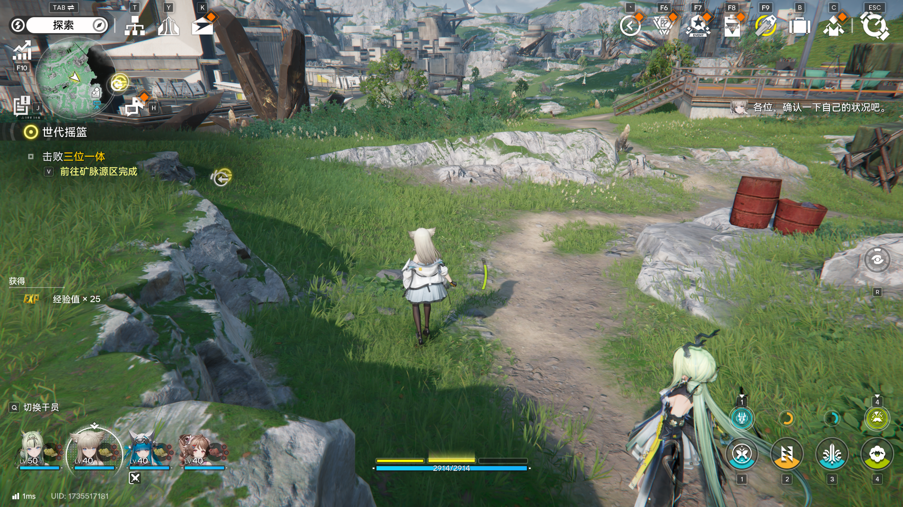
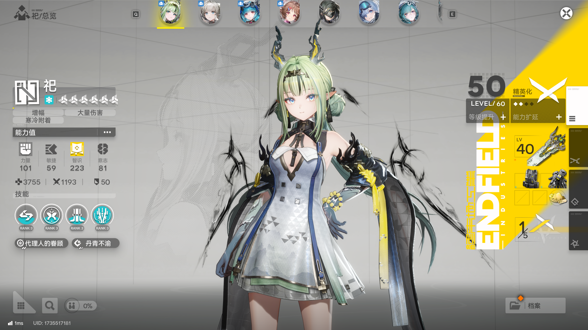

+ [x] 第三人称控制器
+ [x] 简单的 FSM （Idle、Walk、Run）
+ [x] 对象池（代码、SO、示例配置与受控 Play Mode 检查完成，正式音频素材待配置）
+ [x] 属性系统（攻击、生命、防御及 Modifier）
+ [x] 简单的 UI（展示血量、角色属性；[详细手动实施方案](简单UI系统设计与实现方案.md)与效果图已完成，代码、预制体、Unity 编译与场景验收待手动实施）

+ [ ] 核心战斗系统
+ [ ] 设计模式
