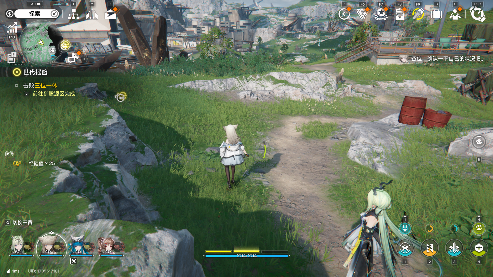

+ [x] 第三人称控制器
+ [x] 简单的 FSM （Idle、Walk、Run）
+ [x] 对象池（代码、SO、示例配置与受控 Play Mode 检查完成，正式音频素材待配置）
+ [x] M1.1 Stats 阶段收尾。19 项属性、固定派生公式、来源词条与变化通知已交付。[技术设计与验收](./M1.1%20StatSystem%20详细技术设计.md#阶段验收)
+ [x] 角色属性面板。[CombatDemo](../Assets/Scenes/CombatDemo.unity) 展示 7 项图标摘要和 12 项文字详单，[StatsDemo](../Assets/Scenes/StatsDemo.unity) 演示木剑穿脱与角色切换
+ [ ] 血量 HUD 接入 Resources 的当前生命，与 Stats 的 MaxHP 联动

+ [ ] 核心战斗系统
+ [ ] 设计模式
+ [ ] 动画编辑器
+ [ ] 可攻击对象使用 IDamagable 接口
+ [ ] 攻击过程中设置播放速度
