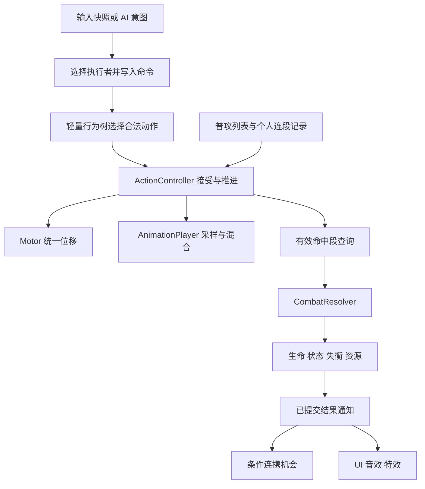
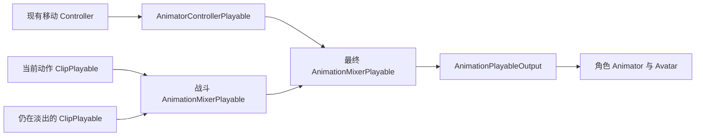

# 战斗系统具体实现方案

创建日期：2026-11-13

适用项目：`D:\CODE\Unity\Projects\ArknightsEndfield`

文档状态：实现设计完成，部分玩法细节待讨论；本次未写入运行时代码，未执行编译、Unity 场景或构建验证

配套文档：[战斗系统完整规划](战斗系统完整规划.md)、[战斗系统阶段性实施规划](战斗系统阶段性实施规划.md)

## 1. 本次设计的范围与决定

本文把已讨论的玩法落实为数据、职责、调用顺序、接入步骤和验收案例，重点细化动作、普攻接招和插入闪避/战技后的续段，同时明确后续两人小队、技能、结算的接入方式。本文不提供 C# 实现，不把设计完成计为功能完成。

### 1.1 用户已经确认

| 编号 | 决定 | 实现含义 |
| --- | --- | --- |
| D1 | 保留终末地核心机制，做适合当前项目的简化版本 | 先完成一条资源与角色配合路线，不以逐项复刻原作为验收条件 |
| D2 | 两人同场 | 两个独立单位各自执行动作，玩家只直接操控其中一个 |
| D3 | 闪避或战技后，短时间内可以继续下一段普攻 | 连段记录与当前身体动作分开，结束旧攻击时可以保留连段记录 |
| D4 | 接招窗口内，输入匹配成功就立即进入下一招 | 每帧检查，成功接受后当帧切换逻辑动作，不预约到固定衔接点，也不等待旧动画完整结束 |
| D5 | 战斗动画采用 Playables，移动保留现有 Animator Controller | 每个角色独立持有动画图，移动 Controller 与战斗 Clip 在图内混合，Animator 作为统一输出目标 |

“普攻连段”表示同一角色的连续普攻；“条件连携”表示满足条件后开放的一次技能机会，两者不共用同一份运行时进度。

### 1.2 沿用总规划的基线

- 从 P1 继续，P2 达成单角色双向战斗 M1，P4 达成两人配合 M2，P5 做复用和构建验证
- 轻量行为树负责选择动作，ActionController 负责动作生命周期，CharacterMotor 统一提交位移
- 保留 Idle/Walk/Run FSM，继续使用现有输入管理器、自定义相机、三属性、生命和表现对象池
- AnimationPlayer 负责 PlayableGraph、片段采样和混合，ActionController 继续负责动作时间、窗口和结束规则
- 队伍共享 SP，角色分别拥有生命、个人能量和冷却；队友第一版不自动消耗 SP
- 一个角色同一时刻只有一个主要身体动作，不同角色可以同时行动
- P1 一个普攻，P2 至少两段普攻，末段标记为重击；不提前建设分支连招编辑器

### 1.3 推荐默认值与尚待确认的规则

用户在讨论到下表内容时转而要求编写实现方案，因此这些内容仍是推荐方案，不能记为已确认。实现相关分支前继续核对；不影响已确认的窗口内立即接招流程。

| 编号 | 待确认问题 | 本文推荐方案 | 影响位置 |
| --- | --- | --- | --- |
| R1 | 什么时机算某段普攻已打出 | 最后一个有效命中段结束时推进续段记录，空挥也算；此前取消仍从本段重新开始 | 第 7 节 |
| R2 | 续段时间从何时计算 | 离开普攻后开始倒计时；合法插入的闪避/战技期间暂停剩余时间，动作结束后继续；反复插入不补满时间 | 第 7 节 |
| R3 | 输入与续段期限 | 普攻输入缓冲先试 0.15 秒，续段保留先试 0.8 秒，均为游戏时间 | 第 5、7 节 |
| R4 | 受击与控制权切换如何影响段数 | 普通受击重置；切换只清玩家待消费输入，各角色保留自己的段数并正常到期 | 第 7、10 节 |
| R5 | 普攻按键方式 | 第一版一次按下产生一个请求，长按自动普攻后续另行决定 | 第 5 节 |
| R6 | 队友生存与避让 | 队友同样受伤、死亡；先跟随和普攻，不提供自动无敌或复杂闪避 AI | 第 10 节 |

动作时长、取消窗口、位移距离、无敌时间、资源收益和伤害倍率属于素材适配与调试参数。本文示例只用于说明逻辑。

## 2. 当前工程基础与需要改动的位置

以下为 2026-11-13 源码核对结果，本次没有重新进行 Unity 运行验证。

| 现有位置 | 已有能力 | 本方案的接入方式 |
| --- | --- | --- |
| [GameInputManager](../Assets/Scripts/Input/GameInputManager.cs) | 唯一运行时输入资产，Move/Look/Run 快照、光标捕获和失焦处理 | 增加按下沿与战斗输入有效性，保留捕获当帧不产生玩法输入 |
| [ButtonInput](../Assets/Scripts/Input/ButtonInput.cs) | 按下、松开和持续按住读取 | 普攻首版使用按下沿，不用每帧 IsPressed 重复写命令 |
| [PlayerController](../Assets/Scripts/Character/PlayerController.cs) | 读取输入、移动 FSM、Motor 调用、直接写 Animator 参数 | P1 保留移动计算，参数统一交给新增 AnimationPlayer，按第 6.2 节编排动作、移动和动画求值 |
| [CharacterMotor](../Assets/Scripts/Character/Movement/CharacterMotor.cs) | 平滑速度、转向、重力和 CharacterController.Move | 合并普通移动、动作位移与击退后单次提交，不能再额外调用一次旧 Tick |
| [Combatant](../Assets/Scripts/Character/Combatant.cs) | 每个单位独立 Stats 和 Health | 作为命中目标与角色数据入口，按需加入阵营引用，不改成万能控制器 |
| [CharacterHealth](../Assets/Scripts/Character/Stat/CharacterHealth.cs) | 扣血、治疗、生命变化与死亡事件 | CombatResolver 计算最终伤害后调用，死亡通知关闭动作与判定 |
| [CombatFeedbackPlayer](../Assets/Scripts/Presentation/CombatFeedbackPlayer.cs) | 池化音效、粒子与 PlayHit 入口 | 订阅已提交命中结果，使用实际命中位置播放 |
| CombatDemo、Player.prefab、TrainingDummy.prefab | 控制器、玩家与属性木桩已有工程资产 | 在现有场景和预制体接入，不为阶段复制一套目录 |

当前没有 ActionController、AnimationPlayer、普攻命中链路、队伍资源、连携或失衡运行时实现。本轮查看时 Assets/Scripts/UI 已有三个 UI 脚本；本次不重新验收 UI，也不把文件存在当作 UI 工作包已经通过场景验收，实际接入顺序仍遵循阶段规划。

## 3. 职责与最小数据流

| 逻辑对象 | 拥有的数据 | 关键操作 | 初次接入 |
| --- | --- | --- | --- |
| CombatInputBuffer | 一个角色最近的待消费动作命令与有效期 | Write、Peek、Consume、Clear | P1 |
| BehaviorController | 行为树及正在运行的节点 | 读取意图、提出动作请求、保留 Running 节点 | P1 |
| ActionController | 当前动作实例、动作进度、窗口、命中段记录 | Tick、TryStart、Cancel、Finish | P1 |
| AnimationPlayer | 每角色独立的图、移动 ControllerPlayable、战斗片段节点与混合权重 | 初始化、设置移动参数、播放动作、同步采样时间、求值与释放 | P1 |
| 普攻连段记录 | 当前角色的可续段索引、是否有效、剩余期限 | 查询下一段、在规定时机推进、保留、重置 | P2，先作为 ActionController 的小型数据结构 |
| HitDetection | 命中查询所需参数 | 从碰撞体找到 Combatant、过滤阵营、提交候选命中 | P1 |
| CombatResolver | 无长期角色状态 | 统一结算伤害与命中结果 | P1 |
| PartyController | 两个成员、控制对象、共享 SP | 切换、命令路由、检查并扣除 SP | P3 |
| ComboController | 条件连携机会 | 开放、到期、查询、消费 | P3 |
| EffectController / StaggerController | 活动效果与敌人失衡状态 | 刷新、到期、积累、恢复、处决占用 | P4 |

表中的操作名是实现契约，不要求各建接口。P1 不创建 P3/P4 的空组件，不创建全局事件总线或通用动作解释器。普攻列表选择由动作执行器内部直接调用即可。

## 4. 配置与运行时数据

### 4.1 动作配置

P1 使用 AttackAsset。动作的共同字段放在可序列化的 ActionSettings 数据中；闪避复用这份数据结构，P3 的 SkillAsset 再组合它。暂不建立多层资产继承关系。

| 数据 | 字段含义 | 约束 |
| --- | --- | --- |
| 动画 | Clip、BlendInTime、BlendOutTime | 一段动作对应一个非循环 Clip，直接交给 Playables；战斗配置不保存 Animator 状态名或 Trigger |
| 动作速率 | PlaybackRate | 开始时确定，首版动作中途不动态修改攻速 |
| 命中段 | SegmentId、Start、End、形状偏移/尺寸、倍率 | P1 只用一个命中段和一种形状，P2/P3 按实际技能增加 |
| 接招窗口 | ComboOpen、ComboClose | 固定普攻的窗口安排在最后命中段之后，关闭边界不包含在窗口内 |
| 取消窗口 | 可取消到的动作类别及起止时间 | 闪避、战技分别配置；优先级不能绕过此条件 |
| 移动规则 | 普通移动倍率、转向权限、动作前移参数 | 初期选择适配现有素材的原地/代码前移动作 |
| 防护窗口 | 无敌、霸体的起止时间 | 两者独立，不用一个 IsInvincible 代表全部防护 |
| 表现 | 可选 AudioAsset、ParticleEffectAsset | 表现配置不决定是否已经命中 |
| 普攻附加信息 | 是否末段重击、资源收益 | P3 才实际结算共享 SP |

命中、接招、取消和防护窗口统一用动画片段时间轴上的秒，范围在 0 到 Clip 长度之间。动作进度只由 ActionController 按游戏 deltaTime 乘 PlaybackRate 推进，AnimationPlayer 把该进度写入战斗 Clip 的采样时间。混合时长、输入缓冲、续段期限和冷却使用游戏秒，不再乘动作倍率；暂停时这些时间均停止，具体更新约定见第 6.6 节。

总时长由 Clip 长度与倍率得到，不再另维护一份互相可能不一致的 Duration。Animator 全局速度保持 1；移动状态的 PlaybackRate 参数仅写入图内的 AnimatorControllerPlayable，战斗播放不覆盖它。

### 4.2 普攻列表

每个角色的战斗组件直接引用有序的 AttackAsset 列表，第一版为 Attack01、Attack02，Attack02 标记为末段重击。以后增加第三段只调整列表与资产，不复制控制流程。

P1 只有 Attack01，暂不开启普攻衔接，只验证单次动作与有限期输入；P2 增加 Attack02 后才启用列表内的接招窗口。

正在普攻时，下一段由当前动作的列表索引决定；普攻结束或被合法插入动作后，再从个人续段记录决定起手索引。末段之后，新输入可以开始新一轮 Attack01，每轮末段都需要重新完成前序动作。

现在不需要额外的 ComboTreeAsset。出现轻/重击分支、方向派生等真实需求后，再把“选择下一段”替换为分支查询，输入、执行器和命中系统继续复用。

### 4.3 当前动作与续段记录

| 运行时对象 | 最少需要保存的内容 |
| --- | --- |
| CombatCommand | 命令种类、输入来源、执行者、目标意图、生成时间、到期时间 |
| ActionInstance | 本次实例编号、定义、执行者、目标、当前/上一进度、普攻索引、结束原因 |
| 命中记录 | 本动作各 SegmentId 已成功命中的 Combatant 集合，以及已发放的一次性资源收益 |
| BasicComboProgress | 可续段索引、有效标志、剩余保留时间；属于当前角色 |
| 动画播放记录 | 动作实例编号、ClipPlayable、采样时间、当前权重及淡出剩余时间；已失去玩法作用的片段只保留到混合结束 |
| 连携机会 | 技能拥有者、触发结果编号、目标、到期时间、消费状态；P3 再创建 |

命令只表示“玩家想攻击”，不在按键时预先锁死 Attack02。真正接受时根据角色当前动作和续段记录决定播放哪一段，防止闪避、受击或超时后使用过期的段数。

SO 不保存上述运行时数据。同一个 AttackAsset 可以供多个角色或敌人使用，各次释放拥有独立实例与命中记录。

## 5. 输入、窗口与每帧检查

### 5.1 输入入口

1. 在现有 Player map 增加 Attack；Dodge 在接入闪避时增加，具体按键遵循总规划，不占用现有 Run
2. 重新生成 EndfieldInputActions，手写管理器使用 ButtonInput 包装
3. GameplayInputFrame 增加 AttackPressed、DodgePressed 和玩法输入是否有效；释放光标、失焦和打开阻断输入的 UI 时清空待消费战斗输入
4. P1 直接路由给玩家，P3 由 PartyController 先决定执行者，再写入该角色的缓冲
5. AI 使用相同语义的请求入口，不查询键鼠，也不直接调用扣血

按 R5 推荐采用按下沿。捕获光标的左键不同时作为普攻。当前 GameInputManager 已经在捕获当帧直接返回，扩展时保留这一行为。UI 工作包若已经手动落地，应在它的实际版本上追加输入，不能用旧管理器覆盖 UI 功能。

### 5.2 缓冲规则

每个执行者先只保留一个待处理动作命令，新命令覆盖旧命令。它表达最近一次动作意图，不缓存一长串普攻。死亡、受击等强制结果直接进入执行器，不挤占玩家输入槽。

同一帧产生多个可操作命令时，建议按合法闪避、技能、普攻的顺序选择一个写入；给另一个队友的技能命令进入另一个执行者的槽，可以同时处理。角色切换优先于本帧战斗命令路由。

Peek 只读取，成功接受新动作时才 Consume。请求暂时不可执行就等待窗口或到期，不在行为树的条件节点中消费。没有可用动作定义、资源不足或目标不合法时，不产生动画、扣费或冷却副作用。

按 R3，输入在生成时间至生成时间加 0.15 秒内有效，到期边界不再有效。示例：0.38 秒按下，0.45 秒开窗，输入仍可接受；0.10 秒按下，0.45 秒开窗，输入已经过期。

### 5.3 接招的 Enter / Tick / Exit

| 时机 | ActionController 的行为 |
| --- | --- |
| 窗口打开 | 允许下一段普攻请求，检查已有有效输入 |
| 窗口期间 | 每帧读取缓冲，选择下一段并验证，成功后立即切换 |
| 窗口关闭 | 停止把新普攻请求解释为本次攻击的衔接 |
| 动作结束或被取消 | 关闭全部旧窗口，结束旧动作的判定与动作位移权限 |

沿用 ARPG 的思路，但职责要明确：其 ComboInputWindowNotify 通过 Enter/Exit 发布开关，OnTickNotify 当前为空；持续检查位于 MeleeAttackState.Tick，MeleeCombatController 查询连招树并开始下一招。本项目把时间窗口归 ActionController 管理，直接调用接招检查，不需要每帧广播“窗口仍然打开”。

如果以后迁入 ARPG 的通知编辑方式，通知可作为时间点的配置来源，运行时仍由同一动作进度执行窗口规则，不能同时存在动画通知与执行器各自控制的一套开关。

## 6. 一次攻击的实际执行流程

### 6.1 动作入口契约

| 操作 | 行为 |
| --- | --- |
| TryStart | 验证当前动作权限、目标和资源，确定动作；成功后消费命令并进入一次 |
| Tick | 推进当前动作进度，得出本帧经过的关键时间点、窗口和运动请求，不重复进入动作 |
| ResolveFrame | 在角色 LateUpdate 按本帧经过的时间点处理命中与行为树请求，成功时立即切换并通知 AnimationPlayer，未切换时处理自然结束 |
| Cancel | 按死亡、受击、闪避、战技等明确原因退出，应用对应的连段保留策略 |
| Finish | 普通动作自然结束时关闭窗口并混回移动，按续段策略保留或重置进度；死亡动作保持终态，不返回移动 |

输入、取消权限、资源验证通过后，才提交“结束旧动作、扣费、消费命令、建立新动作”。必要引用与配置错误在资产检查或启动时发现，不等旧动作已经被停止才尝试修复配置。

### 6.2 与现有帧循环接入

P1 继续由 PlayerController 编排玩家一帧，ActionController 和 AnimationPlayer 不再额外自启 Update 重复计时。P2 的敌人驱动采用同样调用契约；P3 队友 AI 替换意图来源，单位自身的更新仍继续运行。图采用手动求值，时序不依赖另一个自动推进的动画时钟。

1. GameInputManager 在已有执行顺序 -100 产生输入快照
2. 角色驱动读取一次快照/AI 意图，写入命令，调用 ActionController.Tick 推进当前动作并准备窗口信息
3. 移动 FSM 输出普通移动意图，动作输出移动倍率、转向约束和前移请求，Motor 合并后只调用一次 CharacterController.Move
4. 把 MoveAmount、TurnAngle、移动 PlaybackRate 交给 AnimationPlayer；把当前动作进度写入对应 ClipPlayable，相机目标同步
5. AnimationPlayer 更新混合权重并调用一次 graph.Evaluate(deltaTime)，移动 Controller 在这里推进，战斗 Clip 按指定时间采样
6. 在角色的 LateUpdate 阶段，使用本帧已求值的姿态处理命中段与动作选择，具体逻辑时间顺序见第 6.3 节
7. 新动作接受成功时当帧替换逻辑动作，接入新 Clip 并启动混合；若没有新动作且旧动作到达终点，执行自然结束或死亡终态
8. 仅在第 7 步改变了片段连接、采样时间或权重时，AnimationPlayer 补一次 graph.Evaluate(0) 刷新输出，不再次推进动作、移动、混合计时或命中；相机沿用现有 LateUpdate 跟随

同一个角色每帧只推进一次动作时间、消费一次玩家动作请求、提交一次最终移动，并最多进行一次带正 deltaTime 的图求值。刚启动的动作从进度 0 开始，下一帧再推进，不把旧动作剩余帧时长连续灌入多个新动作。补求值只刷新姿态，不能再触发一轮玩法更新。混合时间大于 0 时，新 Clip 的初始权重可以为 0；逻辑已进入下一招，但视觉逐渐过渡。

### 6.3 窗口跨帧与事件顺序

只检查“本帧最终进度是否在窗口内”会漏掉被一帧完整跨过的窗口。执行器同时保存上一进度和当前进度，处理其间经过的命中段、接招窗口与结束点。

接招需要存在同一时刻同时满足：当前动作经过接招窗口、命令已经生成、命令尚未过期。动画窗口换算到本次动作的游戏时间后，与本帧时间区间及命令有效期求交集。输入第一版以采样帧的游戏时间记时，不拿后来才采到的按键补进过去的窗口。

例如，窗口为 0.45～0.70 秒，本帧从 0.44 推进到 0.72：

- 0.43 已写入、0.58 才过期的输入，与经过的窗口有交集，本帧可以衔接
- 到 0.72 才首次采到的输入，不允许倒算成 0.70 前已经按下
- 到 0.44 已过期的输入，不能因补处理窗口而重新生效

在本帧处理少量相关时间点即可，不建立通用事件调度框架。先确定请求最早合法的时间，再按时间顺序处理旧动作到该处的必要命中/阶段结果；如果角色仍存活且请求仍合法，再接受转换，并停止处理旧动作之后的时间点。不能先把整段旧动作未来命中全部结算，再响应发生在前面的闪避。

同一时刻强制死亡/控制优先于普通请求；取消成功后不再处理同一旧动作的后续命中。普攻衔接窗口安排在最后命中段之后，因此普通连段不会提前跳过本段必要的命中阶段。

跨帧窗口补处理只保证逻辑事件不遗漏。空间查询使用本帧可获得的姿态，不能据此声称重建了历史运动轨迹；首版近距离判定按场景验收，实际出现高速位移漏判时再增加扫掠。

### 6.4 立即接招示例

攻击 1 片段时长 0.8 秒，倍率 1；命中段为 0.20～0.30，接招窗口为 0.45～0.70。以下是示例配置。

| 时间/事件 | 执行结果 |
| --- | --- |
| 0.00，接受攻击 1 | 创建新实例，播放动画，清空本次命中记录 |
| 0.20～0.30 | 对合法目标进行命中查询，本段每个目标成功结算一次 |
| 0.38，玩家再次按普攻 | 写入短期缓冲，攻击 1 继续 |
| 首次经过 0.45 | 缓冲仍有效，选中攻击 2，消费输入，结束攻击 1 并启动攻击 2 |
| 攻击 2 启动后 | 进度从 0 开始，旧攻击的窗口、回调和命中记录不能作用于新实例 |
| 另一轮在 0.55 才按普攻 | 窗口内直接接受并切攻击 2，不等待 0.70 或 0.80 |
| 整个窗口无有效输入 | 攻击 1 到 0.80 自然结束，按第 7 节决定之后的起手段数 |

不保存“已预约攻击 2，等待固定播放点”的状态。输入存在缓冲不等于下一招已经被接受。

窗口关闭后才采到的普攻可以继续短期缓存，但不能借它取消旧攻击；如果到旧攻击自然结束时仍未过期，再作为一次新的起手请求读取个人续段记录。应区分“在旧窗口内立即接招”和“旧动作自然结束后的续段”，后者仍遵守 R1～R3 最终确定的规则。

### 6.5 Playables 动画图与职责

每个角色只建立一个 PlayableGraph，并用一个 AnimationPlayableOutput 输出到该角色的 Animator。保留现有移动 Controller 资产与 Idle/Walk/Run Blend Tree，通过 AnimatorControllerPlayable 接入图；战斗片段通过 AnimationClipPlayable 接入动作混合器。

Unity 提供了用 AnimationMixerPlayable 混合 AnimatorControllerPlayable 与 AnimationClipPlayable 的示例，采用这一路径可以复用现有移动动画。[Unity Playables 示例](https://docs.unity3d.com/6000.0/Documentation/Manual/Playables-Examples.html)

最终混合器的移动与战斗权重相加为 1；动作混合器内部有片段时，其有效权重也归一化。普通移动时战斗权重为 0，战斗全身动作稳定播放时为 1，进入/退出期间按配置变化。第一版全身混合即可，不提前增加 AvatarMask、上半身分层或独立通用动画状态机。

AnimationPlayer 是具体组件，不建立额外接口体系。它接收动作实例编号和动画配置，维护片段节点；不判断是否有 SP、是否允许接招，也不通过动画完成回调直接启动下一招或判定死亡。

| 入口契约 | 具体职责 |
| --- | --- |
| Initialize | 从角色驱动初始化一次，创建图、移动 ControllerPlayable、两个混合器与输出 |
| SetLocomotion | 把 MoveAmount、TurnAngle、PlaybackRate 写入图内的移动 ControllerPlayable |
| PlayAction | 接受实例编号、Clip 与混合配置，新 Clip 从时间 0 开始，旧片段转为表现淡出 |
| SetActionTime | 仅更新对应当前实例的战斗片段采样时间，不在播放器内推进玩法时间 |
| BlendToLocomotion | 普通动作结束后，把最终权重平滑恢复给移动分支 |
| HoldActionPose | 死亡动作结束后保留末帧和战斗权重，直到重开或单位退出 |
| EvaluateFrame | 更新表现混合计时，手动求值一次，并清理权重归零的旧片段 |
| RefreshPose | 片段切换后以 0 时间求值一次，不更新任何计时或玩法规则 |
| StopPlayback / Dispose | 停止播放并清理临时片段；角色销毁时释放整张图 |

### 6.6 时间同步与手动求值

本方案选择 DirectorUpdateMode.Manual。ActionController 是当前动作时间的唯一来源；AnimationPlayer 的图由角色驱动显式求值，不能同时使用自动 GameTime 推进和手动 Evaluate(deltaTime)。Manual 模式与 Evaluate 的职责见 [DirectorUpdateMode.Manual](https://docs.unity3d.com/6000.3/Documentation/ScriptReference/Playables.DirectorUpdateMode.Manual.html)、[PlayableGraph.Evaluate](https://docs.unity3d.com/6000.3/Documentation/ScriptReference/Playables.PlayableGraph.Evaluate.html)。

具体约定：

1. 当前动作的 ClipTime 每帧只累加一次 deltaTime × PlaybackRate，窗口检查使用该进度及上一进度
2. 战斗 ClipPlayable 的自动时间增量设为 0，每帧用 SetTime(ClipTime) 指定采样位置，求值时不再累加一遍动作倍率
3. 移动 ControllerPlayable 保持正常推进，由 graph.Evaluate(deltaTime) 驱动其状态和 Blend Tree；移动 PlaybackRate 仍沿用现有参考步速公式
4. 混合权重按游戏 deltaTime 变化，不按 ClipTime 计算；暂停时动作、移动动画和混合全部冻结
5. 非循环战斗片段的采样时间限制到 Clip 长度；到达终点由 ActionController 决定回移动或死亡保持，播放器不自行循环攻击
6. 淡出片段首版固定在退出时已采样的位置，只改变表现权重；不再推进旧动作的窗口、位移、事件或伤害

SetTime 可以指定 Playable 本地时间，SetSpeed 控制其自动时间增量；上述“战斗手动指定时间、移动随求值推进”是本项目的实现选择，仍需实际场景验证。[PlayableExtensions.SetTime](https://docs.unity3d.com/6000.3/Documentation/ScriptReference/Playables.PlayableExtensions.SetTime.html)、[PlayableExtensions.SetSpeed](https://docs.unity3d.com/6000.3/Documentation/ScriptReference/Playables.PlayableExtensions.SetSpeed.html)

不以 GetCurrentAnimatorStateInfo、Animator Exit Time 或 Playable.IsDone 决定接招窗口。Animation Event / 自定义通知可提供配置标记或表现提示，但玩法只消费当前动作执行器的进度；旧淡出片段上的事件不能再次提交伤害或改变当前动作。首版不在求值回调中分发战斗命令。

### 6.7 立即接招与动画混合

攻击 1 在窗口内接受攻击 2 时，按以下顺序处理：

1. ActionController 消费输入，关闭攻击 1 的命中、取消和接招窗口，建立攻击 2 的新实例
2. AnimationPlayer 把攻击 1 的片段转为只参与表现的淡出节点，保存退出时的采样位置与当前权重
3. 创建攻击 2 的片段，设置时间 0，依据攻击 2 的 BlendInTime 混入；战斗分支继续覆盖移动分支
4. 混合期间攻击 1 的画面贡献逐渐降低，但只有攻击 2 拥有玩法权限，是否命中由攻击 2 自己的窗口决定
5. 攻击 1 权重归零后，断开连接并销毁该节点；攻击 2 普通结束时按其 BlendOutTime 混回移动

混合时间为 0 时直接切换并释放旧节点。混合尚未结束又发生受击、闪避或下一次接招时，从当前权重继续过渡：保留仍有权重的旧片段，已有淡出期限不延长，原当前片段开始淡出，新片段承接剩余权重。不得为了固定成两个节点而突然丢弃仍有明显权重的姿态。仅保留仍在混合的节点，不缓存历史攻击图或全部技能节点。

从移动混入攻击、从攻击混回移动时也从最终混合器的当前权重开始，避免在过渡中再次打断时先重置为纯移动。片段实例编号与动作实例对应；旧实例的停止请求只能清理自己的节点，不能让后启动的新动作退出。

混合的初始配置可先试 0.05～0.10 秒，以所选动画的接招姿态调整。这是表现调试值，不是额外接招等待时间，也不是新的已确认平衡参数。

### 6.8 图的生命周期与位移

角色驱动在 Awake 中取得依赖后先调用 AnimationPlayer.Initialize，再在 OnEnable 初始化移动参数与普通移动输出。AnimationPlayer 显式引用角色 Animator 和现有移动 Controller 资产；运行时把 Animator 自身的 runtimeAnimatorController 清空，由图内 ControllerPlayable 承担播放，避免业务再沿旧入口驱动另一套控制状态。Prefab 上的 Controller 资产保留用于绑定与编辑，不能删除现有移动资源。

角色启用期间复用同一张图，开始一次攻击只创建所需片段节点。禁用时由角色驱动先取消动作、清缓冲，再调用 StopPlayback，清理战斗节点并停止求值；重新启用时恢复移动参数和权重，不自动恢复被取消的攻击。角色销毁时由 AnimationPlayer.OnDestroy 释放图及全部剩余节点，不能继续使用已经失效的句柄。仅切换玩家控制权不调用这套禁用流程，两名角色的图和动作继续独立运行。

第一版继续关闭 Animator.applyRootMotion，选择已适配的原地动画或由动作提供代码前移。所有水平位移、重力和击退仍由 CharacterMotor 合并后单次提交，PlayableGraph 只负责姿态。

后续若某招需要 Root Motion，应单独设计根位移采样并交给 Motor，同时核对混合权重和手动求值的增量；特别是 RefreshPose 的零时间求值不能再次提交根位移。此轮不恢复运行时步速采样，不增加 Motion Warping，也不把接入 Playables 等同于 Root Motion 已实现。

## 7. 闪避、战技插入与普攻续段

### 7.1 两种记录必须分开

输入缓冲保存“玩家刚才想做什么”，续段记录保存“下一次普攻可以从第几段开始”。结束攻击时可以保留后者，同时彻底清理旧动作的判定、窗口和动画所有权。

例如攻击 1 后插入闪避：当前动作变成闪避，可续段索引为 Attack02。闪避结束后没有新普攻请求就不自动攻击；新的有效请求到来且期限未到，才选择 Attack02。

### 7.2 按 R1 推荐的推进点

本节是待确认规则的具体设计：

1. 普攻开始时，记录当前段索引，但不立即把续段索引推进到后一段
2. 经过最后命中段的结束点后，把续段索引推进一段；空挥也推进
3. 在该点之前取消，续段索引指向本段，之后重新从本段起点播放
4. 末段完成出手后，可续段索引回到第一段，等待新的输入开始下一轮
5. 攻击期间在合法接招窗口选下一段，直接依据当前段索引；无需等待离开普攻后才建立续段记录

P1 原型可先不实现此记录。P2 实现闪避续段前确认 R1，P3 战技沿用已确定的同一规则。

### 7.3 按 R2/R3 推荐的保留时限

离开普攻时建立一次 0.8 秒的续段剩余时间。处于普通移动/空闲时递减；合法插入的闪避/战技期间暂停；恢复普通行动后从剩余值继续。已经暂停的记录再次经历插入动作，不重新补满剩余时间。

例：攻击 1 完成出手后进入闪避，保留 0.8 秒；闪避结束后等待 0.3 秒，再释放战技，剩余 0.5 秒在战技期间暂停；战技结束后 0.5 秒内再按普攻可接攻击 2。期间没有自动攻击，也不保存攻击 1 的播放进度。

这是一种简化的时间取舍，意味着技能本身时长不消耗续段机会；若后续决定采用绝对到期时间，应同时修改本节、数据字段和对应验收，不混用两种计时方式。

### 7.4 结束原因与清理

| 情况 | 当前动作 | 输入缓冲 | 普攻续段记录 |
| --- | --- | --- | --- |
| 成功接下一段 | 结束旧攻击，开始新段 | 消费一次 | 新段接管，待规定推进点更新 |
| 自然结束 | 关闭判定并恢复普通移动 | 未过期的新输入仍可参与下一次合法起手 | 按推荐规则短期保留 |
| 合法闪避/战技插入 | 结束旧攻击，开始插入动作 | 消费插入命令，不保留被覆盖的旧普攻请求 | 按 R1/R2 保留本段或下一段 |
| 普通受击 | 终止旧动作，进入受击 | 清空 | 按 R4 推荐重置 |
| 角色死亡/战斗重开 | 全部结束 | 清空 | 重置 |
| 切换操控角色 | 原单位已接受动作继续 | 清掉切换两端未消费的玩家命令 | 按 R4 各自保存，不复制给新角色 |
| 光标释放/失焦/输入被 UI 阻断 | 已接受动作按游戏时间继续 | 清空玩家待消费输入 | 按既定时间继续，不因 UI 自动续期 |

死亡和重开必须清理属于本角色的连段数据；其他保留行为按最终确认的规则实施。

## 8. 命中、结算与表现

P1 首先实现角色前方一个 OverlapBox 判定，以角色根节点和配置偏移定位，不要求先实现完整武器轨迹系统。锁定目标只影响朝向/选敌，伤害仍须通过实际判定。

1. 从碰撞体找到所属 Combatant，过滤自身、友军、死亡单位
2. 用“动作实例、命中段、目标”检查去重；同一目标有多个子碰撞体也只提交一次成功命中
3. 无敌拒绝整次命中，不附加伤害、状态或失衡；首版拒绝的命中不写入成功集合，窗口内无敌结束后可以再次尝试
4. 读取现有 Attack、Defense，按总规划的 Demo 公式计算伤害，调用 CharacterHealth.ApplyDamage
5. 致死时立即结束目标动作和旧判定；存活时再施加允许的受击、状态和失衡
6. 提交结果事件，资源、条件连携和表现只处理已经接受的结果

首版结算使用总规划中的 `max(0, ATK × Multiplier × 100 / (100 + max(0, DEF)))`，保留浮点，UI 负责显示格式。扩展属性时统一改结算入口，不修改每个攻击脚本。

受击由允许的命中结果产生。霸体只阻止对应控制，仍然扣血；不能让碰撞体先触发受击动画再检查无敌。位移、击退与寻路的期望方向都交给 Motor。

命中结果最少包含执行者、目标、动作实例、命中段、实际扣血、命中位置及是否致死。后续按需要增加失衡/状态结果。结果经局部 C# 事件通知消费者，PlayHit 使用命中位置，不能再把施法者位置固定当作所有命中特效位置。

## 9. 敌人、死亡与第一场完整战斗

P2 增加一个敌人原型，复用 ActionController、HitDetection、CombatResolver 和现有 Combatant。

- 行为树先处理死亡、受击和强制控制，再根据距离选择接近、面向、攻击、恢复
- EnemyAsset 保存感知距离、停止距离、攻击配置与间隔，不复制伤害公式
- 导航提供方向，攻击前摇允许转向到规定时间，实际位移仍由 Motor 提交
- 敌人攻击有可见前摇，玩家可以移出范围或在合法窗口闪避
- 当前玩家死亡判负，敌人全部死亡判胜，BattleSession 停止新指令并展示结果
- 第一版重开使用重新加载 CombatDemo，重新创建生命、命令、动作、效果与队伍资源

动画自动退出不能作为死亡依据。死亡由 Health.Died 通知，先关闭动作/命中，再播放死亡动画。场景重载通过现有场景级对象池销毁表现，不另建复杂全量重置框架。

## 10. 两人小队、技能与资源接入

### 10.1 控制权与角色独立性

P3 的 PartyController 保存成员 A/B、当前操控对象和 SP。切换只改变输入路由、相机目标与 HUD 绑定；不销毁角色，不通过停用整个角色驱动来停止原玩家输入，否则原角色动作也会中断。

PlayerController 中的玩家意图读取与角色自身更新在此阶段分开：被控角色接玩家输入，另一人接 Companion AI；两个单位持续更新自己的动作、生命、冷却和连段。AI 在已有动作不能被替换时等待，不每帧重播攻击。

队友命令明确包含执行者 B 与目标 T。操控 A 时让 B 放技能，验证距离、动作权限、伤害属性和能量归属时都使用 B。A 的动作继续运行。

### 10.2 技能配置与接受流程

SkillAsset 组合动作配置，增加技能类别、SP/能量消耗、冷却、目标条件和命中效果。第一版 A、B 各一个战技，至少 A 一个终结技，B 一个条件连携。

接受流程：执行者存活与可行动 → 目标合法与距离 → 当前动作允许取消 → 资源/冷却/连携机会合法 → 一次提交扣费、机会消费和动作启动。

同帧两个角色都请求战技时按确定顺序处理，后者读取前者扣费后的 SP。资源不足时不抢先打断旧动作。开始后被打断按总规划不返还资源。

| 资源 | 数据归属 | 首版规则 |
| --- | --- | --- |
| HP | 各 Combatant.Health | 沿用现有生命实现 |
| SP | PartyController | 玩家普攻末段有效命中按动作奖励一次，处决奖励一次，战技消耗 |
| 终结技能量 | 各角色技能运行时状态 | 该角色技能成功命中积累，终结技消耗 |
| 冷却 | 各角色对应技能 | 动作接受时开始，暂停随游戏时间停止 |

为明确切换时的资源归属，推荐在普攻接受时记录它是否由玩家直接控制发起：这种普攻切换后继续命中仍有资格发放 SP，队友 AI 新发起的自动普攻不发放。此项作为 P3 的具体建议核对，不按命中当帧相机正在跟随谁临时判断。

### 10.3 条件连携

P3 先监听玩家普攻末段成功命中，开放 B 的连携机会；P4 再改为 A 战技施加状态 X。一次机会记录拥有者、目标、触发结果和到期时间。

UI 只展示机会。玩家发出连携命令后，仍经 B 的动作接受入口；机会有效不代表可以跳过受击、冷却和距离限制。接受后消费一次，目标死亡或到期关闭。命中事件不能直接递归释放 B 的整套技能。

## 11. 状态、Buff、失衡与处决

P4 只先完成以下一条配合，不提前扩展完整元素表：

1. A 战技命中施加单层状态 X，同来源再次施加刷新持续时间
2. 该成功施加结果开放 B 连携；接受连携时重新验证并消费 X，实际命中时产生额外伤害与失衡
3. B 战技首次命中为自身施加 ATK Buff，使用已有 StatModifier，保存目标 Stat 与句柄，到期按句柄移除
4. 攻击和技能成功命中积累敌人失衡值，达阈值时终止敌人普通动作并进入失衡
5. 距离合法的角色可以请求处决，接受时占用目标的一次处决机会；完成时结算一次伤害与 SP
6. 处决完成或失衡超时，存活敌人清零失衡并恢复；死亡则直接关闭全部机会

失衡期间不再累计本轮失衡，两个角色请求同一个处决目标只能接受一个。Buff 的计时和刷新由效果实例负责，属性核心只负责 Modifier 增删。完整效果与处决规则继续以总规划第 8 节为依据。

## 12. 文件、资产与场景接入

### 12.1 按功能新增

| 路径 | 计划内容 | 阶段 |
| --- | --- | --- |
| Assets/Scripts/Input/ | 保留现有输入层，增加 CombatInputBuffer 与命令数据 | P1 |
| Assets/Scripts/Character/Behavior/ | 轻量行为树与角色选择逻辑 | P1 |
| Assets/Scripts/Character/Action/ | ActionController、AttackAsset、ActionSettings、运行时动作与小型连段记录 | P1/P2 按需 |
| Assets/Scripts/Character/Animation/ | AnimationPlayer，管理每角色图、移动参数、动作片段、混合与求值 | P1 |
| Assets/Scripts/Combat/Hit/、Damage/ | 命中查询、伤害结算与结果数据 | P1 |
| Assets/Scripts/AI/、Battle/ | 敌人/队友意图与战斗开始、结束、重开 | P2/P3 |
| Assets/Scripts/Party/、Combat/Skill/ | 两人队伍、技能、资源和条件连携 | P3 |
| Assets/Scripts/Combat/Effect/、Stagger/ | 活动效果、失衡和处决机会 | P4 |
| Assets/ScriptObjects/Combat/Attacks/、Skills/、Effects/ | 对应配置实例，不与运行时脚本混放 | 随功能创建 |

P1 接入 Playables 时创建一个具体的 AnimationPlayer，承担原规划中 AnimationPresenter 的职责，不再同时创建同职责的 Presenter。现有 Input 目录继续使用 Assets/Scripts/Input，不为目录示意图搬动已经使用的文件。任何新文件都不以 P1/P2 命名。

### 12.2 场景配置顺序

1. 复用 Player.prefab 与 CombatDemo，补充 ActionController、AnimationPlayer 和输入引用，保留现有 Combatant、Motor、相机与 Avatar 绑定
2. AnimationPlayer 引用现有移动 Controller；把 PlayerController 中设置 Animator 参数的入口统一转给它，保留移动参考步速公式，再选一段非循环普攻 Clip 直接接入战斗分支，无需新建攻击 Animator 状态或 Transition
3. 建一个 Attack01 资产，填写 Clip、倍率、混合时间、命中段与判定盒；接招窗口先保持未启用，P2 配置第二段时再打开
4. 给已有 TrainingDummy 增加明确命中层与单位映射，使用两个木桩检查独立生命、多个碰撞体与命中去重
5. 接入命中反馈与 HP 显示，提供当前动作实例、逻辑/采样进度、窗口、混合权重、活动节点数、缓冲剩余时间和连段索引的最小调试展示
6. P2 增加 Attack02 和闪避，确认 R1～R5 后调试取消与续段，再完成敌人和胜败
7. P3 增加第二单位、PartyController 与队友 AI，改输入/镜头/UI 绑定，复用同一套动作与结算

P1 以已有原地动画和代码位移为默认接入方向。若选定素材必须使用 Root Motion，应在对应动作接入时明确传给 Motor 的位移来源，不能开启 Animator 自动移动同时再执行代码前移。

## 13. 实施工作包与退出条件

当前简单 UI 工作包的顺序保持不变；完成后进入下面的战斗工作包。没有独立 P0，不提前创建后续阶段空类。

| 对应阶段任务 | 具体工作 | 可检查的交付 |
| --- | --- | --- |
| P1-01 | 增加 Attack 按下沿、输入有效性、有限期缓冲 | 捕获当帧不攻击，一次输入只接受一次 |
| P1-04/P1-05 | 行为树、动作时间窗口、AnimationPlayer 图与手动求值，一个普攻与基础闪避 | 动作只 Enter 一次，移动与战斗平滑混合，结束/取消关闭旧窗口，动画采样与逻辑进度一致 |
| P1-02/P1-03 | 按总规划补操控和锁定，合并动作与普通移动 | Motor 单次移动，动画不自行改变角色位置 |
| P1-06/P1-07 | 一种命中查询、统一扣血、死亡清理和反馈 | 可靠打中木桩，多碰撞体不重复扣血 |
| P2-04/P2-05 | 第二段普攻、立即衔接、闪避取消与短期续段 | 窗口内当帧接受，闪避结束后按规则继续段数 |
| P2 其余任务 | 敌人反击、受击、胜败与重开 | 完成 M1，正常操作能赢也能输 |
| P3-01～P3-09 | 两人独立动作、命令路由、资源、战技和初步连携 | 操控 A 可命令 B，资源与执行者归属正确 |
| P4-01～P4-07 | Buff、状态 X、连携消费、失衡与处决 | 完成 M2 的完整配合路线 |
| P5 | 内容变体、反馈调节、最小回归与开发构建 | 核心流程复用，构建中可战斗并重开 |

用户确认的规则优先；R1～R6 在相关工作包开始前逐项核对即可，不要求为了 P1 一个攻击先定完全部小队 AI 行为。

## 14. 最小验收设计

本节是待执行的验收计划，不是测试结果。逻辑检查使用必要的小型规则测试；动画、判定和相机使用实际场景，不为每个配置字段编写测试。

| 编号 | 场景/输入 | 预期结果 | 验证层级 |
| --- | --- | --- | --- |
| A01 | 窗口前按一次普攻，开窗时仍有效 | 开窗后接受下一段一次 | 规则与 Play Mode |
| A02 | 窗口中按一次普攻 | 当帧逻辑切下一段，不等动画完整结束 | Play Mode |
| A03 | 输入早于窗口且已到期 | 不接下一段，不补发过期输入 | 规则 |
| A04 | 有效旧输入遇到一帧跨过整个接招窗口 | 能按交集规则衔接 | 规则 |
| A05 | 跨过窗口后才采到新输入 | 不把新输入倒填进旧窗口 | 规则 |
| A06 | 输入消费后继续 Tick 多帧 | 不重复开始下一段，不重置进度 | 规则 |
| A07 | 攻击取消后旧通知/待处理命中到达 | 不推进新动作，不产生旧攻击伤害 | 规则与 Play Mode |
| A08 | 同段接触目标多个碰撞体 | 对该单位只成功结算一次 | Play Mode |
| A09 | 同一目标先处于无敌，后在窗口内恢复 | 无敌期不受伤，恢复后可接受本段一次命中 | Play Mode |
| A10 | 出手前插入闪避，再输入普攻 | 按 R1 推荐仍从本段起点开始 | R1 确认后的场景验收 |
| A11 | 完成出手后闪避，期限内/外分别普攻 | 按 R1/R2/R3 分别续下一段/重置第一段 | 对应规则确认后的验收 |
| A12 | 空挥完成出手后插入战技，再普攻 | 按推荐规则可以续段，技能本身不自动发出普攻 | P3，对应规则确认后 |
| A13 | 死亡或重开 | 无残留动作、输入、连段和命中结果 | Play Mode |
| A14 | 操控 A 攻击时命令 B 战技 | 两人分别执行，伤害与能量归 B | P3 Play Mode |
| A15 | SP 只够一次，两人同帧请求战技 | 一个成功，一个拒绝，拒绝方无副作用 | P3 规则与场景 |
| A16 | 切换角色时原角色正在攻击 | 原动作继续，新角色不继承旧玩家输入 | P3 Play Mode |
| A17 | 连携过期、目标死亡、重复按键 | 不重复消费机会或产生额外技能 | P3/P4 规则 |
| A18 | 完成状态、连携、失衡、处决、终结技并重开 | 不靠调试补资源完成整场战斗 | P4 场景、P5 构建运行 |
| A19 | Playables 接入后行走、跑动、停止，再攻击和回到移动 | 原 Blend Tree、参考步速倍率和角色位置正常，过渡不突跳 | P1 Play Mode |
| A20 | 攻击 1 混合到攻击 2，混合中再插入受击/闪避 | 新动作立即获得玩法权限，旧节点仅淡出，稳定播放后没有遗留节点 | P2 Play Mode |
| A21 | 调整动作倍率、暂停/恢复，接招帧触发零时间补求值 | 逻辑和采样进度一致，没有双倍推进、暂停偷跑或重复命中 | 最小规则检查与 Play Mode |
| A22 | 禁用/重启角色、销毁、重开及两角色切换控制 | 生命周期清理正确，重新启用不恢复旧攻击，控制权切换不销毁任一角色图 | P1 生命周期检查，P3 双角色场景 |
| A23 | 死亡片段播到末帧 | 保持死亡姿态，不自行混回移动或循环播放死亡 | P2 Play Mode |

## 15. 本次文档交付记录

- 已完成：实现设计、已确认/待确认规则区分、数据与调用流程、项目接入路径、阶段映射和待执行验收案例
- 同步范围：完整规划与阶段性实施规划中的范围、接招、续段、链接及文档实施记录
- 未修改：Assets、输入资产、预制体、场景、项目设置与用户自行审查的 TODO
- 验证范围：文档内容、UTF-8、表格/围栏、新增本地链接及本轮差异检查；没有 C# 代码可编译，本次不执行 Unity 或 Player 构建

2026-11-13 Playables 修订：确认移动 Controller 与战斗 Clip 的组合，新增 AnimationPlayer、动画图、手动时间同步、混合打断和生命周期设计；同步动作字段、帧流程、场景步骤及 A19～A23 验收计划。Unity API 按官方文档核对，当前仍是设计，尚未执行代码编译、图播放、角色动画或场景验收。

后续先讨论 R1 的段数推进条件和 R2 的计时方式，再按阶段进入实现。具体实现获得授权前，本文保持为设计依据。
