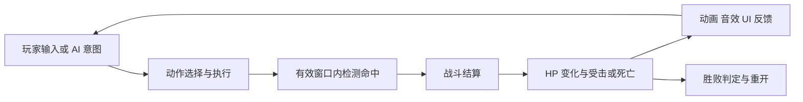
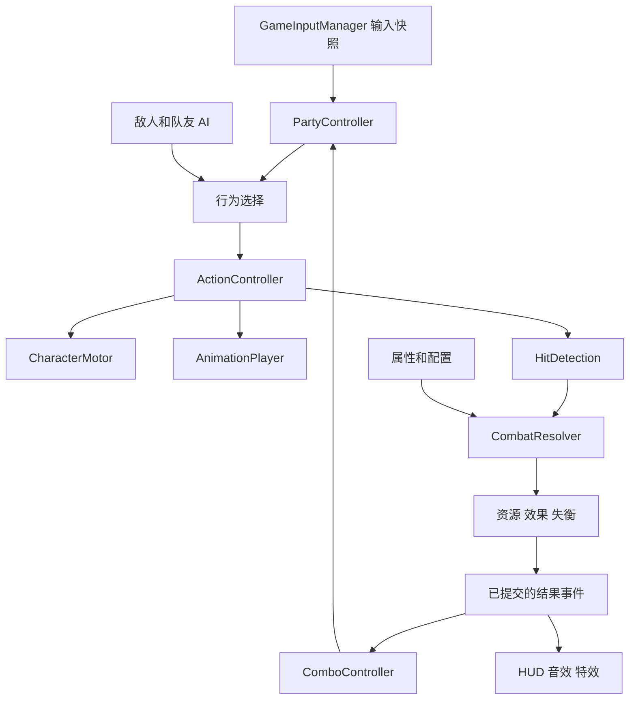

# 《明日方舟：终末地》风格战斗 Demo：完整规划

创建日期：2026-11-11  
适用项目：`D:\CODE\Unity\Projects\ArknightsEndfield`  
文档状态：P1 进行中；基础第三人称控制器已实现、通过 Unity 编译与受控 Play Mode 检查，完整战斗与构建尚未验收。
配套文档：[战斗系统阶段性实施规划](战斗系统阶段性实施规划.md)、[战斗系统具体实现方案](战斗系统具体实现方案.md)、[第三人称控制器与移动状态系统实现方案](第三人称控制器与移动状态系统实现方案.md)、[GameObject 对象池设计与实现方案](GameObject对象池设计与实现方案.md)、[属性系统设计与实现方案](属性系统设计与实现方案.md)、[简单 UI 系统设计与实现方案](简单UI系统设计与实现方案.md)。

## 1. 项目定位与规划原则

本项目是基于 Unity 的第三人称小队战斗 Demo。目标是以有限角色、敌人和场景，完整验证操控、动作、命中、伤害、资源、小队配合、条件连携、失衡与战斗反馈，再从已实现的内容中提炼可复用结构。

官方战斗介绍强调多人同时在场、切换操控、普攻衔接重击恢复技力、失衡与处决以及条件连携。本项目以这些体验作为方向，不推断游戏内部代码或公式。[官方战斗介绍，2026-01-16](https://blog.playstation.com/2026/01/16/arknights-endfield-hits-ps5-on-january-22-new-action-rpg-gameplay-details-revealed/)

本文件中标为“Demo 规则”的内容是本项目的简化设计，不代表原作的精确机制。参考资料的发布日期也不等于当前游戏版本；需要逐项复刻时，在对应功能实施时记录具体版本和可复查的游戏表现。

### 1.1 工作原则

1. 先明确完整目标和模块边界，再按可运行的战斗流程交付。
2. 优先完成当前需要的实现，不先创建整套空类、通用接口或编辑器框架。
3. 行为选择、动作时序、位移执行、战斗结算分别有明确负责人。
4. 玩家、队友和敌人尽量共用动作、命中和结算能力，输入与决策来源不同。
5. 配置资产保存规则，运行时实例保存角色和战斗的实时状态。
6. 玩法命令使用明确调用；已发生的结果通过局部事件通知 UI、表现和连携判定。
7. 一次迭代交付可操作的场景，不以脚本数量或目录完整度作为完成标准。
8. 文档完成、代码完成、编译通过、场景验收和构建验证分别记录。

2026-11-13 用户确认：保留终末地核心机制的简化版本、两人同场、闪避或战技后可在短时间内续接普攻，以及接招窗口内有效输入匹配成功后立即进入下一招。具体数据、调用流程和项目接入见[战斗系统具体实现方案](战斗系统具体实现方案.md)。该方案第 1.3 节的段数推进点、续段计时等仍是待确认建议，不代表本次同时批准了所有细节。

同日确认战斗动画采用 Playables：现有移动 Controller 经 AnimatorControllerPlayable 接入，每个角色由独立 AnimationPlayer 管理战斗 Clip、混合和图输出。此项当前仅完成设计，未修改控制器代码或角色资产。

### 1.2 当前工程事实

以下内容来自 2026-11-11 的工程检查；控制器运行验证范围见配套方案第 9 节，不能扩大为完整战斗验收。

| 项目 | 当前情况 | 规划处理 |
| --- | --- | --- |
| Unity | `6000.3.28f1` | 沿用现有版本，不为本 Demo 主动升级 |
| URP | manifest 声明 `17.3.0` | 使用现有渲染管线 |
| Input System | manifest 声明 `1.20.1` | 使用现有包与输入资产，实施时核对绑定 |
| AI Navigation | manifest 声明 `2.0.16` | 用于敌人和队友寻路 |
| Test Framework | manifest 声明 `1.6.0` | 用于必要的纯规则与生命周期测试 |
| 相机 | manifest 已声明 Cinemachine 3.1.7 | P1 首个控制器工作包使用自定义相机；已有包可以保留，运行时不依赖 Cinemachine |
| 场景 | 已有 `Assets/Scenes/CombatDemo.unity` | 直接在现有场景配置控制器验证区域 |
| 角色与动画 | 已有 Si、Phoebe 模型；GreatSword、DualKatana 共 58 段动画已恢复原始 FBX 和源 Avatar，两个 Origin Controller 引用已迁移 | 按控制器方案通过 FBX 导入设置核对根运动；原 Root Motion Node 为 root，调整 Bake 前需解除覆盖，资源恢复不等于运行适配完成 |
| 自定义玩法代码 | 已实现输入框架、三状态 FSM、CharacterController 移动、自定义相机和动画步速校准；尚无战斗实现 | 从当前控制器继续 P1，按实际需求接入动作、判定和伤害 |
| Docs | 已有完整规划、阶段性规划及控制器实施方案与验证记录 | 两份总规划管理范围，控制器方案细化当前工作包 |
| 版本管理 | 当前已存在 Git 仓库，含既有素材迁移等未提交改动 | 保留已有工作，本轮未提交或发布远程仓库 |

依赖版本来自 `Packages/manifest.json`，不构成包已成功解析或互相兼容的运行证据。

## 2. 最终交付范围

### 2.1 两个主要里程碑

| 里程碑 | 目标 | 必须能体验到的内容 |
| --- | --- | --- |
| M1：基础战斗原型 | 验证单角色动作与双向战斗 | 玩家移动、攻击、闪避；敌人追击、预警、攻击；双方受伤与死亡；胜败与重开 |
| M2：小队特色 Demo | 验证协同和战斗资源循环 | 两人同场、切换操控、队友行动、共享技力、战技、终结技、条件连携、状态配合、失衡与处决 |

开发直接从 P1 的角色操控与首次命中开始，工程和素材条件随具体功能按需补齐。P2 完成 M1；P4 完成 M2；P5 完成内容复用验证、表现整理和最终交付。脚本与资产按功能组织，各阶段沿用同一批可复用文件。

P1 首个工作包先完成第三人称控制器与 Idle、Walk、Run 移动状态系统，随后补齐本阶段其余功能。首个工作包通过不等于 P1 完成，不恢复独立 P0 准备阶段。

### 2.2 最终必需内容

- 一个小型战斗场景，包含开阔区、障碍物和用于移动验证的坡面或台阶。
- 两名具有不同战斗职责的角色，可以使用相同模型和基础动画制作占位版本。
- 一个正式敌人原型：追击、带前摇的攻击、攻击后恢复、受击、失衡、死亡。
- P5 新增一个敌人变体，用于验证复用，例如更慢的重攻击或不同攻击范围。
- 第三人称移动、行走/跑动、冲刺、基础跳跃/落地、闪避、自由视角与锁定。
- 至少两段普攻，最后一段作为 Demo 重击节点；不默认另设独立蓄力重攻击。
- 两名角色各一个战技；至少一个可释放的终结技和一个有条件的连携技。
- 一个简化状态配合路线、一个定时 Buff、失衡与处决。
- HP、队伍 SP、角色终结技能量、敌人失衡值、技能和连携可用性的必要 UI。
- 可重复重开的战斗、最低限度的反馈和调试信息。

### 2.3 后续扩展范围

四人完整小队、全部物理异常和法术反应、多个武器类型、完整装备成长、复杂 Boss、多平台输入适配、动作编辑器和独立通用框架属于后续扩展，不是本次 Demo 的完成条件。

开放世界、工业建设、任务、抽卡、联网和完整存档系统不在当前战斗项目范围内。阶段重开使用场景初始配置恢复状态即可。

## 3. 目标战斗流程

### 3.1 基础闭环



### 3.2 小队闭环

Demo 采用以下可配置的配合路线，作为 P3、P4 的共同实现目标：

1. 玩家操控 A，通过普攻末段命中获取队伍技力，并积累敌人失衡。
2. A 消耗队伍技力释放战技，命中后施加状态 X。
3. B 的连携条件由这次状态施加事件满足，显示短时间可释放提示。
4. 玩家命令 B 释放连携；B 在自己的动作执行器中执行，消耗目标的状态 X，产生额外伤害与失衡。
5. 技能成功命中为对应角色积累终结技能量；能量达到要求后可释放终结技。
6. 敌人失衡值达到上限后进入失衡窗口；玩家在距离和状态允许时执行处决，获得伤害与技力收益。
7. 若未击败敌人，失衡结束后回到普通战斗；击败敌人或全队死亡则结算并允许重开。

这是本项目的示例规则。P3 先用“普攻末段命中”触发 B 的连携，P4 再接入“状态 X 施加”条件，保证开发阶段之间没有未实现依赖。

### 3.3 默认操作设计

输入语义应先于具体按键确定。以下为键鼠候选绑定，在 P1 接入输入资产时记录当前所需操作，后续功能逐步扩展；可调整但不得让同一上下文的操作互相冲突。

| 操作 | 候选绑定 | 说明 |
| --- | --- | --- |
| 移动、视角 | WASD、鼠标移动 | 相机相对移动 |
| 行走/跑动 | WASD 默认行走，按住 Left Shift 跑动 | 已接入 Run 输入；与后续独立 Sprint 冲刺区分 |
| 跳跃、冲刺、闪避 | Space、Left Ctrl、闪避键待定 | 三者独立；闪避不得复用已用于 Run 的 Shift |
| 普攻 | 鼠标左键 | 支持有限时间的连段输入缓冲 |
| 锁定、切换目标 | Tab、鼠标滚轮 | 无目标时可使用自由攻击 |
| 切换角色 | 1、2 | 仅切换到存活且可控制的角色 |
| 当前角色战技、队友战技 | Q、E | 必须明确动作实际执行者 |
| 当前角色终结技 | R | 消耗该角色能量 |
| 连携、处决 | F、V | 使用不同命令，避免优先级歧义 |
| 角色属性面板 | C；Esc 或 × 关闭 | UI 工作包计划接入，打开时释放光标并停止玩法输入，游戏时间继续运行 |

当前输入资产为 Player/Move、Look、Run 和独立 Control map 的光标控制输入，按用户决定使用 Left Shift 跑动；保留现有 Run 绑定 `<Keyboard>/shift`，该合并控制也响应 Right Shift。保留 UI map，尚无 Sprint 动作。后续接入冲刺/闪避时，新增 Sprint 并绑定 Left Ctrl，闪避键另行确定，避免与 Run 冲突。Escape 释放光标并暂停操作输入，点击 Game 视图重新捕获；上述首轮输入规则已实现。

首轮即建立参照 ARPG Demo 的项目输入层：生成 EndfieldInputActions，场景唯一 GameInputManager 拥有运行时资产，通过 InputBase / ValueInput / ButtonInput 统一启停与读取，在采样时完成移动方向的死区与归一化处理，再生成 GameplayInputFrame，PlayerController 直接读取该快照。Player map 本轮只启用 Move/Look/Run，独立 Control map 保留光标捕获/释放操作；管理器先于角色 Update，不随角色启停销毁。按键名不进入玩法接口，不引入单例基类、动态交互注册或事件中心。自定义长按/多击、跨场景持久化、角色控制权分发与战斗命令缓冲在对应需求接入时实现。

项目级 Project-wide Actions 保持未指定，`InputSystem.actions` 为 null；输入资产仅作为生成类的数据来源，由 GameInputManager 创建、启停并释放运行时实例。`EditorBuildSettings` 不再注册 `com.unity.input.settings.actions`，避免 Unity 自动启用另一份资产。UI 接入时明确使用的资产与启停入口，不重新引入隐式的第二条玩法输入路径。

简单 UI 的接入规则：Control map 新增 ToggleCharacterPanel，C 切换属性面板；Esc 优先关闭已打开的面板，否则沿用释放光标行为。面板打开期间屏蔽左键捕获，关闭时恢复打开前的捕获状态并清空当帧玩法输入；失焦后取消自动恢复捕获。InputSystemUIInputModule 绑定 GameInputManager 创建的同一份运行时资产，仅使用 UI/Point 和 UI/Click。具体代码与配置见[简单 UI 方案](简单UI系统设计与实现方案.md)，当前手动实施进行中，验证状态以该文第 10 节为准。

## 4. 架构与数据归属

### 4.1 核心模块

下表是逻辑职责划分，不要求每一行立即变成独立程序集或多个脚本。

| 模块 | 拥有的数据 | 提供的能力 | 不负责的事情 |
| --- | --- | --- | --- |
| BattleSession | 参战单位、战斗状态、初始配置 | 开始、胜败判定、重开 | 不直接实现攻击、伤害公式 |
| GameInputManager / InputBuffer | 输入资产生命周期、操作快照、后续命令及有效期 | 统一启停/采样、移动方向死区与归一化；战斗接入时再缓存与消费命令 | 不直接扣血、移动角色或判断战斗动作是否合法 |
| PartyController | 队伍成员、当前操控角色、队伍 SP | 切换控制、路由队友命令、资源消费 | 不接管每名角色的动作计时 |
| BehaviorController | 行为树运行上下文 | 根据意图和合法条件选择行为 | 不写 HP，不直接修改 Transform |
| LocomotionStateMachine | 当前 Idle/Walk/Run 移动模式 | 根据移动意图选择目标速度，执行状态生命周期 | 不管理战斗动作时序，不直接提交位移 |
| ActionController | 当前动作实例、时间、阶段、取消权限及个人普攻续段记录 | 接受、推进、打断、结束动作，窗口内立即接招 | 不自行实现 UI 或伤害公式 |
| CharacterMotor | 当前运动结果、接地、垂直速度 | 统一执行移动和转向 | 不决定技能是否有资源 |
| Targeting | 当前目标、候选目标 | 搜索、锁定、切换、验证目标 | 不拥有相机和角色动作状态 |
| AnimationPlayer | 每角色 PlayableGraph、移动 ControllerPlayable、战斗 Clip 与混合权重 | 统一播放、手动求值、按动作进度采样与清理节点 | 不决定接招、伤害或角色是否死亡 |
| HitDetection | 本次判定段已命中的目标集合 | 空间查询、阵营过滤、提交命中 | 不直接修改目标 HP |
| CombatResolver | 无长期角色状态 | 验证命中，计算并提交战斗结果 | 不控制相机或播放动画 |
| CharacterStats / Resources | 最终属性、当前 HP、个人能量 | 查询属性、资源变更与通知 | 不包含队伍 SP 的第二份副本 |
| EffectController | 每个目标的活动效果与来源 | Buff、附着、刷新、到期和移除 | 不决定技能输入 |
| ComboController | 连携机会、有效期、已消费事件 | 根据结果开放连携、验证与消费 | 不直接跳过动作规则释放技能 |
| StaggerController | 当前失衡值、失衡窗口、处决占用 | 积累失衡、开放处决、恢复 | 不把所有受击都当作失衡 |
| Enemy / Companion AI | 感知、导航目标、决策上下文 | 提交移动、攻击和技能意图 | 不单独维护一套伤害流程 |
| Presentation / Debug | 表现对象、只读快照、日志 | HUD、血条、反馈、调试展示 | 不通过改字段绕过玩法接口 |
| GameObjectPool | 按 Prefab 分组的场景内 GO 实例、借出状态与空闲容量 | Audio、粒子特效等临时表现的预热、复用、归还与销毁 | 不管理 Buff、伤害结算、资源加载或战斗暂停规则 |

### 4.2 依赖与通信



概念流程允许结果影响下一次决策，但代码依赖不应形成所有模块互相引用的环。命令走明确 API，结果经局部事件或只读快照传播；UI 不参与结算调用链。

初期使用组件引用、构造参数和 C# 事件即可。只有跨场景或多个独立消费者出现实际需求时，才评估统一事件总线。

### 4.3 数据来源规则

- `MaxHP` 属于最终属性；当前 `HP` 属于资源。资源上限读取最终属性，不能维护两份相互失步的上限。
- 队伍 SP 由队伍拥有；终结技能量由各角色拥有；敌人失衡由各敌人拥有。
- 角色死亡由 HP 归零的已提交结果触发，不由 Animator 状态名判断。
- 无敌、霸体、接地等是独立条件，不要求与攻击、闪避做成同一互斥枚举。
- ScriptableObject 只保存定义；命中集合、冷却、HP、效果剩余时间都在运行时实例中。
- 配置中的 ID 用于资源查找；运行时动作实例 ID 用于区分同一种攻击的不同释放。

## 5. 操控、行为树与动作系统

### 5.1 移动与相机

移动使用 CharacterController，相机平面方向作为移动参考。Motor 统一处理重力、接地、台阶、坡面、跳跃、闪避、攻击位移和击退的最终提交。

CharacterController 不会自行响应外力，因此击退通过 Motor 的运动请求实现。[Unity Character Controller 文档](https://docs.unity3d.com/6000.0/Documentation/Manual/class-CharacterController.html)

普通移动第一版采用代码速度驱动：FSM 选择 0/walkSpeed/runSpeed，Motor 平滑速度并在 Update 中执行转向，将水平代码位移与重力合并后通过一次 CharacterController.Move 提交。同一个 CurrentSpeed 驱动动画混合与 Locomotion 播放倍率，不再独立平滑动画参数。PlayerController 直接引用 Animator 并关闭 Apply Root Motion；运行时根步速采样已移除。攻击的位移来源在接入具体动作时确定，同样只能由 Motor 提交；不能让 Animator、导航和动作脚本分别写角色位置。

上述直接写 Animator 是当前已实施控制器的状态。后续 P1 接入 Playables 时保留移动公式、FSM 和 Controller 资产，将参数入口转交 AnimationPlayer 内部的 AnimatorControllerPlayable；战斗 Clip 与移动分支在同一张图内混合，Animator 保留为输出目标，首版仍关闭自动根运动。

walkSpeed/runSpeed 是玩法目标速度，walkReferenceSpeed/runReferenceSpeed 是动画在 1 倍速下的参考步速。当前沿用已保存的 1.31/5.29；新素材通过编辑器 Compute Thresholds → Velocity Z 取得初值并手动配置，随后恢复 0/1/2 混合阈值，结合角色表现调整。稳定 Walk/Run 的倍率为目标速度除以对应参考步速；中间混合段按控制器方案使用线性参考模型并验收。只调整 Locomotion 状态的 PlaybackRate，Animator 全局速度保持 1。素材初值与重定向后的角色步速可能不同，不保证混合、急转、坡面、碰撞情况下完全不滑步。

角色转向由 Motor 使用 SmoothDampAngle 平滑处理，保留角速度状态，默认平滑时间 0.12 秒、角速度上限 720°/秒；松开方向输入和重置移动时清空转向惯性。输入与动画参数不额外添加平滑，移动仍沿当帧角色 forward 执行。

相机负责跟随、自由旋转、距离、遮挡和锁定构图。Targeting 提供目标；角色朝向和相机分别消费该结果。切换角色时更新跟随对象，并清理无效目标。

首个工作包使用 CustomThirdPersonCamera 跟随独立 CameraTarget，完成鼠标自由视角、基础相机避障、代码地面移动、重力、转向与按参考步速调整倍率的三段移动动画。默认镜头位于角色后上方，不采用三层环；相机观察方向与角色自身朝向独立。锁定、跳跃、独立冲刺与战斗动作仍待后续实现。PlayerCameraTarget 管理 yaw/pitch 与移动参考，CustomThirdPersonCamera 在 LateUpdate 通过球形检测收近避障，并平滑恢复距离；完整代码和配置见[控制器实施方案](第三人称控制器与移动状态系统实现方案.md)。

### 5.1.1 首轮移动状态系统

使用小型平级 FSM 管理 Idle、Walk、Run：无移动输入为 Idle，有输入且未按 Run 为 Walk，有输入且按住 Run 为 Run。同一状态不重复 Enter，状态输出目标速度 0/walkSpeed/runSpeed，Motor 只平滑一次 CurrentSpeed。PlayerController 根据该速度映射 MoveAmount=0/1/2 及 PlaybackRate，不使用 SetFloat 的额外阻尼；零速时纯 Idle、倍率为 1。碰撞后的 ActualSpeed 用于诊断，不与代码请求速度混淆。Idle 是无输入意图，允许尚未完成减速。

保留 IGBeginnerFinalDemo 的相机相对世界方向、角色局部方向和 Atan2 转角流程；普通移动改为 FSM 选择目标速度 → Motor 平滑、转向并执行代码位移 → SetupAnimator 写混合参数和倍率 → 更新相机目标。角色沿转向后的 forward 移动，急转形成弧线。当前动画只用 MoveAmount 一维混合；TurnAngle 保留为参数和调试值，匹配的转弯素材到实际需要时再接入。参考工程的三层环、蹲伏、瞄准、跳跃及空中速度缓存不迁入本轮。

这三个状态表示普通移动意图，不是整个角色的互斥战斗状态。本轮先独立实现，不要求提前创建行为树或 ActionController；后续行为树选择行为、动作执行器给出移动限制，普通移动请求与动作请求合成后仅由 Motor 提交。行为树的总体设计保持不变。

### 5.2 轻量行为树

本方案采用轻量行为树进行行为选择，不建设可视化行为树编辑器。动作执行器负责持续动作的时序，行为树保留正在运行的节点。

基本规则：

1. 条件节点只读，不在判断条件时消费输入或资源。
2. 一个命令仅在动作真正接受时消费一次。
3. 返回 Running 的动作不得每帧重新进入或重置时间。
4. 高优先级意图仍需通过动作取消权限检查。
5. 受击意图只能来自已通过无敌、霸体等规则判断的结果，不能由原始碰撞直接触发。
6. 中止和结束必须清理判定、临时运动权限和动作专属条件；重复清理不产生额外副作用。

候选优先关系是：死亡与强制失控、允许执行的受击、合法闪避、已接受的技能或连携、普通攻击、移动。优先关系只解决选择，不替代取消规则。

### 5.3 动作执行与取消

`ActionController` 是当前身体动作的权威来源。每个动作实例至少具有定义、实例 ID、执行者、目标快照或目标策略、当前时间、已触发事件和结束原因。

| 当前情况 | Demo 默认处理 |
| --- | --- |
| 空闲或普通移动 | 允许满足条件的新动作 |
| 攻击前摇或有效判定段 | 禁止另一普通攻击直接覆盖；缓存下一段 |
| 攻击取消窗口 | 允许配置指定的闪避、战技或下一段攻击 |
| 闪避有效段 | 无敌条件独立生效；普通技能不能随意覆盖 |
| 受击或失衡控制 | 根据控制类型限制移动与攻击 |
| 死亡 | 结束所有动作、判定与输入，不接受新动作 |

普通移动可以与某些动作共存，通过动作的移动倍率、转向权限和位移请求表达，不为每种组合创建新状态。

初期不做同一角色的多条身体动作并行。已确认支持战技和闪避后短时间内续接普攻，连段记录属于每个角色自身，与当前身体动作分开；旧攻击被取消时必须关闭判定和窗口，不保留旧动画播放进度，也不因保留段数自动发出普攻。这是 Demo 简化，与另一角色同时释放技能是两件事。

具体在出手前后保留本段还是下一段、续段期限何时递减，以及普通受击是否重置，见[具体实现方案](战斗系统具体实现方案.md)第 1.3、7 节的待确认建议，实施相关分支前继续核对。

### 5.4 动作时间与输入缓冲

Demo 默认以动作执行器中的游戏时间作为动作时序依据，动画速度和播放进度与之匹配。攻击窗口、取消窗口、连段窗口均由同一个进度判断。

Animation Event 可用于音效、特效提示或辅助标记，不单独成为判定关闭的唯一保证。回调必须验证当前动作，旧动作的回调不能推进新动作。

窗口处理检查上一帧到当前帧经过的时间区间，避免低帧率直接跨过整个命中窗口或结束点。输入缓冲记录命令、时间和有效期；过期、死亡、重开和控制权切换按策略清理。

接招采用已确认的立即衔接：窗口打开时检查已有输入，窗口期间每帧检查；匹配成功并通过动作许可后，消费一次输入、结束旧动作并当帧启动下一招，不等待固定衔接点或旧动画完整结束。窗口前的输入只有在有效期内才能被接受。跨帧补处理必须同时满足窗口与输入有效期，不能把窗口结束后才生成的输入倒填进旧窗口。

输入缓冲保存最近一次动作意图，普攻续段记录保存下一次可从哪段开始，两者分别维护。第一版普攻采用有序 AttackAsset 列表，不创建分支连招树；动作执行器直接进行窗口和下一段选择，初期无需每帧广播窗口事件。数据字段、调用顺序、立即衔接案例和验收见[具体实现方案](战斗系统具体实现方案.md)第 4～7、14 节。

所有持续时间默认使用游戏时间。暂停时动作、技能计时、效果和连携窗口一起停止。P5 若加入全局短暂停顿，同样使用统一暂停入口，UI 使用不受暂停影响的时间；不提前实现多层时间缩放框架。

### 5.5 Playables 动画播放

P1 创建具体的 AnimationPlayer，承担原 AnimationPresenter 的播放职责。图结构为移动 AnimatorControllerPlayable 与战斗 AnimationClipPlayable 混合，再经唯一 AnimationPlayableOutput 输出到该角色 Animator；第一版全身混合，不增加分层动画框架。

采用手动图求值：ActionController 推进动作时间并判定窗口，战斗片段关闭自动时间增量，用 SetTime 采样该进度；移动 Controller 经一次 Evaluate(deltaTime) 推进。LateUpdate 接招后必要时补 Evaluate(0) 刷新输出，不重复推进逻辑、混合或命中。具体帧调用契约见[具体实现方案](战斗系统具体实现方案.md)第 6.2、6.5～6.8 节。

立即接招时旧动作的玩法窗口立刻关闭，旧 Clip 可以继续以冻结的采样位置淡出，不能继续造成伤害。普通动作结束混回移动，死亡保持末帧；角色禁用清理战斗播放，销毁时释放图。仅切换控制权不销毁图，两名角色分别保持自己的播放与动作进度。时间同步、混合中再次打断与启停行为均须场景验收，不能以文档或 API 存在替代。

## 6. 命中、伤害与受击

### 6.1 攻击定义

攻击配置至少包含：AnimationClip、PlaybackRate、混入/混出时间、前摇/判定/后摇、取消与连段窗口、伤害倍率、失衡值、判定形状与偏移、位移参数、受击类型以及可选附着。战斗 Clip 直接交给 Playables，不保存 Animator 状态名；总时长由 Clip 长度与动作倍率得到，不另维护一份 Duration。

首先实现一种适合当前动画的 OverlapBox 或 OverlapSphere 判定。只有实际出现高速位移漏判时，再加入上帧到本帧的扫掠判定，不一次实现所有形状。

同一目标有多个碰撞体时，先映射到同一个战斗单位再去重。去重范围为“动作实例＋命中段＋目标”，多段技能可以在不同命中段各命中一次。

### 6.2 结算流程

1. 检查执行者、目标、阵营、存活和本段去重条件。
2. 检查目标的无敌及其他命中许可；Demo 默认无敌同时阻止该命中的伤害、附着和失衡。
3. 读取攻击与目标属性，生成伤害结果。
4. 提交 HP 变化；如果致死，进入死亡流程，跳过新附着和普通受击控制。
5. 对仍存活的目标提交附着、失衡以及允许的受击反应。
6. 发出带执行者、目标、动作和命中段标识的结果事件，再进行资源收益、连携判定和表现。

事件表示结果已经提交。致死命中可以按规则产生攻击方资源收益，但不得让死亡目标继续获得控制或打开处决机会。

### 6.3 第一版数值范围

最初只需要 MaxHP、ATK、DEF 和技能倍率。可采用如下 Demo 公式启动验证：

```text
Damage = max(0, ATK × Multiplier × 100 / (100 + max(0, DEF)))
```

这是测试公式，不是原作公式。最终扣血在一个位置统一取整或保留浮点；UI 只负责显示格式。暴击、抗性和增伤在选定内容需要时再扩展，不先实现完整乘区体系。

伤害结果保留本次倍率、防御折算和最终数值，便于检查，不要求先建立通用表达式系统。

### 6.4 受击与控制

无敌决定命中是否允许；霸体决定已接受命中是否产生对应的受击打断。霸体默认不免伤。

第一版支持轻受击、有限击退和死亡。击飞、倒地以及复杂控制恢复作为后续扩展。敌人是否被轻攻击打断必须由配置确定，不能每次扣血都无条件播放受击动作。

## 7. 小队、技能与资源

### 7.1 控制权切换

两名角色始终作为独立单位存在，各自保留 HP、动作、冷却和个人能量。切换时修改输入归属、相机目标和 HUD 绑定，不销毁或重建角色。

已接受的动作继续在原执行者身上完成；未消费的玩家输入清理，防止新角色继承旧攻击命令。原角色由队友 AI 接管时，AI 必须等待当前动作允许新的决策。

被控角色死亡时自动切换到存活队友；全队死亡判负。相机锁定目标可在有效时继承，但技能执行者、目标距离和技能目标仍需重新验证。

### 7.2 队伍与个人资源

| 资源 | 拥有者 | Demo 获取方式 | 消耗方式 |
| --- | --- | --- | --- |
| HP | 每个战斗单位 | 初始值，必要时治疗 | 已接受的伤害 |
| SP | PartyController | 被控角色普攻末段成功命中、处决收益 | 队伍成员战技 |
| 终结技能量 | 每名角色 | 该角色成功命中的技能，具体值配置 | 该角色终结技 |
| 失衡值 | 每个敌人 | 已接受的攻击和技能 | 处决后或失衡窗口结束时重置 |

普攻末段命中多个敌人时，SP 默认按动作实例只奖励一次；队友自动普攻不产生相同的技力收益，避免队友数量直接放大资源流入。这是 Demo 规则。

资源不足、冷却未结束或动作不允许时拒绝技能请求。动作被接受时统一扣除资源并启动冷却；接受前取消不消耗，接受后被打断默认不返还。共享 SP 的检查与扣除必须在同一接受流程完成。

### 7.3 技能类别

- 普攻：按连段和动作窗口推进，最后一段可提供资源收益。
- 战技：消耗队伍 SP，可有最小释放间隔或配置冷却；不能仅用冷却替代技力循环。
- 连携技：满足条件后开放机会，具有有效期与独立冷却；Demo 默认不消耗 SP。
- 终结技：消耗个人能量；第一版使用普通技能流程加专属配置，不加入复杂演出相机。
- 处决：失衡期间的特定交互，受到距离、动作状态和目标处决占用限制。

### 7.4 条件连携

连携机会至少记录：技能拥有者、触发事件 ID、目标、开放时间、到期时间和已消费状态。

检查目标存活、距离、拥有者状态和冷却后，才接受连携。接受时消费机会；目标死亡或机会到期时关闭提示。一个事件不能反复打开同一机会；多个机会按稳定的优先级展示，第一版可以只存在一个角色的一种连携。

不在处理一个命中事件的过程中递归执行另一项攻击；连携先成为可选择机会，再通过统一命令入口释放。

## 8. 属性、效果、附着与失衡

### 8.1 属性与资源边界

属性工作包已实现攻击、生命、防御及供 Buff 使用的 Modifier，具体代码、配置与验收见[属性系统设计与实现方案](属性系统设计与实现方案.md)。玩家和两个共用配置的木桩已接入 CombatDemo，Unity 编译、编辑模式下 45 项规则断言和 Play Mode 下 43 项受控场景断言通过；未执行 Player 构建或完整战斗验收。Modifier 基础能力从原 P4 提前到本工作包；P4 仍负责实际 Buff 的计时、刷新、技能触发和到期移除。

CharacterAsset 保存三个基础值；Combatant 为每个单位创建独立的 CharacterStats 与 CharacterHealth。CharacterStats 持有攻击、最大生命、防御三个 Stat，每个 Stat 独立拥有基础值、下限与 Modifier 列表并负责计算；CharacterStats 仅组装、查询和汇总变化通知。StatModifier 保存操作、数值和来源，目标由所属 Stat 确定。MaxHP 属于属性，当前 HP 属于资源；生命模块监听上限变化立即同步。Modifier 支持固定值和加算百分比，先计算非负的“基础值＋固定值之和”，再乘非负的“1＋百分比之和”；最终攻击、防御最低为 0，生命上限最低为 1。

Modifier 在目标 Stat 上添加，来源保存目标 Stat 与独立句柄，到期时按句柄移除对应项，不能通过减回某个常量恢复属性。MaxHP 变化时，Demo 默认保持当前 HP 的绝对值并限制到新上限；降低上限不会额外触发一次伤害事件。

本轮属性枚举仅包含 Attack、MaxHP、Defense。完成连招和技能后再按实际需求考虑扩展，不提前增加暴击、抗性、移速、成长或装备系统；不实现通用属性依赖图或全量缓存。

### 8.2 最小效果系统

P4 的初期效果支持添加、到期、移除和同来源刷新，复用属性工作包已有的 Modifier。运行时效果具有定义、来源、目标和剩余时间；首次施加时添加 Modifier 并保存句柄，同来源刷新只更新效果时间，到期按原句柄移除。属性核心本身不计时，也不把相同来源的重复添加自动解释为刷新。

第一版选择一个 ATK 提升 Buff 作为完整生命周期验证对象：B 的战技首次成功命中后为自身施加，同一释放命中多个目标也只施加一次。周期伤害、独立计时的多层叠加、效果驱散等在内容确实使用时添加。

### 8.3 附着与反应

法术伤害类型与附着是独立配置：造成某种伤害不等于必然施加同种附着。附着需要明确类型、层数、来源和持续时间，反应规则需要区分已有附着与新输入。

官方二测说明已经分别描述物理异常的积累/消耗，以及同类法术附着与不同法术附着的处理。这说明不能仅用无序的“元素 A＋元素 B”代替完整规则；实际复刻仍需核对选定版本。[官方二测机制说明，2025-11-01](https://endfield.gryphline.com/en-us/news/1340)

本次必需路线采用简化状态 X：最多一层，有持续时间；A 战技施加，重复施加刷新；B 连携接受时重新验证并消费，额外伤害和失衡在动作实际命中时结算。接受后被打断默认不返还状态。该路线用于验证状态生命周期、来源和连携，不宣称已经完成原作完整元素反应系统。

两种元素和两种反应属于后续扩展。扩展前先完成规则表：已有状态、新输入、触发条件、消耗、结果、来源与连携事件。反应生成的额外伤害默认不再次施加附着，避免意外自循环。

### 8.4 失衡与处决

普通受击硬直和失衡是两个机制。敌人可以受到伤害但保持动作，也可以在失衡值达到阈值后进入强制失衡。

Demo 默认规则：

1. 有效命中向目标积累失衡值，达到上限时只进入一次失衡。
2. 失衡期间中断敌人的普通攻击，开放固定持续时间的输出窗口。
3. 处决必须由存活角色在有效距离内主动请求；接受后锁定该目标的一次处决机会。
4. 处决完成后给予伤害与队伍 SP 收益；目标存活则退出失衡并清零失衡值。
5. 未处决但时间到期也退出失衡并清零；失衡期间不重复积累同一轮失衡。
6. 目标死亡时立即清除机会。两个角色同帧请求处决，也只能有一个请求成功。

具体阈值、持续时间、增伤和收益由配置给出，P4 根据演示流程调节。

## 9. 敌人与队友 AI

敌人第一版只需要感知、接近、面向、攻击、恢复和失去目标后的处理。死亡、受击和失衡通过同一动作和结算能力介入，不另写一套“AI 专用扣血”。

队友第一版支持跟随、选择合法敌人、接近并普攻，以及接受玩家战技或连携命令。自动释放消耗 SP 的战技暂不启用，让玩家能验证资源决策。

导航系统提供路径和期望方向，Motor 执行运动；使用 NavMeshAgent 时需关闭与 Motor 冲突的自动位置/旋转更新，并同步代理状态。受击、闪避和攻击时，导航不得把角色拉回旧位置。

AI 动作必须保留可观察的前摇与后摇；攻击距离、冷却和追击停止距离可以配置。第一版不建设复杂仇恨表和群体战术系统。

## 10. 表现与调试

P1 就提供命中变色或简单命中特效；当前在属性工作包后安排简单 UI 工作包，先制作玩家底部蓝色血条与左侧属性面板，作为 P1-07 的基础显示子项。P2 沿用玩家血条并补齐敌方血条、攻击预警、胜败和重开入口。表现应跟随玩法迭代，不集中到最终阶段才验证。

简单 UI 使用 uGUI 与 TextMeshPro，由 GameUIController 订阅 CharacterHealth.Changed 和 CharacterStats.Changed，分别驱动底部 HealthBarUI 与 CharacterStatsPanelUI。当前生命及比例只在底部 HUD 显示，角色面板只显示名称、最大生命、攻击、防御及最终值相对基础值的变化；UI 不结算伤害、不写入属性。面板打开仅停止新的玩法输入，不改变游戏时间，角色按现有 Motor 规则减速。详见[简单 UI 系统设计与实现方案](简单UI系统设计与实现方案.md)；2026-11-13 手动实施进行中，已按最新需求清理面板当前生命刷新调用，场景与完整 UI 验收待完成。

P3、P4 逐步增加队伍状态、技力、能量、连携可用性、附着和失衡提示。显示不可释放原因，例如资源不足、距离过远或正在受控。

调试界面按阶段增加以下信息：当前操控角色、当前动作及进度、命中窗口、当前目标、最近伤害结果、资源、连携机会和效果。使用 Gizmos 显示判定范围和目标距离即可，不先开发复杂 EditorWindow。

调试命令经正式接口恢复 HP、添加效果或重开；不要让面板直接写入内部字段而绕过事件。伤害数字、音效、镜头震动和短暂停顿在 P5 根据实际反馈补充。

Audio、粒子特效等重复出现的 GO 使用场景级、按 Prefab 分池的复用方案，具体代码与配置见[GameObject 对象池设计与实现方案](GameObject对象池设计与实现方案.md)。池只管理表现实例，`EffectController / ActiveEffect` 仍负责玩法效果。单次播放自然归还，循环表现由拥有者持有句柄并在结束或打断时归还；空闲容量限制不等于播放并发上限。2026-11-12 已完成池核心、AudioAsset / ParticleEffectAsset SO、播放组件与 CombatDemo 配置，通过 Unity 编译及 8 项受控 Play Mode 生命周期检查；正式音频素材与战斗事件尚未接入，不改变 P1—P5 的阶段出口。

## 11. 配置、运行时对象与项目目录

### 11.1 核心数据

| 静态定义 | 对应运行时数据 | 首次需要 |
| --- | --- | --- |
| CharacterAsset | Combatant、CharacterStats 内的三个独立 Stat、各自 Modifier 集合及 CharacterHealth | P1 属性工作包 |
| AttackAsset，组合 ActionSettings | 动作实例、命中段记录；P2 增加个人普攻续段记录 | P1/P2 |
| EnemyAsset | AI 上下文与当前目标 | P2 |
| SkillAsset | 技能冷却与释放实例 | P3 |
| ComboConditionAsset | 连携机会与消费记录 | P3 |
| EffectAsset | ActiveEffect、Modifier 句柄 | P4 |
| StaggerSettings | 当前失衡值、窗口与处决占用 | P4 |
| BattleScenario | 当前战斗状态、出生单位与重开初始值 | P2 |
| AudioAsset / ParticleEffectAsset | 池化音源或粒子实例、本次播放句柄 | 表现对象池已实现；玩法反馈按需接入 |

这些名称是职责示意，实施时可以合并简单结构；不为尚未使用的数据创建空资产。

### 11.2 目录建议

```text
Assets/
  Scripts/
    Battle/
    Character/
      CharacterAsset.cs
      Combatant.cs
      Stat/
        Stat.cs
        CharacterStats.cs
        CharacterHealth.cs
        StatModifier.cs
      Input/
      Behavior/
      Action/
      Movement/
      Animation/
    Camera/
    Combat/
      Hit/
      Damage/
      Skill/
      Effect/
      Stagger/
    Party/
    AI/
    Presentation/
    Pooling/
  ScriptObjects/
    Characters/
    Presentation/
  Game/
    Prefabs/
    Art/
    Animations/
    Audio/
  Scenes/
    CombatDemo.unity
  Tests/
    EditMode/
    PlayMode/
Docs/
  战斗系统完整规划.md
  战斗系统阶段性实施规划.md
  战斗系统具体实现方案.md
  第三人称控制器与移动状态系统实现方案.md
  GameObject对象池设计与实现方案.md
  属性系统设计与实现方案.md
```

目录按实际实现逐步创建。现有 Input Actions 可继续使用；无需为符合目录图移动无关资产。初期最多划分运行时、编辑器和测试程序集，不按每个小模块创建独立程序集。

SO 类型脚本保留在所属功能模块，配置实例统一放在 Assets/ScriptObjects/ 下按用途分类。当前属性工作包将 Stat、CharacterStats、CharacterHealth、StatModifier 集中在工程已有的 Character/Stat/，CharacterAsset 与 Combatant 保留在 Character/ 根目录；目录集中不改变属性与当前生命的数据归属。

### 11.3 初始化、结束和重开

初始化顺序：读取场景配置 → 创建并绑定单位 → 初始化属性与资源 → 绑定队伍/AI/相机/UI → 开启输入与战斗更新。

战斗结束后停止新战斗命令，保留结算展示。重开先停用决策并结束活动动作，再清理临时效果、连携、目标与订阅，最后恢复出生位置、资源和敌人状态。重新载入专用场景可作为第一版重开实现，不必先建设复杂对象重置框架。

对象池落地后，同场景重开在停止产生新表现请求之后调用 `GameObjectPool.ReturnAll()`；场景重载则由池销毁空闲和借出实例，不保留跨场景静态池。战斗全局暂停入口同时协调游戏时间与 `AudioListener.pause`，池本身不修改全局暂停状态。

## 12. 验证与完成标准

### 12.1 必要的规则验证

- 单次输入只启动一次动作；Running 不重复进入；取消只清理一次。
- 同段攻击对多碰撞体目标只结算一次；不同命中段按配置分别结算。
- 一帧跨过窗口时不会漏掉必要逻辑；旧回调不会影响当前动作。
- 无敌、霸体、死亡与受击打断按不同职责生效。
- 队伍 SP 不会因同帧多个请求变负；技能拒绝时不消耗资源。
- 连携事件只产生一次机会；到期、目标死亡和消费后不可再使用。
- Modifier 到期正确移除，失衡和处决收益不会重复发放。

只对当前阶段实际引入的高价值规则编写测试，不要求为每个表现脚本编写自动化测试。

### 12.2 场景验收

每阶段提供从初始场景可重复执行的步骤，包含正常流程和至少一个关键失败流程。检查输入、相机、动作、反馈与资源变化，记录 Console 错误及已知问题。

最终演示必须完整展示：进入战斗 → 普攻获取技力 → 战技施加状态 → 队友连携消费状态 → 失衡与处决 → 终结技 → 胜利 → 重开；另外验证全队死亡的失败流程。

### 12.3 最终交付

交付包含 Unity 工程中的专用场景、角色/敌人预制体、实际使用的配置资产、输入说明、两份更新后的规划文档和验证记录。P5 增加一个 Windows 开发构建并进行启动与完整战斗流程检查；未实际构建时不得将构建标为通过。

## 13. 风险与决策记录

| 风险 | 提前处理方式 | 决策或验证阶段 |
| --- | --- | --- |
| 动画资源不适合动作节奏 | 在动作接入时检查普攻、闪避和受击素材，确定原地动画或 Root Motion | P1、P2 |
| 模块先于玩法膨胀 | 每次交付一个可操作流程，以实际需求增加抽象 | 全阶段 |
| 状态、行为树与 Animator 互相争夺控制权 | 动作时序只有一个权威，位移只有一个提交者 | P1、P2 |
| 队友导航与动作位移冲突 | 导航提供意图，Motor 提交，运行场景验证 | P3 |
| 资源和连携事件重复触发 | 明确实例、命中段、事件和机会的消费边界 | P3、P4 |
| 同时复刻过多机制 | 先完成一条明确配合路线，再扩展机制表 | P4、P5 |
| 只有代码和测试，没有手感 | 各阶段在真实场景检查镜头、距离、时机与反馈 | P1 起 |

P1 实施中记录实际采用的输入绑定、角色素材、动作位移方案、自定义相机参数及遮挡层、最小伤害数值和角色/木桩场景布局。其他规则在对应功能实施时按需记录，不设置独立准备阶段；发现冲突时同步更新两份规划。

当前已完成基础控制器代码、输入/动画资产、角色预制体与 CombatDemo 配置，以及 Unity 编译和受控 Play Mode 检查；不等于 P1 完整完成。人工键鼠手感、完整视觉、坡面/低台阶与 Player 构建尚未验收，Inspector 内部异常已在控制器方案记录。实施任务、运行验收和构建结果以配套阶段性规划中的实际记录为准。
