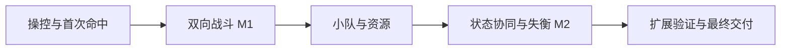

# 《明日方舟：终末地》风格战斗 Demo：阶段性实施规划

创建日期：2026-11-11  
适用项目：`D:\CODE\Unity\Projects\ArknightsEndfield`  
文档状态：P1 进行中；基础控制器已实现并完成受控 Play Mode 检查，完整 P1 尚待实施。
系统规则与范围依据：[战斗系统完整规划](战斗系统完整规划.md)。
当前工作包：[第三人称控制器与移动状态系统实现方案](第三人称控制器与移动状态系统实现方案.md)，代码、资产、预制体与场景已写入工程；具体校准数据和验证边界见该文第 9 节。

## 1. 如何使用这份规划

本文件把完整战斗目标拆成 P1—P5 五个阶段，直接从角色操控与首次命中开始。阶段按依赖关系推进，每个阶段都产出可检查的工程内容或可运行流程。

完整规划负责系统职责、玩法规则与数据归属；本文件负责实施顺序、任务、交付与验收。规则发生变化时，两份文件同步更新，避免阶段任务实现了已经过期的设计。

阶段状态使用“未开始、进行中、待验收、已验收”。代码写完不自动等于已验收；基础控制器已经实现，但 P1 复选框覆盖更大的完整阶段要求，仍保留未完成。各次实际实施及验证记录见第 8 节。

每次实现应明确本次任务编号、涉及文件和验证方式。通常选择一个连贯的行为目标，而不是一次创建某个模块下的所有类。

## 2. 总体路线与里程碑

| 阶段 | 目标 | 依赖 | 核心交付 | 退出条件 | 当前状态 |
| --- | --- | --- | --- | --- | --- |
| P1 | 操控角色并完成首次命中 | 现有 Unity 工程，按需补齐本阶段依赖 | 操控、相机、动作、判定、木桩扣血 | 从输入到伤害反馈贯通 | 进行中（基础控制器已实现） |
| P2 | 完成双向战斗 | P1 | 敌人攻击、连段、闪避、受击、胜败与重开 | 完成 M1：可输可赢的单角色战斗 | 未开始 |
| P3 | 建立两人小队与技能资源循环 | P2 | 切换、队友 AI、共享 SP、技能、初步连携 | 两名角色通过资源和命令共同战斗 | 未开始 |
| P4 | 完成状态配合、失衡与处决 | P3 | 状态 X、条件连携、一个 Buff、失衡与处决 | 完成 M2：小队特色 Demo | 未开始 |
| P5 | 验证复用并完成交付 | P4 | 敌人变体、表现完善、验证记录、Windows 构建 | 最终演示和重开流程通过 | 未开始 |



第一轮先完成 P1 的基础第三人称控制器与 Idle/Walk/Run 移动状态，再补齐相机、动作与首次命中，随后制作 P2 的敌人反击。完整属性、效果和元素系统不作为第一次双向战斗的前置条件。

不预设日历工期。根据 P1 的实际资源、实现速度和验收问题，再估算后续工作量。场景、输入和动画准备随当前功能按需完成，不另设独立准备阶段或实验文档。

## 3. P1：角色操控与首次命中

### 3.1 目标与前置

P1 直接作为开发起点，沿用当前 Unity 工程。完成一个可操控角色和一个可受伤木桩，建立最短的输入—动作—命中—结算—反馈流程。

当前先实施[控制器工作包](第三人称控制器与移动状态系统实现方案.md)：复用 CombatDemo、模型与动画，采用 Idle/Walk/Run FSM、代码速度经 CharacterController 执行位移、按参考步速调整走跑动画倍率、自定义相机跟随/旋转/基础避障，通过独立 CameraTarget 提供移动方向参考。默认 WASD 行走、Left Shift 按住跑动；Run 保留现有 `<Keyboard>/shift` 绑定，与后续独立冲刺区分，闪避键待接入时另定。该包不含输入缓冲、跳跃、冲刺、目标锁定、行为树和战斗动作，不能替代 P1 完整验收。

实施时只补齐当前功能需要的条件：

- 使用现有输入资产，明确移动、视角、普攻、跳跃、冲刺、闪避和锁定绑定。
- 沿用已有角色素材；为本阶段接入待机、移动、一个普攻和闪避动画，其他动作随后续功能加入。
- GreatSword/DualKatana 已恢复为原始 FBX，并迁移两个 Origin Controller 的动画引用；源 Avatar 一并恢复。Root Transform/Bake 设置通过 FBX Animation 页调整，先按控制器方案解除 Root Motion Node 覆盖。此项仅是资源恢复和针对性采样验证，不代表控制器或 P1 已完成。
- 在 `CombatDemo` 中配置地面、障碍和角色，按首个工作包配置自定义相机并记录参数及遮挡层；木桩随首次攻击接入。
- 普通移动由 Motor 在 Update 中平滑代码速度并执行一次 CharacterController.Move，合并重力；同一个 CurrentSpeed 驱动 MoveAmount 和 PlaybackRate。PlayerController 直接引用 Animator，关闭 Apply Root Motion，移除运行时根步速采样；参考速度按控制器方案第 2.4 节在编辑器中配置，当前沿用 1.31/5.29。后续攻击根位移也只能经同一 Motor 提交，接入时重新安排合成时序。

脚本、资产和目录按功能命名，后续阶段继续使用同一场景、输入资产、模型和动画控制器。

本阶段实现基础跳跃、冲刺和闪避动作，但闪避无敌与受击交互在 P2 验证。暂不加入完整敌人 AI、小队和通用 Buff。

### 3.2 组件与数据

P1 完整职责包括项目输入管理、输入方向处理、最小输入缓冲、BehaviorController、ActionController、LocomotionStateMachine、CharacterMotor、动画接入、相机/Targeting、HitDetection、CombatResolver 和 HP。当前控制器工作包使用 9 个手写文件：GameInputManager、InputBase、ValueInput、ButtonInput、PlayerController、三状态 FSM、CharacterMotor、PlayerCameraTarget、CustomThirdPersonCamera；另由输入资产生成 EndfieldInputActions。方向处理已合并进 GameInputManager，PlayerController 直接读取 Frame，并直接引用 Animator 写入 MoveAmount/PlaybackRate。根步速采样组件已删除，不提前拆 AnimationPresenter。其余组件在接入对应功能时创建。

输入层采用 ARPG Demo 的基础包装方式，管理器放在独立 Systems/GameInput，唯一拥有运行时资产、光标及每帧快照。Player/Move、Look、Run 与 Control/ReleaseCursor、CaptureCursor 分开管理；GameInputManager 在每帧采样时完成方向死区和归一化，Dead Zone 为 0.1，不再单独创建 Reader。当前不迁入 SingletonMono、自定义长按/多击、交互 Tick 集合或战斗输入缓冲；功能出口仍是第三人称控制器与 Idle/Walk/Run。

项目级 Project-wide Actions 保持未指定，已移除 `EditorBuildSettings` 中的 `com.unity.input.settings.actions` 注册，仅由 GameInputManager 管理生成类创建的运行时资产。2026-11-12 已在 Unity 编辑模式核对配置清除，当前 Run 绑定与生成类保持不变；本次配置与文档修正不代表新增 Play Mode 或构建验收。

P1 接入战斗时使用一个 CharacterDefinition 和一个 AttackDefinition。首个控制器工作包的少量移动参数先保存在组件中，无需提前创建这些资产。最小伤害输入包含执行者、目标、动作实例、命中段、攻击力与倍率；结果至少包含是否接受、最终伤害与目标剩余 HP。

### 3.3 实施任务

| 编号 | 工作 | 产出与完成依据 |
| --- | --- | --- |
| P1-01 | 输入读取和控制意图 | 一份输入快照与有限期命令，角色脚本不分散查询按键 |
| P1-02 | 相机相对移动与 Motor | 行走/跑动、冲刺、重力、基础跳跃/落地、碰撞、转向 |
| P1-03 | 相机与基础目标选择 | 跟随、自由旋转、距离、遮挡、锁定/解除/切换目标 |
| P1-04 | 轻量行为树与动作生命周期 | 动作进入、Running、完成和中止；只读条件和一次消费 |
| P1-05 | 动画映射与动作时间 | 移动混合、一个普攻和闪避；判定窗口与动作时间同步 |
| P1-06 | 一种空间判定与最小结算 | 同目标多碰撞体去重，木桩扣血并达到死亡状态 |
| P1-07 | 最小反馈和调试 | 血条或 HP 文本、命中提示、动作进度和判定 Gizmos |

当前控制器工作包细化 P1-01、P1-02、P1-03、P1-05 的基础子项，并建立移动状态生命周期、代码位移与动画步速校准链路。包含自定义相机的基础球形检测避障；输入缓冲、跳跃/冲刺、目标锁定、战斗动画与 P1-04 行为树仍未覆盖，完成该包不得将上述整项全部勾选为完成。

### 3.4 实施顺序与调用流程

直接在 CombatDemo 推进：GameInputManager 在 Update 顺序 -100 处理方向并产生快照 → PlayerController 在默认顺序 0 直接读取 Frame → 相机相对世界方向 → 角色局部方向 → Idle/Walk/Run FSM 输出目标速度 → Motor 平滑速度、转向并执行代码位移 → SetupAnimator 写 MoveAmount/PlaybackRate/TurnAngle → 同步 CameraTarget。Animator 关闭 Apply Root Motion，当前没有 OnAnimatorMove 回调。相机使用 CustomThirdPersonCamera + 独立 CameraTarget，在 LateUpdate 检测遮挡并跟随，遇障碍立即收近、离开后逐渐恢复，不采用三层环。之后补齐本阶段操控功能、接入行为树和动作执行，再实现首个攻击。移动 FSM 管理普通移动步态，动作执行器管理战斗时序，不先建设通用状态框架。

```text
GameInputManager 输入快照 / 后续输入缓冲
  → 行为树提出动作请求
  → ActionController 接受并消费命令
  → Animator 播放，动作时间推进
  → 有效窗口进行空间查询
  → CombatResolver 处理一次命中
  → 目标 HP / 死亡状态变化
  → 表现显示结果
```

先完成一个攻击配置，再检查结构是否足以增加第二段攻击。不要提前实现四种判定形状或完整技能继承体系。

### 3.5 交付与验收步骤

交付：可操作角色预制体、木桩预制体、一个攻击配置、场景中的验证目标、最小调试信息。

从初始场景执行以下步骤：

1. 向不同相机方向移动，经过墙边、台阶和坡面，执行跳跃、冲刺与闪避。
2. 移动视角、锁定木桩并切换另一个候选目标；移除或禁用目标时解除锁定。
3. 释放普攻，在有效窗口进入和离开判定区域，检查扣血与反馈。
4. 给木桩设置多个子碰撞体，确认同次攻击不重复扣血。
5. 重复点击或按住攻击键，观察每个输入按配置产生动作，不会每帧重置动作时间。

验收清单：

- [ ] 相机相对移动、冲刺、跳跃和基础闪避可用，碰撞由 Motor 统一处理。
- [ ] 相机遮挡处理、锁定与失效解除可观察且稳定。
- [ ] 攻击只在有效窗口命中，同一段对同一目标只结算一次。
- [ ] 一个命令只启动一次动作，Running 不重新进入。
- [ ] 旧动作的回调不影响新动作，结束后不会残留攻击判定。
- [ ] 命中、扣血与木桩死亡均有可观察反馈。

最小自动化验证针对动作生命周期、窗口跨帧和命中去重；移动、动画和相机通过 Play Mode 场景验收。检查低帧率跨过整个判定窗口的情况，不用录制大量不同帧率测试。

### 3.6 风险与阶段出口

重点检查动作计时与动画脱节、Animator 和 Motor 双重位移、锁定系统同时控制相机与角色导致的责任混乱。

P1 退出条件为“能够控制角色并可靠打中目标”。这不等于完整战斗；下一阶段应立刻让敌人攻击玩家。

## 4. P2：双向战斗与基础战斗原型 M1

### 4.1 目标与前置

前置为 P1 的攻击、伤害和动作流程通过验收。把木桩升级为会追击、预警和攻击的敌人，让玩家可以闪避、受伤、死亡、获胜和重开。

### 4.2 组件与数据

增加 Enemy AI、导航意图、受击请求、动作取消规则和 BattleSession。补齐第二段普攻、闪避无敌窗口、受击和死亡配置。

玩家和敌人使用共同的命中结算流程。生命、无敌和霸体的规则先于受击行为选择，不允许原始碰撞直接打断闪避。

### 4.3 实施任务

| 编号 | 工作 | 产出与完成依据 |
| --- | --- | --- |
| P2-01 | 敌人追击与攻击决策 | 感知、接近、攻击、恢复、目标失效处理 |
| P2-02 | 可观察的攻击前摇和后摇 | 玩家可以判断并避开攻击，不在输入帧直接扣血 |
| P2-03 | 玩家受击与角色死亡 | 命中许可、扣血、轻受击、击退与死亡有统一流程 |
| P2-04 | 闪避无敌与取消规则 | 无敌期间不扣血、不受击；合法窗口内可取消攻击 |
| P2-05 | 两段普攻与输入缓冲 | 提前输入合法衔接，过期输入不补发，末段有明确标记 |
| P2-06 | 死亡、胜败和重开 | 敌人死亡判胜、玩家死亡判负；重开恢复初始状态 |
| P2-07 | 基础战斗 UI 与反馈 | 双方血条、敌人预警、受击提示和重开入口 |
| P2-08 | 完整流程验收 | 保留可重复演示步骤与当前已知问题 |

### 4.4 实施顺序与关键规则

先让敌人主动打一招，再完成玩家受伤；随后接入无敌和取消，最后调整连段与战斗节奏。不要先扩大敌人技能数量。

敌人寻路只提供移动意图。导航、击退和攻击前移统一经 Motor；敌人进入攻击前摇后是否继续转向，必须由攻击配置明确。

死亡优先结束攻击判定和动作，再触发死亡表现与战斗结果。第一版重开可直接重新加载专用场景，只要初始化和订阅能够正确恢复。

### 4.5 交付与验收步骤

交付：正式敌人原型、玩家两段连击和闪避/受击能力、基础 BattleSession、基础 HUD，以及可输可赢的场景。

从初始场景执行：

1. 接近敌人，观察追击、前摇、攻击与恢复；远离并重新进入范围。
2. 主动承受攻击，检查伤害、受击、击退与恢复。
3. 在闪避有效窗口内承受同一攻击，再在窗口外承受，比较结果。
4. 在连段窗口前输入下一段，并验证过期输入、连点和取消后的行为。
5. 攻击期间被合法打断或死亡，检查原判定是否关闭。
6. 分别完成一次胜利和一次失败，通过场景入口重开，再重复战斗。

验收清单：

- [ ] 敌人能够完整完成追击—前摇—攻击—恢复循环。
- [ ] 玩家和敌人使用相同的伤害规则，均可受伤和死亡。
- [ ] 无敌、霸体和受击打断各自按规则生效。
- [ ] 连段输入只消费一次；取消后的旧攻击不继续命中。
- [ ] HP 归零后不会继续行动、扣费或攻击。
- [ ] 胜利、失败和重开均可完成，重开后没有遗留目标、判定或重复事件。

最小自动化验证覆盖取消权限、无敌/霸体差异、死亡只处理一次。场景验证覆盖一次胜利、一次失败及重开；无需此时进行 Player 构建或完整性能测试。

### 4.6 风险与阶段出口

若出现玩家长期被受击锁死，先调整受击规则、敌人恢复时间和战斗距离，不急于加入复杂韧性系统。若敌人攻击缺少可读性，优先修正预警和动画时机。

M1 达成后才能开始小队系统，确保后续复杂度建立在已经能玩的战斗基础上。

## 5. P3：两人小队、技能与资源循环

### 5.1 目标与前置

前置为 M1 验收完成。加入第二名角色、共享 SP、个人能量和技能，让玩家能在不切换角色的情况下命令队友行动。

本阶段连携先由“被控角色普攻末段成功命中”开放；状态 X 在 P4 才加入。因此 P3 可以独立运行和验收。

### 5.2 组件与数据

增加 PartyController、Companion AI、SkillDefinition、技能运行时状态、ComboController 与连携机会。

PartyController 负责控制权、队伍 SP 和命令路由。每名角色保留独立 ActionController、HP、能量与冷却；不能把当前操控角色作为所有技能的执行者。

### 5.3 实施任务

| 编号 | 工作 | 产出与完成依据 |
| --- | --- | --- |
| P3-01 | 队伍成员与控制权 | 两名角色同时存在，切换输入、相机和 HUD 归属 |
| P3-02 | 最小队友 AI | 跟随、选敌、接近和普攻，不自动消费队伍 SP |
| P3-03 | 共享技力 | 普攻末段按动作奖励一次，战技原子检查与扣费 |
| P3-04 | 战技通用执行入口 | A、B 各一个战技；共用动作和命中结算能力 |
| P3-05 | 队友指令路由 | 玩家可以命令非操控角色释放战技，距离和状态由执行者验证 |
| P3-06 | 个人能量与终结技 | 角色技能命中积累能量，至少 A 的终结技可完整释放 |
| P3-07 | 初步条件连携 | 末段命中产生 B 的短期连携机会，可释放、到期和消费 |
| P3-08 | 队伍死亡与切换边界 | 当前角色死亡时切换至存活队友，全队死亡判负 |
| P3-09 | 小队 HUD 和调试信息 | 展示操控角色、双方 HP、队伍 SP、能量和连携可用性 |

### 5.4 接受技能与切换流程

```text
玩家选择技能拥有者与目标
  → 验证拥有者存活、目标合法、距离和动作权限
  → 验证冷却及所属资源
  → 接受动作，同时消费输入、资源和相应机会
  → 该角色的 ActionController 执行
  → 有效命中产生伤害、能量或连携结果
```

同一帧多个战技请求必须顺序接受，不能都读取同一份旧 SP 后各自扣费。请求失败时没有动画、扣费或冷却副作用；动作接受后被打断，默认不退款。

切换控制权时，旧角色的已接受动作继续，未消费的玩家命令清理；新角色不会继承旧连击输入。队友 AI 接管时不得重新开始一个仍在运行的动作。

### 5.5 交付与验收步骤

交付：双角色队伍、队友 AI、双方战技、至少一个终结技、初步连携、资源与小队 UI。

从初始场景执行：

1. 以 A 普攻获取 SP，切换 B，确认 SP 属于同一个队伍，而 HP 和能量分别保留。
2. 操控 A，命令 B 战技，检查动画、伤害和能量归属均属于 B。
3. SP 不足时请求技能；再让两个角色在资源仅够一次时请求战技。
4. 触发一次连携，分别尝试及时释放、等待到期、让目标死亡后释放。
5. 在角色动作中切换，观察原动作继续和 AI 接管情况。
6. 积累能量并释放终结技；再验证当前角色死亡自动切换和全队死亡。

验收清单：

- [ ] 两名角色同时在场，只有被控角色接收直接移动与普攻输入。
- [ ] 队友能够跟随和攻击，导航不会覆盖攻击、受击或其他动作位移。
- [ ] 共享 SP 不变负、不重复奖励；拒绝技能不会产生扣费或冷却。
- [ ] 非操控角色能够正确执行命令，执行者、目标和资源归属明确。
- [ ] 切换不重置 HP、冷却、个人能量或已经接受的动作。
- [ ] 一个事件只开放一次连携机会；到期、死亡和消费后不能再次使用。
- [ ] 至少一个终结技可通过正常战斗积累能量并释放。
- [ ] 自动切换、全队死亡和重开均能恢复正确小队状态。

最小自动化验证覆盖 SP 同帧竞争、机会消费与过期、技能拒绝无副作用。场景重点检查切换、队友导航和非操控角色技能执行。

### 5.6 风险与阶段出口

该阶段最容易出现“所有技能都从当前角色身上释放”和“切换后旧输入仍被执行”。应先打通命令拥有者、执行者和目标的显式传递，再增加表现。

退出条件是小队与资源循环可运行，不要求此时已经实现所有元素与失衡效果。

## 6. P4：状态配合、效果、失衡与处决

### 6.1 目标与前置

前置为 P3 两人小队和技能流程验收通过。完成“施加状态—开放连携—消费状态—积累失衡—处决”的主要特色路线，同时验证一个 Buff 的完整生命周期。

本阶段不以两种元素或完整反应矩阵为前置要求。状态 X 是明确标注的 Demo 简化规则。

### 6.2 规则与数据

| 对象 | 需要的数据 | 关键规则 |
| --- | --- | --- |
| 状态 X | 来源、目标、剩余时间、层数 | 最多一层；重复施加刷新；到期或消费移除 |
| B 连携 | 拥有者、事件、目标、有效期 | 由 A 的成功状态施加开放；接受时重新验证状态并消费 |
| ATK Buff | 定义、来源、Modifier 句柄、剩余时间 | 同来源刷新，到期移除对应修改器 |
| 失衡 | 当前值、上限、窗口剩余时间 | 达到上限只进入一次；期间不重复积累 |
| 处决机会 | 目标、可用状态、占用者 | 有效距离内主动请求；同时最多一个执行者 |

B 连携接受时消费状态 X，随后通过其动作命中结算额外效果；接受后被打断默认不返还状态。这是当前 Demo 的明确取舍，不能一部分代码在请求时消费、另一部分又在命中时消费。

### 6.3 实施任务

| 编号 | 工作 | 产出与完成依据 |
| --- | --- | --- |
| P4-01 | 最小活动效果与属性 Modifier | B 战技首次命中后为自身施加 ATK Buff；按来源刷新、到期和移除，属性恢复正确 |
| P4-02 | 状态 X 的施加与显示 | A 战技命中后施加；显示持续时间和来源调试信息 |
| P4-03 | 连携条件升级 | 从临时末段命中条件切换到状态 X 施加事件 |
| P4-04 | 连携消费与额外结果 | B 接受连携时消费状态，命中产生配置的额外伤害与失衡 |
| P4-05 | 失衡积累与恢复 | 达到阈值进入失衡，结束或处决后正确重置 |
| P4-06 | 处决执行与收益 | 距离、目标、执行者和占用校验；结算一次伤害与 SP |
| P4-07 | 特色流程与 UI | 状态、连携、失衡与处决提示；完整展示 A、B 配合 |

### 6.4 实施顺序

先建立一个定时 ATK Buff 验证效果生命周期，再实现状态 X；随后替换连携条件，最后接入失衡和处决。

伤害、附着、连携和失衡通过已提交的结果串联。反应或额外伤害默认不重新附着；不在一个命中回调中递归调用完整技能释放。

状态 X 与 Buff 可以共享基本生命周期，但不要求把所有特殊规则塞入一个万能 Effect 类。

### 6.5 交付与验收步骤

交付：一个 Buff、状态 X 与消费规则、升级后的 B 连携、敌人失衡与处决能力，以及完整特色流程。

从初始场景执行：

1. 正常普攻获得技力，A 战技命中施加状态 X，检查 B 连携提示。
2. 及时释放 B 连携，观察状态消费、伤害与失衡值；再次按键不能重复消费。
3. 重新施加状态后等待其到期，验证无效连携被拒绝；再验证目标提前死亡。
4. 用 B 战技命中施加 ATK Buff，观察后续伤害变化；再次释放刷新同来源效果，再等待到期验证属性恢复。
5. 持续攻击积满失衡，靠近执行一次处决并检查 SP 收益。
6. 另一次失衡中不处决，等待窗口结束；再尝试两个角色同时请求处决。
7. 从正常初始资源开始完成一次包含战技、连携、处决、终结技和胜利的战斗。

验收清单：

- [ ] 状态 X 的施加、刷新、到期和消费一致，没有一份逻辑维护多份计时。
- [ ] 连携开放来源明确；接受时验证拥有者、目标、状态与有效期。
- [ ] 状态消费、额外伤害和事件都不会重复处理。
- [ ] Buff 到期仅移除自己的 Modifier，不破坏其他属性来源。
- [ ] 普通受击与失衡独立；达到阈值只触发一次失衡。
- [ ] 处决机会只允许一个执行者接受，伤害和技力收益各发放一次。
- [ ] 超时、死亡和重开都能正确清理效果、连携与处决机会。
- [ ] M2 配合路线可以通过正常操作完整完成，不依赖调试面板补资源。

最小自动化验证覆盖效果刷新/移除、状态消费、连携重复事件、失衡阈值和处决竞争。场景验收重点观察提示是否明确、配合是否有收益、资源是否能形成持续循环。

### 6.6 风险与阶段出口

若正常战斗中无法完成终结技或处决，应先调整敌人 HP、能量获取和失衡参数，使演示路线成立，不能依靠隐藏的资源补充冒充完整闭环。

P4 通过即达到 M2。完整物理异常、两元素交互和全部反应规则仍属于扩展内容，不应因此把已有 Demo 标为未完成。

## 7. P5：复用验证、表现完善与最终交付

### 7.1 目标与前置

前置为 M2 验收通过。通过一个额外敌人变体验证数据和行为复用，补足战斗可读性，并形成可以打开、运行和演示的交付版本。

本阶段只整理已出现的重复和边界问题，不在最后重新搭建通用 Gameplay Framework。

### 7.2 实施任务

| 编号 | 工作 | 产出与完成依据 |
| --- | --- | --- |
| P5-01 | 增加一个敌人变体 | 使用新配置或必要的独立行为完成不同攻击节奏，不复制完整结算流程 |
| P5-02 | 补充必要表现 | 命中音效、简单 VFX、伤害数字及可读的技能和失衡提示 |
| P5-03 | 调整镜头与动作反馈 | 按实际需要加入适量震动或短暂停顿，暂停规则一致 |
| P5-04 | 整理实际复用边界 | 合并明确重复、补充必要 API 说明，删除不再使用的试验内容 |
| P5-05 | 完整场景回归与小规模性能观察 | 两角色、敌人原型与变体在场时能够完成战斗，处理实际异常 |
| P5-06 | Windows 开发构建与启动验证 | 构建成功后从可执行文件完成战斗和重开 |
| P5-07 | 完成使用与验证记录 | 输入说明、场景入口、参考规则、已知限制和实际通过的验收项 |

### 7.3 复用检查

增加敌人变体时应主要调整角色/攻击配置和必要决策，不复制 HP、伤害、无敌判断、判定去重和死亡流程。

若新机制确实不同，可以增加清晰的专用实现；“数据驱动”不意味着所有行为都必须放进一个巨大配置结构或通用解释器。

对象池只在实际重复生成伤害数字、特效等带来问题时引入。性能检查以目标演示场景为范围，不承诺未经测量的敌人数或固定帧率。

### 7.4 最终验收

- [ ] 敌人原型和变体可使用同一套核心战斗流程。
- [ ] 提示能区分资源不足、连携不可用、失衡窗口和处决机会。
- [ ] 正常操作可完成普攻获取 SP、战技、连携、失衡、处决、终结技和胜利。
- [ ] 全队死亡、自动切换与重开正常；重开后资源和临时状态回到初始值。
- [ ] 暂停及所采用的短暂停顿不会让动作、判定和动画明显脱节。
- [ ] 实际运行过程中无新增未解释的 Console 错误或异常。
- [ ] Windows 开发构建成功，并在构建产物中完成一次完整战斗和重开。
- [ ] 文档、输入说明和已知限制与最终实现一致。

P5 回归先覆盖关键规则和完整战斗流程；只有新改动、失败或未解决问题才扩大测试范围。构建中验证的是实际执行的流程，不代表所有平台或全部玩法已充分验证。

## 8. 任务与验证管理

### 8.1 每次迭代的最小交付记录

每次完成工作后，在下表追加实际信息。计划中的验收项不应预填为“通过”。

| 日期 | 任务编号 | 实际改动与文件 | 验证层级及结果 | 未解决问题 | 下一步 |
| --- | --- | --- | --- | --- | --- |
| 2026-11-11 | 文档规划 | 创建完整规划与阶段性规划 | 文档内容、严格 UTF-8、本地链接、表格列数与代码围栏检查通过；62 个现有工程资产与配置文件哈希未变化 | 玩法与依赖兼容性尚未运行验证 | P1 |
| 2026-11-11 | 开发入口调整 | 移除独立准备阶段及其配套实验文档，两份规划统一从 P1 开始 | 仅调整文档；代码实施与运行验收尚未开始 | P1 功能尚待实现 | P1-01 |
| 2026-11-11 | 控制器工作包初版设计 | 新增第三人称控制器方案，同步两份总规划；明确三状态 FSM 与后续行为树边界 | 当时仅文档设计，未实施代码与运行验证 | 原代码位移/自定义相机方案已由下行新方案替代 | 按新版控制器方案第 8 节实施 |
| 2026-11-11 | 控制器实现说明重写 | 改用 Cinemachine 3、FSM、Root Motion + CharacterController；提供完整代码、动画副本配置工具和自定义相机替换示例 | 八段文档代码通过工程外独立引用编译；未写入 Assets、未安装包，Unity 导入/场景/构建未验证 | 需验证 Avatar、根位移、转向及碰撞下脚滑 | 按控制器方案第 8 节实施 |
| 2026-11-11 | 按参考流程修订控制器 | 明确世界/局部方向、FSM、MoveAmount/TurnAngle、根位移链路；相机采用 Third Person Follow + 独立目标；保留 FBX 导入流程 | 文档修订；本版七段参考代码的检查结果见控制器方案第 9 节，未实施场景 | 模型适配、转弯与碰撞表现待运行验收 | 按控制器方案第 8 节手动实施 |
| 2026-11-11 | 改为代码速度与动画倍率匹配 | FSM 输出目标速度；Motor 单次移动；MoveAmount/PlaybackRate 共用 CurrentSpeed；提供参考步速采样，替代前两行的普通 Root Motion 移动方案 | 本轮独立代码检查见控制器方案第 9 节；未写入 Assets、未运行场景 | 稳态参考步速需实测，混合公式是近似，不保证完全无滑步 | 先执行控制器方案第 2.4 节校准和第 8 节验收 |
| 2026-11-11 | 控制器改为自定义相机 | 新增完整跟随、yaw/pitch 环绕、俯仰限制、球形遮挡检测和距离恢复代码；同步 GO 层级、绑定及验收，替代此前 Cinemachine 实施步骤 | 七段文档代码通过工程外独立引用编译；未写入 Assets，Unity 导入/场景/构建未验证 | 起点重叠、近裁面及墙角效果需场景验收；已有 Cinemachine 包保留 | 按控制器方案第 3、5、7、8 节实施 |
| 2026-11-11 | 控制器输入层重设计 | 引入生成类、GameInputManager、数值/按钮包装、每帧快照与角色适配；首轮仍限第三人称控制器和 Idle/Walk/Run | 11 段手写代码加真实生成文件在工程外独立编译通过；未改 Assets、未运行场景 | 输入生命周期、光标恢复和执行顺序待 Play Mode 验收 | 按控制器方案第 4、5、8 节实施 |
| 2026-11-11 | P1 控制器基础工作包实施 | 写入 11 个脚本与生成类；调整输入资产、Phoebe_Controller、Walk 循环；配置并保存 Player.prefab 与 CombatDemo；参考步速校准为 1.31/5.29 | Unity 项目编译通过；虚拟设备经真实输入链路完成 17 项受控 Play 检查，最终参考步速另行复核通过；已查看相机渲染 | 两条 UnityEditor Inspector 内部异常已记录；真实桌面键鼠、完整脚底视觉、坡面/低台阶及构建未验收 | 人工体验当前控制器；再继续 P1 的剩余玩法，不能将 P1 全项标为完成 |
| 2026-11-11 | 控制器转向平滑 | CharacterMotor 从固定角速度限幅改为 SmoothDampAngle；平滑时间 0.12 秒写入 Player.prefab，松键和重置清空角速度 | Unity 编译通过；Play Mode 内以 30/60/120 Hz 时间步驱动实际 Motor 的 90°/180° 转向，以及跨零、松键、重置和反向检查通过 | 属于受控 Motor 检查，非真实帧率性能或人工手感验收；原 Inspector 异常仍存在 | 人工体验转向；其余 P1 范围不变 |
| 2026-11-12 | 合并角色输入读取 | 方向死区与归一化移入 GameInputManager，PlayerController 直接读取 Frame；删除 Reader 脚本及组件，迁移预制体和场景引用；合并时为 10 个手写文件 | Unity 编译通过；编辑模式确认引用与实例覆盖正确，场景及角色预制体无 Missing Script；文档代码与实际文件一致 | 本次未运行 Play Mode 或构建；原两条 Inspector 异常仍存在 | 按控制器方案继续场景验收，战斗缓冲仍按 P1/P2 接入 |
| 2026-11-12 | 移除运行时根步速采样 | 删除 RootMotionRelay 脚本与组件；PlayerController 直接引用 Animator，关闭自动根运动；保留参考值和倍率公式，编辑器配置参考速度；当前为 9 个手写文件 | Unity 编译通过；编辑模式确认引用、根运动开关及 Missing Script 检查通过；隔离预览中 Idle/Walk/Run 动画推进且模型无局部漂移，见控制器方案第 9.7 节 | 未执行 Play Mode、脚底视觉验收或构建；原两条 Inspector 异常仍存在 | 按第 2.4 节配置后续动画参考值，继续 P1 剩余玩法 |

验证层级统一使用：文档检查、源码分析、编译、Edit Mode、Play Mode、Player 构建、构建运行。不能用某一层通过替代其他层。

### 8.2 阶段完成记录

| 阶段 | 实施完成日期 | 编译情况 | 自动化规则验证 | 场景验收 | 构建验证 | 结论 |
| --- | --- | --- | --- | --- | --- | --- |
| P1 | — | 基础控制器 Unity 编译通过 | 17 项受控 Play 检查及最终步速复核通过 | 基础平地移动、墙体与相机已检查；人工操作及完整阶段未验收 | 未执行；本阶段不要求 | 进行中 |
| P2 | — | 未执行 | 未执行 | 未执行 | 本阶段不要求 | 未开始 |
| P3 | — | 未执行 | 未执行 | 未执行 | 本阶段不要求 | 未开始 |
| P4 | — | 未执行 | 未执行 | 未执行 | 本阶段不要求 | 未开始 |
| P5 | — | 未执行 | 未执行 | 未执行 | 未执行 | 未开始 |

### 8.3 范围与规则变更

新增需求先判断属于修复既有规则、完成阶段缺项，还是增加交付范围。修复和缺项直接纳入相关任务；新增范围应记录其对阶段依赖和最终验收的影响。

保持本文的 P1—P5 编号和完整规划的 M1/M2 含义一致。若改变角色数量、资源归属、动作时间来源、取消规则或状态消费时机，应同步修改两份文档和对应验收。

## 9. 第一轮具体工作包

当前工作包按[第三人称控制器与移动状态系统实现方案](第三人称控制器与移动状态系统实现方案.md)执行。以下为实施顺序；第 1～4 步已落地，第 5 步已完成受控输入、平地与墙体检查，人工手感和未覆盖场景仍待验收：

1. 在现有 CombatDemo 配置可控角色、地面、障碍与验证区域，选定模型和三段移动动画。
2. 补齐 Player/Run 与 Control map 的光标输入并生成 EndfieldInputActions；录入输入框架，创建独立 GameInputManager，将其直接绑定到 PlayerController 的 Input Manager 字段，停用已有旧相机驱动。复用当前 Phoebe_Controller 与 GS_Idle/GS_Walk/GS_Run，核对根运动导入设置并调整已有参数名、阈值与 PlaybackRate 绑定，不重复创建控制器或动画副本。
3. 计算世界方向、局部方向和转角，实现 Idle/Walk/Run 及 Enter/Tick/Exit；FSM 输出目标速度，Motor 平滑、转向并经 CharacterController 执行代码位移，动画参数不再二次平滑。
4. PlayerController 直接绑定 Phoebe 的 Animator，关闭 Apply Root Motion；在编辑器中取得参考步速并填写，恢复 0/1/2 阈值，将 PlaybackRate 绑定到 Locomotion 状态倍率；配置 CameraTarget 与 Main Camera 上的 CustomThirdPersonCamera，完成跟随、旋转和基础避障。
5. 验证输入管理器启停、失焦、捕获当帧、持续按住与采样顺序；验证修改目标速度后动画步频同步变化及混合/停止效果；保存角色预制体与场景，完成最小验收并记录边界；本轮不要求构建。

该包通过后再继续 P1：补齐冲刺/跳跃、锁定与基础目标选择，并扩大相机遮挡验收；实现输入缓冲、行为树、ActionController、一个普攻和闪避；最后接入木桩、命中、最小伤害、HP 与反馈，执行第 3.5 节完整验收。当前工作包本身不创建这些后续功能。

工程检查、依赖安装和素材适配只在对应功能需要时进行。当前工作包目标是可操作的三状态第三人称角色；P1 的完整出口仍是能够可靠打中木桩。不创建完整属性系统、完整效果系统、反应矩阵或通用技能编辑器。
