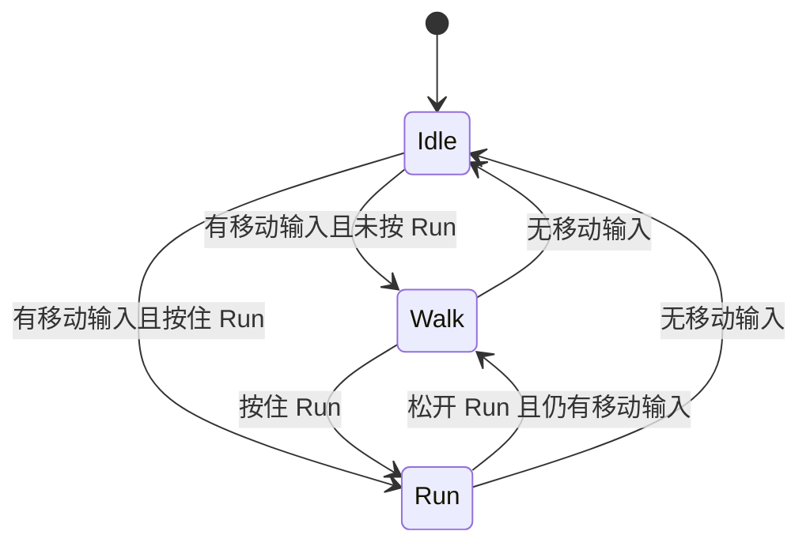

# 第三人称控制器与移动状态系统实现方案

创建日期：2026-11-11  
所属阶段：P1 首个工作包，覆盖输入、移动、相机、移动动画的基础部分。  
状态：设计完成，供手动实施；未编写玩法代码，未编译，未进行场景或构建验证。  
关联文档：[完整规划](战斗系统完整规划.md)、[阶段性实施规划](战斗系统阶段性实施规划.md)。

## 1. 本轮目标与设计决定

完成一个可在场景中操作的第三人称角色：WASD 相机相对移动、鼠标环绕视角、角色面向移动方向，并通过代码状态机管理 `Idle`、`Walk`、`Run`。移动采用 CharacterController，动画采用代码驱动的原地动画。

第一版只有三个移动状态，采用平级有限状态机（FSM）。状态对象负责移动模式，Motor 负责真正移动，Animator 负责表现；不用 Animator 的状态反推代码状态。

完整规划中的行为树仍用于后续战斗行为选择。本轮暂不创建行为树或 ActionController，也不创建空的攻击、受击、跳跃状态。移动状态机不承担整个角色的战斗状态管理，后续可作为普通移动模块接入。

| 本轮完成 | 留给 P1 后续或更晚阶段 |
| --- | --- |
| Idle、Walk、Run 及进入/更新/退出生命周期 | 攻击、闪避、受击、死亡、技能及其取消规则 |
| 相机相对移动、转向、碰撞、重力与基础接地 | 跳跃、独立 Sprint 冲刺、落地动作、移动平台 |
| 相机跟随、鼠标水平旋转与俯仰限制 | 遮挡避让、锁定、目标切换、缩放与镜头效果 |
| 三段移动动画的混合 | Root Motion、方向性战斗移动、动作分层 |
| 键鼠操作和简单调试信息 | 手柄手感验收、输入缓冲、小队控制权切换 |

地面验证场景先采用开阔空间。重力允许角色离开低台阶后落回地面，但本轮没有独立空中状态或空中动画；这不代表完整跳跃/落地功能已经完成。

## 2. 当前工程依据

以下为 2026-11-11 磁盘检查结果，未检查编辑器当前打开的场景或实际动画播放效果。

| 项目 | 已确认事实 | 实施处理 |
| --- | --- | --- |
| Unity / Input System | `6000.3.28f1` / manifest 声明 `1.20.1` | 沿用，不升级依赖 |
| 输入配置 | `activeInputHandler: 1`；已有 `Assets/InputSystem_Actions.inputactions` | 使用新 Input System |
| 输入资产 | Player 下已有 Move、Look、Sprint 等；Sprint 当前绑定 Left Shift | 新增独立 Run，不将 Sprint 当作 Run |
| 输入代码生成 | `.inputactions.meta` 中 `generateWrapperCode: 0` | 本轮使用 InputActionReference，无需生成包装类 |
| 场景 | 已有 `Assets/Scenes/CombatDemo.unity` | 在该场景内配置验证区域，不重复创建同名场景 |
| 模型 | 已有 Si、Phoebe 模型 | 选一个作为本轮角色，核对 Avatar 与动画兼容性 |
| 动画 | 已有 GreatSword、DualKatana 的 Idle、Walk、Run 素材和 Origin 控制器 | 选一组动画，新建简洁移动 Animator Controller；保留原素材 |
| 玩法代码 | `Assets/Scripts` 下未找到自定义 C# 控制器；IDE 中的 StartTest.cs 未在磁盘找到 | 按从零实现处理，不假定测试脚本已有功能 |
| Cinemachine | manifest 未声明 | 本轮用小型相机脚本；后续实现遮挡/锁定时再决定是否替换 |

IDE 中的 `P0阶段实验与具体实施方案.md` 当前也未在磁盘找到。本方案归入现有 P1，不恢复独立 P0 阶段。

## 3. 操作与状态规则

### 3.1 输入定义

以下是本方案的默认设计，实施时据此配置输入资产；当前尚未修改绑定。

| Action | 类型与读取方式 | 键鼠绑定 | 含义 |
| --- | --- | --- | --- |
| Move | Value / Vector2，ReadValue | 复用 WASD、方向键 | 移动意图 |
| Look | Value / Vector2，ReadValue | 复用 Pointer delta | 鼠标视角增量 |
| Run | Button，IsPressed | 新增 Left Alt | 按住跑动，松开行走 |
| ReleaseCursor | Button，WasPressedThisFrame | 新增 Escape | 释放鼠标并暂停角色输入 |
| CaptureCursor | Button，WasPressedThisFrame | 新增鼠标左键 | 鼠标释放后点击 Game 视图恢复控制 |

WASD 默认 Walk，WASD＋Left Alt 为 Run；只按 Left Alt 仍是 Idle。Run 是持续按住的模式，不配置 Hold interaction，也不做切换式开关。

Left Alt 用于本轮 Walk/Run 切换，以保留总规划中的 Left Shift 闪避和 Left Ctrl 冲刺。既有 Sprint 的 Left Shift 绑定本轮不启用；后续接入 Sprint 时改为 Left Ctrl，闪避使用 Left Shift。Run 与 Sprint 是不同速度档，本轮只实现 Run。

第一版只验收键鼠。InputReader 对本轮使用的 Action 设置 `Keyboard&Mouse` 绑定组过滤，避免将手柄摇杆的持续值当成鼠标增量。以后加入手柄时，再分别定义摇杆角速度与鼠标增量换算。

### 3.2 状态定义与切换

状态表示玩家当前请求的移动模式，实际速度由 Motor 单独提供。墙体阻挡不会把 Run 自动切为 Idle；松开方向键才进入 Idle。

先将 Move 限长到 1，再用 `Move.sqrMagnitude > moveDeadZone * moveDeadZone` 判断是否有移动输入。低于阈值时将 Move 归零，后续状态判断与位移使用同一份处理结果。

| 当前状态 | 条件 | 目标状态 |
| --- | --- | --- |
| 任意 | 无移动输入 | Idle |
| 任意 | 有移动输入，未按住 Run | Walk |
| 任意 | 有移动输入，按住 Run | Run |

每帧只解析一个目标状态，目标与当前相同时不重新进入。Walk 与 Run 可直接互相切换，Idle 也可直接进入 Run。



状态切换不等待动画结束，不配置退出时间，也不引入冷却或输入缓冲。加减速与动画混合负责过渡手感，不拖延逻辑切换。

## 4. 脚本职责与数据归属

建议按下面的职责实现。状态类为普通 C# 对象，组件通过 Inspector 明确引用，不引入单例、事件总线、依赖注入容器或通用状态框架。

| 脚本 | 类型 | 唯一职责与主要数据 |
| --- | --- | --- |
| PlayerController | MonoBehaviour | 组装依赖，按固定顺序驱动输入、状态、Motor 和动画；持有 walkSpeed、runSpeed |
| PlayerInputReader | MonoBehaviour | 管理本轮 Action 生命周期；每帧读取一份输入快照；处理输入捕获状态 |
| LocomotionStateMachine | 普通类 | 持有当前状态和三个状态实例；解析目标，执行切换与 Tick |
| LocomotionState | 抽象普通类 | 定义 Enter、Tick、Exit 的最小共同约定，不做泛型或层级状态 |
| IdleState / WalkState / RunState | 普通类 | 在 Tick 输出对应目标速度：0、walkSpeed、runSpeed |
| CharacterMotor | MonoBehaviour | 保存水平/垂直速度、接地和实际运动结果；统一提交位移与转向 |
| CharacterAnimationPresenter | MonoBehaviour | 保存 Animator 引用，将实际水平速度映射到动画参数 |
| ThirdPersonCamera | MonoBehaviour | 保存 yaw、pitch、距离、跟随目标；管理视角与最终相机姿态 |

`LocomotionStateId { Idle, Walk, Run }` 放在状态机文件中即可。调试显示从 `CurrentState.Id` 获取，不在 Controller、Motor、Animator 各存一份可写状态。

建议的数据传递：

```text
InputFrame：Move、LookDelta、RunHeld
状态 Tick 输出：TargetSpeed（m/s）
Motor 输入：WorldMove（世界平面的移动向量，长度 0..1）、TargetSpeed、deltaTime
Motor 输出：PlanarSpeed（实际水平速度）、IsGrounded
Animator 输入：Speed（m/s）
```

输入快照可以是 InputReader 文件中的小型 struct。移动参数先用组件的序列化字段保存；只有多个角色确实需要共享配置时，再抽成 ScriptableObject。

### 4.1 状态生命周期约定

`LocomotionState` 只需要 `Id`、`Enter()`、`Tick()`、`Exit()`。本轮 `Tick()` 返回目标速度，Walk/Run 的速度由所属角色配置传入；Enter/Exit 可暂时只用于切换日志，不添加无用途的订阅。

状态实例在初始化时创建一次，帧更新不重复 new。

```text
初始化：构造三个状态 → Current = Idle → Idle.Enter()

每帧：
    next = 无移动 ? Idle : (RunHeld ? Run : Walk)
    若 next != Current：
        Current.Exit()
        Current = next
        Current.Enter()
    TargetSpeed = Current.Tick()
```

约束：Enter/Exit/Tick 不在内部再次调用 ChangeState；切换由状态机统一发起，因此无须引入重入队列。新状态在切换当帧执行 Tick，不多执行一次旧状态 Tick。禁用时退出当前状态一次；再次启用重新进入 Idle，并由下一帧输入决定目标状态。

这三个状态很小是正常的：当前只需验证明确的生命周期和速度模式。以后出现实际专属逻辑再放入对应状态，不为填满类而增加重复逻辑。

### 4.2 每帧执行顺序

由 PlayerController 的 `Update` 统一调用下列步骤，InputReader、Motor、AnimationPresenter 不再各自实现一套独立 Update：

1. `InputReader.ReadFrame()`：读取并处理本帧 Move、LookDelta、RunHeld。
2. `Camera.ApplyLook(LookDelta)`：先更新 yaw、pitch 数值，尚不提交相机位置。
3. 使用更新后的 yaw，把 Move 转换为世界平面方向。
4. `StateMachine.Tick(frame)`：完成状态切换，输出本帧 TargetSpeed。
5. `Motor.Tick(worldMove, targetSpeed, deltaTime)`：加减速、转向、重力与一次位移提交。
6. `AnimationPresenter.Tick(Motor.PlanarSpeed, deltaTime)`：更新动画参数。

ThirdPersonCamera 在 `LateUpdate` 使用角色移动后的目标位置，提交相机位置和朝向。这样角色和相机使用同一份本帧 yaw，不依赖多个脚本 Update 的默认调用顺序。

所有组件先在 Awake 获取自身依赖；PlayerController 首次 Start 进行跨组件组装并进入 Idle。OnEnable 只恢复输入或已初始化系统，避免第一次 OnEnable 在组装前启动状态机。缺失必填引用时给出一条明确错误并停用控制入口，不自动创建替代相机、Animator 或角色。

## 5. 输入读取与生命周期

InputReader 持有五个 InputActionReference。首次启用前配置绑定组，启用这五个 Action，禁用时只禁用自己管理的 Action；本轮不挂 PlayerInput，不整体启用 Player map，防止重复读取和无关动作生效。

Move 和 Look 每帧轮询读取，Run 使用 IsPressed。Input System 使用动态更新模式，使输入在 Update 使用；不在 FixedUpdate 重读同一份鼠标增量。

Escape 释放光标后输出零输入，角色进入 Idle 并减速停下，相机保持当前角度。点击 Game 视图重新锁定并隐藏光标，恢复控制的当帧返回零 LookDelta，避免捕获瞬间跳转。失去应用焦点时也释放控制；恢复焦点后由点击重新捕获。禁用或退出时恢复可见光标并清空快照。这里暂停的是操作输入，重力继续执行，不修改全局 timeScale。

CaptureCursor 与未来 Attack 使用同一鼠标键时，恢复捕获的点击必须被输入层消费，不再作为攻击命令传递；攻击接入时实现这条规则，本轮没有攻击消费逻辑。

鼠标 delta 是一次输入更新中累计的位移量，因此用 `delta × 鼠标灵敏度` 更新角度，不额外乘 deltaTime，也不再次累加多个回调中的累计值。[Unity Pointer.delta 文档](https://docs.unity3d.com/Packages/com.unity.inputsystem@1.20/api/UnityEngine.InputSystem.Pointer.html#UnityEngine_InputSystem_Pointer_delta)

## 6. CharacterMotor 的实现规则

### 6.1 相机相对移动与转向

相机保存的 yaw 是水平参考，不使用带俯仰的 camera.forward 直接移动：

```csharp
// 算法示意，不是已实现脚本。
Vector2 move = Vector2.ClampMagnitude(frame.Move, 1f);
Quaternion yawRotation = Quaternion.Euler(0f, cameraYaw, 0f);
Vector3 worldMove = yawRotation * new Vector3(move.x, 0f, move.y);
Vector3 desiredVelocity = worldMove * targetSpeed;
```

前后左右都朝移动方向转身。按 S 时角色转向相机所在方向再向该方向移动，本轮不做保持朝前的倒退或侧步动画。

当 worldMove 非零时，Motor 通过 `Quaternion.RotateTowards` 以 `turnSpeed × deltaTime` 转向；无输入时保留最后朝向。第一版世界移动方向立即响应输入，视觉朝向平滑跟随；不强制先转完再移动。

角色根节点只绕世界 Y 轴旋转，模型局部朝向在 Visual 子节点校准。相机不作为角色旋转层级的子物体。

### 6.2 加减速、重力和碰撞

1. 用 `Vector3.MoveTowards` 让当前水平速度接近期望水平速度。无输入或目标速度降低时用 deceleration，否则用 acceleration；直接反向也通过向量过渡处理。
2. 若上一帧接地且 verticalSpeed 向下，将其设为小的负接地速度；否则按 `gravity × deltaTime` 累加。
3. 合并水平速度与垂直速度，调用一次 `CharacterController.Move(totalVelocity × deltaTime)`。
4. 根据本次返回的 CollisionFlags 更新接地；Below 且向下时重置 verticalSpeed，Above 且向上时清零 verticalSpeed。
5. 记录 Move 前后的位置差，去掉 Y 后除以 deltaTime，得到本帧实际 PlanarSpeed。deltaTime 为零时跳过运动积分与速度除法。

CharacterController.Move 接收位移量且不会自动施加重力，因此重力与时间换算由 Motor 负责。[Unity CharacterController.Move 文档](https://docs.unity3d.com/6000.0/Documentation/ScriptReference/CharacterController.Move.html)

Idle 的目标水平速度为零，但 Motor 仍每帧执行减速和重力。进入 Idle 不等于立即清空垂直速度，也不等于整个 Motor 停止更新。禁用/重新启用角色时清空 Motor 的旧运动缓存，避免继承停用前的速度。

本轮不做贴坡射线、坡面法线投影、自定义台阶算法或平台附着。先依靠 CharacterController 的碰撞、Step Offset、Slope Limit 验证普通地面与低台阶；下坡离地抖动若确实出现，再依据场景补充贴地处理。

### 6.3 初始调试参数

这些数值仅作为调试起点，不是已验证的手感或最终平衡。

| 字段 | 初值 | 单位/用途 |
| --- | --- | --- |
| walkSpeed / runSpeed | 2 / 5 | m/s，分别对应 Walk、Run |
| acceleration / deceleration | 20 / 25 | m/s² |
| turnSpeed | 720 | 度/秒 |
| gravity / groundStickSpeed | -20 / -2 | m/s²、m/s |
| moveDeadZone | 0.1 | 输入长度阈值 |
| cameraDistance / targetHeight | 4 / 1.5 | m |
| pitch / pitchLimits | 15 / [-30, 70] | 度，正值向下俯视 |
| mouseSensitivity | 0.1 | 度/输入像素，按鼠标实际体验调整 |

## 7. 第三人称相机

本轮使用一个 ThirdPersonCamera，固定跟随距离。首先直接跟随，不加入弹簧、位置阻尼或自动回正，便于排查移动与相机之间的问题。

相机逻辑：

```text
yaw += LookDelta.x × sensitivity
pitch = Clamp(pitch - LookDelta.y × sensitivity, minPitch, maxPitch)
rotation = Euler(pitch, yaw, 0)
pivot = target.position + worldUp × targetHeight
position = pivot - rotation × forward × cameraDistance
```

在 LateUpdate 一次提交 position 和 rotation。target 指向角色根节点；高度只在相机中加一次，不再从抬高的 CameraTarget 重复偏移。初始化 yaw 来自角色起始水平朝向，pitch 使用配置值。

鼠标旋转视角时，Idle 角色本身不跟着旋转；下一次移动使用新的相机 yaw。角色朝向由 Motor 控制，相机 yaw 由相机自己控制。

本轮已知限制：相机尚无遮挡处理，穿墙属于 P1 后续待办。因此首轮在开阔区域验收，不把本方案验收等同于完整 P1 相机验收。

## 8. 动画接入

为本轮新建 `Assets/Game/Animations/Characters/Controllers/PlayerLocomotion.controller`，保留已有 Origin 控制器作为素材参考，不直接在复杂原控制器上删改。

先选择一套，例如 `Assets/Game/Animations/Characters/Clips/GreatSword/Normal/` 下的 `GS_Idle.anim`、`GS_Walk.anim`、`GS_Run.anim`。需要检查它们与所选角色 Avatar 的匹配、循环、根位移和播放方向；文件名只能说明候选用途，不能证明已可直接使用。

Animator 只建立一个默认 Locomotion 状态，内部放一个 1D Blend Tree：

| 参数 | 动画与阈值 |
| --- | --- |
| Speed（float，m/s） | Idle = 0，Walk = 2，Run = 5 |

阈值与配置的 walkSpeed、runSpeed 保持一致。代码状态机有三个状态，Animator 不需要同步建三个互相跳转的状态；两者分别负责逻辑和连续混合。

AnimationPresenter 在 Motor 移动后写入实际水平速度，使用约 0.1 秒的 SetFloat 阻尼，不每帧 Play/CrossFade。撞墙时 Run 逻辑状态可保持，但实际速度变低，动画随之减弱或回到待机；松键进入 Idle 后，减速过程中动画逐渐回到 Idle。

关闭 Apply Root Motion，普通移动动画应在原地播放；必要时在导入设置中处理根位移或选择合适素材。模型不要再有独立移动脚本。状态 Tick、动画回调、相机都不能额外修改角色根节点的位置。

## 9. 场景、组件与文件安排

在现有 CombatDemo 内整理一个可控角色，不同时让多个展示模型接受输入：

```text
CombatDemo
├─ Environment                    地面、墙、低台阶、温和坡面
├─ PlayerRoot                     缩放 1，局部 +Z 为正前方，原点位于脚底
│  ├─ CharacterController
│  ├─ PlayerController / PlayerInputReader / CharacterMotor
│  ├─ CharacterAnimationPresenter（引用子节点 Animator）
│  └─ Visual                      模型、Animator；仅在这里修正模型朝向和比例
└─ Main Camera                    Camera、AudioListener、ThirdPersonCamera
```

角色根节点不额外挂 Rigidbody 或同尺寸 CapsuleCollider。按模型身高设置 CharacterController；以约 1.8 m 人形为起点，可试 Height 1.8、Radius 0.3、Center Y 0.9、Step Offset 0.25、Slope Limit 45、Skin Width 0.03、Min Move Distance 0。这些值需结合模型和碰撞实际调整。

地面和墙有 Collider，角色出生时胶囊不穿地；只保留一个启用的主相机和 AudioListener。角色、输入、Animator、相机引用全部在 Inspector 完成绑定。

建议新增文件：

```text
Assets/Scripts/Character/
  PlayerController.cs
  Input/PlayerInputReader.cs
  Movement/CharacterMotor.cs
  Movement/States/LocomotionStateMachine.cs
  Movement/States/LocomotionState.cs
  Movement/States/IdleState.cs
  Movement/States/WalkState.cs
  Movement/States/RunState.cs
  Animation/CharacterAnimationPresenter.cs
Assets/Scripts/Camera/ThirdPersonCamera.cs
```

最后将可控角色保存为 `Assets/Game/Prefabs/Characters/Player.prefab`。相机留在场景中，通过场景 PlayerController 组装引用；角色预制体自身不依赖某个场景相机对象。无需此时拆程序集或建立全项目 BaseState。

## 10. 实施顺序

| 步骤 | 实施内容 | 完成时应看到的结果 |
| --- | --- | --- |
| 1 | 配置验证区域、PlayerRoot、CharacterController；选模型与三段动画 | 胶囊尺寸和出生位置正确，引用完整 |
| 2 | 增加 Run 与光标控制 Action，完成 InputReader | 可显示 Move、RunHeld；松键归零，捕获/释放输入有效 |
| 3 | 完成 Motor，暂用固定 yaw 和 Walk 速度 | 角色可移动、转向、碰撞、接地；斜向不更快 |
| 4 | 完成状态基类、三个状态和状态机，接入 Controller | Idle/Walk/Run 按表切换；持续输入不重复 Enter |
| 5 | 完成相机数值更新、LateUpdate 跟随与相机相对方向 | 改变视角后 W 始终沿新的画面前方移动 |
| 6 | 建立移动 Blend Tree 和 AnimationPresenter | 动画随实际移动速度混合，无双重位移 |
| 7 | 保存角色预制体，执行下面的最小验收 | 留下实测记录和明确的未完成项 |

步骤 3 的固定参数只是连通 Motor 的临时调试入口，步骤 4、5 完成后移除，最终只有状态机提供目标速度、相机提供方向参考。

## 11. 最小验收与记录

在 Play Mode 中完成下表即可；本轮不要求全量自动化测试或 Player 构建。调试面板只显示 CurrentState、Move、RunHeld、目标速度、实际水平速度与 IsGrounded，切换日志只在 Enter/Exit 打印。

| 操作 | 期望结果 |
| --- | --- |
| 无输入进入场景 | Idle，稳定站地，动画待机 |
| 按 W，再松开 | Idle → Walk → Idle，平滑加减速 |
| 按住 W，再按下/松开 Left Alt | Walk → Run → Walk |
| 先按 Left Alt，再按 W，随后松开 W | Idle → Run → Idle；只按 Alt 不移动 |
| 连续移动 5 秒 | 不重复 Enter，不每帧重播动画 |
| 按 W 与 W+D 分别在平地持续移动 | 稳定后速度相同，无斜向加速 |
| 转动相机约 90° 后按 W；向上/下看后移动 | 移动方向随 yaw 改变，pitch 不使角色飞起或减速 |
| 静止时旋转相机；移动中快速反向 | Idle 朝向不变；移动转向平滑，没有相机随角色旋转的反馈循环 |
| 顶墙、擦墙、走过低台阶和温和坡面 | 不穿墙，观察实际速度与接地；记录坡面未解决的问题 |
| Escape、点击恢复、失焦再回到 Game 视图 | 输入清零并减速停止；恢复时镜头不突跳、不保留旧输入 |
| 禁用再启用控制入口，退出再进入 Play Mode | 状态与运动缓存重置，无重复输入或引用异常 |
| 临时禁用 Animator | 逻辑状态、碰撞与移动仍工作，证明动画不驱动位移 |

最后检查 Console 无新增错误。如果状态生命周期出现实际回归，再补一个针对重复进入/退出的 Edit Mode 测试；无需为三个简单条件建立大型测试框架。

实施记录模板：

```text
日期 / 实施者：
采用模型与动画：
实际输入绑定与移动/相机参数：
代码完成范围：
编译结果：未执行 / 通过 / 失败（错误）
Play Mode：未执行 / 已执行（通过项、问题）
构建：本轮未要求；未执行时明确写未执行
下一步：本工作包问题修复，或 P1 后续功能
```

本次交付仅是设计文档与规划同步。上述验收均待实施后执行，不能据此将 P1 标记为完成。

## 12. 后续接入边界

本工作包通过后，继续完成 P1 的冲刺、跳跃、相机遮挡与锁定，再接入行为树、ActionController、攻击和首次命中。

届时行为树决定是否选择普通移动或战斗行为，ActionController 管理身体动作的时间、取消权限和移动限制。普通移动状态机仍只表达 Idle/Walk/Run 意图，不把 Attack、Stun、Dead 塞入当前枚举。

普通移动与动作限制在提交 Motor 前合成一次最终运动请求。例如攻击禁止移动时，移动请求被动作权限覆盖为零，而不是继续让状态机与攻击脚本分别 Move。具体请求结构和接口到接入动作时再实现；本轮只保证 Motor 是唯一位移提交者。
