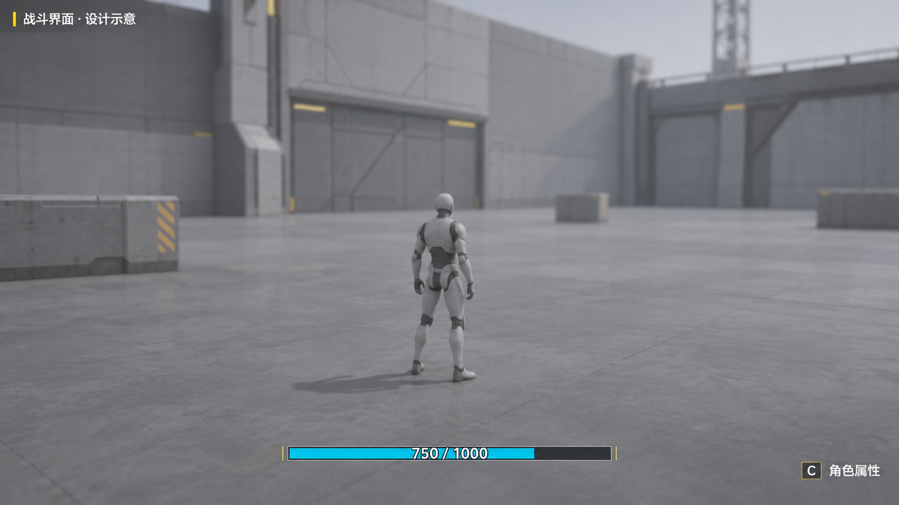
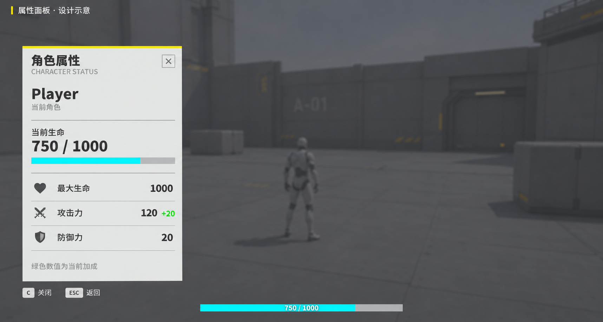

# 简单 UI 系统设计与实现方案

创建日期：2026-11-13  
适用项目：`D:\CODE\Unity\Projects\ArknightsEndfield`  
实施方式：按本文手动录入代码、配置预制体与场景  
当前状态：手动实施进行中，三个 UI 脚本已存在；本轮移除角色面板的当前生命刷新调用，验证状态见第 10 节

配套入口：[TODO](TODO.md)、[战斗系统完整规划](战斗系统完整规划.md)、[战斗系统阶段性实施规划](战斗系统阶段性实施规划.md)

本轮在已完成的属性系统上制作两个界面：屏幕底部常驻血条，以及按 C 打开的左侧角色属性面板。采用项目现有的 uGUI、TextMeshPro 和 Input System，界面读取 Combatant 的运行时数据，通过已有 C# 事件刷新。本文给出完整手写脚本、输入资产修改、RectTransform 参数、Inspector 绑定及最小验收步骤。

## 1. 本轮范围与已有基础

### 1.1 交付范围

| 内容 | 本轮实现 |
| --- | --- |
| 常驻血条 | 当前玩家生命数值、蓝色填充、扣血与治疗后的即时更新 |
| 属性面板 | 角色名称、最大生命、攻击力、防御力及相对基础值的加成，当前生命仅在底部 HUD 显示 |
| 面板操作 | C 切换，Esc 和右上角关闭按钮关闭 |
| 输入协调 | 面板打开时释放光标、停止玩法输入，点击面板不会捕获光标 |
| 适配 | 以 1920×1080 设计，在桌面 16:9、21:9 窗口下检查布局 |
| 场景接入 | 复用 CombatDemo、玩家 Combatant 和 StatTest |

敌人头顶血条、队伍切换、技力、能量、技能列表、装备、升级、角色展示相机、全局暂停和通用窗口栈留在相应需求出现时实现。本轮不引入 UIManager 单例、界面基类、事件总线或数据绑定框架。

本工作包纳入 P1-07 的基础显示子项。P2-07 继续负责敌方血条、预警、胜败及重开入口；完成本文不代表 P1-07 全项或 P1 已完成。

### 1.2 当前工程事实

以下接口已在本次文档编写时核对：

| 现有文件或资产 | 可直接使用的内容 |
| --- | --- |
| `Assets/Scripts/Character/Combatant.cs` | Awake 创建 Stats、Health，提供运行时访问入口 |
| `Assets/Scripts/Character/Stat/CharacterStats.cs` | Attack、MaxHP、Defense、Changed、GetValue、GetBaseValue |
| `Assets/Scripts/Character/Stat/CharacterHealth.cs` | Current、Max、Changed，支持扣血、治疗、生命上限变化 |
| `Assets/Scripts/Input/GameInputManager.cs` | 唯一运行时输入资产、光标控制、GameplayInputFrame，执行顺序为 -100 |
| `Assets/Scripts/Input/ButtonInput.cs` | IsPressed、WasPressedThisFrame，已有按钮包装 |
| `Assets/InputSystem_Actions.inputactions` | Player、Control、UI 三个 Action Map |
| `Assets/ScriptObjects/Characters/PlayerCharacter.asset` | 基础攻击 100、最大生命 1000、防御 20 |
| `Assets/Scripts/Test/StatTest.cs` | 右键菜单扣血、治疗、添加和移除攻击加成 |
| `Packages/manifest.json` | 已声明 uGUI 2.0.0 和 Input System 1.20.1 |

保留 CharacterAsset、Combatant、Stat、CharacterStats、CharacterHealth 的现有职责与代码。UI 不向配置资产写值，也不自行结算伤害。

## 2. 效果图与显示规则

### 2.1 战斗 HUD



参考 [TODO 图一](image-1.png) 的底部中央血条。采用深灰底槽、青蓝色填充、白色数字，血条始终从左向右填充。右下角显示静态提示 `C 角色属性`。

### 2.2 角色属性面板



参考 [TODO 图二](image-2.png) 的左侧信息区。第一版采用浅灰面板、深色文字、黄色细线；右侧继续显示原来的游戏场景，只叠加半透明黑色背景。底部 HUD 保留显示。

2026-11-13 按最新需求移除面板内的当前生命数字与血条。上图保留为初版配色参考，其中的当前生命区域不再实施；当前布局使用第 7 节的紧凑三属性面板。

两张图是布局与配色示意，场景和人物为生成的占位背景，不需要制作对应场景、模糊后处理或展示模型。落地尺寸以第 7 节的 RectTransform 表为起点。图片由内置 imagegen 生成，提示词见 [generation-prompts-v1.txt](Images/UI/generation-prompts-v1.txt)。

### 2.3 数值规则

| 显示 | 读取与格式 |
| --- | --- |
| 角色名称 | 第一版使用场景中 `Combatant.name`，玩家对象可命名为 Player |
| HUD 生命数字 | `CeilToInt(Current) / CeilToInt(Max)`，只在显示层向上取整 |
| HUD 血条比例 | `Current / Max`，使用未取整的 float |
| 三个属性主值 | 最终值，格式 `0.#`，最多一位小数 |
| 属性加成 | 最终值减基础值，显示精度为一位小数，正值绿色、负值红色、零隐藏 |

例如基础攻击 100，添加 20% 攻击加成后显示 `120 +20`。其中 120 已包含加成，不能再加一次 20，也不能把 Modifier 中的 0.2 直接当作展示值。

现有属性规则保证 Max 至少为 1，生命模块保证 Current 位于 0 到 Max，视图直接使用这些约束。死亡显示 `0 / 最大生命`，UI 不触发死亡逻辑。

上限增加不自动回血，例如 `750/1000 → 750/1300`。上限降低会限制当前生命，例如 `750/1000 → 500/500`。这两种情况都由 CharacterHealth 发出 Changed，HUD 更新数值与比例；属性面板仅通过 CharacterStats.Changed 更新最大生命行。

## 3. 文件结构与职责

### 3.1 手动创建或修改的文件

```text
Assets/
  Scripts/
    UI/
      HealthBarUI.cs                    新增
      CharacterStatsPanelUI.cs          新增
      GameUIController.cs              新增
    Input/
      GameInputManager.cs              按第 5 节替换
      Generated/EndfieldInputActions.cs 由输入资产自动重新生成
  InputSystem_Actions.inputactions     新增 Control/ToggleCharacterPanel
  Game/
    Prefabs/UI/
      GameUI.prefab
    Art/UI/
      Sprites/WhiteSquare.png
      Fonts/                           中文源字体及 TMP 字体资产
  Scenes/CombatDemo.unity               放置并绑定 UI
```

复用场景唯一的 GameInputManager。GameUI.prefab 只保存 UI 内部引用，场景里的玩家和输入管理器引用在实例上绑定，避免将场景对象引用当作预制体资产依赖。

### 3.2 数据与调用流程

```text
Combatant.Awake
  → 创建 CharacterStats
  → 创建 CharacterHealth，先订阅 Stats.Changed

GameUIController.Start
  → 缓存当前 Combatant 的 Stats / Health
  → 订阅 Health.Changed 与 Stats.Changed
  → 立即刷新 HUD

Health.Changed
  → 更新 HUD

Stats.Changed
  → 面板打开时刷新三行属性

打开面板
  → 全量读取一次名称与三个属性
  → 显示面板并请求输入管理器释放光标
```

三个 UI 类不使用 Update 轮询属性。GameUIController 始终位于活动的 UI 根节点，隐藏时只停用 CharacterPanelRoot。面板关闭时无需刷新隐藏文字，下次打开会读取最新数据。

## 4. 先修改输入资产

1. 在 Project 中打开 `Assets/InputSystem_Actions.inputactions`
2. 选择 `Control` Action Map，保留 ReleaseCursor 和 CaptureCursor
3. 新增 Action：`ToggleCharacterPanel`
4. Action Type 设置为 `Button`，Control Type 设置为 `Button`
5. 添加绑定 `<Keyboard>/c`，勾选绑定组 `Keyboard&Mouse`，Interactions 和 Processors 保持空
6. 保存输入资产，确认 Inspector 的 Generate C# Class 已启用
7. 保持生成路径 `Assets/Scripts/Input/Generated/EndfieldInputActions.cs`、类名 `EndfieldInputActions`、命名空间 `Endfield.Controller`
8. Apply 或等待自动生成，确认生成类出现 `actions.Control.ToggleCharacterPanel`

运行时管理器设置了 `Keyboard&Mouse` bindingMask，因此漏填绑定组会导致 C 键无响应。生成代码不手改。

UI Map 保留原有动作，本轮只将 `UI/Point` 与 `UI/Click` 交给 InputSystemUIInputModule。键盘 C、Esc 仍在 Control Map 处理；UI/Cancel 不接入关闭逻辑，避免一次 Esc 同时走两条路径。当前不制作按钮键盘导航。

Project-wide Actions 继续保持未指定，不调用 `InputSystem.actions`，不新增 PlayerInput 组件。唯一的 `new EndfieldInputActions()` 仍位于 GameInputManager。

## 5. 修改 GameInputManager

### 5.1 输入行为约定

| 状态或操作 | 结果 |
| --- | --- |
| 普通玩法中按 C | 打开面板，记录此前是否捕获光标，释放光标，清空玩法输入 |
| 面板打开时按 C 或 Esc | 关闭面板，恢复打开前的捕获状态 |
| 面板打开时点击 × | 与键盘关闭相同，点击当帧不传入玩法 |
| 面板打开时点击其他位置 | 继续显示面板，不捕获光标，不关闭面板 |
| 面板未打开时按 Esc | 保持当前的释放光标行为 |
| 光标未捕获且面板关闭时点击 Game 视图 | 捕获光标，当帧不移动、不转镜头 |
| 失去应用焦点 | 释放光标，并取消关闭面板后自动恢复捕获；回到应用后按原规则点击捕获 |

面板打开只阻止新的玩法输入，不改变 Time.timeScale。现有 Motor 仍按原减速规则停止，重力与场景更新继续；这不是全局暂停。以后需要暂停时再接入统一的暂停入口。

### 5.2 完整替换代码

先完成第 4 节生成，再将以下内容替换到 `Assets/Scripts/Input/GameInputManager.cs`，文件中的 GameplayInputFrame 一并保留，不另外新建同名结构。

```csharp
using System;
using UnityEngine;
using UnityEngine.InputSystem;
using UnityEngine.InputSystem.UI;

namespace Endfield.Controller
{
    public readonly struct GameplayInputFrame
    {
        public readonly Vector2 Move;
        public readonly Vector2 Look;
        public readonly bool RunHeld;

        public GameplayInputFrame(Vector2 move, Vector2 look, bool runHeld)
        {
            Move = move;
            Look = look;
            RunHeld = runHeld;
        }
    }

    [DefaultExecutionOrder(-100), DisallowMultipleComponent]
    public sealed class GameInputManager : MonoBehaviour
    {
        [SerializeField, Range(0f, 0.9f)] private float deadZone = 0.1f;
        [SerializeField] private InputSystemUIInputModule uiInputModule;

        private EndfieldInputActions actions;
        private ValueInput<Vector2> moveInput;
        private ValueInput<Vector2> lookInput;
        private ButtonInput runInput;
        private ButtonInput releaseCursorInput;
        private ButtonInput captureCursorInput;
        private ButtonInput toggleCharacterPanelInput;
        private InputBase[] gameplayInputs;
        private InputBase[] controlInputs;
        private InputActionReference uiPointReference;
        private InputActionReference uiClickReference;
        private bool characterPanelOpen;
        private bool restoreCaptureOnClose;
        private int suppressGameplayFrame = -1;

        public GameplayInputFrame Frame { get; private set; }
        public bool GameplayCaptured { get; private set; }
        public event Action CharacterPanelToggleRequested;
        public event Action CharacterPanelCloseRequested;

        private void Awake()
        {
            actions = new EndfieldInputActions();
            actions.bindingMask = InputBinding.MaskByGroup("Keyboard&Mouse");
            actions.Player.Run.wantsInitialStateCheck = true;
            moveInput = new ValueInput<Vector2>(actions.Player.Move);
            lookInput = new ValueInput<Vector2>(actions.Player.Look);
            runInput = new ButtonInput(actions.Player.Run);
            releaseCursorInput = new ButtonInput(actions.Control.ReleaseCursor);
            captureCursorInput = new ButtonInput(actions.Control.CaptureCursor);
            toggleCharacterPanelInput = new ButtonInput(actions.Control.ToggleCharacterPanel);
            gameplayInputs = new InputBase[] { moveInput, lookInput, runInput };
            controlInputs = new InputBase[]
            {
                releaseCursorInput, captureCursorInput, toggleCharacterPanelInput
            };

            // 先解除编辑器配置，再绑定同一份运行时资产
            uiInputModule.enabled = false;
            uiInputModule.UnassignActions();
            uiInputModule.actionsAsset = actions.asset;
            uiPointReference = InputActionReference.Create(actions.UI.Point);
            uiClickReference = InputActionReference.Create(actions.UI.Click);
            uiInputModule.point = uiPointReference;
            uiInputModule.leftClick = uiClickReference;
        }

        private void OnEnable()
        {
            foreach (InputBase input in controlInputs) input.Enable();
            uiInputModule.enabled = true;
            SetCaptured(false);
        }

        private void Update()
        {
            Frame = default;
            if (!Application.isFocused)
            {
                SetCaptured(false);
                return;
            }

            // Esc 优先处理当前面板，不同时执行普通释放逻辑
            if (releaseCursorInput.WasPressedThisFrame)
            {
                if (characterPanelOpen)
                    CharacterPanelCloseRequested?.Invoke();
                else
                    SetCaptured(false);
                return;
            }

            if (toggleCharacterPanelInput.WasPressedThisFrame)
            {
                CharacterPanelToggleRequested?.Invoke();
                return;
            }

            if (characterPanelOpen || suppressGameplayFrame == Time.frameCount)
                return;

            if (GameplayCaptured && Cursor.lockState != CursorLockMode.Locked)
            {
                SetCaptured(false);
                return;
            }

            if (!GameplayCaptured)
            {
                if (captureCursorInput.WasPressedThisFrame) SetCaptured(true);
                return; // 捕获当帧不移动、不转镜头
            }

            Vector2 move = moveInput.ReadValue();
            move = move.sqrMagnitude > deadZone * deadZone ? move.normalized : Vector2.zero;
            Frame = new GameplayInputFrame(move, lookInput.ReadValue(), runInput.IsPressed);
        }

        public void SetCharacterPanelOpen(bool open)
        {
            if (characterPanelOpen == open) return;
            characterPanelOpen = open;
            suppressGameplayFrame = Time.frameCount;

            if (open)
            {
                restoreCaptureOnClose = GameplayCaptured;
                SetCaptured(false);
            }
            else
            {
                SetCaptured(restoreCaptureOnClose && Application.isFocused && isActiveAndEnabled);
                restoreCaptureOnClose = false;
            }
        }

        private void SetCaptured(bool captured)
        {
            Frame = default;
            GameplayCaptured = captured;
            Cursor.lockState = captured ? CursorLockMode.Locked : CursorLockMode.None;
            Cursor.visible = !captured;
            foreach (InputBase input in gameplayInputs)
            {
                if (captured) input.Enable();
                else input.Disable();
            }
        }

        private void OnApplicationFocus(bool focused)
        {
            if (focused) return;
            restoreCaptureOnClose = false;
            SetCaptured(false);
        }

        private void OnDisable()
        {
            CharacterPanelCloseRequested?.Invoke();
            SetCharacterPanelOpen(false);
            SetCaptured(false);
            foreach (InputBase input in controlInputs) input.Disable();
            if (uiInputModule != null) uiInputModule.enabled = false;
        }

        private void OnDestroy()
        {
            if (uiInputModule != null)
            {
                uiInputModule.enabled = false;
                uiInputModule.UnassignActions();
            }

            Destroy(uiPointReference);
            Destroy(uiClickReference);
            foreach (InputBase input in gameplayInputs) input.Dispose();
            foreach (InputBase input in controlInputs) input.Dispose();
            actions.Dispose();
        }
    }
}
```

### 5.3 为什么这样接 UI 输入

InputSystemUIInputModule 的 OnEnable 会启用已绑定的 UI 动作，未配置动作时可能自动分配默认输入。这里先设置同一份 `actions.asset` 与 Point、Click 引用，再启用模块。不要在别处再次创建 EndfieldInputActions，也不要额外调用 `actions.Enable()` 将所有 Map 一起开启。

管理器启用期间，Control 动作和 UI 模块保持启用；Player 动作只在捕获玩法输入时启用。UI 模块只读取 Point、Click，隐藏面板和 HUD 没有可点击区域，因此无需每次关闭面板就停用整个模块。场景卸载时先停用模块、解除引用，再释放运行时资产和创建的两个 InputActionReference。

`suppressGameplayFrame` 只记录开关当帧，防止关闭按钮或其他直接调用在输入采样前执行时，当帧恢复出玩法输入。未来增加普攻时，也应在同一输入流程的面板与当帧屏蔽判断之后采样。

## 6. 新增三个 UI 脚本

### 6.1 HealthBarUI.cs

创建 `Assets/Scripts/UI/HealthBarUI.cs`。该组件只设置 HUD 的 Image 与 TMP 文本，不自行订阅角色事件。属性面板不引用 HealthBarUI。

```csharp
using TMPro;
using UnityEngine;
using UnityEngine.UI;

namespace Endfield.UI
{
    public sealed class HealthBarUI : MonoBehaviour
    {
        [SerializeField] private Image fill;
        [SerializeField] private TMP_Text hpText;

        public void Refresh(float current, float max)
        {
            fill.fillAmount = current / max;
            hpText.text = $"{Mathf.CeilToInt(current)} / {Mathf.CeilToInt(max)}";
        }
    }
}
```

### 6.2 CharacterStatsPanelUI.cs

创建 `Assets/Scripts/UI/CharacterStatsPanelUI.cs`，挂在包含遮罩和左侧面板的 CharacterPanelRoot。三行属性采用直接字段引用，不创建通用行组件。

```csharp
using Endfield.Character;
using TMPro;
using UnityEngine;
using UnityEngine.UI;

namespace Endfield.UI
{
    public sealed class CharacterStatsPanelUI : MonoBehaviour
    {
        [SerializeField] private TMP_Text characterNameText;
        [SerializeField] private TMP_Text maxHPText;
        [SerializeField] private TMP_Text attackText;
        [SerializeField] private TMP_Text defenseText;
        [SerializeField] private Button closeButton;

        public bool IsOpen => gameObject.activeSelf;
        public Button CloseButton => closeButton;

        public void SetVisible(bool visible) => gameObject.SetActive(visible);

        public void SetCharacterName(string characterName)
        {
            characterNameText.text = characterName;
        }

        public void RefreshStats(CharacterStats stats)
        {
            maxHPText.text = FormatStat(stats, StatId.MaxHP);
            attackText.text = FormatStat(stats, StatId.Attack);
            defenseText.text = FormatStat(stats, StatId.Defense);
        }

        private static string FormatStat(CharacterStats stats, StatId id)
        {
            float value = stats.GetValue(id);
            float bonus = Mathf.Round((value - stats.GetBaseValue(id)) * 10f) / 10f;
            string text = value.ToString("0.#");
            if (bonus == 0f) return text;

            string color = bonus > 0f ? "#208A55" : "#C44343";
            string change = bonus.ToString("+0.#;-0.#;0");
            return $"{text}  <size=75%><color={color}>{change}</color></size>";
        }
    }
}
```

三行数值的 TMP Rich Text 必须开启。代码对展示用的差值取一位小数，避免出现 `+0`，不改变 Stats 中的真实值。面板说明文字建议写为 `绿色为加成，红色为减益`，图片中只展示正加成。

### 6.3 GameUIController.cs

创建 `Assets/Scripts/UI/GameUIController.cs`，挂在活动的 GameUI 根节点。只切换子节点，不将此控制器挂到会隐藏的 CharacterPanelRoot。

```csharp
using Endfield.Character;
using Endfield.Controller;
using UnityEngine;

namespace Endfield.UI
{
    public sealed class GameUIController : MonoBehaviour
    {
        [SerializeField] private Combatant target;
        [SerializeField] private GameInputManager inputManager;
        [SerializeField] private HealthBarUI healthHUD;
        [SerializeField] private CharacterStatsPanelUI statsPanel;
        [SerializeField] private GameObject openPanelHint;

        private CharacterHealth boundHealth;
        private CharacterStats boundStats;
        private bool started;

        private void Awake()
        {
            statsPanel.SetVisible(false);
            openPanelHint.SetActive(true);
        }

        private void OnEnable()
        {
            inputManager.CharacterPanelToggleRequested += TogglePanel;
            inputManager.CharacterPanelCloseRequested += ClosePanel;
            statsPanel.CloseButton.onClick.AddListener(ClosePanel);
            if (started) BindTarget();
        }

        private void Start()
        {
            started = true;
            BindTarget();
        }

        private void BindTarget()
        {
            UnbindTarget();
            boundHealth = target.Health;
            boundStats = target.Stats;
            boundHealth.Changed += OnHealthChanged;
            boundStats.Changed += OnStatsChanged;
            healthHUD.Refresh(boundHealth.Current, boundHealth.Max);
            if (statsPanel.IsOpen) RefreshPanel();
        }

        private void UnbindTarget()
        {
            if (boundHealth != null) boundHealth.Changed -= OnHealthChanged;
            if (boundStats != null) boundStats.Changed -= OnStatsChanged;
            boundHealth = null;
            boundStats = null;
        }

        private void OnHealthChanged(HealthChange change)
        {
            healthHUD.Refresh(change.Current, change.Max);
        }

        private void OnStatsChanged(StatChange change)
        {
            if (statsPanel.IsOpen) statsPanel.RefreshStats(boundStats);
        }

        private void RefreshPanel()
        {
            statsPanel.SetCharacterName(target.name);
            statsPanel.RefreshStats(boundStats);
        }

        private void TogglePanel()
        {
            if (statsPanel.IsOpen)
            {
                ClosePanel();
                return;
            }

            RefreshPanel();
            statsPanel.SetVisible(true);
            openPanelHint.SetActive(false);
            inputManager.SetCharacterPanelOpen(true);
        }

        private void ClosePanel()
        {
            statsPanel.SetVisible(false);
            openPanelHint.SetActive(true);
            inputManager.SetCharacterPanelOpen(false);
        }

        private void OnDisable()
        {
            if (inputManager != null)
            {
                inputManager.CharacterPanelToggleRequested -= TogglePanel;
                inputManager.CharacterPanelCloseRequested -= ClosePanel;
                inputManager.SetCharacterPanelOpen(false);
            }

            if (statsPanel != null)
            {
                statsPanel.CloseButton.onClick.RemoveListener(ClosePanel);
                statsPanel.SetVisible(false);
            }

            if (openPanelHint != null) openPanelHint.SetActive(true);
            UnbindTarget();
        }
    }
}
```

首次在 Start 绑定，保证活动玩家的 Combatant.Awake 已执行。重新启用 UI 时，在 OnEnable 绑定并刷新；隐藏属性面板不会解除 HUD 订阅。关闭按钮只由代码注册一次，Inspector 中 Button 的 On Click 列表保持空。

本轮目标是场景启动时已经存在并处于活动状态的玩家，不做运行时角色生成或队伍切换。需要换目标时，先在编辑模式调整 Target，再进入 Play Mode。

## 7. 手动制作 UI 资产与预制体

### 7.1 白色 Sprite 与中文字体

1. 创建 `Assets/Game/Art/UI/Sprites/` 和 `Fonts/`
2. 用图像编辑器创建一张 8×8 纯白不透明 PNG，保存为 `Sprites/WhiteSquare.png`
3. 在 Unity 中设置 Texture Type 为 Sprite (2D and UI)、Sprite Mode 为 Single、Mesh Type 为 Full Rect，关闭 Generate Mip Maps，Compression 选择 None，Apply
4. 血条 Fill 必须引用这个 Sprite，再设置 Image Type 为 Filled；不要让 Source Image 保持 None，否则不能按预期生成填充网格
5. 首次使用 TMP 时按提示导入 TMP Essential Resources
6. 将可用的中文源字体文件放入 Fonts，打开 `Window > TextMeshPro > Font Asset Creator`，选择源字体
7. 选择 Custom Characters，初始 Atlas Resolution 使用 1024×1024、Padding 5，生成并保存 TMP 字体资产；若报告缺字，先确认源字体包含这些字形
8. 将全部 TMP 文本统一指定到该资产；数值文本关闭 Auto Size，按下表设置字号

Custom Characters 可以先使用以下字符，覆盖本文界面与默认名称 Player：

```text
角色属性当前生命最大攻击力防御绿色为加成红减益关闭返回数值战斗界面设计示意
0123456789ABCDEFGHIJKLMNOPQRSTUVWXYZabcdefghijklmnopqrstuvwxyz /+-×.，：
```

若将 Player 改成其他中文角色名，重新生成字体时补入相应字形。运行时看到方框时先检查字形，不以调整字号掩盖缺字。

### 7.2 GameUI 层级

在 CombatDemo 中创建 UI 根节点，结构如下。GameUI 自身是 Canvas，所有 UI 子节点使用 RectTransform。

```text
GameUI                                  活动，Canvas 与 GameUIController
├─ CharacterPanelRoot                   全屏拉伸，保存时关闭
│  ├─ DimBackground                     全屏 Image
│  ├─ Panel                             浅灰背景 Image
│  │  ├─ AccentLine                     黄色顶边
│  │  ├─ Title                          角色属性
│  │  ├─ Subtitle                       CHARACTER STATUS
│  │  ├─ CloseButton                    Button，内部 TMP 显示 ×
│  │  ├─ CharacterName                  Player
│  │  ├─ CharacterLabel                 当前角色
│  │  ├─ Separator
│  │  ├─ MaxHPRow                       最大生命，Value 与 Divider
│  │  ├─ AttackRow                      攻击力，Value 与 Divider
│  │  ├─ DefenseRow                     防御力，Value 与 Divider
│  │  └─ BonusHint                      绿色为加成，红色为减益
│  └─ CloseHint                         C 关闭    ESC 返回
├─ HealthHUD                            HealthBarUI
│  ├─ Border
│  ├─ Track
│  │  └─ Fill
│  └─ HPText
├─ OpenPanelHint                        C 角色属性
└─ EventSystem                          EventSystem 与 InputSystemUIInputModule
```

Canvas 兄弟顺序按上图排列，让底部 HUD 绘制在面板遮罩之后，继续清晰显示。图中的小图标、端点刻度可在基础功能通过后增加，均为不接收射线的装饰 Image，不影响本文脚本。

### 7.3 Canvas 与 EventSystem

| 对象或组件 | 设置 |
| --- | --- |
| GameUI / Canvas | Render Mode 为 Screen Space - Overlay，Sort Order 为 0 |
| GameUI / CanvasScaler | Scale With Screen Size，Reference Resolution 为 1920×1080，Match Width Or Height 为 0.5 |
| GameUI / GraphicRaycaster | 保留，用于关闭按钮交互 |
| EventSystem | 场景只保留一个，First Selected 留空，Send Navigation Events 关闭 |
| InputSystemUIInputModule | 在编辑模式取消勾选 Enabled，Actions Asset 和各 Action 引用清空，由管理器 Awake 绑定后启用 |

创建 Canvas 时 Unity 可能自动生成独立 EventSystem。将唯一的 EventSystem 放到上述层级，或保留在场景中并正确绑定，不再新增第二个。删除旧的 StandaloneInputModule，仅保留 InputSystemUIInputModule。

关闭 UI 输入模块的初始 Enabled 是为了让第 5 节代码先完成运行时动作绑定。管理器的 `UI Input Module` 字段必须拖入该组件，GameUI 根节点和 GameInput 所在节点在场景启动时均应为活动状态。

### 7.4 全局 RectTransform 与配色

以下位置与尺寸均为参考分辨率下的 UI 单位。固定锚点时 Anchor Min 与 Max 设为同一个值，表中的 Position 对应 Anchored Position。全屏拉伸节点设 Min=(0,0)、Max=(1,1)，四边 Offset 为 0。

| 节点 | Anchor / Pivot | Position | Size | 样式 |
| --- | --- | --- | --- | --- |
| CharacterPanelRoot | 全屏拉伸 | — | 跟随父节点 | 初始 inactive |
| DimBackground | 全屏拉伸 | — | 跟随父节点 | 黑色，Alpha 0.35，Raycast Target 开 |
| Panel | (0,1) / (0,1) | (64,-160) | 460×546 | `#E8EAE8`，Raycast Target 开 |
| CloseHint | (0,1) / (0,1) | (64,-722) | 460×36 | 字号 20，白色 |
| HealthHUD | (0.5,0) / (0.5,0.5) | (0,88) | 440×24 | 整体不接收射线 |
| OpenPanelHint | (1,0) / (1,0) | (-48,48) | 220×32 | 字号 22，右对齐，白色 |

HUD 内部：Border 全拉伸、颜色 `#B8C2C8`；Track 全拉伸、四边内缩 2、颜色 `#252B31`；Fill 在 Track 内全拉伸、颜色 `#19BFE5`；HPText 全拉伸，字号 22、居中，必要时用 TMP 材质的细描边提高可读性。

Fill 的 Image 设置：Source Image 为 WhiteSquare，Type 为 Filled，Fill Method 为 Horizontal，Fill Origin 为 Left，Fill Amount 初始为 1，Preserve Aspect 关闭。Border、Track、Fill、HPText 的 Raycast Target 全部关闭。

### 7.5 左侧面板内部布局

下表中的普通节点全部相对 Panel 左上角，Anchor=(0,1)、Pivot=(0,1)。CloseButton 单独使用右上角 Anchor=(1,1)、Pivot=(1,1)。

| 节点 | Position | Size | 建议字号或样式 |
| --- | --- | --- | --- |
| AccentLine | (0,0) | 460×5 | `#F3DC32` |
| Title | (32,-24) | 340×44 | 36，粗体，`#25282B` |
| Subtitle | (32,-72) | 360×24 | 16，`#737B80` |
| CloseButton | (-24,-24) | 36×36 | × 字号 28，Target Graphic 指向按钮背景 |
| CharacterName | (32,-124) | 396×50 | 40，粗体 |
| CharacterLabel | (32,-178) | 396×26 | 18，灰色 |
| Separator | (32,-224) | 396×1 | `#A1A7AA` |
| MaxHPRow | (32,-248) | 396×64 | 左标签，右数值 |
| AttackRow | (32,-320) | 396×64 | 左标签，右数值 |
| DefenseRow | (32,-392) | 396×64 | 左标签，右数值 |
| BonusHint | (32,-488) | 396×28 | 16，灰色 |

面板的角色名称下方直接排列三个属性行。若已经按初版制作了面板，删除其当前生命数字与条形所在的旧节点，按本表将属性行和底部提示上移，并缩短 Panel；底部 HealthHUD 保持原设置。

每个属性行内：Label 位于左上 (0,0)，Size=156×48，字号 24，左侧垂直居中；Value 使用右上锚点与 Pivot=(1,1)，Position=(0,0)，Size=232×48，字号 26，右侧垂直居中，Rich Text 开；Divider 位于 (0,-63)，396×1。关闭文字换行，确保 `1300 +300`、`120 +20` 均能单行显示。

CloseButton 的 Navigation 设置为 None，保留按钮背景的 Raycast Target；按钮内 × 文本关闭 Raycast Target。DimBackground 只挡住指针，不添加 Button、不注册点击关闭。其余标签、分隔线和装饰关闭 Raycast Target。

### 7.6 Inspector 引用清单

| 组件 | 字段 | 拖入对象 |
| --- | --- | --- |
| GameUIController | Target | 场景中 Player 的 Combatant |
| GameUIController | Input Manager | 场景现有 GameInputManager |
| GameUIController | Health HUD | HealthHUD 上的 HealthBarUI |
| GameUIController | Stats Panel | CharacterPanelRoot 上的 CharacterStatsPanelUI |
| GameUIController | Open Panel Hint | OpenPanelHint GameObject |
| GameInputManager | UI Input Module | 唯一 EventSystem 上的 InputSystemUIInputModule |
| HUD 的 HealthBarUI | Fill / HP Text | HealthHUD/Track/Fill 与 HealthHUD/HPText |
| CharacterStatsPanelUI | Character Name Text | Panel/CharacterName |
| CharacterStatsPanelUI | Max HP Text / Attack Text / Defense Text | 对应三个 Row 下的 Value |
| CharacterStatsPanelUI | Close Button | Panel/CloseButton 上的 Button |

场景只保留一份 GameUI。布局完成后将 GameUI 保存为 `Assets/Game/Prefabs/UI/GameUI.prefab`，在场景实例上完成 Target、Input Manager 的场景引用，再保存 CombatDemo。保存前确认 CharacterPanelRoot 为 inactive，GameUI 根节点为 active，UI 输入模块初始 disabled。

## 8. 手动实施顺序

1. 完成第 4 节输入资产修改与生成，先确认生成类中的动作名正确
2. 按第 5 节替换输入管理器，按第 6 节创建三个脚本，等待 Unity 编译完成
3. 在进入 Play Mode 前完成中文字体、白色 Sprite、Canvas、EventSystem 与第 7 节全部引用
4. 先配置 HUD 并观察初始生命；即使先验收 HUD，也要给管理器和控制器填好必需引用，不留未配置的面板字段进入运行
5. 配置面板内容与样式，测试 C、Esc、关闭按钮以及光标恢复
6. 使用 StatTest 进行第 9 节最小验收，保存预制体与场景
7. 记录第 10 节实施结果，同步阶段规划；TODO 由用户自行审查，助手只读

新 UI 没有必要读取 PlayerCharacter.asset 来获取实时值。若显示加成后攻击仍为 100，先检查是否误读了配置或 GetBaseValue，而不是最终属性。

## 9. 最小验收与手动测试入口

### 9.1 使用已有 StatTest

确认场景中的 StatTest.Target 指向玩家 Combatant。若当前测试组件绑定木桩，在编辑模式改为玩家，或在独立测试对象上添加一个 StatTest 并指定玩家。

进入 Play Mode 后通过 StatTest 组件右键菜单执行操作。为了复现效果图，将 Damage Amount 设为 250、Heal Amount 设为 50、Attack Bonus Percent 保持 0.2。通过 Inspector 操作时 Unity 可能释放游戏窗口焦点，这属于已有光标规则；专门测试 C、Esc、鼠标关闭时，应回到 Game 视图进行真实键鼠操作。

### 9.2 可选的生命上限测试扩展

现有 StatTest 没有生命上限菜单。需要手动覆盖这条 UI 更新路径时，在现有 StatTest 类内部追加以下字段与方法，不另建测试框架：

```csharp
[SerializeField] private float maxHPBonusFlat = 300f;
private Stat maxHPBuffStat;
private StatModifier maxHPBuff;

[ContextMenu("测试/属性/添加生命上限修正")]
private void AddMaxHPBuff()
{
    if (!Application.isPlaying || maxHPBuff != null) return;
    maxHPBuffStat = target.Stats.GetStat(StatId.MaxHP);
    maxHPBuff = maxHPBuffStat.AddModifier(ModifierOperation.Flat, maxHPBonusFlat, this);
    PrintStats();
}

[ContextMenu("测试/属性/移除生命上限修正")]
private void RemoveMaxHPBuff()
{
    if (!Application.isPlaying) return;
    ClearMaxHPBuff();
    PrintStats();
}

private void ClearMaxHPBuff()
{
    if (maxHPBuff == null) return;
    maxHPBuffStat.RemoveModifier(maxHPBuff);
    maxHPBuff = null;
    maxHPBuffStat = null;
}
```

同时将原来的 `private void OnDestroy() => ClearAttackBuff();` 替换为下面的方法，不能保留两个 OnDestroy：

```csharp
private void OnDestroy()
{
    ClearAttackBuff();
    ClearMaxHPBuff();
}
```

每次改变 Max HP Bonus Flat 前先移除旧句柄，再添加新的修正。这里只验证显示同步，不增加 Buff 计时、技能触发或正式玩法按钮。

### 9.3 验收表

数值测试按 A 组连续执行；B、C、D 组各自重新进入 Play Mode。所有测试目标均为玩家。

| 组别 | 操作 | 预期 |
| --- | --- | --- |
| A1 | 启动场景 | HUD 为 1000/1000，比例 1；面板默认隐藏 |
| A2 | C 打开面板 | 名称 Player，最大生命 1000，攻击 100，防御 20，无加成文字，也无当前生命数字或条形 |
| A3 | 扣血 250 | HUD 为 750/1000，比例 0.75；面板三个属性保持原值 |
| A4 | 治疗 50 | HUD 为 800/1000，比例 0.8；面板三个属性保持原值 |
| A5 | 添加 20% 攻击加成 | 攻击显示 120 和绿色 +20，其他属性保持原值 |
| A6 | 关闭面板后移除攻击加成，再打开 | 攻击恢复 100，加成隐藏 |
| B1 | 扣血 250，再添加 +300 上限 | HUD 当前生命保持 750，分母变 1300，比例约 57.7%；面板最大生命行显示 1300 +300 |
| B2 | 移除 +300 修正 | 恢复 750/1000，最大生命行恢复 1000 |
| B3 | 设置修正为 -500 并添加 | 显示 500/500、满条，最大生命行显示 500 和红色 -500 |
| B4 | 移除 -500 修正 | 显示 500/1000、半条，不自动补血 |
| C1 | 伤害值设为 2000 后扣血 | HUD 显示 0/1000，填充为 0，面板仍显示最大生命 1000，UI 不额外触发死亡 |
| C2 | 死亡后治疗 | 仍为 0/1000，沿用当前 Health 不复活的规则 |
| D1 | 游戏中按住 W，然后按 C | 新的移动、转镜头输入停止；Motor 按原减速逻辑停止，光标显示 |
| D2 | 点击面板、暗色背景 | 面板保持打开，光标不被重新捕获 |
| D3 | 分别用 C、Esc、× 关闭 | 面板关闭，恢复此前捕获状态，关闭当帧不产生玩法输入 |
| D4 | 先 Esc 释放光标，再 C 打开并关闭 | 关闭后仍不捕获，点击 Game 视图后才捕获 |
| D5 | 面板打开时切出应用，再切回并关闭 | 不自动锁住鼠标，点击 Game 视图后捕获 |
| D6 | 反复开关面板，再扣血一次 | 数据正确更新，无异常或重复按钮调用 |
| D7 | 禁用再启用 GameUI 根节点 | 面板关闭，重新启用后 HUD 显示当前生命，后续变化继续刷新 |
| D8 | 1280×720、1920×1080、2560×1080 Game 视图 | HUD 底部居中，面板左侧定位，文字和关闭按钮不裁切，中文无方框 |

检查 Console 无新增错误即可；本工作包不要求完整自动化框架或 Player 构建。A～C 是资源与 UI 同步检查，不能当作真实攻击命中、战斗死亡流程或完整阶段验收。

## 10. 完成状态与记录

### 10.1 当前交付状态

| 层级 | 当前状态 |
| --- | --- |
| 实施方案与效果图 | 已完成 |
| Assets 中的 UI 代码与输入修改 | 手动实施进行中，三个 UI 脚本已存在，本轮清理控制器中已失效的面板生命刷新调用 |
| UI 预制体、字体与场景绑定 | 尚待完整验收，按第 7 节使用无当前生命区域的面板 |
| 项目 C# 编译 | 2026-11-13 执行 `dotnet build Assembly-CSharp.csproj --no-restore --verbosity quiet` 通过，0 错误，2 条既有警告 |
| Unity 编译 | 未执行 |
| Play Mode 场景验收 | 未执行 |
| Player 构建 | 未执行，本轮不要求 |

本轮两条警告来自 PoolTest.audio 的 CS0108 和 GameObjectPool.Entry.prefab 的 CS0649，与面板修改无关。上述检查只验证项目 C# 编译，不代表 Unity 导入、场景显示或 Player 构建已通过。

### 10.2 手动实施后的勾选项

- [ ] 新增三个 UI 脚本，替换 GameInputManager，重新生成输入类
- [ ] Unity 编译通过
- [ ] GameUI.prefab、字体、Sprite、场景引用保存完成
- [ ] 数值更新、隐藏后重新打开、生命上限变化检查通过
- [ ] C、Esc、鼠标关闭、失焦与捕获状态检查通过
- [ ] 三种窗口尺寸与中文显示检查通过
- [ ] 阶段规划按实际结果更新，TODO 留给用户自行审查

建议记录日期、实际通过项及剩余问题。完成必要的代码、配置、编译和场景检查后，由用户自行决定是否勾选 TODO 中的简单 UI，助手不修改该文件；P1 和 P2 的总体完成状态仍由各阶段出口决定。

## 11. 接口核对与参考

本文的 InputSystemUIInputModule 接入依据工程已安装包中的 `InputSystem/Runtime/Plugins/UI/InputSystemUIInputModule.cs`，核对了 actionsAsset、point、leftClick、UnassignActions 和启停行为。HealthBar 的填充设置对应已安装 uGUI 的 `Runtime/UGUI/UI/Core/Image.cs`。

[Unity uGUI Canvas Scaler 文档](https://docs.unity3d.com/Packages/com.unity.ugui@2.0/manual/script-CanvasScaler.html)说明参考分辨率、屏幕比例匹配与整体缩放设置。本文的尺寸、颜色和操作规则是本项目的具体设计，后续可在预制体中调整。
