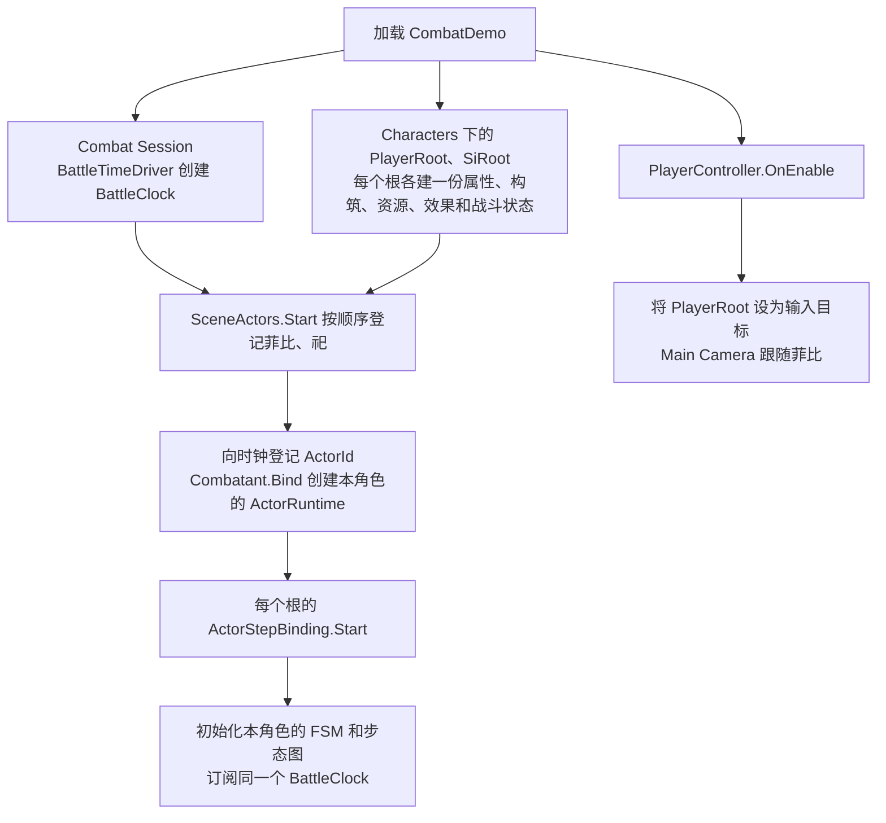
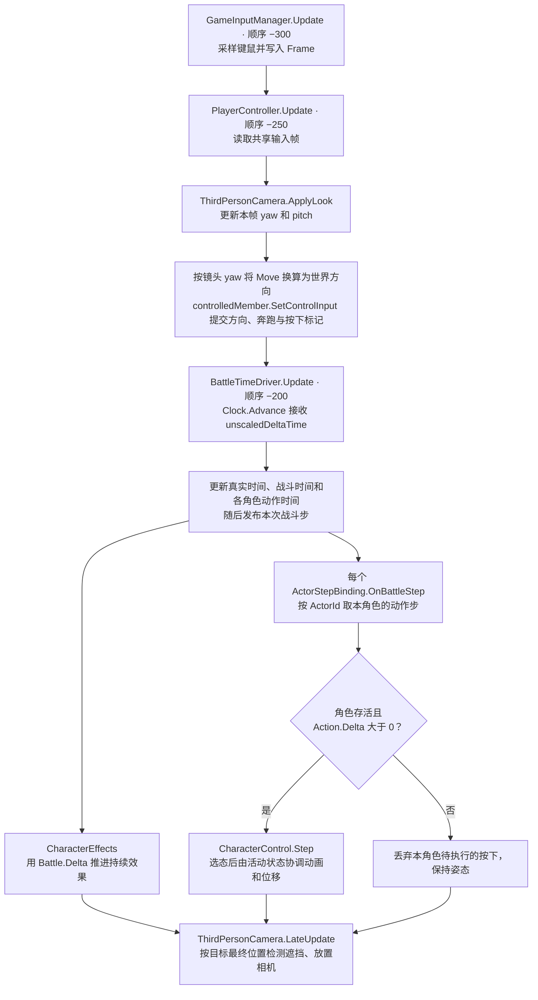
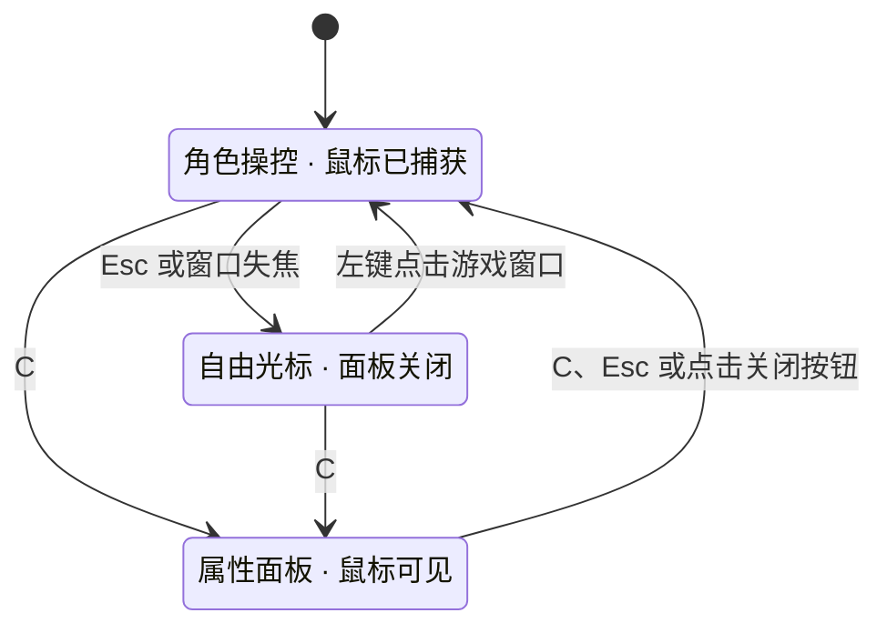
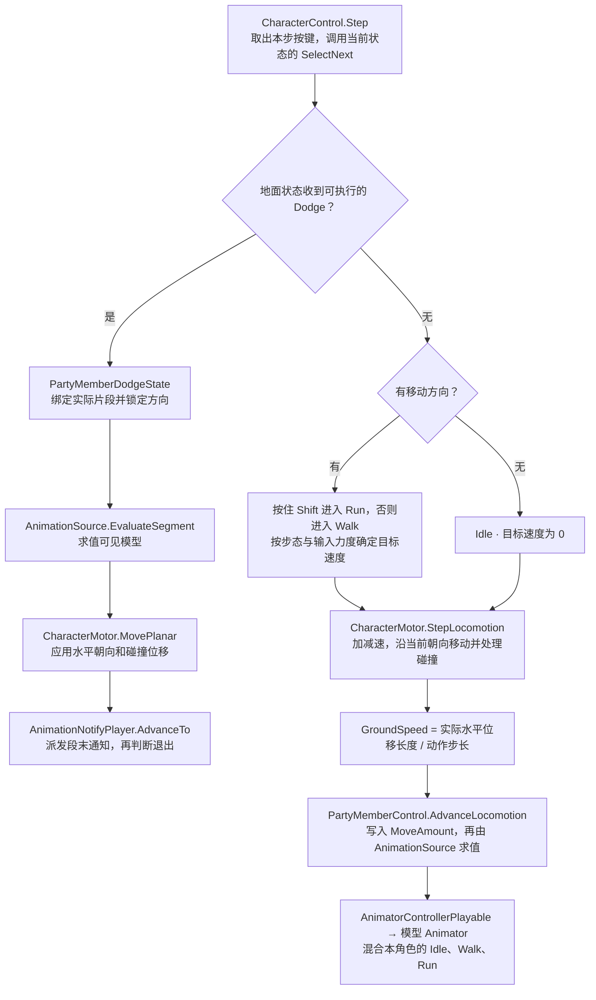
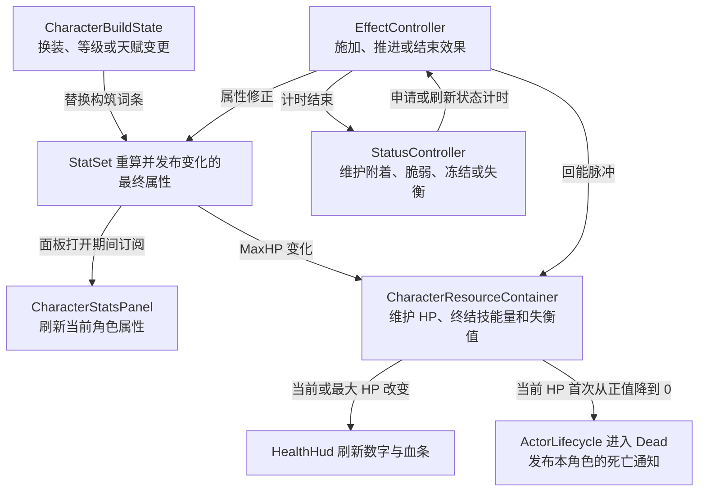

# CombatDemo 项目运行流程图

进入 [CombatDemo 场景](../Assets/Scenes/CombatDemo.unity)后，玩家直接操控菲比。按住 W 时，本帧的镜头朝向决定行走方向，角色自己的动作时间决定走多远，碰撞后的实际速度决定模型播放哪种步态。可以沿图 2 和图 4 对照这条链路。下图按 2026-11-25 的工程实现绘制。

## 1. 开场时，谁把角色接入场景？

`ActorRuntime` 保存本角色已有模块的引用，并创建监听生命变化的 `ActorLifecycle`。菲比和祀共用状态类，各自持有状态机、状态对象和动作时钟。祀开场也接收战斗步，初始移动方向为零，保持 Idle。[场景登记](../Assets/Scripts/Runtime/Actors/SceneActors.cs) · [角色绑定](../Assets/Scripts/Runtime/Actors/Combatant.cs) · [战斗步绑定](../Assets/Scripts/Runtime/CombatSession/ActorStepBinding.cs)

## 2. 一次渲染帧怎样推动战斗？

控制器在渲染帧内将 WASD 转为世界方向，并把走向与 Attack、Dodge 标记提交给当前角色。正动作步开始时，角色将待执行的按下移入 `StepCommands`，供本步使用。全局暂停时仍发布战斗步，但战斗和角色动作增量为零。单角色顿帧只扣减该角色的可用动作时间，持续效果仍按战斗时间推进。冻结或死亡时绑定丢弃按下，恢复后仍按住的方向可以继续生效。[玩家控制器](../Assets/Scripts/Runtime/CharacterControl/PlayerController.cs) · [战斗时钟](../Assets/Scripts/Runtime/Timing/BattleClock.cs) · [第三人称相机](../Assets/Scripts/Runtime/Camera/ThirdPersonCamera.cs)

## 3. C、Esc 和鼠标点击由谁处理？

`GameInputManager` 采样 C 键来切换面板，也处理面板打开时的 Esc。点击面板内的关闭按钮时，场景 `EventSystem` 将点击派发给绑定的 `CharacterStatsPanel.Close()`。面板开关时直接通知 GameInputManager 切换 Gameplay 和光标。PlayerController 收到 GameplayInputCleared 时清除菲比已收到的指令。面板打开期间战斗时钟继续走，关闭后持续按住的 W 和 Shift 可恢复生效，关闭按钮的点击不会触发普攻。[输入读取](../Assets/Scripts/Runtime/Input/GameInputManager.cs) · [角色属性面板](../Assets/Scripts/Runtime/UI/CharacterStatsPanel.cs)

## 4. 从 W 到角色位移和步态动画

`CharacterControl.Step` 先选态，再推进活动状态。Idle、Walk、Run 先应用地面位移，再用实际速度推进步态，顶墙时模型回到待机。地面状态优先响应可执行的闪避，闪避由 Controller 选择实际片段。有根运动时先落实碰撞位移，再派发段末通知。到片尾或被通知打断后，本步余时只推进步态图，下一正步恢复地面移动 · [队员状态](../Assets/Scripts/Runtime/CharacterControl/FSM/States/PartyMember) · [位移出口](../Assets/Scripts/Runtime/CharacterMotion/CharacterMotor.cs) · [动画源](../Assets/Scripts/Runtime/Animation/AnimationSource.cs)

## 5. 换装、持续效果和生命变化如何反映到界面？

以菲比为例，满血时 HP 为 150 / 150。先通过资源接口扣除 40 HP，再装备木剑，血条会从 110 / 150 变为 110 / 165。此时打开属性面板会读到最新最大生命 165。队伍技力由 `Combat Session` 的 `TeamSkillPoints` 单独持有，场景初始为 60 / 100。[构筑状态](../Assets/Scripts/Runtime/CharacterBuild/CharacterBuildState.cs) · [角色资源](../Assets/Scripts/Runtime/Resources/Character/CharacterResourceContainer.cs) · [效果与状态接线](../Assets/Scripts/Runtime/Status/CharacterStatus.cs) · [场景算例](../Assets/Scripts/Test/Editor/CharacterBuild/CharacterBuildSceneTests.cs)

## 当前攻击链路接到哪里？

左键按下会产生一次 `CharacterCommand.Attack`，经 `InputDataFrame.Pressed` 提交给主控角色，在正动作步的 `StepCommands` 中可读。M5 已接入由动画驱动的前闪，M6 从该输入请求接入攻击和命中检测，M7 接入连招和伤害结算。场景已有独立的 `HitSparkPool`，预热 1 个火花、容量 2 个，租出的火花播放结束后归还 · [输入帧](../Assets/Scripts/Runtime/Input/InputDataFrame.cs) · [火花回收](../Assets/Scripts/Runtime/Presentation/PooledHitSpark.cs) · [项目路线](./仿终末地战斗系统设计方案.md)
